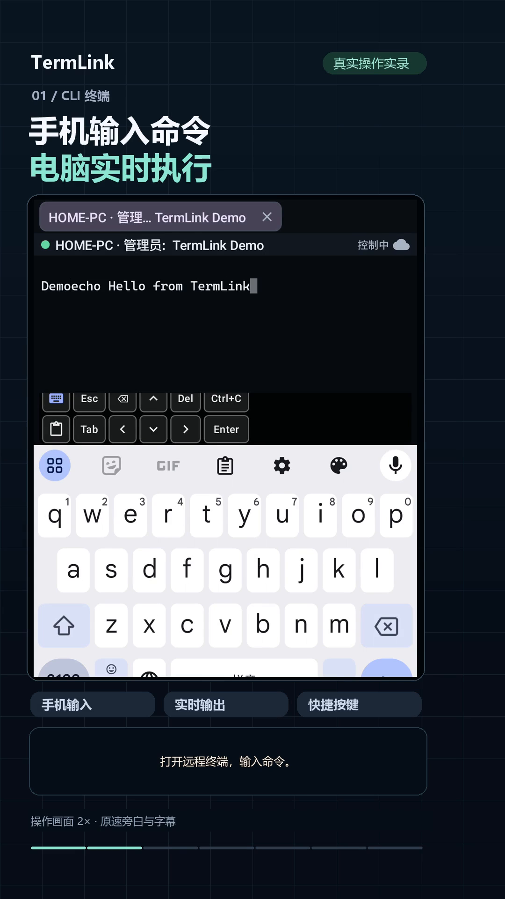
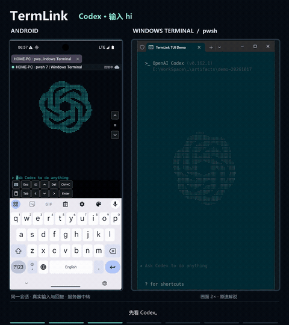
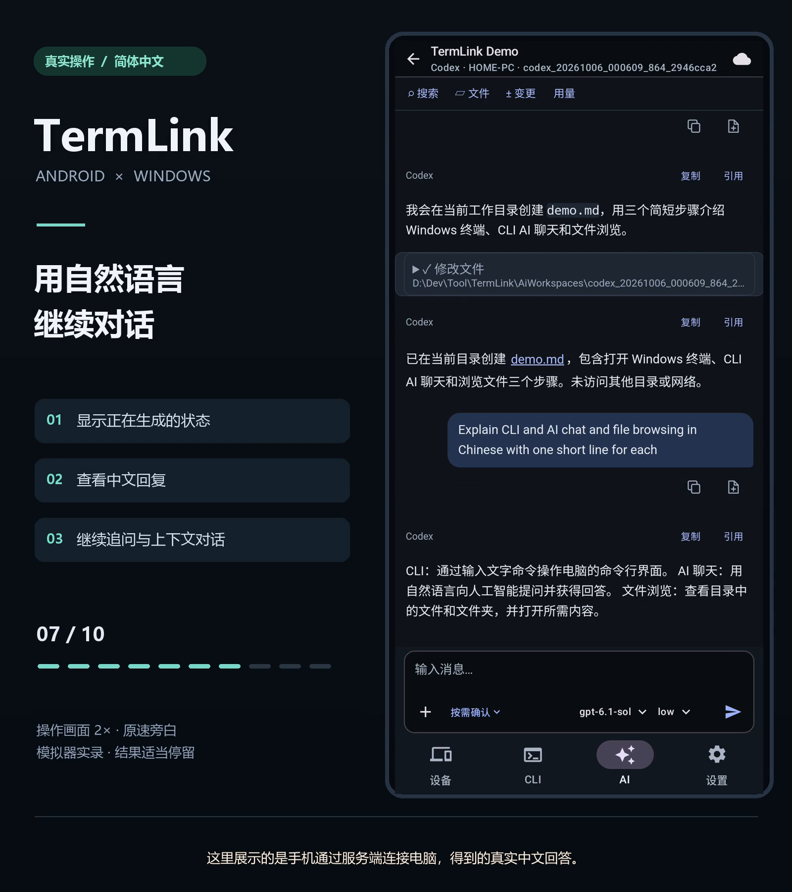
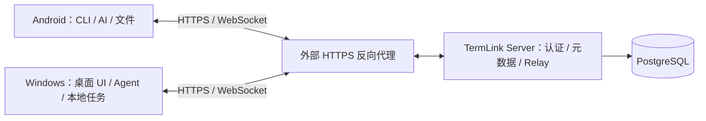

# TermLink

**简体中文** · [English](README.en.md)

TermLink 让你在 Android 手机上使用 Windows 电脑上的 **CLI 终端、AI Agent 对话和文件**。任务在电脑上执行，手机负责交互；你可以部署自己的服务端连接两端。

当前主要交付 Android 客户端、Windows x64 客户端和 Docker 服务端。Linux/macOS 桌面代码仍有待验收的能力，不等同于已正式支持的完整产品。

> 自有代码采用 [GNU GPLv3，仅第 3 版](LICENSE)（`GPL-3.0-only`），允许商用。terminal-core 同样采用 GPLv3，仓库计划后续公开；第三方材料保留各自条款。详见[授权范围与源码交付说明](LICENSE-STATUS.md)。

## 产品与功能演示

| 产品介绍 | Windows Terminal 与安卓 TUI | CLI、AI、文件功能总览 |
| --- | --- | --- |
|  |  |  |
| [中文产品视频](docs/media/feature-demos/中文/06_产品视频/README.md) · [English product videos](docs/media/feature-demos/English/06_Product_videos/README.md) | [中文 TUI 演示](docs/media/feature-demos/中文/00_完整演示/01_TUI双端同步.mp4) · [English TUI demo](docs/media/feature-demos/English/00_Full_demos/01_TUI_on_Windows_and_Android.mp4) | [中文功能总览](docs/media/feature-demos/中文/00_完整演示/02_功能总览.mp4) · [English overview](docs/media/feature-demos/English/00_Full_demos/02_Feature_overview.mp4) |

[中文目录](docs/media/feature-demos/中文/README.md) · [English catalogue](docs/media/feature-demos/English/README.md) · [网页目录](docs/media/feature-demos/index.html)

- TUI 双端同步：[中文（约 1 分 27 秒）](docs/media/feature-demos/中文/00_完整演示/01_TUI双端同步.mp4) · [English（约 1 分 22 秒）](docs/media/feature-demos/English/00_Full_demos/01_TUI_on_Windows_and_Android.mp4)。在 Windows Terminal 的 `pwsh 7.6.6` 中运行 Codex、Claude Code 和 OpenCode，由安卓输入 `hi` 并查看真实回复。
- 功能总览：[中文（约 1 分 40 秒）](docs/media/feature-demos/中文/00_完整演示/02_功能总览.mp4) · [English（约 1 分 40 秒）](docs/media/feature-demos/English/00_Full_demos/02_Feature_overview.mp4)。展示 CLI、AI 对话、模型与授权、文件操作和深色主题。

操作画面按 2 倍速剪辑，旁白和字幕保持正常速度；两端使用同一加速时间轴。每种语言包含 2 部完整演示、15 段功能介绍和 5 部此前产品视频，按 CLI、TUI、AI、文件、外观和产品视频分类。英文版翻译标题、旁白与字幕，实录界面及真实回复保留原语言。全部最终视频、封面和字幕均在本仓库的 `docs/media/feature-demos/`，无需桌面文件或外部视频平台。[录制与制作说明](docs/media/feature-demos/README.md)

点击封面或文字链接可打开或下载 MP4；动态预览没有声音。网页目录需下载仓库后在浏览器打开。

## 下载与开始使用

- Android / Windows：[GitHub Releases](https://github.com/myucxy/TermLink/releases)（APK、Setup、完整对应源码）或 [AppShip](https://appship.kget.cc:8910)，版本及签名说明见[发布记录索引](docs/releases/README.md)。
- 0.3.13 / 143：[Android APK](https://appship.kget.cc:8910/api/v1/artifacts/45a0d90c-5ed9-4601-b0cc-57af6f584745/download) · [Windows Setup](https://appship.kget.cc:8910/api/v1/artifacts/19068d5a-70f5-4c04-ba00-6ef5d78aa84d/download) · [完整对应源码](https://appship.kget.cc:8910/api/v1/artifacts/fff1800e-1ebc-4f10-beea-10de871e194a/download)；[发布记录](docs/RELEASE_0.3.13_143.md)。
- 服务端：[Docker Hub](https://hub.docker.com/r/myucxy/termlink)，部署方式见 [Server README](server/README.md)。
- 首次使用：[快速开始](docs/guides/QUICK_START.md)。
- 修改代码：[开发与构建](docs/development/BUILDING.md)及[贡献指南](CONTRIBUTING.md)。
- 0.3.5 / 135 对应源码：[下载源码包](https://appship.kget.cc:8910/api/v1/artifacts/ca7763b8-ae84-4a24-9c78-d0e5698bbca6/download)，应用 `8503acb`、core `1c907c5`；哈希与签名记录见[发布结果](docs/RELEASE_0.3.5_135.md)。

下载包有独立的签名要求。当前 Windows 发布记录仍使用自签名开发证书，不能把“GitHub 构建”或“签名校验通过”理解为已经获得公开 CA 的信任。

## 可以做什么

- **CLI**：打开和操作电脑上的受管终端，支持输入、快捷键、鼠标报告、窗口尺寸调整和历史浏览。
- **AI**：从电脑实际上报的 Agent 能力创建或恢复对话；按协议能力提供模型、推理强度、附件、工具详情、审批和中断。
- **文件**：浏览和传输电脑文件，从目录创建 AI 会话，以及从 AI 文件结果跳到对应目录。
- **多设备与恢复**：同账号设备发现、加密 Relay 转发、断线恢复；Windows 提供会话真实状态与主机历史。
- **自部署**：服务端内置身份服务、设备管理和 Web 管理页面，使用 PostgreSQL 持久化元数据。

各 Agent 支持的模型和操作不同。程序已安装不等于已登录或具备可用额度；ZCode 桌面远控采用独立网页入口，具体边界见[当前架构](docs/architecture/CURRENT.md)。

## 系统组成

正常 CLI 和 TermLink 结构化 AI 的内容通过客户端间的 E2EE 通道传输。Server 管理身份、设备、会话元数据和任务协调，不执行电脑命令，不保存完整终端历史或持久文件对象。第三方 Agent 自身的模型服务访问及 ZCode 官方网页远控有各自的网络边界。

**当前使用与发布验收范围为 Relay Only。** 仓库保留直连代码与历史实验，但不把 LAN/NAT 记为本轮已验证能力；配置与构建能力开关不等于线上策略已经核验。

## 仓库导航

| 目录 | 用途 |
| --- | --- |
| [android/](android/README.md) | Android 产品 UI、网络、加密、预编译 JNI 调用与 View |
| [pc-client/](pc-client/README.md) | Avalonia 桌面 UI、本机 Agent 控制接口及平台适配 |
| [win-agent/](win-agent/README.md) | Windows Agent、AI 适配器、ConPTY SessionHost、Setup、Updater |
| [ai-web/](ai-web/README.md) | APK 内嵌的 AI 对话 Web 界面 |
| [server/](server/README.md) | Go 服务端、数据库迁移、Web 管理和部署 |
| [protocol/](protocol/README.md) | 实时消息、加密信封与协议契约 |
| native/terminal-core/ | 预编译 DLL/SO；实现与编译在独立 core 仓库，采用 GPLv3、计划后续公开，见[双仓库说明](docs/development/REPOSITORY_LAYOUT.md) |
| [network-core/](network-core/README.md) | 可选直连核心；当前运行及验收使用 Relay |
| scripts/、release/ | 构建、制品验证和发布脚本 |
| testdata/、technical-validation/ | 测试向量、协议和跨端验收工具 |
| [docs/](docs/README.md) | 使用、开发、架构、发布及历史文档导航 |
| terminal-reference/、prototypes/、ui-prototypes/ | 仍保留的独立参考工具和原型；过时设计与会话知识库已清理，第三方来源见[归档索引](docs/archive/README.md) |

## 参考项目与致谢

感谢以下开源项目及其维护者。TermLink 的设计和兼容性研究参考了这些项目的公开行为、协议与架构；具体用途和实际使用关系如下。

### AI 对话与远程协作

| 项目 | 参考范围 |
| --- | --- |
| [Happier](https://github.com/happier-dev/happier) | Agent 能力目录、按 runtime 区分支持范围、模型/权限/恢复能力描述，以及 ACP 接入边界。 |
| [HAPI](https://github.com/tiann/hapi) | 移动聊天分块、工具分组、审批、历史翻页与阅读位置、Agent 配置描述，以及 Web/原生客户端共用会话服务的设计。仅参考行为和架构，未移植其产品源码。 |
| [CC Pocket](https://github.com/K9i-0/ccpocket) | 电脑为会话权威、增量历史、输入回执、断线恢复、简洁聊天投影，以及文件/HTML 预览的隔离边界。 |
| [Happy](https://github.com/slopus/happy) | 消息 ID 与回执归并、工具结果和审批关联、跨设备加密同步的交互与一致性规则。 |
| [Agent Client Protocol](https://github.com/agentclientprotocol/agent-client-protocol) | Agent 初始化、会话、能力协商与动态配置等协议定义；实际支持范围按 TermLink 各适配器实现和已验证能力解释。 |
| [OpenAI Codex](https://github.com/openai/codex) | Codex 原生协议接入与 Windows 终端颜色查询、输入记录和探测时限等兼容行为；终端适配来源见[显示还原修复记录](docs/TERMINAL_FIDELITY.md)。 |

移动端调研还比较过 [Agmente](https://github.com/rebornix/Agmente)、[AionUi](https://github.com/iOfficeAI/AionUi)、[Lody](https://github.com/LodyAI/Lody)、[CloudCLI / Claude Code UI](https://github.com/siteboon/claudecodeui) 和 [AgentAPI](https://github.com/coder/agentapi)，用于协议、统一入口、项目/会话/文件切换等候选方案评估，不代表全部方案已采用。

详细来源及固定 revision 见[手机客户端调研](docs/AI_MOBILE_CLIENT_RESEARCH_20261003.md)、[聊天功能对照](docs/AI_CHAT_GAP_ANALYSIS_20261004.md)和 [Web/Host 架构评估](docs/AI_WEB_HOST_ARCHITECTURE_FEASIBILITY_20261004.md)。这些记录不等于运行过参考项目的全部功能，也不将其支持声明直接作为 TermLink 的实测结果。TermLink 保留自己的 Windows 执行权威、E2EE Relay、会话和文件协议及聊天 UI。

### 终端与移动端交互

| 项目 | 参考范围与当前关系 |
| --- | --- |
| [Microsoft Windows Terminal](https://github.com/microsoft/terminal) | Windows 终端宿主、ConPTY、窗口尺寸、颜色、查询回复和输入行为对照。应用实际随包使用微软 ConPTY 原生组件，保留其[许可声明](win-agent/src/SessionHost/ConPTY-NOTICE.txt)。terminal-core 中固定字符映射数据的来源另见[许可文本](docs/licenses/Legacy-Charsets-MIT-LICENSE.txt)。 |
| [Termux](https://github.com/termux/termux-app) | 早期 Android 终端引擎、IME、触控选择、键盘和滚动交互研究。旧派生模块已退役并迁出，当前 Android 产品与测试使用自有 native core/JNI/View；Windows 旧快照兼容路径仍保留有来源记录的字宽数据，详见[迁出与保留边界](docs/archive/TERMUX_CLEANUP_20261008.md)。 |
| [xterm.js](https://github.com/xtermjs/xterm.js) | 早期 WebView 方案、终端能力与主题对照。仓库保留独立[离线参考 Harness](terminal-reference/xterm-harness/README.md)及其[第三方声明](terminal-reference/xterm-harness/THIRD_PARTY_NOTICES.md)，不作为当前 Android 产品的终端引擎。 |
| [ConnectBot termlib](https://github.com/connectbot/termlib) | 早期 Android 原生终端与 libvterm 适配方案评估，未接入当前 native core 主链。 |
| [xterm](https://invisible-island.net/xterm/) / [kitty](https://github.com/kovidgoyal/kitty) | [xterm 控制序列](https://invisible-island.net/xterm/ctlseqs/ctlseqs.html)、[Kitty 键盘](https://sw.kovidgoyal.net/kitty/keyboard-protocol/)与[图形协议](https://sw.kovidgoyal.net/kitty/graphics-protocol/)用于终端语义参考；具体实现和限制由自有 core 的 profile 与资源契约定义。 |

早期选型还比较过 [xterm.dart](https://github.com/TerminalStudio/xterm.dart)、[hterm](https://github.com/libapps/libapps-mirror)、[Android Terminal Emulator](https://github.com/jackpal/Android-Terminal-Emulator) 和 [WezTerm](https://github.com/wezterm/wezterm)。[Android 引擎调研](docs/ANDROID_TERMINAL_ENGINE_RESEARCH.md)保留当时的选型方案，当前实现以[架构说明](docs/architecture/CURRENT.md)和上述迁出记录为准。

### 实际使用的部分组件与资源

| 来源 | 用途与声明 |
| --- | --- |
| [Avalonia](https://github.com/AvaloniaUI/Avalonia) | 桌面客户端 UI 框架，见 [PC 客户端说明](pc-client/README.md)。 |
| [React](https://github.com/facebook/react)、[react-markdown](https://github.com/remarkjs/react-markdown)、[React Virtuoso](https://github.com/petyosi/react-virtuoso) 等 | 自有 AI Web UI 的运行依赖，完整范围、锁定版本及打包规则见 [AI Web 第三方说明](ai-web/THIRD_PARTY.md)与 [package-lock.json](ai-web/package-lock.json)。 |
| [CommonMark Java](https://github.com/commonmark/commonmark-java) | Android 原生 Markdown 解析依赖，随包保留 [CommonMark 许可](android/app/src/main/assets/licenses/commonmark-LICENSE.txt)。 |
| [LobeHub Icons](https://github.com/lobehub/lobe-icons) / [ZCode](https://github.com/zai-org/ZCode) | Claude Code 图标来自固定版本的 LobeHub Icons，ZCode 图标来自其上游仓库；来源、哈希、转换方式及许可见 [Agent 图标声明](android/app/src/main/assets/licenses/ai-agent-icons-NOTICE.md)。ZCode 的官方远控网页由其官方加载，不复制或重分发其网页资源。 |
| [Nerd Fonts](https://github.com/ryanoasis/nerd-fonts) / [Cascadia Code](https://github.com/microsoft/cascadia-code) | Android 终端内置 CaskaydiaCove Nerd Font Mono；固定版本、哈希与 OFL 声明见[字体来源](android/terminal-engine-api/src/main/assets/termlink-fonts/NOTICE.txt)。 |
| [wcwidth](https://github.com/jquast/wcwidth) | Windows 旧 V1 快照兼容字宽数据的上游来源，经 Termux `WcWidth.java` 引入；保留[固定 revision 与 MIT/原始声明](win-agent/src/Agent/WcWidth-NOTICE.txt)。 |

这不是完整依赖许可证清单。项目参考、协议适配和实际代码/资源引入分别保留来源，完整声明以 [NOTICE](NOTICE)、[授权说明](LICENSE-STATUS.md)及各组件的第三方许可文件为准；项目名和产品图标不表示上游为 TermLink 背书。自有终端核心的更多参考与数据来源见 [terminal-core 致谢](https://github.com/myucxy/terminal-core#参考项目与致谢)。

## 开发、贡献与发布

请先阅读[开发与构建](docs/development/BUILDING.md)。它说明固定工具链、AI Web 资源生成、Android 原生依赖及 DEV 版本参数，不要求贡献者复用维护者电脑的盘符路径。

正式构建、签名及上传遵循[发布运行手册](docs/RELEASE_RUNBOOK.md)和[发布构建说明](docs/RELEASE.md)。客户端支持 AppShip 与 [GitHub 发布管道](docs/development/GITHUB_RELEASE.md)：本地签名，Actions 独立校验通过后由本机命令自动发布。Docker 由本机构建并推送 Docker Hub。

Docker CI 另行验证双架构镜像构建、许可入包和 amd64 容器的数据库迁移、就绪及重启恢复，不推送镜像。

- 改动与问题反馈：[CONTRIBUTING.md](CONTRIBUTING.md)
- 漏洞报告：[SECURITY.md](SECURITY.md)
- 项目及第三方授权：[LICENSE-STATUS.md](LICENSE-STATUS.md)
- 开源准备进度与未完成项：[整理清单](docs/development/OPEN_SOURCE_READINESS.md)
