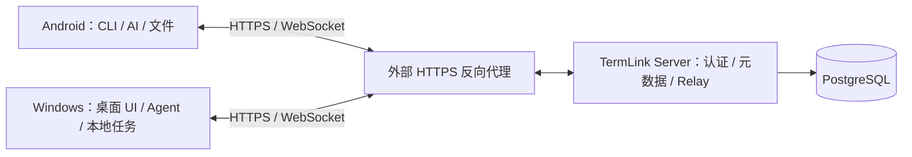

# TermLink

TermLink 让你在 Android 手机上使用 Windows 电脑上的 **CLI 终端、AI Agent 对话和文件**。任务在电脑上执行，手机负责交互；你可以部署自己的服务端连接两端。

当前主要交付 Android 客户端、Windows x64 客户端和 Docker 服务端。Linux/macOS 桌面代码仍有待验收的能力，不等同于已正式支持的完整产品。

> 项目级许可证暂未确定。现有组件声明和第三方授权继续有效，详见 [许可证状态](LICENSE-STATUS.md)。

## 下载与开始使用

- Android / Windows：[AppShip](https://appship.kget.cc:8910)，安装包版本及签名说明见[发布记录索引](docs/releases/README.md)。
- 服务端：[Docker Hub](https://hub.docker.com/r/myucxy/termlink)，部署方式见 [Server README](server/README.md)。
- 首次使用：[快速开始](docs/guides/QUICK_START.md)。
- 修改代码：[开发与构建](docs/development/BUILDING.md)及[贡献指南](CONTRIBUTING.md)。

下载包有独立的签名要求。当前 Windows 发布记录仍使用自签名开发证书，不能把“GitHub 构建”或“签名校验通过”理解为已经获得公开 CA 的信任。

## 可以做什么

- **CLI**：打开和操作电脑上的受管终端，支持输入、快捷键、鼠标报告、窗口尺寸调整和历史浏览。
- **AI**：从电脑实际上报的 Agent 能力创建或恢复对话；按协议能力提供模型、推理强度、附件、工具详情、审批和中断。
- **文件**：浏览和传输电脑文件，从目录创建 AI 会话，以及从 AI 文件结果跳到对应目录。
- **多设备与恢复**：同账号设备发现、加密 Relay 转发、断线恢复；Windows 提供会话真实状态与主机历史。
- **自部署**：服务端内置身份服务、设备管理和 Web 管理页面，使用 PostgreSQL 持久化元数据。

各 Agent 支持的模型和操作不同。程序已安装不等于已登录或具备可用额度；ZCode 桌面远控采用独立网页入口，具体边界见[当前架构](docs/architecture/CURRENT.md)。

## 系统组成

正常 CLI 和 TermLink 结构化 AI 的内容通过客户端间的 E2EE 通道传输。Server 管理身份、设备、会话元数据和任务协调，不执行电脑命令，不保存完整终端历史或持久文件对象。第三方 Agent 自身的模型服务访问及 ZCode 官方网页远控有各自的网络边界。

**当前使用与发布验收范围为 Relay Only。** 仓库保留直连代码与历史实验，但不把 LAN/NAT 记为本轮已验证能力；配置与构建能力开关不等于线上策略已经核验。

## 仓库导航

| 目录 | 用途 |
| --- | --- |
| [android/](android/README.md) | Android 产品 UI、网络、加密、预编译 JNI 调用与 View |
| [pc-client/](pc-client/README.md) | Avalonia 桌面 UI、本机 Agent 控制接口及平台适配 |
| [win-agent/](win-agent/README.md) | Windows Agent、AI 适配器、ConPTY SessionHost、Setup、Updater |
| [ai-web/](ai-web/README.md) | APK 内嵌的 AI 对话 Web 界面 |
| [server/](server/README.md) | Go 服务端、数据库迁移、Web 管理和部署 |
| [protocol/](protocol/README.md) | 实时消息、加密信封与协议契约 |
| native/terminal-core/ | 预编译 DLL/SO；实现与编译在私有 core 仓库，见[双仓库说明](docs/development/REPOSITORY_LAYOUT.md) |
| [network-core/](network-core/README.md) | 可选直连核心；当前运行及验收使用 Relay |
| scripts/、release/ | 构建、制品验证和发布脚本 |
| testdata/、technical-validation/ | 测试向量、协议和跨端验收工具 |
| [docs/](docs/README.md) | 使用、开发、架构、发布及历史文档导航 |
| terminal-forks/、terminal-reference/、prototypes/、ui-prototypes/ | 来源归档、参考实现和原型，详见[归档索引](docs/archive/README.md) |

## 开发、贡献与发布

请先阅读[开发与构建](docs/development/BUILDING.md)。它说明固定工具链、AI Web 资源生成、Android 原生依赖及 DEV 版本参数，不要求贡献者复用维护者电脑的盘符路径。

正式构建、签名及上传遵循[发布运行手册](docs/RELEASE_RUNBOOK.md)和[发布构建说明](docs/RELEASE.md)。客户端分发使用 AppShip；Docker 按当前规则由本机构建并推送 Docker Hub。Windows/Android 的 GitHub Actions 构建尚未接入。

- 改动与问题反馈：[CONTRIBUTING.md](CONTRIBUTING.md)
- 漏洞报告：[SECURITY.md](SECURITY.md)
- 项目及第三方授权：[LICENSE-STATUS.md](LICENSE-STATUS.md)
- 开源准备进度与未完成项：[整理清单](docs/development/OPEN_SOURCE_READINESS.md)
