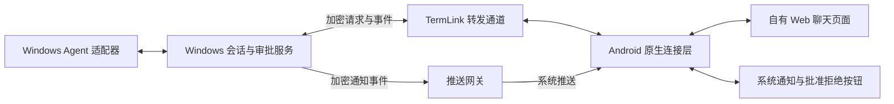

# Windows 承载 AI 服务、Android WebView 展示的可行性（2026-10-04）

## 结论

可行，推荐“Windows 会话服务 + TermLink 自有 Web UI + Android 原生系统能力”的组合。Windows 集中处理 Agent 协议、会话、文件、审批和任务状态，Web UI 统一呈现内容；安卓原生层保留设备身份、加密连接、系统文件选择、通知与通知动作。

这可以减少 Kotlin 对不同 Agent 内容的解析和 UI 实现，但不能让手机完全不处理数据：WebView 中的 JavaScript 仍在手机上运行，要接收事件、维护展示状态、渲染 Markdown。后台通知也必须识别少量统一事件。应消除的是手机上的供应商协议适配和业务权威，而不是所有客户端代码。

另保留官方网页接入方式，适用于确实提供网页的 Agent。只有 HTTP/JSON-RPC/stdio 服务而没有 Web UI 的 Agent，反向代理不能自动生成聊天、工具和审批界面。官方网页没有可订阅事件接口时，TermLink 不能可靠增加自己的后台完成提醒或原生批准/拒绝。

本轮仅分析当前代码、参考源码和官方文档；没有改动产品实现、安装新服务、部署反向代理或发布版本。

## 当前项目可复用什么

- Windows 的 `AiSessionManager` / `AiAgentSession` 已是原生 AI 会话和审批权威；恢复、历史授权、上传、文件引用、模型配置和请求去重不必重写。
- `ProductionAiAgents` 已通过加密控制通道分发 AI 请求，避免 Agent 启动阻塞终端和设备刷新。
- Android `ProductionProductRepository.aiRequest` 已处理登录、设备信任、远程访问开关和加密请求。这个能力可供自有 Web UI 的窄接口复用。
- 当前 AI 请求串行化，活跃页面轮询快照；迁移 Web 不会自动解决实时性、长请求排队或增量恢复，仍需改进统一协议和调度。
- 现有 `AiRemotePage` 已实现 ZCode 官方网页、文件选择及导航限制，但没有给第三方网页注入自有业务桥，也没有获得 ZCode 的后台事件。
- 现有通知依赖 `AiWorkspace` / Compose 生命周期及进程存活，只有点击打开 App；Manifest 没有独立推送服务、审批通知接收器或相应后台 Worker。后台动作需要从页面状态中独立出来。

## Agent 能否直接使用自己的网页

| 对象 | 核查结果 | TermLink 可选接法 | 提醒和动作的限制 |
| --- | --- | --- | --- |
| Codex（当前接入） | 本项目实际运行 `app-server`，使用结构化请求/事件，并不是 HTML 页面服务 | 复用当前 Windows 适配器，给它换自有 Web UI | 保留适配器即可统一生成通知事件和处理审批；本轮官方文档端点返回 403，未据此声称当前所有官方产品都没有远控网页 |
| Claude Code（当前接入） | 本项目使用 `stream-json`；另有官方 Remote Control | 自有 Web UI 继续使用现有适配器；官方网页可作为独立入口 | 官方 Remote Control 通过 Anthropic 服务，官方通知送到 Claude App，不会因为嵌入页面就送到 TermLink |
| ZCode | 官方远控网页已确认；独立 app-server 与桌面 Host 授权有边界 | 继续保留 `desktop_remote`；原生适配仍可进入自有 Web UI | WebView 看得到网页，不等于 Windows 能订阅网页背后的审批/完成事件。没有稳定授权接口时，只保证打开官方页 |
| OpenCode | 官方提供 `opencode web`；`opencode serve` 提供 HTTP/OpenAPI 和事件 API | 属于直接复用本地 Web UI/反代最合适的类型，也可另接自有 UI | 通过官方事件和权限 API 做小型适配，可统一通知；文档可行不等于本项目已完成集成或验证 |
| 其他 ACP/CLI Agent | ACP 是结构化客户端协议；终端界面本身也不是网页 | 有稳定事件协议时接现有服务；只有终端的继续使用 CLI 页面 | 不能从终端可见提示推导出可靠的结构化批准 API，不应模拟点击作为通用审批机制 |

Claude 官方 Remote Control 的本次文档说明：需要适用订阅及登录，API Key 不适用；执行和文件访问在本机，连接通过官方 API，远控会话 transcript 会存于 Anthropic 服务。它能使用本地环境，但不符合“所有界面数据只经 TermLink 自有服务”的要求。其登录及可信设备流程也可能需要系统浏览器，不能承诺任意 WebView 都可完整登录。

OpenCode 文档明确：`serve` 是无界面的 HTTP 服务，`web` 提供网页；同一服务可以由终端 attach，共享会话状态。必须复用同一个实例/工作目录上下文，不能随意启动第二实例后宣称接管了原桌面会话。

## 参考项目实际做法

| 项目 | 实际结构 | 对 TermLink 的启示 |
| --- | --- | --- |
| HAPI | CLI/Runner 适配 Agent，通过 Socket.IO 连接 Hub；Hub 提供 REST、SSE、SQLite；Web/PWA 和原生客户端使用相同 API | 丰富网页来自它自己的协议适配和 Web UI，并非反代 Codex/Claude 自带页面。可参考统一服务/事件；不照搬 Hub 存储职责 |
| HAPI Android 通知 | 原生 FCM 接收；`NotificationActionReceiver` → `PermissionActionWorker` → 认证 API；区分成功、已处理、会话退出和临时失败 | 已有“网页/原生页面之外独立处理通知批准”的实证。通知能力不依赖聊天页面存活 |
| CC Pocket | Flutter 客户端 ↔ 电脑 Bridge ↔ Codex/Claude；Bridge 提供会话、文件和同步 | 与 Windows 为权威的方向相近，但它不是只渲染网页的壳；可参考主机事件和恢复行为 |
| Happier | 主机适配器、多端客户端和加密同步服务；当前能力目录按 Agent/runtime 分别声明支持度 | 多种展示表面调用同一能力，不能因为 UI 统一就声称 Agent 能力一致；服务器加密存储政策不必照搬 |
| ZCode | 桌面 Host 管理工作区、会话和授权；官方远控页通过配对及官方 Relay 操作 Host | 更接近用户设想，但仍有配对、状态协议、授权和系统通知层，不只是转发某个端口 |

HAPI 的原生 Android 是独立 Compose 客户端，而非 WebView；其源码同时证明 Web UI 与原生推送动作能够共用会话服务。HAPI AGPL-3.0，仅参考行为和架构，不能直接当成本项目可任意复制的 MIT 组件。

## 推荐架构与反代边界

### 自有 Web UI

1. Windows 继续做当前业务处理及 Agent 事件转换。模型/授权/思考/文件/计划等能力以统一数据交给 Web UI。
2. Web UI 维护展示状态、输入草稿、滚动位置等前端状态。其本身仍需开发，换成 Web 技术不会自动获得之前缺失的功能。
3. Android 用有来源校验的消息接口连接自有页面与现有加密请求服务。只开放当前电脑/会话的必要能力，不暴露 Token、私钥、通用 shell 或任意 URL 代理。
4. Web 页面和原生通知通过同一个 Windows 操作入口提交动作；不建立两套批准状态机。不通过 `evaluateJavascript` 点击网页按钮来执行通知审批。
5. 第三方网页、生成的 HTML 预览、自有可信 UI 使用不同的信任边界。第三方网页和 Agent 生成 HTML 不获得自有业务桥；同一 origin 下的 iframe 也不能默认视为可信来源。

首个验证阶段可直接打包自有 Web 静态资源并用 `WebViewAssetLoader` 加载，降低网络和版本变量。若目标是“只升级 Windows 就能更新 AI 页面”，后续可把同一 Web 构建产物随 Windows 发布，通过认证连接获取并缓存，增加完整性/发布签名、UI/桥协议版本协商及回退。加载页面的位置与业务归属是两个问题；即使资源来自 Windows，JavaScript 仍在手机执行。

使用 Windows 提供的页面也不意味着以后永远无需发 APK：原生桥协议、文件选择、推送 SDK、系统权限、系统通知兼容性改变仍需安卓更新。多台 Windows 版本不同还需明确兼容范围，不能让某台电脑的页面访问其他设备的原生能力。

### 已有 Agent 网页

直接接入有两种：

- **官方远程网址**：最省集成时间，但登录、数据通路、功能限制和网页更新由官方控制。优先保持官方 origin；不能保证改域名反代后登录、Cookie、WebSocket、可信设备流程仍可用。
- **本地 HTTP Web UI**：由 Windows 管理实际本地服务，绑定 loopback，通过授权通道访问。需覆盖 HTTP、流式响应、WebSocket/SSE、文件上传下载、相对/绝对资源路径、Cookie、Origin 与实例选择；跨 NAT 还需要既有中转或反向隧道。

手机上的 `127.0.0.1` 不是电脑；Windows 本地端口存在也不等于手机能连到。Nginx 转发和 TLS 终止本身也不等于现有应用层 E2EE。若中转解密 HTTP 正文，就改变了当前隐私边界，不能把它当成现有桥接的等价替换。

自有 UI 没有必要先做通用 HTTP 反向代理：直接复用现有加密请求与事件通道更小。对确实已有 Web UI 的供应商再单独接入真实 HTTP/WS 通道；不能用 `shouldInterceptRequest` 充当完整 WebSocket 代理。

保留已有 `strategy=native|desktop_remote` 的兼容含义。自有页面从 Compose 换为 Web，不必改变 Agent 协议策略；新增本地 Web 接入时再明确该策略。模型能力与 `backgroundEvents` / 通知动作支持应分别判断，不能按“网页能打开”统一标记支持。

## 后台通知、批准/拒绝与状态展示

### 可以实现的功能

| 用户场景 | 实现方式 | 必要限制 |
| --- | --- | --- |
| 完成、失败、待审批提醒 | Windows 发事件，安卓原生通知 | WebView 后台计时器和长连接不足以保证到达 |
| 点击通知直接进入会话 | 原生按 pc/session 标识恢复页面并读取最新快照 | 登录过期先恢复登录；Windows 离线按既定要求隐藏正文 |
| 通知直接“允许本次/拒绝” | 原生接收动作，连接 Windows 的统一审批入口 | 必须校验请求仍待处理、有效期、设备权限、host/control 版本及操作去重 |
| 复杂多选问题、授权范围变更 | 通知显示“查看并处理”，打开对应表单 | 不能将任意用户问题转换成允许/拒绝，也不在简短通知中扩大授权范围 |
| 锁屏批准 | API 31+ 可对动作设置 `setAuthenticationRequired(true)`，旧系统打开受保护的处理页面 | 默认不在锁屏直接批准敏感操作；不需要先启动整张网页才能有安全动作入口 |
| 正在运行状态 | 原生普通持续通知，按状态转换更新 | 无真实百分比就显示阶段/耗时，不逐 token 推送、不伪造进度 |
| 安卓“灵动岛”式展示 | 系统/厂商支持且用途符合要求时增强 | 不是通用跨品牌保证，普通通知必须完整可用 |

### 通知不能依赖 WebView

WebView 进程可能被暂停或回收，不能把页面中的 WebSocket、setInterval、Service Worker 当作可靠后台基础；WebView 也不能直接等同于安装了浏览器 PWA 的 Web Push 环境。

支持 Google Play 服务和网络的设备可使用 FCM。无 GMS 的目标机型需要实际适用的厂商推送或用户已部署的推送分发器；其消息可达性、数据推送能力、后台回调和分发凭据要单独验证，不能写一个“推送接口”就宣称所有国产手机相同。推送令牌/项目配置须属于 TermLink，嵌入 Claude/ZCode 网页不会继承对方 App 的推送凭据。

建议 TermLink Server 增加最小推送网关：保存设备推送登记、路由和必要的短期投递状态，转发 Windows 加密的事件；不保管聊天明文、不负责执行审批或查询 Agent。网关/供应商仍会看到投递元数据，不能声称完全不可见。

加密通知必须在活跃会话通道断开后仍可验证解密，因此要基于已信任设备身份设计通知信封与重放防护，不能直接假定当前实时连接的加密状态能在冷启动时复用。可以发最小“有新活动”唤醒后取详情；需要考虑设备离线或无法取回详情时的提示。钥匙不可用时不从明文回退获得审批能力。

不建议把每个 Windows 客户端都配上 FCM/厂商服务端密钥以绕过网关。后台可靠投递通常会涉及 Server 改动，但职责仍是消息投递，不成为 AI 会话业务服务。

推送被提供商接收不等于手机已经显示。通知权限、通道设置、勿扰、网络、厂商电池限制及用户强行停止 App 都影响到达。保活服务也不能作为万能替代：例如 Android 15 起，目标版本适用时，后台 `dataSync` 前台服务有 24 小时内累计 6 小时限制；不能借不相关服务类型规避限制。WorkManager 适合通知动作提交和有限重试，不是秒级常驻监听。

### 审批的完整链路

Windows pending request → 加密事件 → 原生通知 → 用户点允许/拒绝 → 认证并获取最新请求 → Windows 验证、执行 → 回执 → 更新/移除各端提示。

- 至少绑定电脑、host 实例、会话、requestId、请求版本或内容标识、有效期、operationId；不能只按网页标题找到请求。
- 用户已在 Windows/网页处理、请求过期、Agent 退出、Windows 重启，应显示对应结果，不重新批准新请求。
- 未收到执行回执先显示“正在提交/结果待确认”，不能点击后立即显示“已允许”。断线恢复沿用同一 operationId，且重试仍受有效期和原始请求约束。
- 重复点击、允许和拒绝竞态、多台手机处理要由 Windows 原子决定一次。Worker 去重只能减少请求，不能替代主机判断。
- 当前控制版本变化或另一设备接管时不能从旧通知静默抢回权限并批准，应返回需要重新确认的状态。
- 过期通知的清除是尽力展示行为，最终安全性始终依靠 Windows 拒绝失效操作。

### “灵动岛”的准确边界

Android 官方 Live Updates 要求活动进行中、用户发起且具有时间敏感性。当前官方明确把 `chat messages`、`alerts` 列为不适合的用途；系统和 OEM 还可增加条件。`POST_PROMOTED_NOTIFICATIONS` 及请求 promotion 不是保证显示的开关。

因此不能把“AI 正在聊天/等待批准”直接承诺做成 Android 标准 Live Update。首版以普通通知、允许/拒绝按钮和必要的普通持续状态为完整方案。某品牌的“流体云/胶囊/灵动岛”类能力，只在官方能力及目标用途允许时单独评估。应用内自己绘制的顶部胶囊可以实现，但它不是系统级能力，退出 App 后不会自动保留。悬浮窗不建议作为默认替代。

## 推荐执行顺序与验收

1. **先统一 Windows 事件和独立动作入口。**补齐生成/工具/思考摘要/审批/完成事件、seq 与 snapshot 回退，让通知脱离 Compose 生命周期。此步同时改善现有原生页，不依赖先重写 UI。
2. **用一个真实 Agent 验证自有 Web UI。**在现有入口中切换同一会话的展示，不重建 Agent、不换历史 ID。验证聊天、停止、模型/授权/附件、恢复和紧凑布局，再扩展其他 Agent。现有 CLI 页面保持原样。
3. **实现后台通知与审批动作。**先在当前目标真机完成可达性，再扩大推送覆盖；模拟器无法证明各厂商后台和胶囊能力。Server 仅加密投递，Win 仍作最终状态判断。
4. **再扩充成果预览和供应商网页策略。**自有文件/HTML 预览使用隔离容器；OpenCode 类有本地网页的按真实需要接入；ZCode 官方页面继续独立策略，未验证的通知能力明确隐藏。

必须覆盖：原生/Web 切换不丢功能和未发内容；WebView 崩溃后按游标恢复；IME/上传/返回/系统字体和紧凑布局；Android 冷启动、锁屏、无 GMS、推送重复/延迟/错序；审批过期、双方竞态、登录过期、控制转移、Windows 重启；同一 operationId 结果恢复；LAN/跨 NAT/中转策略实测；Windows/UI/原生桥不同版本回退；CLI 回归。已有 CLI 直连能力不能自动算作新 Web/AI 通道的直连验收。

迁移 Web 的收益是统一前端与更成熟的富内容生态，不是零成本获得所有 Agent 功能或永久免安卓升级。短期增加 WebView/桥接/版本兼容工作，长期减少 Compose 与 Web 两套 AI 页面的重复实现；应逐步替换，不长期维护两套完整同功能聊天页。

## 来源与核查范围

- 本地代码：[AiRemotePage.kt](../android/app/src/main/kotlin/dev/termlink/product/AiRemotePage.kt)、[AiSessionActions.kt](../android/app/src/main/kotlin/dev/termlink/product/AiSessionActions.kt)、[ProductionProductRepository.kt](../android/app/src/main/kotlin/dev/termlink/product/ProductionProductRepository.kt)、[AndroidManifest.xml](../android/app/src/main/AndroidManifest.xml)、[ProductionAiAgents.cs](../win-agent/src/Agent/ProductionAiAgents.cs)、[AiAgentSession.cs](../win-agent/src/Agent/AiAgentSession.cs)。
- [前一轮功能差距](AI_CHAT_GAP_ANALYSIS_20261004.md)、[ZCode 本机架构核查](ZCODE_DESKTOP_REMOTE_ANALYSIS.md)。
- HAPI 固定 revision `86c88df93baf5d1f738dd4b202078bdf6dec376e`：[架构](https://github.com/tiann/hapi/blob/86c88df93baf5d1f738dd4b202078bdf6dec376e/docs/guide/how-it-works.md)、[通知契约](https://github.com/tiann/hapi/blob/86c88df93baf5d1f738dd4b202078bdf6dec376e/docs/api/native-companion-contract.md)、[NotificationActionReceiver](https://github.com/tiann/hapi/blob/86c88df93baf5d1f738dd4b202078bdf6dec376e/android/app/src/main/kotlin/app/hapi/companion/fcm/NotificationActionReceiver.kt)、[PermissionActionWorker](https://github.com/tiann/hapi/blob/86c88df93baf5d1f738dd4b202078bdf6dec376e/android/app/src/main/kotlin/app/hapi/companion/fcm/PermissionActionWorker.kt)。通过 GitHub blob API 读取固定版本正文。
- CC Pocket 固定 revision `8354ffdb03d0df7786fccd703ed3fe9e1969399f`：[README](https://github.com/K9i-0/ccpocket/blob/8354ffdb03d0df7786fccd703ed3fe9e1969399f/README.md)、此前已核查 Bridge session 源码。
- Happier `88d45f33a5e5faf3235f621ee168a6f0ca58762d`：之前缓存的 README/Agent 能力目录；本轮仅用于架构参考，没有运行其产品。
- [Claude Code Remote Control](https://code.claude.com/docs/en/remote-control)：本轮读取正文，确认官方路由、订阅、transcript 存储及移动推送需要 Claude App。
- [OpenCode server](https://opencode.ai/docs/server/)、[OpenCode web](https://opencode.ai/docs/web/)：本轮读取官方正文，确认本地 HTTP/Web、认证及 attach；没有在本机启动。
- OpenAI Docs 的 Codex app-server 页面本轮访问返回 403；关于当前 Codex 接入仅依据 TermLink 实际调用，不把未取得的官方页面当作已验证来源。
- [Android Live Updates](https://developer.android.google.cn/develop/ui/views/notifications/live-update?hl=en)、[Notification.Action.Builder](https://developer.android.google.cn/reference/android/app/Notification.Action.Builder?hl=en)、[加载本地 Web 内容](https://developer.android.google.cn/develop/ui/views/layout/webapps/load-local-content?hl=en)、[WebView 原生桥风险](https://developer.android.google.cn/privacy-and-security/risks/insecure-webview-native-bridges?hl=en)、[前台服务超时](https://developer.android.google.cn/develop/background-work/services/fgs/timeout?hl=en)：主域部分访问超时，改读官方中国镜像，未使用第三方转载。
- [FCM Android 接收](https://firebase.google.cn/docs/cloud-messaging/android/receive)：官方中国镜像；新项目的签名、推送配置与具体设备可达性尚未测试。
