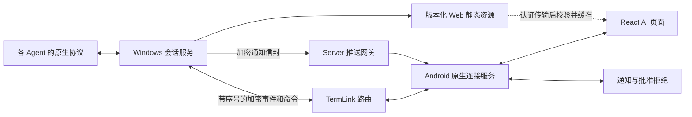

# AI Web 主机方案：架构决策与完整改动计划

日期：2026-10-04。状态：推荐方案，待实施。本文所有性能数值为待验证目标或初始调参值，不是已取得的测试结果。本轮只扫描代码和编写方案，未开始产品实现、构建、发布或服务变更。

后续实施说明：以上是制定方案时的状态。2026-10-04 已开始分阶段实现，实际代码、验证证据及未完成项以 `AI_WEB_IMPLEMENTATION_STATUS.md` 为准；本文保留完整目标，不将局部实现等同于全部交付。

## 1. 选定方案及理由

采用 **现有 Windows .NET Agent 会话服务 + React/TypeScript Web UI + Android 原生连接/通知层 + Server 加密转发和推送投递**。

以 TermLink 自有 Web UI 为主要 AI 体验，供应商官方网页作为独立、按能力启用的接入策略。当前 ZCode `desktop_remote` 保留。新 Agent 优先接真实结构化协议；确实已有可用本地 Web UI 的再选择本地网页策略，不能把任意 CLI 当作可反代网站。

理由：

1. Windows 已有会话、历史恢复、授权、附件、请求去重和 Agent 适配，可继续作为唯一业务权威。
2. 一套 Web 组件处理思考、Markdown、工具、Diff 和成果预览，减少后续在不同平台重复实现聊天 UI 的成本。安卓保持系统能力强项。
3. 通知、网页及未来其他入口调用同一 Windows 操作入口，审批不会因网页销毁而中断，也不用模拟点击 DOM。
4. 自有页面可完全遵循紧凑设计与隐私边界；仅嵌入第三方网站无法保证事件、审批 API、桌面授权或页面兼容性。
5. 性能改善来自增量传输、受限订阅、虚拟列表、按需读取和有界调度。WebView 相比原生会多一个渲染进程和启动开销，不作“换 Web 必然更快”的承诺。

技术选择：

| 部分 | 选定方向 | 原因 |
| --- | --- | --- |
| Windows | 保留现有 .NET Agent 和会话对象；按边界提取事件/传输/文件服务 | 避免在两套主机服务中重复维护账号、授权和会话；Web 静态文件不要求 Windows 安装 Node 运行时 |
| AI 前端 | React + TypeScript + Vite，产出静态资源 | 类型化消息/能力、组件生态、适合增量更新与测试；Node 仅用于开发构建 |
| 移动长列表 | 优先评估 React Virtuoso 的普通虚拟列表组件 | 支持动态高度；必须用实际聊天翻页/流式/软键盘测试验证锚点，不直接依赖付费消息组件 |
| Markdown | react-markdown + remark-gfm；普通聊天不启用原始 HTML | 基础富文本足够；代码高亮、Diff、预览模块延迟加载，HTML 放独立预览容器 |
| 样式 | 项目自己的少量 CSS 变量与组件 | 精确遵守现有紧凑密度，避免大型桌面组件库增加体积和嵌套布局 |
| 安卓 | 系统 WebView + AndroidX WebKit 的受限消息桥；原生通知/Worker | 复用当前登录、设备身份、E2EE 和系统交互；不把私钥交给网页 |
| Server | 继续 Go；添加兼容事件转发及最小推送网关 | 不引入聊天业务、Agent 执行、明文消息数据库 |

具体依赖版本在实施时根据 D:\Dev 的工具清单、许可证、兼容性和安全状况固定到 lockfile。本计划不安装依赖，也不按未知最新版本生成脚手架。

## 2. 职责与资源交付

Windows 管模型/授权、真实会话状态、Agent 协议、工具、历史和文件；网页管展示、输入布局、滚动锚点和短期 UI 状态；原生层管账号、设备密钥、可信连接、文件选择、持久草稿/操作回执、系统通知。网页仍在手机上运行，不可能完全不接触显示数据。

最终资源方案：同一 `ai-web` 构建产物随 Windows 交付，Android 通过认证通道获取、验证后在本地 HTTPS origin 下加载；APK 同时内置一份已知兼容的资源作为首次验证和回退基础。这样重复开页面不需要重新下载整包，Windows 可在桥协议兼容范围内更新页面。

资源标识使用内容 hash + 源码 revision + UI 协议版本，不仅依赖产品版本号；DEV 沿用正式版本号时仍能区分资源。远程资源启用前必须完成受信发布签名、公钥轮换、允许回退范围、桥协议协商、原子下载和上次可用版本恢复。HTTPS 或 PC 可信身份不能替代前端发布完整性策略。初始 Web 功能验证只用内置包，不在同一阶段同时调试远程资源升级。

缓存只保留必要的当前/上次兼容资源，设磁盘配额。多电脑页面上下文按账号和设备绑定，切换账号/撤销信任立即关闭消息桥。第三方网页和生成 HTML 不使用自有 UI 的 origin 或原生业务桥。

## 3. 现场代码揭示的优化点

| 现状 | 影响 | 计划 |
| --- | --- | --- |
| `AiPage` 活跃会话约 1 秒 poll | 重复序列化、传输、解析快照；反馈节奏受轮询限制 | 引入 v2 增量订阅，v1 保留兼容 |
| `ProductionProductRepository.aiRequestLock` 全局串行；请求超时 40 秒 | 一个慢查询可能推迟其他电脑请求、发送或审批 | 每电脑有界调度；同会话变更有序，读请求受限并行，取消/审批优先 |
| 附件 24 KiB 一片且逐片等回执，每片 `Flush(true)` | RTT 和磁盘 flush 放大上传耗时 | 保留旧上传协议；新增二进制块/有界窗口与累计确认，明确持久确认语义 |
| `Put` 每次 FindIndex、拼接整个字符串；`TrimMessages` 每次 Sum | 流式长回复和长历史时 CPU/分配增长 | 消息 ID 索引、维护累计大小、追加缓冲及批量发布，不每 token 扫描全文 |
| 历史游标按当前 List 下标；容量到顶会移除前部 | 分页时下标漂移，需要明确缺口 | 用稳定消息序号/游标，保留显式 history gap |
| catalog 首次读取并解密多份完整 archive | 列表冷启动及内存峰值随历史增长 | 索引与正文分开读取，按需打开历史；保留可迁移的旧档案 |
| 快照读取顺带续期控制租约 | 用订阅取代轮询后可能失去续期，输入/审批失败 | 显式控制续期，校验 owner/controlVersion；订阅存在不等于抢占权限 |
| 通知在 Compose 生命周期内 | WebView 或页面销毁、冷启动时无法独立处理 | 通知与动作迁移到无 UI 依赖的原生服务 |
| Server 当前只识别 AI request/response | 新事件不加协议路由无法送达 | 新增类型/能力协商、角色与目标校验，不绕过现有设备授权 |

上传例子只是理论量级：24 KiB 每次等待 100 ms 回执、窗口为 1 时，上限约 240 KiB/s，20 MiB 文件约 85 秒，尚未计磁盘/协议成本。调大 Web 字号或换前端框架不会消除这个限制。

## 4. Windows 业务与存储改动

### 4.1 统一事件，保留真实能力差异

沿用现有会话对象和动作入口，补充结构化 `turnId/itemId/kind/status/parentId`、公开 reasoning/summary、工具、计划、文件引用、usage 及 pending 请求。先覆盖当前 Codex/Claude/ZCode；将协议分支整理为少量适配模块，避免先造插件框架。

能力沿用已存在的 catalog/configuration 字段，增量加入实际用到的事件/文件/审批能力。明确 `supported/unsupported/unknown` 和配置生效阶段；不向客户端展示协议未提供的模型、思考强度、授权或撤销。

网页和通知都调用相同的 `send/configure/interrupt/answer/...`，沿用 operationId、hostId、controlVersion、settingsVersion。只有 Windows 可决定执行结果。Agent 退出、故障、审批等待、暂停、压缩等状态分开；网络断开不伪装为任务完成。

### 4.2 热路径与调度

- 单会话的状态变更保持顺序；将阻塞磁盘/进程等待移出短状态锁。独立查询不占全局互斥直到超时。
- 文本先累积 delta，再按初始 50–100 ms 或字节阈值组成一批；critical 状态到达时先 flush 同序列前置文本，再发完成/审批，不能为了优先级造成语义乱序。
- 停止/审批不等待长模型查询或完整附件传输；每会话、每设备设并发和队列上限。保留错误与背压，不能直接丢关键事件。
- 不在每个 delta 上做全文 Markdown 解析、档案加密和磁盘保存；转轮、设置、重要终态落盘，生成中的检查点按时间/数据量受控合并。
- 本地通知事件从真实状态变化产生，不依赖手机正好在 poll。只发给已授权且订阅相关会话的设备；发送前和执行时分别验证权限。

### 4.3 历史存储

第一步复用现有 DPAPI 保护与原子替换：新增小型加密索引，列表只读元数据；正文在进入会话后按需加载；限制活跃缓存，离开会话可卸载已结束历史。先解决已证实的全量读取问题。

需要避免长会话全量重写时，再把同一存储格式升级为带版本的加密分页文件：已完成历史页不可变，只更新尾页和清单，继续使用系统保护能力，不自创密码协议。旧 `.bin` 在打开或受控迁移时转换，校验数量、正文、nativeId 与历史授权后原子切换；保留可回退副本，禁止静默删除原档案。

消息/字节上限仍存在并显示具体缺口，不因“分页”声称无限历史。原生导入近期摘要与完整 transcript 区分。AI 历史不套用 CLI 的失效清理期限。首轮不因采用 Web 就同时引入新的数据库和全文检索引擎；会话内搜索由 Windows 对需要的页进行有界、可取消读取。

## 5. 协议、网络与文件传输

### 5.1 v2 增量订阅

在 `protocol/protobuf/termlink_realtime.proto` 加可协商的事件能力和必要的新消息类型，沿用外层加密 Envelope。所有语言生成物和 Server 手工类型白名单同步更新；不复用终端 ACK、resize 或 ConPTY 数据。

逻辑流程：`subscribe(session, streamId, afterSeq)` → 同一一致性边界的 snapshot/replay → events → `unsubscribe`。新字段只在协商成功后启用，旧端继续 v1。

重要规则：

1. streamId 绑定主机实例/会话流，seq 只在该流中递增；跨重启明确失效，不能拿旧游标拼新进程数据。
2. snapshot 必须标识截止 seq，建立订阅与快照边界要原子衔接，避免订阅竞态丢事件。
3. 重复事件去重、乱序有界缓存、缺口补拉；超过保留窗口明确 reset/snapshot，不静默跳过。消息修订与追加区分。
4. seq 在 Web JSON 接口用十进制字符串，避免 JS Number 超过 2^53 的精度问题；文本 offset 明确编码单位，不能混用 UTF-8 字节和 UTF-16 下标。
5. 加密 Envelope 的序号/nonce 和业务 seq 是不同层；独立正确分配，重发不得造成 nonce 重用。
6. 列表订阅只有目录/状态摘要；前台选中会话订阅内容；App 后台停止 token 级更新，保留通知所需状态。不为所有后台会话持续重建 DOM。
7. 订阅续期和控制租约续期分开。前台当前 controller 显式续期；其他订阅者不延长/抢占控制；通知点击时仍按新鲜版本执行。
8. 有界 replay 队列、客户端确认游标和限额；慢客户端脱离流后重同步，不拖住 Agent，也不无限占用 Relay。

首个实现可用现有通道增加 `afterSeq` 的短请求验证事件模型；正式流式阶段新增订阅事件，不把不断提高轮询频率当作最终优化。

### 5.2 通道调度与连接策略

逻辑上将命令/审批、实时内容、文件块分别排队，仍可复用现有连接。限制一帧大小和在途字节，避免大文件把输入、终端、心跳和设备刷新压在队尾。不能仅增加并发而取消对同一会话修改的串行约束。

范围更新（2026-10-04，用户指定）：当前仅使用服务器转发（Relay Only），不安排 AI/CLI LAN/NAT、打洞或直连切换开发验收，不作为待办或发布阻塞项。沿用现有中转能力，验证真实 Relay 链路。

Relay 断线重连保持同一逻辑游标和 operationId；旧连接事件须按 host/stream 去重；恢复连接不重建 Agent 会话，不重放已执行输入。浏览器版若将来脱离安卓壳，需要另行实现认证、加密和连接，不算本次自动获得。

### 5.3 附件和成果

保留兼容上传，v2 使用二进制分块，初始可评估 64 KiB 块与 2–4 个在途块，严格受路由帧限制及设备预算约束。累计 ACK 支持重连询问已保存 offset，必要时重发并校验内容。旧版每块 fsync 的语义不能直接删除：区分“已收到”和“已持久化”的 offset，崩溃后只信实际保存位置；最终 commit 校验长度/hash 后才可被发送引用。

Web JS 不持有完整 base64 大文件：系统选择器/原生流读取到 Windows，网页只收进度和 attachmentId。取消和权限变动时关闭流。

输出文件通过 Windows 的 artifact/file ID、MIME、大小、版本/hash、来源回合描述；按需读取缩略图、Range、源码和 Diff。路径要校验工作区及明确授予的额外范围，处理 Windows reparse point；聊天文本中出现路径不自动授予读取权。缓存以内容版本更新，防止旧预览。

静态 HTML 第一阶段禁用脚本、外部请求、导航和任意本地路径访问；相对图片/CSS只映射已经授权的资源。可交互 JS/React/Vue 项目及开发服务器预览单独设计 origin、资源范围和运行授权，不沿用自有 UI 消息桥。

## 6. Web UI 与安卓改动

建议新增 `ai-web/`，只维护 AI 页面。原生底部导航、设备页、设置页和 CLI 页面保持原行为；AI 列表、聊天和详情逐步集中到一套 Web UI。

必须保持现有产品要求：

- 40 dp 级紧凑搜索、设备→Agent 分组、真实标题/Agent 删除确认、默认工作目录和可选目录浏览。
- 附件/授权靠左，模型/推理强度/发送靠右；云朵不显示“只读/控制中”，后端仍校验权限。
- 状态一行，真实思考/计划/工具折叠，审批和问题不被默认折叠隐藏；文件/变更按需展开。
- 历史恢复沿用授权；不因换页面而新建另一 Agent 会话；电脑离线隐藏正文、保留手机未发草稿。
- 输入法收放、系统字体、字体缩放、手势返回、选择复制、TalkBack、触控区域都纳入验证，不能为紧凑把点击目标压得不可用。

Web 性能措施：虚拟列表、稳定 messageId key、仅更新变化消息；已完成消息的 Markdown 渲染缓存，流式尾部节流；代码高亮/Diff/预览按需加载；图片缩略图和懒加载；用户翻历史时保持锚点，不强拉底部。

AI 区通常只保留一个活跃聊天 WebView；外部网页或预览按需创建、离开释放，不给每条会话常驻一个 WebView。渲染进程恢复时重建页面并从游标/snapshot 恢复，不从 DOM 推断状态。

原生层提供窄消息接口（初始化上下文、请求、订阅、文件选择、保存草稿、打开预览），采用来源/主框架/会话绑定及参数长度校验；不开放任意 Java 对象、任意文件或任意命令。第三方导航移除业务桥；原始 HTML 不进入可信 UI origin。

抽取独立于 Compose 的 AI 连接与操作服务给 WebView、通知 Worker 共用。草稿、附件索引、未知结果操作由同一原生持久层管理；网页登录状态和 Native 登录不建立第二套 Token。草稿可以来自 JS，但保存账号/电脑/会话隔离，杀进程后恢复前核对 host 和会话状态，不自动执行旧队列。

## 7. 原生通知和 Server 改动

Windows 从权威状态产生 `completed/failed/approval_required/input_required/approval_resolved` 等少量事件。Server 管设备推送登记、Token 轮换、限流、到期投递及撤销；载荷由 Windows 加密，Server 不解析正文或决定批准。

先根据真实目标机型验证 FCM 或厂商通道，只实现当前需要的通道，其他按需接入；不用一个空泛的通道列表掩盖无 GMS 的可达性问题。通知加密使用适合冷启动的可信设备信封，支持过期与重放防护，不能依赖已经断开的实时会话密钥状态。

原生 `MessagingService/Receiver/Worker` 收到通知后展示、处理动作、连接 Windows；未登录或密钥不可用时显示通用提醒/要求恢复登录，不降低验证。通知点击深链进入电脑和会话，而不是只打开 App 首页。

审批链路：请求有 deadline 和版本 → 用户点击 → 读取/验证最新请求与控制状态 → 同一 Windows answer 动作 → 回执 → 更新通知。两端竞态、重复点击、过期、Windows 重启、撤销信任要有不同明确结果；未知结果沿用原 operationId 确认，不显示假成功。另一设备已经接管时不从旧通知静默抢占。

允许本次/拒绝可直接在通知操作；复杂问题、长期授权或范围变更进入表单；锁屏敏感批准要求解锁。系统通知遵守用户权限/勿扰设置；“推送提供商接收”不视为送达。

安卓灵动岛/胶囊仅作目标机型允许时的增强。Android Live Updates 对普通聊天及 alerts 的用途限制仍适用，基础验收以标准通知和动作完整可用为准。持续通知不等于永久保活；不通过悬浮窗或不相关前台服务类型规避系统限制。

Server 还需支持 v2 加密事件角色/目标校验、有界转发及慢消费者行为。现有 AI 路由每帧可能查询权限，增加事件频率时先批量/测量；若复用既有权限缓存，必须连同撤销事件、代际隔离与失效语义一起验证，不以性能理由省掉授权。

## 8. 文件级改动范围

下表新文件/目录是建议落点，不代表本轮已创建代码。

| 范围 | 现有落点/建议新增 | 改动 |
| --- | --- | --- |
| Agent 适配/状态 | `win-agent/src/Agent/AiAgentSession.cs`, `AiConfiguration.cs`, `AiSessionFeatures.cs`, `AiNativeHistory.cs` | 完整事件、索引、续期、既有配置/恢复兼容 |
| 会话服务 | `AiSessionManager.cs`, `ProductionAiAgents.cs`；按需新增事件缓冲/订阅与文件服务 | 统一动作、增量、调度、成果读取、通知事件 |
| 资源交付 | Windows 构建资源目录、受限 UI manifest/资源读取动作 | 版本化资源、验证与缓存协议 |
| Web | 新 `ai-web/` | 列表、聊天、composer、内容组件、桥接入口和相关行为测试 |
| Android UI | `AiPage.kt`, `AiWorkspace.kt`, `AiRemotePage.kt`, `AiSessionActions.kt` 及新 Web 容器/桥 | 渐进迁移，保留外部网页隔离和原生系统能力 |
| Android 通信 | `ProductionProductRepository.kt`, `core-network/.../ProductionAiAgents.kt`, realtime multiplexer | 独立业务服务、调度、增量订阅、冷启动动作 |
| Android 通知 | Manifest、推送接收、通知动作、Worker、deep link | 独立后台处理，草稿和未知操作持久化 |
| 协议 | `protocol/protobuf/termlink_realtime.proto` 及生成物 | additive v2 能力、事件和受限二进制文件传输 |
| Server | `internal/realtimewire/envelope.go`, `internal/realtime/session_catalog.go`, `relay.go`；新推送 API/store/migration | 加密事件路由，设备推送登记及投递 |
| 构建/验证 | 现有构建脚本与新 Web 构建步骤 | 工具版本固定、资源hash、跨平台协议 fixtures、资源回退验证 |

## 9. 分阶段实施与停止条件

| 阶段 | 交付 | 验收/进入下一阶段条件 |
| --- | --- | --- |
| A 基线和主机事件 | 现有功能清单、性能基线；统一事件/索引/显式续期 | 现有原生页及 Codex/Claude 回归通过；无重复输入/审批，Agent 间能力不混用 |
| B v2 传输 | 增量、snapshot/replay、优先调度、Server 兼容路由 | 断线/乱序/满队列/路由切换无静默丢失；旧端可用；取消/审批不被文件阻塞 |
| C Web 等价替换 | 内置资源的一个完整 Agent 流程，再覆盖其他 Agent 和列表 | 模拟器＋Windows 联合测试；现有输入、模型、授权、附件、恢复、导出、文件引用、分支均不遗漏 |
| D 成果与资源优化 | 文件/Diff/静态 HTML、附件传输、资源签名缓存及回退 | 实测提升、预览隔离、缓存失效、版本不匹配与资源恢复通过 |
| E 后台提醒 | 最小推送网关、原生接收/动作、深链 | 锁屏/冷启动/登录过期/通知竞态在目标真机通过；无 GMS 机型单独记录结论 |
| F 扩展能力 | 真实 ACP Agent、OpenCode 本地 Web 或更多工作区能力 | 一项一项按能力与真实链路验收；不把它们阻塞基础 Web/通知完成 |

每阶段可在开发入口比较原生/Web，但同一时刻同一会话只有一套前台控制与订阅，不双发输入。过渡期保留旧页作为回退，等价性验证结束后移除重复 AI 渲染逻辑，不长期维护两套完整 UI。CLI 不进入迁移范围。

新旧版本：旧服务端不支持事件则不启用 v2；旧 Windows 使用旧请求/显示能力；新服务端保留 v1；UI 包与原生桥不匹配使用兼容包或明确提示更新。存储迁移保留回退副本，不能只回滚页面而忽略档案格式。

正式发布顺序必须服从兼容矩阵，先准备能接受旧端的服务端，再验证 Windows/Android 组合及回退；本方案不授权实际发布。若执行发布，须按 `RELEASE_RUNBOOK.md` 和 `RELEASE.md` 重新核验源码 revision、线上版本/build、签名、测试、数据备份和回退证据；不在本文预分配版本号。Docker 发布遵循现有仅 Docker Hub 的规则。

## 10. 性能与正确性验收目标

先在同一电脑、同一安卓真机/WebView 版本、同一模拟器配置做当前原生基线；测试脚本固定输入和事件速率。记录 p50/p95、内存、字节数、CPU 和主要长任务，不用体感或模型服务端耗时替代前端性能。

初始目标（必要时根据目标低端设备基线调整，但调整需有测量说明）：

| 指标 | 目标/测量方式 |
| --- | --- |
| 文本可见延迟 | 从 Windows 接收 Agent 文本事件到屏幕呈现，在记录 RTT 的受控 Relay 链路下测量 p50/p95；单独列网络耗时与渲染耗时，再固定可复现的验收目标 |
| 本地交互 | 点击反馈 p95 ≤ 100 ms；停止/审批本地入队不被文件队列堵住，网络/Agent完成时间另记 |
| 长历史滚动 | 10,000 消息数据集，虚拟化可视项；目标中端真机以接近 60 fps 为目标，主要滚动帧 p95 ≤ 20 ms，未通过则不替换默认页 |
| 内存 | DOM和Web堆不随历史消息总数线性增长；切换/预览/销毁循环后无持续增长；额外WebView进程内存单独记账 |
| 初始化 | 兼容资源已缓存时，页面框架可交互目标 ≤ 500 ms；首屏内容时间另受主机/网络影响，不混为一项 |
| 网络 | 空闲订阅无每秒全文快照；流式流量随新内容增长；以相同记录重放与基线对照报告比例，不预先声称节省百分比 |
| 附件 | 固定 20 MiB、模拟 100/200 ms RTT 验证吞吐、可取消与崩溃续传；传输期间停止/审批仍可及时入队并获得机会 |
| 正确性 | 断线/重复/错序/重启/两端竞态：无重复业务执行、无过期批准、无静默缺口；未知结果明确显示 |
| 通知 | 分别记录 Windows 产生、网关接收、供应商接受、设备接收、展示时间；不把供应商接受当端到端成功 |
| 兼容 | 原生/Web切换同一会话ID；历史授权不变；CLI布局与输入、Relay 连接恢复及设备刷新回归通过；LAN/NAT 不适用 |

模拟器用于布局、键盘、桥接、协议与流程；后台推送、厂商限制、功耗、胶囊和真实滚动性能必须用对应真机。采用 Web 的最终默认开关由这些证据决定。

## 11. 参考与边界

本文是基于 [可行性报告](AI_WEB_HOST_ARCHITECTURE_FEASIBILITY_20261004.md) 和 [功能差距报告](AI_CHAT_GAP_ANALYSIS_20261004.md) 的选定方案。HAPI 的统一服务/通知动作、CC Pocket 的主机同步、Happier 的分能力支持及 ZCode 的桌面 Host 只作为行为参考；引用代码/资源前仍须核对许可证，HAPI 的 AGPL 和 ZCode 的非开放产品资源不能直接移植。

本方案保证的是有清晰扩展边界与可验证的性能改进路径，不承诺所有 Agent 功能等价、所有手机推送必达、所有网页都可反代或所有安卓都可显示系统灵动岛。
