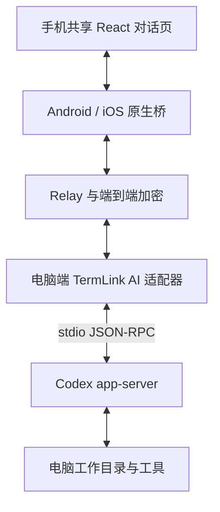

**TermLink 手机 AI 对话页与 Codex 开源代码复用研究**

核查日期：2026-11-11（Asia/Shanghai）。本研究按“把手机客户端 AI 对话界面替换成官方 Codex 的 Web 前端”理解需求，同时检查对话中生成 HTML 的预览能力。目标仓库为官方 `openai/codex`；未指定的第三方 Codex Web UI 不在本次结论范围内。

结论：**当前官方开源仓库没有可直接替换 TermLink AI 对话页的完整 Web 聊天前端。值得复用的是 Codex app-server、协议类型和已有交互设计；TermLink 已经接入 app-server，应在现有共享网页上补齐协议与展示。** 官方桌面界面包含更多功能，并不能直接推出这些界面的源码也包含在开源仓库里。

本轮依据当前工作树进行源码分析，包含工作区原有的未提交修改；未把 HEAD 当作所有工作文件的版本。没有执行客户端功能改造或新版本真实 Relay/设备验收。本报告中的“已有”指找到实现，不代表所有主机、手机和 Codex 版本均实测通过。

**一、核查版本与实际开源范围**

官方 `main` 核查快照为 `83e3d63ba1b928d9f73d52480473694f84aa5a18`，提交时间 `2026-11-11T02:13:43Z`。GitHub recursive tree 返回 `truncated=false`，包含 11,299 个文件/目录条目，其中 10,224 个 blob。这个快照不是本机已安装版本的声明，也不是建议直接升级到开发分支。

| 核查对象 | 观察结果 | 对复用的意义 |
| --- | --- | --- |
| 官方开源组件清单 | 列出 CLI、SDK、app-server；明确 IDE extension、Codex cloud 未开源 | 不能把官方产品中的网页视为仓库附带的 UI 组件 |
| `codex-rs/tui/` | Rust crate，使用 Ratatui/Crossterm | 是终端界面，不能作为 React/HTML 页面装入手机 WebView |
| `codex-rs/app-server/` | 提供客户端协议与运行时能力 | 可由电脑端调用；不是完整网页服务器或聊天组件库 |
| `codex-rs/app-server-protocol/schema/typescript/` | 有生成的请求、事件、ThreadItem 等类型 | 可用于协议对齐和固定版本的契约检查 |
| `sdk/typescript/` | 在 Node.js 中启动本地 CLI、交换 JSONL | 不是浏览器 SDK，也不提供对话页面 |
| 完整文件目录 | `.tsx` 为 0，`.jsx` 为 0；4 个 HTML | 结合包清单与源码入口，未发现可替换现有页面的完整 Web 聊天前端 |
| 官方桌面 App 页面 | 仓库 README 指向独立产品入口 | 本次仓库未提供该产品的完整前端；不据此推断其全部内部实现 |

4 个 HTML 的路径分别为：

- `codex-rs/login/src/assets/error.html`
- `codex-rs/login/src/assets/success.html`
- `codex-rs/login/src/assets/success_legacy.html`
- `codex-rs/tui/assets/inline_visualization/visualize.html`

前三个是登录结果页面，最后一个是可视化支持片段，不包含会话列表、输入框、审批、工具时间线等完整对话产品。`visualize.html` 还包含外部脚本引用，不能直接作为当前可信 AI Web 页面的一部分加载。

证据元数据、路径清单和所读文件 SHA-256 保存在工作区的 [evidence.json](../../artifacts/codex-ui-reuse-research-20261111/evidence.json)。只检索“web”目录名不足以判断可复用性，本次同时检查了文件扩展名、所有 package.json 路径、TUI 构建依赖、协议定义和官方组件说明。

**二、TermLink 实际已经采用了什么架构**

当前源码形成以下链路：

这套架构已经在复用 Codex 的核心执行能力。网页接收 TermLink 整理后的会话状态，手机原生层承担授权、网络、附件入口和生命周期；电脑拥有 Agent 进程与工作目录。

| 位置 | 已核查的职责 |
| --- | --- |
| [ai-web/package.json](../ai-web/package.json)、[main.tsx](../ai-web/src/main.tsx) | React/Vite；Markdown、代码、虚拟列表、审批与成果展示 |
| [vite.config.ts](../ai-web/vite.config.ts) | 输出至 `android/app/src/main/assets/ai-web` |
| [Android AiWebConversation.kt](../android/app/src/main/kotlin/dev/termlink/product/AiWebConversation.kt) | 本地资源加载、来源校验、限定动作的消息桥；第 35 行起是动作白名单 |
| [iOS AIWebConversation.swift](../ios/TermLink/Features/AI/AIWebConversation.swift) | `WKWebView` 加载 bundle 中的相同 AI Web 资源；第 48 行起校验消息来源 |
| [AiAgentSession.cs](../win-agent/src/Agent/AiAgentSession.cs) | 第 108 行启动 `app-server`，第 120 行起完成初始化，第 401 行起适配 Codex 事件 |
| [TermLink.Agent.AI.csproj](../pc-client/src/Agent.AI/TermLink.Agent.AI.csproj) | 第 19 行起将 Windows 目录下的共享 AI 实现编入便携主机；目录名不代表只在 Windows 使用 |
| [RelayAiTransport.cs](../pc-client/src/Agent.Connection/RelayAiTransport.cs) | 处理移动端授权及加密请求、响应 |

输入区没有全部迁移到网页。Android 的 [AiPage.kt](../android/app/src/main/kotlin/dev/termlink/product/AiPage.kt) 第 152 行嵌入网页，第 165 行继续使用 `AiEnhancedComposer`；iOS 的 [AIPage.swift](../ios/TermLink/Features/AI/AIPage.swift) 第 58 行嵌入网页，第 60 行后保留原生草稿、附件和输入控件。整页替换需要一起迁移这些交互，不能只替换一个 HTML 文件。

旧交接/架构文档有阶段性描述，应以当前源码及更近的目录约束校正。例如早期 Mac 交接说缺 iOS XCFramework，而当前 iOS 文档已记录接入及模拟器验证；这不构成本轮新的真机验收证据。

**三、哪些能力已有，哪些差距确实存在**

| 能力 | 当前工作树观察 | 补齐方向 |
| --- | --- | --- |
| Markdown、表格、代码高亮、复制/引用 | 已有 React Markdown、GFM 与代码块组件 | 保留并改善手机交互，无需更换整套页面 |
| 长历史与阅读位置 | 已有虚拟列表、增量消息、历史加载和阅读锚点 | 继续用现有机制；Codex 原生历史导入另有缺口 |
| 思考摘要、任务计划 | 已处理公开摘要和 `turn/plan/updated` | 增补新版计划项及增量；仅展示上游公开返回的内容 |
| 工具展示 | 已处理命令、文件变更、MCP、协作工具的开始/完成；详情主要为 JSON 文本 | 增加命令输出、退出码、文件差异、MCP 结果和子任务专用卡片 |
| 工具执行中的输出 | Codex 接收分支未处理 `item/commandExecution/outputDelta`、`item/mcpToolCall/progress` | 先在主机接收/合并，再经现有增量通道展示；不是只改 CSS |
| 网页搜索、生成图像、新子任务项 | 官方类型中有 `webSearch`、`imageGeneration`、`subAgentActivity` 等；当前 Codex item 分支未专门处理 | 按部署版本、模型、账号实际支持映射，未知项应明确显示能力边界 |
| 审批与问答 | 已有命令/文件审批和 `item/tool/requestUserInput` | 当前手机主要提供允许本次/拒绝；新增权限子集审批、MCP 表单/URL 交互需补协议和交互模型 |
| MCP/Skills | MCP 调用能作为工具记录出现；未找到 Skills 目录、MCP 状态/授权管理接口的接入 | 可增加能力驱动的目录/状态页；不能把“无管理页”等同于 Agent 不能执行已配置的 MCP/Skills |
| 分叉、运行中补充、停止 | 已接入 `thread/fork`、`turn/steer`、`turn/interrupt` | 应改进可发现性，不重复实现为新能力 |
| 指定轮次分叉/回退、专门代码审查 | 当前 fork 不传指定轮次；未找到 `thread/revert`、`review/start` 的对应接入 | 独立设计，验证版本与权限；对话回退不恢复文件 |
| 原生 Codex 历史 | 载入最近 10 个 turn 的 summary，只取 user/assistant 文字，标记 truncated | 增补原生历史分页、工具/摘要/附件等结构化还原 |
| Diff 与成果查看 | 已有按文件 Diff、分块读取、图片/文本/静态 HTML 预览和下载动作 | 改善大 Diff 阅读；主机平台限制必须先解决 |
| Token 与错误 | 有 usage 面板；Codex error 在接收处归并为 `AGENT_REPORTED_ERROR` | 补可展示的结构化错误/重试状态；额度事件与 token 使用量分开处理 |

上述差距来自如下可定位代码：

- [main.tsx](../ai-web/src/main.tsx) 第 157–190 行是工具栏、计划、文件、Diff、虚拟列表；第 194–240 行为消息、问答、用量与 Diff 渲染。第 198 行工具详情使用 `<pre>{m.text}</pre>`。
- [bridge.ts](../ai-web/src/bridge.ts) 第 2–14 行的消息模型主要是 `role/kind/text/title/summary/status`；部分工具结构仍保存在 text 内的 JSON 中，不能笼统地说这些数据全部丢失。其他未被接收的事件则无法靠前端补回。
- [AiAgentSession.cs](../win-agent/src/Agent/AiAgentSession.cs) 第 394–398 行只接收列出的交互请求，其余返回 unsupported；第 401–427 行为 Codex 通知分支。第 542–578 行将现有审批映射为接受/拒绝。
- [AiNativeHistory.cs](../win-agent/src/Agent/AiNativeHistory.cs) 第 89–108 行明确只做有界近期文字显示。Codex 恢复会话时仍拥有原生上下文，手机显示较少不等于 Agent 丢失了所有上下文。
- [AiSessionFeatures.cs](../win-agent/src/Agent/AiSessionFeatures.cs) 第 167–179 行已实现分叉，但没有 worktree 创建或文件快照恢复，因此不能把分叉宣称为工作目录隔离。

**四、Mac 主机的能力限制会直接影响手机体验**

[共享 Capabilities()](../win-agent/src/Agent/AiSessionFeatures.cs) 第 32–39 行中，`artifacts`、`attachments`、`fileReferences` 以 `OperatingSystem.IsWindows()` 为条件。当前 [PortableAiHost](../pc-client/src/Agent.AI/PortableAiHost.cs) 直接使用共享 `AiSessionManager`，没有在该包装层重写这些能力。

因此，按当前工作树运行的 Mac 主机在 AI 通道内不会宣告这些能力。手机对应入口隐藏或不可用可以由主机能力声明解释，不能全部归因于 Web 界面简陋。这一结论限定于 AI 通道，不代表独立“文件”功能完全不能在 Mac 使用，也不代表本轮观察过用户已安装应用的真实行为。

此外，Android 的 `aiArtifactLocation()` 仍校验 Windows 盘符目录；只把主机的 capability 改成 true 不足以完成 Mac 支持。需要把主机安全文件访问、附件处理、路径语义和两端文件入口一起适配并验证。

这项工作优先级高于整页替换，因为再完整的网页也不能自己授予后端没有提供的文件能力。

**五、为什么直接加载官方网页或复制打包资源不等于复用开源项目**

官方仓库 README 将 Codex Web、桌面 App、IDE 扩展分别引向产品入口。打开这些产品入口，不等于它们会自动接管 TermLink 当前电脑上的会话、权限和 Relay 通道；本次也没有找到支持这种替换的官方嵌入契约。

即使另行取得桌面/扩展内的 JavaScript 产物，仍须核实对应资源许可、宿主桥和运行依赖。不能把官方开源仓库的 Apache-2.0 自动扩展到其他产品打包资源。本轮没有提取桌面 App 或 IDE 扩展资源。

TermLink 目前的可信页面有明确技术边界：[index.html](../ai-web/index.html) 的 CSP 含 `connect-src 'none'`；Android 使用限定来源与动作的桥；iOS 只接受 bundle 主 frame 的消息。[iOS AGENTS.md](../ios/AGENTS.md) 明确禁止远程第三方页面获取 TermLink 原生桥和应用 token。直接让远程网页接入现有桥会改变这些边界，也不能保留当前 Relay Only 设计。

官方 app-server 的 TCP WebSocket 仍被文档标为 experimental/unsupported。当前已有电脑本地 stdio 连接，更合理的路线是保持本地连接，由 TermLink 继续负责手机到电脑的授权与 Relay/E2EE，而不是额外暴露远程 Codex 端口。

**六、如果需求还包括“AI 生成的网页能像 Codex 那样交互”**

这应作为独立的成果预览功能。当前 [bridge.ts](../ai-web/src/bridge.ts) 的 `staticHtml()` 会删除 script、iframe、form、事件属性和外链，再加限制性 CSP；[main.tsx](../ai-web/src/main.tsx) 的预览使用独立 sandbox iframe。它有意提供静态 HTML 展示，不能运行普通网站应用。

Codex 仓库的 `visualize.html` 可以作为特定可视化行为的参考，逐项核实依赖与许可后也可评估局部复用。但它不是网站运行环境，更不是完整聊天 UI；当前脚本与外部资源策略也不允许原样加载。

如果要支持按钮、图表交互或完整开发站点，应为成果建立独立隔离容器/来源、无 TermLink 特权桥的通信方式，以及通过 Relay 访问主机资源的明确接口。先定义需要支持“自包含交互 HTML”还是“带后端的开发站点”，再做相应方案。不能通过放宽主聊天页 CSP 顺带实现。

**七、可复用的内容与许可证边界**

| 内容 | 建议 |
| --- | --- |
| Codex app-server 运行时 | 继续在电脑端使用，固定支持版本并验证升级兼容 |
| 生成的 TypeScript/JSON Schema | 用于对齐事件/请求与生成契约检查；手机桥仍保持 TermLink 自身受控动作 |
| TUI 交互设计及公开测试语义 | 参考工具状态、问答、计划与导航行为；Rust UI 需要在 React 端重新实现 |
| 完整官方桌面/IDE/云端聊天前端 | 本次没有获得可按开源方式直接移植的完整前端 |
| 第三方 Codex Web 客户端 | 若另行选定仓库，需要重新检查许可证、移动适配、协议与后端耦合；不能沿用“官方开源”的结论 |

官方 Codex 仓库主许可证为 Apache-2.0。Apache 官方兼容性说明确认 Apache-2.0 代码可以纳入 GPLv3 项目，因此与 TermLink 的 GPL-3.0-only 方向并非天然冲突。复制具体文件时仍需保留适用 LICENSE/NOTICE/版权说明、标记修改，并核查第三方依赖及资源自己的条款。这只是所查许可证的技术选型依据，不是对全部资源的自动授权。

**八、推荐的实施顺序**

1. **先建立能力与版本基线。** 确认目标电脑实际 Codex 版本；用该版本生成 schema；将当前接收的通知、请求和操作与 schema 对照。区分 API 存在、运行时启用、手机可操作、真实端到端通过四种状态。
2. **补齐用户能立即看到的执行过程。** 命令输出流、MCP 进度、计划项、新工具项和结构化错误进入主机模型；Web 增加对应卡片；保持当前历史锚点、消息 ID、控制租约和结果回执机制。
3. **修复 Mac AI 文件能力。** 审查便携主机的路径和文件边界，完成附件/成果文件处理，再声明能力；同时处理 Android 的 Windows 路径假设。不要只打开三个布尔值。
4. **补丰富历史与交互。** 同一套消息模型用于实时接收和原生历史加载；增加权限子集/MCP 表单；保留现有允许/拒绝与问答回退。
5. **增加进阶操作。** 先按实际需要接 Skills 列表、MCP 状态、代码审查、指定轮次分叉及历史回退；版本不支持时准确隐藏。对话回退和文件撤销分别设计。

建议把 `ai-web/src/main.tsx` 按消息类型拆分为命令、文件变更、MCP、搜索、子任务、审批等组件；先补可明确验证的能力，再决定是否需要更换通用 UI 组件库。这是建议的模块划分，本轮没有创建这些组件。

主机向手机传输的数据可增加受控结构化字段和消息版本，保留旧文本兼容显示；不要把所有 Codex JSON-RPC 方法无差别透传到 WebView。敏感认证与权限决策继续由原生层和电脑端管理。

**九、当前协议中容易误用的地方**

- 当前文档及固定快照都显示 `thread/rollback` 已移除，应核查目标版本的 `thread/revert`。它只删除指定轮次及之后的对话历史，不恢复本地文件。
- `item/fileChange/outputDelta` 虽仍可能出现在兼容 schema 中，文档已标为 deprecated，当前版本不再发出；应使用 fileChange 项及 `turn/diff/updated`。单靠“schema 里有一个名字”不足以证明应依赖它。
- 部分 plugin API 在官方文档中明确标注开发中、暂不用于生产客户端。无需为了“功能齐全”将它们全部开放。
- `experimentalApi=true` 只表示客户端选择接收实验接口，不保证客户端已经正确处理全部实验请求；当前代码已经设置该值，需要有明确支持范围。
- Codex 开源 runtime 不等于托管服务、模型权限、桌面专属能力也全部可复制。每个能力仍受主机版本、配置、账号和模型支持影响。

**十、验证方式与本轮边界**

现有 [conversation.spec.ts](../ai-web/tests/conversation.spec.ts) 已包含 10,000 条消息虚拟化、审批草稿保持、HTML 隔离、窄屏、大字体、阅读位置恢复、搜索分页等用例。它们为后续改造提供回归基础；本轮只阅读测试，没有将历史测试记录当作本轮执行结果。

实施时应增加有实际价值的验证：同一工具的输出增量与最终项一致；重连后消息不重复且审批不串会话；新权限请求按请求范围回应；历史与实时结构一致；旧版本能回退；Mac 路径/附件通过实际主机测试；Android 和 iOS WebView 在手机尺寸上分别验证。网络范围仍是 Relay Only。

本轮交付研究报告及证据元数据，未修改运行时代码、安装依赖、启动付费模型任务或执行发布。仓库已有修改继续保留。现有 iOS 文档记录的模拟器/编译结果不能替代本轮尚未执行的真实手机、电脑和 Relay 联测。

**资料索引（2026-11-11 读取）**

- 官方开源组件清单：`https://developers.openai.com/codex/open-source`，读取时跳转至 `https://learn.chatgpt.com/docs/open-source`。
- 官方客户端集成协议：`https://developers.openai.com/codex/app-server`，读取时跳转至 `https://learn.chatgpt.com/docs/app-server`。
- 官方 SDK 说明：`https://developers.openai.com/codex/sdk`，读取时跳转至 `https://learn.chatgpt.com/docs/codex-sdk`。
- 官方平台说明：`https://developers.openai.com/blog/codex-as-a-platform`。
- 官方源码快照：`https://github.com/openai/codex/tree/83e3d63ba1b928d9f73d52480473694f84aa5a18`。
- 固定快照重点文件：`README.md`、`LICENSE`、`NOTICE`、`package.json`、`codex-rs/tui/Cargo.toml`、`codex-rs/app-server/README.md`、`codex-rs/app-server-protocol/schema/typescript/{ClientRequest,ServerRequest,ServerNotification}.ts`、`codex-rs/app-server-protocol/schema/typescript/v2/ThreadItem.ts`、`sdk/typescript/README.md`、`sdk/typescript/src/thread.ts`、`codex-rs/tui/assets/inline_visualization/visualize.html`。
- Apache 官方许可证兼容说明：`https://www.apache.org/licenses/GPL-compatibility`。
