# TermLink 完整产品与系统设计

> **⚠️ 状态警告（2026-09-20，审计 #29）**：本文档 §6（部署架构）描述的 Redis+Caddy+ghcr.io 多容器架构已废弃。当前生产拓扑为"反向代理 → 单 Server 容器 → PostgreSQL"（内置身份/OIDC/协调/直连信令全部内置于 Server 进程），详见 `server/README-runtime.md`、`server/compose.yml` 与 `docs/EDGE_GATEWAY.md`。其余章节仍作设计背景参考，但部署相关内容以运行文档为准。

文档版本：1.0
状态：开发基线
更新日期：2026-09-05
适用范围：Windows Agent、Docker 服务端、Android 客户端、终端引擎与 UI/UX

## 1. 文档目的与最终决策

本文把 TermLink 已确认的产品需求、ConPTY 技术验证、Android Terminal 引擎调研、服务端部署要求和 UI 设计合并为统一开发基线。若本文与早期草案冲突，以本文为准；底层验证证据仍以专项文档为准。终端信息获取、事件语义和“经服务端转发到客户端”的专项规定以[终端信息获取与服务端转发需求基线](TERMINAL_INFORMATION_FORWARDING_REQUIREMENTS.md)为准。

已经确定的核心决策：

1. 目标是由 TermLink 管理自己创建并注册到 terminal-main 异步通道的终端会话，不通过窗口抓取、键盘钩子、进程注入或直接 ConPTY 读写接管任意既有 Windows Terminal 标签页；当前注册/IPC 尚未完成。
2. 目标 Windows 端以 terminal-main 的 `TerminalConnection` 边界作为输入输出来源，通过独立异步通道交给 Agent；当前 `ProductionAgentRuntime` 仍使用 ConPTY/SessionHost，旧链路在切换前保留为 Golden Stream 对照。
3. Android 不移植完整 Windows Terminal。默认使用 Termux `terminal-emulator` + `terminal-view` 派生 Fork，xterm.js 离线 WebView 作为兼容性对照与运行时回退。
4. terminal-main 异步通道目标是产生有序的终端输入输出事件；PC 与 Android 的目标载荷带明确编码版本，不传屏幕截图，也不在 Relay 中转换成字符串。当前生产载荷仍是隐式 UTF-8，编码扩展待完成。
5. Windows Agent 与 Android 登录同一 OIDC 账号后直接发现和使用该账号下的 PC/受管 Session，不需要用户配对、自授信或逐 PC Grant；远程输入仍需要短时会话输入租约。
6. 服务端采用 Go，可用 Docker Image 和 Docker Compose 部署；PostgreSQL 保存目录与任务元数据，Redis/Valkey 保存在线状态与租约。终端历史由 Windows 主机本地保存并按需通过认证实时链路提供。
7. 服务端只路由密文。终端正文、输入和快照在 PC 与同账号、未撤销且持有独立设备私钥的 Android 之间端到端加密。
8. UI 采用“Quiet Focus / 安静专注”设计语言：低干扰、内容优先、上下文操作、清晰状态和渐进披露，不以炫光、渐变或大量卡片代替可用性。
9. 服务端保留可配置套餐目录和购买验证接口；同一账号的 Windows PC 与实时 Session 数量不限，历史额度字段以 `-1` 表示 unlimited，套餐名称、周期、功能标记、渠道映射和上下架状态均不硬编码在客户端。

## 2. 产品定义

### 2.1 一句话目标

让用户从 Android 安全、低延迟地查看和控制自己多台 Windows PC 上的受管终端会话，同时保留可恢复、可审计和可选的加密历史。

### 2.2 产品边界

TermLink 是远程终端系统，不是：

- 远程桌面或 GUI 控制工具；
- Windows Terminal 的 Android 移植版；
- 任意控制台窗口的无侵入录屏工具；
- 首版文件管理、端口转发或远程 IDE；
- 依靠自然语言判断命令是否安全的防护系统。

### 2.3 用户角色

| 角色 | 目标 | 默认能力 |
| --- | --- | --- |
| 账号所有者 | 管理本账号 PC、手机、撤销和记录策略 | 账号内设备管理 |
| PC 本地用户 | 本地运行 Shell，并决定是否允许远程访问 | 本地最高优先级 |
| Android 远程用户 | 浏览同账号受管会话、观察，并在取得短时租约后输入命令 | 同账号直接访问；输入受租约约束 |

底层兼容权限分为：

- `VIEWER`：查看在线状态、实时输出和授权范围内历史；
- `CONTROLLER`：拥有 Viewer 能力，并可申请输入租约；
- `MANAGER`：可管理兼容 Grant、撤销设备以及修改 PC 访问策略。

首版生产主流程启用账号级直接访问：同账号、未撤销设备不依赖上述 Grant 才能发现或订阅 PC/Session。`trust_state` 与 `VIEW/CONTROL/MANAGE` 数据仅用于旧部署/旧客户端兼容和撤销状态表达，不得作为当前产品 UI 的前置步骤。

### 2.4 MVP 范围

纳入：

- Windows 10 1809+，优先保证 Windows 11；
- PowerShell 7、Windows PowerShell 5.1、CMD、WSL 2；
- 单账号可管理不限数量的 PC 和并发受管会话；
- 多 PC/多会话发现、实时显示、远程输入、断线恢复和最近历史；
- ANSI 16 色、256 色、True Color、常见 TUI、鼠标、IME 和组合键；
- 同账号设备直接发现、账号隔离、输入租约、设备撤销和逐设备 E2EE；
- Windows Terminal Scheme 配色同步；
- Docker Compose 单机部署和外部 OIDC 接入。
- Free 方案和月付会员的购买、恢复、续费、宽限与功能状态同步；PC/Session 数量不设配额。

暂不纳入：

- 附加普通 Profile 已经打开的标签页；
- 多人同时向一个会话输入；
- macOS/Linux Host Agent 和 iOS；
- 企业组织、LDAP、审批流和合规归档；
- 文件传输、端口转发与公网 SSH Gateway。

模型推理、终端内容解释或摘要、自然语言导航和命令生成不在产品规划内。

### 2.5 成功指标

| 指标 | MVP 目标 |
| --- | --- |
| 稳定网络输出显示延迟 | 区域内 P95 ≤ 250 ms |
| Android 输入经 terminal-main 异步通道 | 区域内 P95 ≤ 250 ms |
| 持续输出能力 | 单会话 2 MB/s 持续 10 分钟无 OOM |
| 断线恢复 | 断线 30 秒后从 ACK/快照恢复，不重复输入 |
| 终端网格兼容 | Golden Stream 最终网格正确率 ≥ 99% |
| 数据保密 | Relay、数据库与日志均无终端明文；服务端不保存终端历史或文件正文 |
| 本地可用性 | Relay 停止时 Windows 本地终端继续运行 |

## 3. 需求目录

### 3.1 账号、设备与权限

| ID | 需求 |
| --- | --- |
| AUTH-001 | Android 使用固定 HTTPS OIDC 端点原生登录，不持久化密码；身份提供方要求交互时使用 Authorization Code + PKCE 浏览器回退。 |
| AUTH-002 | PC Agent 使用浏览器设备授权，不保存账号密码。 |
| AUTH-003 | 每台设备生成独立公私钥；PC 私钥由 DPAPI、Android 私钥由 Keystore 保护。 |
| AUTH-004 | Windows/Android 登录同一 OIDC subject 后自动注册为账号内设备，无需配对、自授信或逐 PC Grant；不同 subject 严格隔离。 |
| AUTH-005 | `trust_state`、pairing 与 Viewer/Controller/Manager Grant 作为兼容模型保留，但不作为首版产品发现/订阅前置条件。 |
| AUTH-006 | 撤销设备后立即断开连接、拒绝旧 Token，并轮换受影响的会话密钥。 |

### 3.2 Windows Agent

| ID | 需求 |
| --- | --- |
| WIN-001 | 安装后提供托盘应用、自动启动、卸载和签名更新。 |
| WIN-002 | 注册 TermLink PowerShell、CMD、WSL Windows Terminal Profile。 |
| WIN-003 | terminal-main 为每个受管会话创建并注册一个独立异步输入输出通道；TermLink 不直接持有 ConPTY。 |
| WIN-004 | 通过异步通道转发输出、远端输入结果、resize、支持范围内的标题、创建、退出码和中断事件；本地输入正文默认不采集。 |
| WIN-005 | 创建、列出、重命名、终止、归档和删除受管会话。 |
| WIN-006 | 网络中断时写入有界的本地加密环形缓冲，恢复后按序补发。 |
| WIN-007 | 本地键盘输入可立即撤销远端输入租约。 |
| WIN-008 | 托盘明确显示远程查看者和控制者，并提供“一键停止远程访问”。 |
| WIN-009 | 支持仅本机、只读远程、允许控制三种 PC 策略。 |
| WIN-010 | Agent 重启后准确标记会话中断，不伪造在线会话。 |
| WIN-011 | terminal-main 异步通道和 Agent 不向终端宿主暴露 Token、日志、Relay Socket 或私钥等敏感句柄。 |
| WIN-012 | 支持停止同步、停止记录、清除本地历史和配置保留期限。 |

### 3.3 服务端与 Docker

| ID | 需求 |
| --- | --- |
| SRV-001 | 提供版本化 REST API 和 TLS WebSocket Realtime Relay。 |
| SRV-002 | 管理 OIDC 账号映射、设备归属、公钥、撤销状态、PC 在线状态、会话索引和审计元数据；兼容授权记录不得改变首版账号级直连主流程。 |
| SRV-003 | 支持输出 ACK、续传、去重、限流、背压、心跳和输入租约。 |
| SRV-004 | 终端载荷保持 E2EE，服务端不得持有正文解密密钥。 |
| SRV-005 | 服务端不保存终端历史正文；在线 Windows 主机从本地 WAL/checkpoint 提供逐设备密封的 Snapshot 和有界事件。 |
| SRV-006 | 官方发布多架构 Docker Image，支持 Docker Compose 单机部署。 |
| SRV-007 | 容器以非 root 用户运行，提供健康检查、只读根文件系统和外部 Secret 注入。 |
| SRV-008 | PostgreSQL 和 Redis/Valkey 支持内置 Compose 或外部托管服务。 |
| SRV-009 | 支持数据库迁移、备份、恢复、审计与版本回滚兼容。 |
| SRV-010 | 日志、指标和 Trace 不包含终端正文、Token、私钥或完整 IP。 |

### 3.4 Android 客户端

| ID | 需求 |
| --- | --- |
| AND-001 | 展示同账号多 PC 在线状态、版本和最近在线时间；不得显示配对/Grant 前置条件。 |
| AND-002 | 按 PC 展示运行中、已退出、已归档会话，并支持搜索和状态筛选。 |
| AND-003 | 会话页支持 ANSI/VT、True Color、备用屏幕、滚动区、TUI 和鼠标。 |
| AND-004 | 支持中文 IME、emoji、宽字符、组合字符、软键盘辅助栏和硬件键盘。 |
| AND-005 | 支持文本、确认式多行粘贴、Enter、Tab、Esc、方向键和 Ctrl/Alt 组合键。 |
| AND-006 | 显示 Live、Reconnecting、Read only、Controlling、Exited 和 History gap 状态。 |
| AND-007 | 支持快照 + 增量事件恢复、历史回放、跳转最新和本地明文搜索。 |
| AND-008 | 横竖屏适配、字体缩放、保持常亮、后台恢复和可选前台监控通知。 |
| AND-009 | 控制请求展示租约持有者、期限和 PC 本地确认状态。 |
| AND-010 | 本地缓存使用 Keystore 包装的数据密钥加密；普通退出清理 Token、实时连接与账号缓存但不等同于设备撤销，设备撤销后再清除不可继续使用的会话材料。 |

### 3.5 终端兼容与主题

| ID | 需求 |
| --- | --- |
| TER-001 | 默认使用 Termux Terminal 派生 Fork，并抽象统一 `TerminalEngine`。 |
| TER-002 | xterm.js 离线 WebView 保留为兼容对照与按会话回退。 |
| TER-003 | 原始字节只由终端引擎解释；网络层不得按字符串拼接。 |
| TER-004 | 支持 SGR mouse、bracketed paste、主/备用屏幕和快速 resize。 |
| TER-005 | Windows Terminal 16 色、前景、背景、光标和选择色可映射。 |
| TER-006 | 背景图、透明度、字体、光标形状等非 Scheme 外观由 TermLink 单独定义。 |
| TER-007 | Termux Fork 补齐 OSC 8、焦点事件、任意鼠标移动、选择色、搜索、快照和复杂 grapheme cluster。 |

### 3.6 安全与隐私

| ID | 需求 |
| --- | --- |
| SEC-001 | 外部通信使用 TLS 1.3，内部容器网络至少受独立网络和访问控制保护。 |
| SEC-002 | 载荷使用 X25519 派生密钥和 ChaCha20-Poly1305 或 AES-GCM。 |
| SEC-003 | AEAD 关联数据包含协议版本、会话、方向、序号、发送设备和 Key ID。 |
| SEC-004 | 输入事件包含唯一 `input_id`，PC Agent 持久化短期去重窗口。 |
| SEC-005 | 输入默认不落盘；云历史默认关闭；PC 本地记录默认 7 天。 |
| SEC-006 | OSC 52、链接、外部 Intent、粘贴和通知正文执行显式安全策略。 |
| SEC-007 | 组件升级包与 Windows 二进制必须签名，服务端镜像应生成 SBOM。 |

### 3.7 会员、计费与权益

| ID | 需求 |
| --- | --- |
| BILL-001 | 同一账号可启用不限数量 PC 的远程访问。 |
| BILL-002 | 同一账号可同时远程显示不限数量的实时 Session。 |
| BILL-003 | 首发 Pro Monthly 按月自动续费，购买状态仅影响可选功能，不改变 PC/Session 数量。 |
| BILL-004 | 实际价格、货币、税费和续费条款由购买渠道在确认前展示，不硬编码在客户端。 |
| BILL-005 | Android 使用 Google Play Billing；其他渠道通过服务端购买 Provider 抽象接入。 |
| BILL-006 | 客户端不能自报会员状态，服务端验证购买凭据并签发版本化 Entitlement。 |
| BILL-007 | 会员到期不终止本地 Shell、不删除设备、历史或已有实时订阅。 |
| BILL-008 | 不执行 PC/Session 超额降级选择或清理。 |
| BILL-009 | 套餐名称、周期、功能标记、排序、上下架和渠道 Product ID 由服务端版本化配置；数量字段仅兼容保留。 |
| BILL-010 | Android、Windows 和 Web 只渲染服务端已发布的套餐目录，不依赖 `FREE/PRO` 客户端枚举。 |
| BILL-011 | E2EE、账号隔离、逐设备密钥、撤销、本地优先和紧急停止等安全能力不得放入付费墙。 |

## 4. 总体架构

### 4.1 逻辑架构

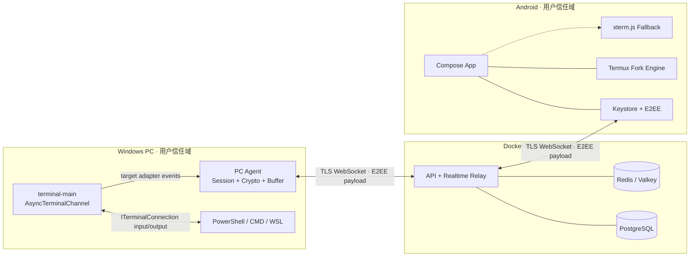

### 4.2 信任边界

| 边界 | 信任假设 | 强制措施 |
| --- | --- | --- |
| terminal-main ↔ Agent | 同一 Windows 用户，宿主与 Agent 进程隔离 | 当前用户 ACL 异步桥接、会话身份校验、长度限制 |
| Agent ↔ Relay | Relay 不可信终端正文 | TLS + E2EE + 序号 + AEAD |
| Relay ↔ Android | 网络和 Relay 均可被观察 | TLS + E2EE + OIDC 账号隔离 + 未撤销设备签名证明 |
| Android UI ↔ Terminal Engine | 终端输出可能恶意 | OSC/URL/剪贴板策略、资源限制、无任意脚本 |
| Docker Edge ↔ 内部服务 | 仅 Edge 暴露公网 | 私有网络、非 root、Secret、最小端口 |

### 4.3 核心实时流程

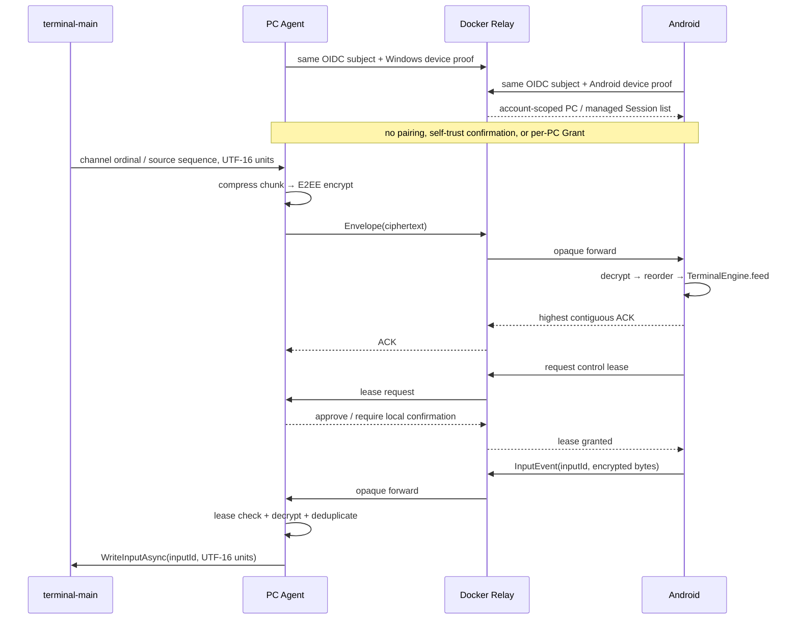

#### 4.3.1 会话标题目录、实时事件与显示合并

标题使用两条互补通路，不能互相替代：REST 会话目录中的 `title_cipher` 让后打开的 Android
在订阅 Realtime 前取得最近一次认证标题；已打开会话的标题变化则作为有序 E2EE
`sessionTitle` 元数据事件随实时序列到达。Relay 和数据库在两条通路中都不能得到标题明文。

当前 Windows runtime 从账号内未移除、具备有效 32-byte pairwise key 和 Key Epoch 的接收设备
构造一个多接收者 envelope；每个 Android 使用自己的 entry、密钥和随机 nonce。同一 envelope 可由
服务器原样分发给同账号多个 Android，但一台设备不能解开另一台设备的 entry。

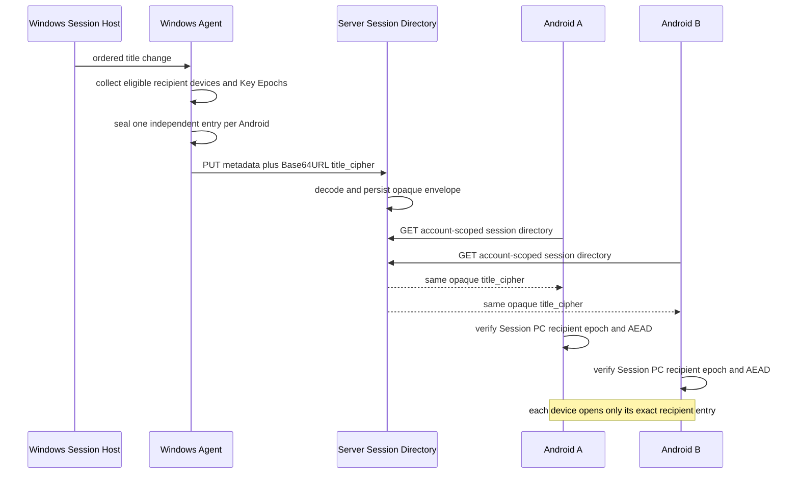

`TLTITLE1` version 1 是大端二进制结构。根部依次为 8-byte magic、`uint32` format version、
16-byte Session UUID、16-byte PC device UUID 和 `uint32` recipient count；每个 entry 依次为
16-byte recipient device UUID、`int64` Key Epoch、12-byte nonce、`uint32` ciphertext length 和
AEAD ciphertext（含 16-byte tag）。Key ID 固定为
`title-v1:<recipient UUID N>:<epoch 8 位十进制>`。AAD 除固定前缀和格式版本外，还绑定
Session ID、PC device ID、recipient count/index、recipient device ID、Key Epoch、Key ID、
nonce 与明文长度，防止跨会话、跨 PC、跨设备、跨 epoch 或 entry 重排使用。

双端约束为：标题严格 UTF-8 且最多 4,096 bytes，envelope 最多 1,048,576 bytes，recipient
最多 4,096 个，pairwise key 必须是 32 bytes，recipient 不得等于 PC device ID 或重复，所有
entry 的明文长度必须一致。服务器 REST JSON body 上限为 2 MiB，以容纳 1 MiB envelope 的
Base64URL 膨胀；服务器只做 Base64URL 解码和 opaque bytes 持久化，不解析或解密 envelope。

没有可用 recipient 时 Windows 发送空 `title_cipher`；recipient directory 暂时不可用时仍继续
metadata heartbeat，并省略标题更新。两种情况都保留服务器上一次成功密封的标题，不以空字符串
清除它。Android 必须同时传入并核对 expected Session ID、expected PC device ID、本机 recipient
device ID 和 expected Key Epoch；magic/version/尺寸、身份绑定、recipient 唯一性、epoch、entry
长度、截断/尾随字节、AEAD 或严格 UTF-8 任一检查失败时，只省略该标题并继续展示会话目录，
不得尝试其他 recipient entry，也不得显示密文或未认证字符串。

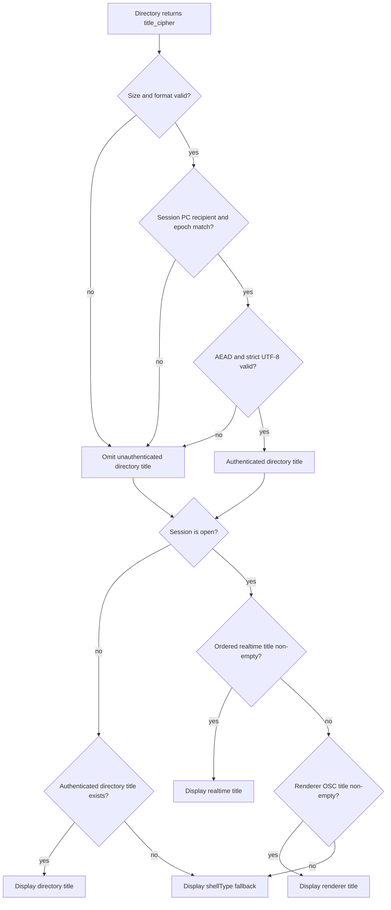

Android repository 将认证后的目录标题与当前会话投影合并到同一个 `sessionTitles` 展示映射：
未打开会话由认证目录标题填充；会话已打开时，优先级为有序 E2EE realtime `sessionTitle`，其次为
Termux renderer 从 OSC 解析出的 title（兼容旧 Agent），显式空 runtime title 会清除旧的展示标题。
UI 最终只取该映射中的非空 projected title，否则显示目录记录的 `shellType`。因此“目录标题”和
“实时标题”是来源概念，不是两个可以互相覆盖安全边界的 UI 字段。

### 4.4 断线恢复原则

终端快照是锚定已有序号 S 的 Windows 主机历史对象，不分配或消耗新的实时
`Envelope.seq`。Android 通过会话专用的 `host_history_v1` 请求取得逐设备密封对象，
服务端只转发帧，不建立历史索引或保存对象。完整恢复时序固定如下：

```mermaid
sequenceDiagram
    participant D as Android Durable State
    participant M as Android Bootstrap
    participant H as Windows Host History
    participant C as Crypto and Validator
    participant P as Detached Termux Engine
    participant L as Live Renderer
    participant R as Realtime Relay
    participant A as PC Agent

    M->>D: read durable cumulative ACK A
    M->>R: open authenticated session endpoint
    R->>A: route latest snapshot request after A
    A->>H: select local checkpoint at S
    H-->>A: recipient-bound sealed snapshot S
    A->>R: bounded host-history response
    R-->>M: sealed snapshot S
    M->>C: verify digest, identity, epoch, AAD and AEAD
    C->>C: decode and fully validate TerminalSnapshotV1 at S
    C-->>M: validated snapshot S
    M->>P: prepare snapshot in a detached renderer
    P-->>M: prepared candidate at S
    M->>D: durably cache the sealed snapshot
    M->>D: atomically bind checkpoint identity and ACK S
    D-->>M: bound renderer generation at S
    M->>L: install prepared candidate
    M->>R: SUBSCRIBE resume_from_seq S with Envelope ACK S
    R->>A: subscriber resumes after S
    A->>R: first ordered Envelope seq S+1
    R->>M: first ordered Envelope seq S+1
    M->>L: apply event S+1
    M->>D: commit cumulative ACK S+1 after apply

    Note over A,R: Relay forwards opaque bounded history responses and does not persist them
    Note over M,L: Before atomic bind, failure may fall back; after bind, restore or reset must complete before opening the socket
```

1. 目标输出序号由受控本地适配器按会话持久化生成；当前合同桥接要求源提供连续 Sequence/Gap，channel ordinal 仅作本地诊断，Android 只 ACK 已连续接收且成功应用的最高序号。
2. 无可用快照时使用从安全前缀开始的有界原始事件回放；不得把中间一段 raw VT 喂给空 parser。数据永久缺失时显示 `History gap`，且 Gap 本身不能推进 ACK。
3. 快照 S 完整认证、detached prepare、持久缓存，并原子绑定 renderer checkpoint 与 ACK S 后，Android 才能发布 `SUBSCRIBE(S)`；仅下载或解密快照不授权 ACK S。
4. 绑定后的进程重启必须先从同一密文缓存恢复完全相同的 renderer checkpoint。安装失败时必须原子重置 renderer/ACK；重置失败则禁止启动 Realtime Socket。
5. 首个新事件必须是 S+1。重复事件按既有去重规则处理；缺少 S+1 时显示 `History gap`，不得继续推进 ACK。
6. 输入 ACK 只表示 PC Agent 已接受该 `input_id`，不表示命令执行成功。多行粘贴只有明确确认 Agent 从未接受对应 `input_id` 时才能整体重试。

### 4.5 Tail-first 历史生产、逐设备隔离与上线门

Tail-first 不是“截取 raw VT 尾部”，而是从同一 durable `LocalFrame` 前缀生成两类
可验证对象。Windows 必须先把帧写入 producer WAL，再以固定序号 S 物化并提交所有
Transcript Page，最后才提交 Snapshot S。Snapshot 的可选择性是这一批对象的提交屏障，
不能在 Transcript 尚未完成时提前发布。

```mermaid
flowchart LR
    FRAME[Durable LocalFrame seq 1..S] --> WAL[Append and fsync producer WAL]
    WAL --> MODEL[Replay portable terminal model through S]
    MODEL --> MATERIALIZE[Materialize Snapshot S and Transcript Pages from the same prefix]
    MATERIALIZE --> OUTBOX[Persist ordered per-recipient outbox]
    OUTBOX --> TUPLOAD[Upload per-recipient Transcript Pages first]
    TUPLOAD --> TCOMMIT[Commit all transcript metadata and object digests]
    TCOMMIT --> SUPLOAD[Upload per-recipient Snapshot S last]
    SUPLOAD --> PUBLISH[Publish Snapshot S as eligible for selection]
```

- `LocalFrame` 的序号和 WAL 提交必须可跨 Agent 崩溃恢复；上传重试使用稳定对象标识和摘要，
  相同内容重复提交必须幂等。
- 最终工作树中的 WAL 是每帧一个 DPAPI 保护的 `.wal.dpapi` 文件，使用原子替换、
  `FileOptions.WriteThrough` 和 `Flush(true)`；自动裁剪/retention 不属于当前已验收能力，未来引入
  时不得早于所有目标 recipient 的 durable delivery 状态。
- Transcript-first 是提交顺序，不要求首开下载 Transcript。没有更早主屏行时，Transcript
  集合为空，提交屏障仍成立，随后才允许提交 Snapshot。
- Snapshot 和 Transcript 都针对每个同账号、未撤销 Android 接收设备分别密封；对象索引
  至少绑定 `account_id`、`session_id`、`recipient_device_id`、对象类型、S、页游标和 Key Epoch。
  同账号两台 Android 可以看到同一逻辑会话，但不得互取、互解或覆盖对方对象与缓存。
- Android 的规范首开时序就是 4.4 的 `select -> download -> verify -> detached prepare ->
  durable cache -> atomic bind -> install -> SUBSCRIBE(S) -> S+1`。首次只安装 Snapshot S
  的最后可见屏幕，不预取 Transcript 或 Event Chunk。
- 用户向上越界时，分页锚点固定为本次安装的 S，每次最多 200 行；页面只进入独立 history
  viewport。实时 parser 继续消费 S+1 以后事件并正常推进 live ACK，分页成功、失败或重试都
  不改变 ACK。

失败和回退必须遵循以下闭环：

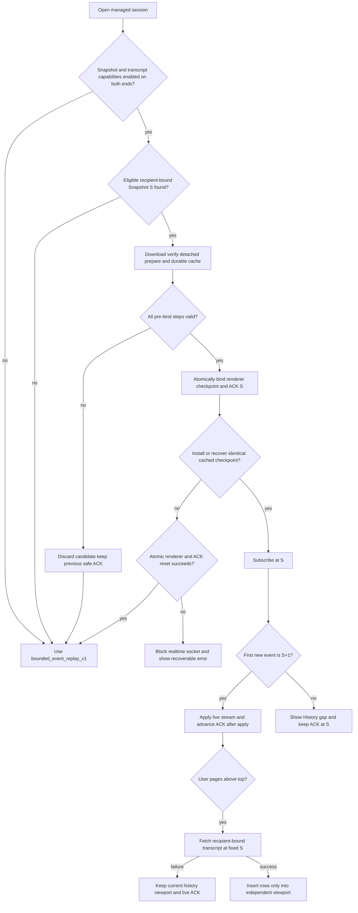

能力与发布门禁如下：

| 能力或门禁 | 旧/新路径 | 当前发布策略 | 开启条件 |
| --- | --- | --- | --- |
| `bounded_event_replay_v1` | 旧的安全连续事件回放 | 生产默认，作为失败回退 | 保持既有 ACK、Gap 和 E2EE 回归通过 |
| `terminal_snapshot_v1` | 新的 Snapshot S bootstrap 及 `TerminalTranscriptPageV1` REST 对象 | Android Release 强制关闭；Debug 仅可用 `-PtermlinkEnableTerminalSnapshotRuntime=true` 显式开启 | Windows durable producer/WAL、transcript-first/snapshot-last 屏障、逐设备密封、Android 原子绑定、崩溃恢复和 S/S+1 等价 E2E 全部通过后，Agent/Android 才可共同宣告 capability |
| Tail-first Debug 观察合同（非 wire capability） | Debug-only 产品 E2E 门禁 | receiver 与合同 asset 不得进入 Release | 真实 Windows -> 生产 Relay/History -> 冷启动 Android 七项验收全部有非敏感证据 |

上线必须 fail closed：任一必需能力未协商、任一端开关关闭、对象身份/摘要/Key Epoch 不匹配，
或真实产品 E2E 未通过时，都继续使用 `bounded_event_replay_v1`，不得宣告 tail-first 已上线。
所有用户可见状态、错误、空态和恢复操作必须同时提供简体中文与 English 资源；测试还需核对
两种语言下顶部状态、历史入口、分页失败、History gap、重试按钮和 IME 布局均不截断或重叠。

## 5. Windows Agent 设计

### 5.1 进程与组件

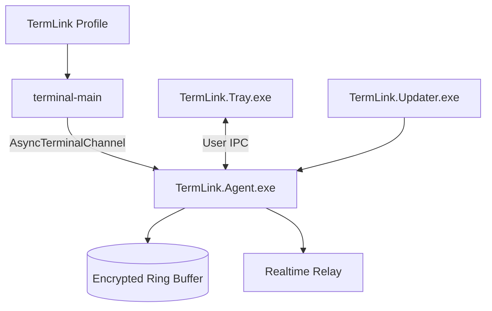

| 组件 | 运行身份 | 职责 |
| --- | --- | --- |
| `TermLink.Tray.exe` | 当前交互用户 | 登录、策略、会话列表、远端状态、紧急停止 |
| `TermLink.Agent.exe` | 当前用户后台进程 | 账号、密钥、Relay、会话目录、缓冲、授权和 IPC |
| `terminal-main` 异步通道 | 每个受管终端会话一个（目标） | 当前实现暴露输出/状态/输入结果/resize 结果回调；lifecycle 生产记录仍需集成适配器映射，不把 ConPTY 句柄交给 TermLink |
| `TermLink.Updater.exe` | 受控提升 | 验证签名、原子更新和失败回滚 |

MVP 不让高权限 Windows Service 直接托管用户 Shell。若后续需要无人登录持续在线，可增加 Broker Service，但它只能负责用户会话发现与启动，Shell 仍以目标用户身份运行。

### 5.2 terminal-main Profile 与异步通道

Windows Terminal Profile 启动命令示例：

```text
（未来示意）terminal-main.exe --termlink-profile powershell-7 --session-id <uuid>
```

terminal-main 负责本地 Shell 连接和渲染，未来集成层只订阅其连接抽象并通过异步通道交换事件；当前尚无该进程注册/IPC 实现：

```text
terminal-main TerminalConnection
    ↕ local keyboard / TerminalOutput(Char[])
AsyncTerminalChannel
    ↕ target adapter input / output / resize / lifecycle records
TermLink.Agent
    ↕ E2EE Envelope
Server Relay / Android
```

这一结构是目标设计，尚未保证本地 terminal-main 与 Android 使用同一条生产事件源。必须用 AsyncTerminalChannel 隔离测试和后续 IPC/Registry 集成测试检查标题来源、颜色、输入模式、resize、取消和关闭竞态；不通过截图、缓冲区回读或 ConPTY 句柄验证终端信息。

### 5.3 Session Host 生命周期

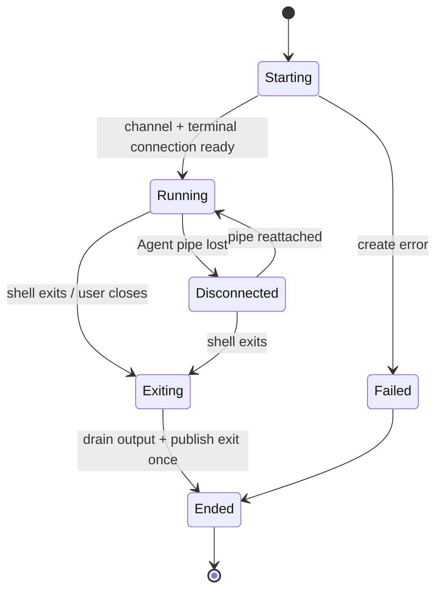

关闭顺序固定为：停止远端输入 → 取消异步通道新写入 → 撤销输出/状态回调 → 等待已提交回调排空 → 关闭 terminal-main 连接 → 发布唯一的 Ended 事件。Shell 的具体关闭由 terminal-main 按其 `closeOnExit` 和连接后端策略负责。

### 5.4 本地 IPC

每个会话使用独立的、当前用户授权的异步桥接通道：

- Pipe ACL 只允许当前用户 SID 和 Agent 进程；
- Agent 与 terminal-main 桥接端相互校验进程身份、用户 SID、Session ID 和一次性握手 Token；
- 帧格式为长度前缀 + 类型 + Session ID + 序号 + Payload；
- 单帧默认上限 1 MiB，输出按 16～64 KiB 批量；
- terminal-main 断开 Agent 时继续服务本地终端并进入有界缓冲；
- 不把 Relay Socket、Token 或加密私钥传入 terminal-main 连接通道。

### 5.5 Agent 内部模块

| 模块 | 职责 |
| --- | --- |
| Session Registry | 会话元数据、状态机、terminal-main 异步桥接和 Shell 类型 |
| Stream Sequencer | 分配输出 seq、批处理、压缩和 ACK 窗口 |
| Local Buffer | DPAPI 包装数据密钥，加密事件块与环形淘汰 |
| Realtime Client | WebSocket、心跳、重连、背压和能力协商 |
| Device Crypto | 设备密钥、会话密钥、轮换和撤销 |
| Access Controller | PC 策略、设备授权、输入租约和本地优先 |
| Profile Manager | Windows Terminal Stable/Preview Profile 注册和 Scheme 解析 |
| Diagnostics | 无正文结构化日志、指标、导出诊断包 |

### 5.6 本地数据目录

```text
%LOCALAPPDATA%\TermLink\
├── config.json                 # 非敏感配置
├── device.dat                 # DPAPI 保护的设备材料
├── sessions.db                # 会话索引，不含明文正文
├── chunks\<session-id>\       # 加密事件块
├── updates\                   # 已验证的待安装更新
└── logs\                      # 脱敏滚动日志
```

### 5.7 托盘 UI

托盘弹层采用 Windows 11 Fluent 视觉，与 Android 的信息架构保持一致：

- 顶部：PC 名称、Relay 状态、当前策略；
- 活动区：运行会话数、查看者、控制者和最近安全事件；
- 会话行：Shell 图标、标题、时长、同步状态、查看/终止菜单；
- 高优先级操作：`停止所有远程访问`；
- 次级操作：新建 PowerShell/CMD/WSL、打开完整设置、退出账号；
- 有远端控制时托盘图标和弹层持续显示，不用短暂 Toast 代替状态。

### 5.8 安装、签名与更新

- 安装格式优先 MSIX；若系统服务与复杂升级需要，再提供签名 MSI；
- 二进制使用企业代码签名证书，更新 Manifest 另行签名；
- 更新先下载到隔离目录，校验签名和 SHA-256，再等待无活跃升级冲突时原子替换；
- 更新失败自动回滚；协议至少兼容前一正式版本；
- Profile 修改前备份相关 JSON 片段，只修改 TermLink 自有 Profile 和 Scheme。

## 6. Docker 服务端设计

> **⚠️ 本节已重写（2026-09-21）**：反映当前单 Server 容器拓扑。原始多容器（Redis/Valkey+Caddy）设计已废弃。

### 6.1 服务边界

当前生产将 REST API、WebSocket Relay、内嵌 OIDC 身份服务、租约协调、直连信令、文件传输路由和后台任务编译为**一个 Go 二进制**（distroless 容器）。

| 逻辑组件 | 职责 | 接触终端正文 |
| --- | --- | --- |
| API | 账号归属、设备/PC/会话索引、撤销和审计 | 否 |
| Realtime Relay | WebSocket 认证、路由、ACK、背压和心跳 | 只见 Envelope（E2EE） |
| Lease Coordinator | 输入租约申请、续约、释放和抢占 | 否 |
| Embedded OIDC | 内嵌身份发行方（登录/注册/令牌签发/MFA） | 密码哈希（argon2id） |
| Direct Signaling | 直连传输票据签发、STUN 配置、信令路由 | 只见信令帧 |
| File Transfer Router | 分块传输绑定短时路由 | 只见密文帧 |
| Worker | 撤销传播、过期任务、审计保留、注册找回 | 否 |

### 6.2 当前 Docker Compose 拓扑

```text
Internet → 反向代理（Nginx/Caddy/Lucky，TLS 终结）→ termlink-server:8080 → PostgreSQL（内部网络）
```

- 单 Server 容器（distroless、只读 RootFS、非 root UID 65532、cap_drop ALL）
- PostgreSQL 仅在 Docker 内部网络可见，数据使用持久卷
- 可选 Valkey 用于多副本部署（单节点使用内存协调器）
- 直连传输票据由 Server Ed25519 签发，支持续期（`/v1/transport/tickets/renew`）
- 运行时参数（STUN/AppShip/注册找回/账号注销）由管理页 SUPER_ADMIN 覆盖（`runtime_settings` 表）
- 主密钥可选口令包裹（`TERMLINK_MASTER_KEY_PASSPHRASE`）

### 6.3 镜像设计

- Multi-stage Build，distroless 运行时，`linux/amd64`
- 固定非 root UID/GID 65532，根文件系统只读，`/tmp` tmpfs
- 不在镜像层写入默认密码、OIDC Secret 或数据库密码
- 提供 OCI Label 和可复现构建（`SOURCE_DATE_EPOCH`）
- `SIGTERM` 后停止接收新连接，排空 WebSocket 后退出
- 健康检查 `/readyz`

### 6.4 环境变量

部署参数分为两类：

**bootstrap 级（compose 管理，不可运行时修改）**：`TERMLINK_IMAGE`、`TERMLINK_PUBLIC_URL`、`TERMLINK_DATABASE_URL`、`TERMLINK_INITIAL_ADMIN_PASSWORD_FILE`、`TERMLINK_HTTP_BIND_IP/PORT`、容器日志、`TERMLINK_ALLOW_LOCAL_HTTP`、`TERMLINK_DIRECT_TRANSPORT_ENABLED`

**运行时参数（管理页可覆盖，env 为初始默认）**：`TERMLINK_REGISTRATION_RECOVERY_ENABLED`、`TERMLINK_ACCOUNT_DELETION_ENABLED`、`TERMLINK_DIRECT_STUN_SERVERS`、`TERMLINK_APPSHIP_BASE_URL`、`TERMLINK_APPSHIP_ALLOWED_PRIVATE_IPS`

其他：`TERMLINK_MASTER_KEY_PASSPHRASE`（可选主密钥包裹）、`TERMLINK_TOKEN_SIGNING_KEY_FILE`（可选外部主密钥）

### 6.5 管理

SUPER_ADMIN 管理页（`/admin` 或自定义路由）提供：

- 设备与连接路由（直连开/关）
- 运行时参数（上述 5 项，即时生效跨重启保持）
- 系统版本（当前运行版本 + AppShip 可用更新）
- 身份与安全（MFA 状态、人机验证设置）
- 账号与角色（角色管理、停用/启用）
- 注册与邀请码


## 7. Android 客户端设计

### 7.1 技术栈

| 层 | 选择 |
| --- | --- |
| 语言与 UI | Kotlin、Jetpack Compose、Material 3 基础能力 |
| 架构 | 单向数据流 + ViewModel + Coroutines/Flow |
| 网络 | OkHttp WebSocket 或 Ktor Client，Protobuf 二进制帧 |
| 本地数据 | Room；敏感数据库使用 Keystore 包装的数据密钥加密 |
| 密码学 | 经审计的 Tink/libsodium 封装，不自研算法 |
| 终端默认引擎 | Termux `terminal-emulator` + `terminal-view` Fork |
| 终端回退 | 完全离线 xterm.js WebView |
| 后台 | WorkManager；活跃监控按需使用 Foreground Service |

### 7.2 Gradle 模块

```text
android/
├── app
├── core-model
├── core-network
├── core-crypto
├── core-database
├── core-designsystem
├── terminal-engine-api
├── terminal-engine-termux
├── terminal-engine-xterm
├── feature-auth
├── feature-devices
├── feature-sessions
├── feature-terminal
├── feature-history
├── feature-activity
├── feature-billing
└── feature-settings
```

Feature 模块只能依赖 `terminal-engine-api`，不能直接访问 Termux 或 WebView 类型。明文终端字节只在内存中的 Realtime/Crypto/Terminal 边界短暂存在。

### 7.3 会话数据通路

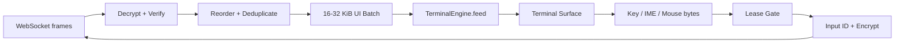

线程约束：

- 网络、解密和排序不在主线程；
- 每个终端引擎只有一个串行解析 Dispatcher，保持 VT 状态确定性；
- View 刷新合并到一帧一次，避免每个字节触发重绘；
- 切后台时停止无意义绘制，但继续接收有界缓冲或主动降级订阅；
- 超过内存水位后暂停/取消正文订阅并从安全 ACK 使用有界回放；只有双方协商并实际启用 `terminal_snapshot_v1` 后才允许改用快照恢复。

### 7.4 Termux Fork 集成

只 Fork `terminal-emulator` 与 `terminal-view`。将 `TerminalView` 对本地 `TerminalSession` 的直接依赖替换为：

```kotlin
interface TerminalSessionPort {
    val emulator: TerminalEmulator
    fun write(bytes: ByteArray)
    fun writeCodePoint(altDown: Boolean, codePoint: Int)
    fun resize(columns: Int, rows: Int, cellWidthPx: Int, cellHeightPx: Int)
}
```

`RemoteTerminalSession` 实现该接口：

- Relay 输出调用 `TerminalEmulator.append`；
- 键盘、鼠标、Paste 和终端查询响应通过 `write` 送入输入加密管线；
- View 尺寸变化先计算稳定 Columns/Rows，经去抖后同时调用本地 `resize` 和远端 terminal-main 异步通道 `ResizeAsync`；
- Compose 使用 `AndroidView` 承载 TerminalView，页面其余区域保持 Compose；
- 上游 Fork 以独立补丁集维护，每次同步 Termux 后运行全部 Golden Stream。

必须补齐：Windows 选择色、OSC 8、DECSET 1004、DECSET 1003、搜索、版本化快照、复杂 Emoji/Grapheme、TalkBack 和增量绘制性能。

### 7.5 xterm.js 回退引擎

- JS/CSS/字体全部打包进 APK，不加载 CDN；
- 使用固定本地域名和受限 Web Message Channel；
- 禁止文件访问、混合内容、任意导航和外部网络；
- Kotlin 层负责登录、网络、密钥、Clipboard、URL 和下载策略；
- Release 关闭 WebView 调试；
- 引擎切换只能从完整连续事件前缀重建；双方启用 `terminal_snapshot_v1` 后可改为认证快照 + S+1 增量事件，不能复制另一个引擎的私有状态。

### 7.6 本地缓存

Android 保存：

- 设备/会话非敏感摘要；
- 最后连续 ACK、renderer generation，以及实验性 Snapshot 密文缓存与 renderer checkpoint 的原子绑定；
- 用户允许的加密历史块；
- UI 偏好和主题；
- 设备密钥的 Keystore 引用。

默认不保存输入正文。Android 当前加密保存经过清理的 OIDC AuthState，用于进程重启后恢复登录；Windows 保存受保护的生产凭据并轮换 Refresh Token。普通退出清除当前 Token、实时连接与本地账号缓存，但不等同于删除服务端设备记录或撤销/解绑设备；重新登录同一账号可继续使用账号作用域的设备身份。设备被显式撤销时立即锁定 UI、关闭连接并清理不可继续使用的会话材料。各端独立“解绑此设备”入口及退出/撤销跨端一致性仍需发布构建验收。

### 7.7 Android 生命周期

| 状态 | 行为 |
| --- | --- |
| 前台 Terminal | 全速实时订阅，按帧刷新，可保持屏幕常亮 |
| 前台列表 | 降低输出订阅，仅接收摘要/通知；用户选择的监控会话除外 |
| 后台短时 | 有界接收并 ACK，停止绘制 |
| 后台长期 | 默认取消正文订阅，保留 Presence；可选前台监控服务 |
| Doze/网络切换 | 恢复后从安全 ACK 重建；能力协商开启后可使用已认证并绑定的 Snapshot |
| 被撤销/Token 失效 | 关闭 WS、清内存、进入重新认证页 |

### 7.8 输入与移动端键盘

- Terminal View 保留渲染与硬件键盘焦点；Android 16 软键盘通过标准命令输入框提交文本，
  IME 修复已实现，但最新真实 LAN 命令 marker 尚未确认执行成功；
- Extra Keys 默认提供 `Esc`、`Tab`、`Ctrl`、`Alt`、方向键和可配置按键；
- Ctrl/Alt 使用一次性锁定和长按锁定两种状态，并有明确视觉反馈；
- 多行粘贴显示行数、字符数和前几行预览，确认后形成一个 `input_id`；
- Terminal 开启 bracketed paste 时由模拟器生成包围序列；
- 触控拖动默认滚动历史，程序启用 Mouse Tracking 后按用户设置切换为鼠标事件；
- 本地选择模式始终优先于鼠标上报，避免无法复制文本。

## 8. 实时协议设计

### 8.1 Envelope

概念结构：

```protobuf
message Envelope {
  uint32 protocol_version = 1;
  MessageType message_type = 2;
  bytes session_id = 3;
  bytes sender_device_id = 4;
  Direction direction = 5;
  uint64 seq = 6;
  uint64 ack = 7;
  int64 sent_at_ms = 8;
  bytes key_id = 9;
  bytes nonce = 10;
  bytes ciphertext = 11;
}
```

`session_id`、路由角色、版本、方向、序号和 Key ID 作为 AEAD Associated Data 的一部分，防止跨会话或跨方向替换。

### 8.2 消息类型

| 类别 | 消息 |
| --- | --- |
| 连接 | `hello`, `welcome`, `capabilities`, `heartbeat`, `goodbye` |
| 会话 | `session_upsert`, `session_removed`, `subscribe`, `unsubscribe` |
| 输出 | `output_chunk`, `output_ack`, `flow_control`, `gap` |
| 输入 | `input_event`, `input_accepted`, `input_rejected` |
| 尺寸 | `resize_request`, `resize_applied` |
| 恢复 | `snapshot_offer`, `snapshot_chunk`, `resume_request` |
| 控制 | `lease_request`, `lease_granted`, `lease_denied`, `lease_revoked` |
| 主题 | `theme_changed` |
| 生命周期 | `session_started`, `session_interrupted`, `session_ended` |

`SNAPSHOT_OFFER` 与 `SNAPSHOT_CHUNK` 的枚举值和方向 ACL 仅为 wire 兼容保留。
当前 Snapshot/Event Range/Transcript 使用会话专用 `host_history_v1` 请求响应，
经 Relay 透明转发，不经 REST 元数据或对象 URL。

### 8.3 顺序、ACK 与背压

- PC 输出与 Android 输入使用独立方向序号；
- 输出序号覆盖 Output、Resize、Title 和 Lifecycle，使回放顺序唯一；
- ACK 为累计 ACK，可附带小型缺口范围用于快速重传；
- Agent 保留最近 ACK 窗口和磁盘 Chunk；Relay 只保留短时内存缓冲；
- Snapshot/Transcript 对象只锚定已有序号，不占用 `Envelope.seq`，也不能插入 Realtime 有序流；
- Android 解析队列超过软上限时发送 `flow_control`；Agent 降低批次频率但不能改变字节顺序；
- 达到硬上限时 Android 断开当前正文流并从安全 ACK 恢复；只有已协商并启用 `terminal_snapshot_v1` 时才能从认证快照 S 恢复，不能随意丢弃中间 VT 字节。

### 8.4 快照格式

跨设备快照不能使用 xterm.js/Termux 私有序列化。Phase 1
`TerminalSnapshotV1` 是规范化的 parser/renderer checkpoint，至少包含：

```text
snapshot_seq, columns, rows
cursor(row, col, visible, style)
modes(alt_screen, origin, wrap, mouse, bracketed_paste)
scroll_region
palette + default colors
visible cells(codepoints, width, style, fg, bg)
primary and alternate visible rows
title
format_version
```

Snapshot 与 Columns/Rows 绑定，并同时保存主/备用屏幕、光标与 saved cursor、
模式、边距、charset、tab stop、palette/style、pending-wrap、title 和 lifecycle
projection。Phase 1 的 `scrollback_rows` 必须为空，不允许截取 raw VT 尾部伪造最后一屏；
更早的主屏行只来自独立 `TerminalTranscriptPageV1` REST 对象。

Snapshot S 应用后只能继续消费 S+1 及之后的实时事件。Transcript Page 以固定
`as_of_snapshot_seq=S` 和排他的 `before_line_id` 向前分页，每页最多 200 行；它是只读
行投影，不是 parser state，不能 prepend 到 live parser，也不能改变实时 ACK。

字段分配、严格验证和 C#/Kotlin 共享 golden vector 已存在，但 runtime 仍未启用：

- Android Release 的 `TERMLINK_TERMINAL_SNAPSHOT_RUNTIME` 强制为 `false`；Debug 默认也是 `false`，只允许用显式 Gradle 属性进行实验；
- Windows 最终工作树已包含 DPAPI write-through per-frame WAL、portable producer、持久 outbox、逐接收设备 seal 和 Transcript-first/Snapshot-last uploader 接线；Android 已包含产品 bootstrap 与独立 Transcript viewport，但这些并行改动仍待主代理最终构建和 E2E 验证；
- saved auto-wrap、saved DEC private-mode bank、DECSACE、title stack 的无损表示或 producer 明确拒绝，以及完整 Windows producer/Android importer 等价语料，仍是 capability enablement blockers；
- 任一端在这些门槛满足前都不得宣告 `terminal_snapshot_v1`、上传这些对象，或用快照推进生产 ACK。生产恢复继续使用 `bounded_event_replay_v1`。

### 8.5 主题协议

```text
TerminalThemeV1 {
  name
  foreground
  background
  cursor
  selection_background
  selection_foreground_optional
  ansi_colors[16]
  bold_as_bright
  font_family_hint
}
```

PC Agent 只提取 Windows Terminal Scheme 与安全的显示字段，不上传整个 `settings.json`，不允许主题引用脚本、URL、字体文件或本地路径。

### 8.6 版本兼容

- `protocol_version` 控制信封破坏性变更；
- `capabilities` 独立声明 `terminal_snapshot_v1`、`osc8`、`mouse_1003`、`win32_input_mode` 等能力；
- 未知可选消息可忽略，未知必需能力必须拒绝并给出升级提示；
- Server 与 Agent/Android 至少兼容前一正式版本；
- 每个发布版本保留固定 Golden Capture 与跨版本连接测试。

## 9. 安全与密码学设计

### 9.1 账号归属、设备证明与撤销

1. Windows Agent 与 Android 分别登录 OIDC；服务端以规范化 issuer + subject 映射同一 TermLink 账号。
2. 设备首次登录后生成独立设备密钥对、登记公钥，并在当前首版策略下自动成为该账号内可用设备。
3. 同账号、未撤销设备可直接发现 PC 与受管 Session，并建立逐设备 E2EE 接收关系；不需要短码/二维码、用户自授信或逐 PC Grant。
4. 每次 REST/Realtime 连接同时证明 OIDC 账号身份和设备私钥持有权。服务端在列表、路由、历史和密钥接收方选择上都强制 `user_id`/subject 账号隔离。
5. 远程输入另行申请短时 Session Lease；PC 本地策略、本地键盘抢占和设备撤销均可拒绝或终止输入。
6. 显式撤销设备后关闭现有连接、拒绝后续设备证明，并停止向其分发新 Key Epoch 的材料。

旧 `PENDING/TRUSTED` 状态、pairing challenge、二维码/短码和 `device_grants` 表/API 仍可用于兼容旧客户端或旧部署，但不得出现在当前产品主流程。兼容路径使用的短时挑战仍应单次使用、默认 5 分钟过期并写安全审计。

### 9.2 会话密钥

- 每台 PC 与每个同账号、未撤销 Android 使用 X25519 建立独立共享材料；
- 通过 HKDF 派生账号/设备通道密钥，再为每个 Session、方向和 Key Epoch 派生子密钥；
- 输出和输入方向使用不同密钥；
- Nonce 必须在同一 Key 下唯一，可由随机前缀 + 单调序号构成；
- 设备撤销、成员变化、达到消息/时间阈值时轮换 Key Epoch；
- 服务端只保存公开 Key ID 和路由元数据。

正式实现前需对密钥分发、多人设备扇出和历史密钥恢复进行独立密码学审查。设计阶段不把伪代码视为可直接生产的加密实现。

### 9.3 威胁与对策

| 威胁 | 对策 |
| --- | --- |
| 账号 Token 泄露 | 设备私钥二次证明、短 Access Token、异常登录告警和设备显式撤销；账号级自动接入带来的风险须单独审计 |
| Relay/数据库泄露 | E2EE、密文 Blob、元数据最小化 |
| 重放远程命令 | Direction Seq、AEAD、唯一 `input_id`、Agent 去重 |
| 旧设备继续访问 | 撤销广播、断连接、Key Epoch 轮换 |
| 恶意终端输出 | OSC 长度限制、URL/Clipboard 回调、内存/CPU 上限 |
| Android 截屏/后台泄露 | 敏感页可选 `FLAG_SECURE`、最近任务模糊、通知隐藏正文 |
| Windows 高权限扩大攻击面 | 用户权限运行 Shell、进程/句柄隔离、签名升级 |
| Docker Secret 泄露 | Secret 文件、非 root、只读文件系统、日志禁敏感字段 |
| 依赖供应链 | 锁版本/校验值、SBOM、镜像与二进制签名、漏洞扫描 |

### 9.4 高风险交互

- “危险命令检测”只能提示，不应声称可靠阻止；
- 多行粘贴、粘贴包含控制字符和远端请求 Clipboard 时必须经过策略；
- OSC 52 默认询问或禁用，且设置最大解码长度；
- OSC 8 链接显示完整域名，外部打开前确认，不允许 `file:`、`intent:` 等危险 Scheme。

## 10. 会话记录、历史与回放

### 10.1 有序事件与主机历史对象

| 类型 | 内容 | 默认持久化 |
| --- | --- | --- |
| `output` | terminal-main 异步通道输出（UTF-16 code unit，按版本编码后传输） | PC 本地是 |
| `input` | 本地或远端输入 | 否 |
| `resize` | Columns/Rows 和像素单元信息 | 是 |
| `terminal_snapshot_v1` | 锚定已有序号 S 的 terminal-core checkpoint；由在线 Windows 主机提供，不消耗 live `Envelope.seq` | PC 本地是 |
| `terminal_transcript_page_v1` | 固定 S 的只读主屏历史行分页；由在线 Windows 主机按需提供，不进入 parser | PC 本地是 |
| `title` | 标题变化 | 可配置，敏感 |
| `lifecycle` | 创建、中断、恢复、退出码 | 是 |
| `control` | 租约变化 | 仅元数据 |

### 10.2 Chunk

- 按 1～4 MiB 或 5～15 秒切块，以先到条件为准；
- 块内先编码与压缩，再整体 AEAD 加密；
- Header 包含 Session、Start/End Seq、时间范围、Compression、Key ID、Hash 和格式版本；
- Windows 使用会话 ID 和序号范围建立幂等本地记录并校验 Hash；
- 运行中会话历史保存在 PC 本地；显式关闭会话后销毁；
- 输入正文不进入 Event Chunk，除非用户明确开启并接受风险。

### 10.3 最后一屏与上滑分页

打开实时会话时只恢复 Snapshot S 中的主/备用可见屏幕；Phase 1 Snapshot 的
`scrollback_rows` 必须为空，首屏不主动下载任何 Transcript Page。用户上滑后才以安装
Snapshot 的固定 S 请求更早行，不能随着实时 ACK 增长而改变该分页锚点：

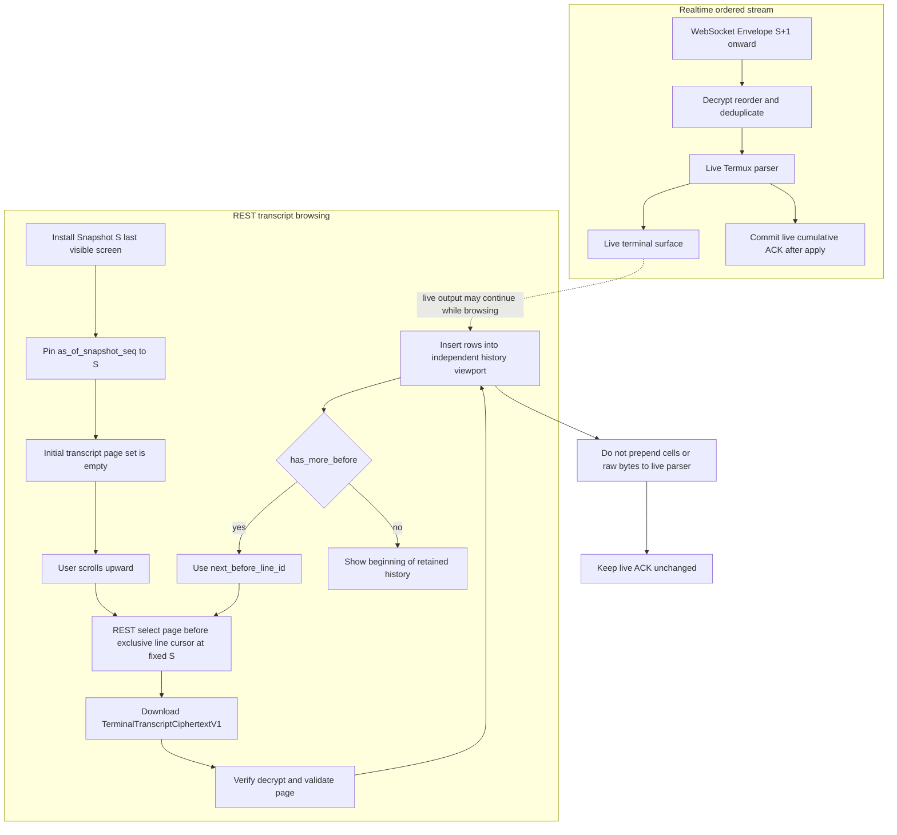

- `TerminalTranscriptPageV1` 只包含主屏 sealed rows，Phase 1 不把备用屏幕行当作 transcript；
- 每页行按 `line_id` 从旧到新排序，`before_line_id` 为排他游标，`sealed_at_seq <= S`；
- 独立 history viewport 可以缓存、搜索和丢弃页面，但不得重建 raw VT 后喂给 live parser；
- 浏览期间 Realtime 可以继续应用 S+1、S+2 等事件并正常推进 ACK，历史 viewport 的固定 S 与实时 ACK 互不影响；
- 已退出会话的时间轴回放同样只读；搜索只在 Android 解密后的本地数据执行，Relay 不建立明文索引。

## 11. UI/UX 总体设计

### 11.1 设计语言：Quiet Focus

TermLink 的“安静专注”设计语言定义为：

- **内容优先**：Terminal 是主角，导航和状态占用最少空间；
- **上下文操作**：只在用户选中 PC、Session 或输出时出现相关动作；
- **可解释状态**：在线、同步、E2EE、租约和恢复进度均有明确文字，不依赖颜色猜测；
- **渐进披露**：默认只显示当前任务所需信息，高级网络、密钥和引擎诊断按需展开；
- **命令式入口**：提供统一搜索/命令面板，支持快速切 PC、Session 和动作；
- **克制的视觉表现**：使用柔和层级、细边界、即时反馈和有限的光谱强调，不大面积使用霓虹渐变或玻璃拟态；
- **人始终掌控**：远程输入、租约、终止和撤销等操作必须由用户明确发起或确认。

### 11.2 信息架构

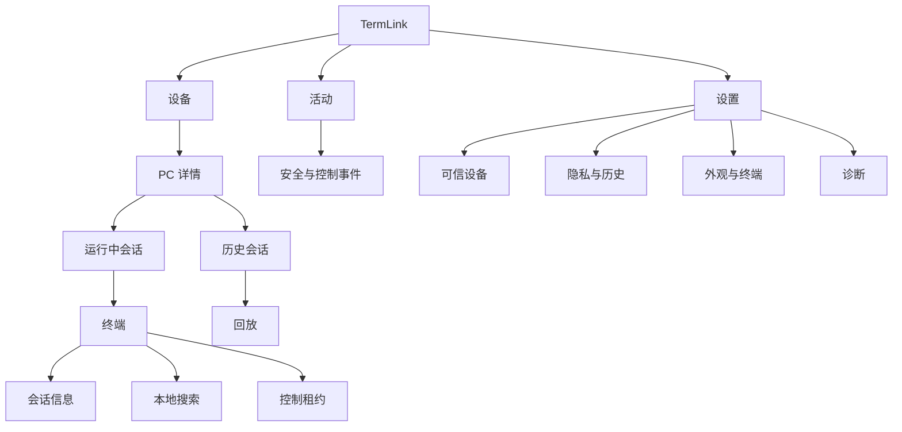

手机底部导航保持三个入口：`设备`、`活动`、`设置`。Terminal 页属于沉浸式子页面，不显示 Bottom Navigation。

### 11.3 视觉 Token

颜色使用语义 Token，适配深色、浅色和系统动态色。Terminal Scheme 与 App Chrome 分离，避免 App 主题污染 ANSI 颜色。

| Token | 深色基准 | 用途 |
| --- | --- | --- |
| `canvas` | `#090B10` | App 背景 |
| `surface` | `#11151C` | 导航、列表与浮层 |
| `surface-raised` | `#171C26` | 对话框、命令面板 |
| `text-primary` | `#F1F4F8` | 主文字 |
| `text-secondary` | `#9CA7B8` | 元数据 |
| `accent-primary` | `#7C8CFF` | 选中、主操作、控制状态 |
| `accent-secondary` | `#4FD1C5` | E2EE、同步完成 |
| `success` | `#49C987` | 在线/完成 |
| `warning` | `#F2B84B` | 重连/待确认 |
| `danger` | `#F46D75` | 撤销/终止/错误 |

要求：

- 正文对比度达到 WCAG AA；状态不能只使用颜色；
- 圆角以 12/16 dp 为主，Terminal Surface 可使用 8～12 dp；
- 间距遵循 4 dp 基础网格，主要页面边距 16 dp；
- 不给每一行套 Card；分组主要依靠留白、标题和细分隔线；
- 光谱渐变只用于 Onboarding 品牌瞬间或命令面板选中光晕，面积不超过页面约 10%。

### 11.4 字体与图标

- App UI：Roboto Flex/系统 Sans，支持中文系统字体回退；
- Terminal：JetBrains Mono、Cascadia Mono 或用户选择的等宽字体；
- 数字状态使用 Tabular Numerals；
- 层级建议：页面标题 24sp、区块 16sp、正文 14～16sp、辅助信息不低于 12sp；
- 图标使用 Material Symbols Rounded 或统一线性图标，避免混用多套风格；
- 图标按钮必须有无障碍标签，关键动作同时显示文字。

### 11.5 动效与反馈

- 页面切换 180～240 ms，使用淡入 + 轻微位移；
- 状态变化使用局部更新，不让整个页面闪烁；
- Reconnecting 使用低频呼吸点和文字，不使用无限旋转大 Loading；
- 新终端输出不做逐行动画，保证性能和阅读稳定；
- 控制租约获得/失去提供视觉、触觉和可选声音反馈；
- 遵守系统“移除动画”和省电设置。

### 11.6 屏幕清单

| 屏幕 | 核心内容 | 主操作 |
| --- | --- | --- |
| 启动/登录 | 品牌、价值、OIDC 登录、自托管地址 | 登录 |
| 设备首页 | PC 分组、在线状态、运行会话、最近活动 | 打开 PC/新建会话 |
| PC 详情 | Presence、策略、运行中/历史会话 | 进入会话 |
| Terminal | 状态、终端画布、Extra Keys、租约 | 观察/申请控制 |
| 会话信息 | Shell、尺寸、延迟、创建时间、引擎 | 重命名/归档/终止 |
| 历史回放 | Terminal、时间轴、速度、搜索 | 跳转/导出允许内容 |
| 活动 | 登录、设备注册/撤销、租约、会话生命周期 | 查看详情 |
| 设备安全（待完善） | 同账号手机/PC、最后活动、撤销状态 | 显式撤销；不做配对/Grant |
| 设置 | 外观、终端、历史、安全、通知、诊断 | 保存 |
| 会员与功能 | 当前方案、PC/Session 用量（不限）、月付升级、恢复购买 | 订阅/管理会员 |

### 11.7 设备首页线框

```text
┌──────────────────────────────────────┐
│ TermLink                  搜索   头像 │
│ Free · PC 不限 · 实时会话不限         │
│                                      │
│ 我的设备                              │
│ ● OFFICE-PC                 在线  28ms│
│   PowerShell · build-release   LIVE  │
│   WSL · api-server            12m    │
│                                      │
│ ＋ 添加更多 PC                       │
│   在 Windows Agent 登录同一账号       │
│                                      │
│ 设备              活动              设置│
└──────────────────────────────────────┘
```

列表直接展示最需要决策的信息：在线、延迟和活动 Session。避免顶部 KPI 卡片占据空间，也不显示配对或 Grant 状态。

### 11.8 Terminal 页面线框

```text
┌──────────────────────────────────────┐
│ ‹ OFFICE-PC / build-release      ⋮   │
│ ● Live · E2EE · 82×28       只读     │
├──────────────────────────────────────┤
│ PS C:\src\app> dotnet test           │
│ Restore complete (1.2s)              │
│ Tests: 248 passed, 0 failed          │
│                                      │
│ PS C:\src\app> █                     │
│                                      │
│                                      │
│                            ↓ 最新输出│
├──────────────────────────────────────┤
│ ESC  TAB  CTRL  ALT   ←  ↑  ↓  →    │
├──────────────────────────────────────┤
│          [ 申请控制 ]                │
└──────────────────────────────────────┘
```

获得租约后，底部改为输入状态和释放控制；键盘弹出时 Terminal 自动 resize，并对 PC 端 resize 做 100～200 ms 去抖。

### 11.9 Terminal 顶栏与状态

顶栏第一行显示 PC/Session 标识，第二行是可扫读状态：

- `Live`：绿点 + 文本；
- `Reconnecting · 12s`：黄点 + 离线时长；
- `Read only`：中性锁图标；
- `Controlling · 24s`：强调色 + 租约剩余时间；
- `Controlled by Pixel 10`：显示持有设备；
- `Exited · code 0`：退出状态；
- `History gap`：警告图标，可点击解释缺失范围。

延迟和尺寸属于次级诊断，可在横屏或会话信息中显示；小屏不把所有状态堆成 Badge。

### 11.10 控制请求流程

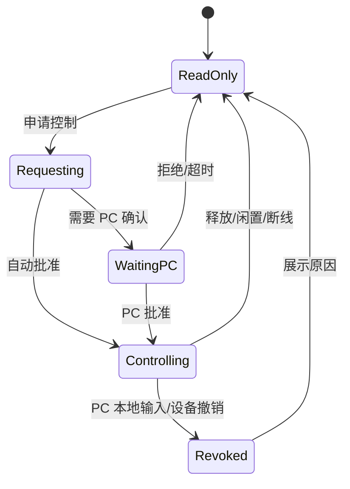

控制按钮必须描述结果，例如“申请 30 秒控制权”，不能只用无上下文的闪电图标。

### 11.11 历史回放 UI

- 顶部明确标记 `Replay`，避免用户误以为仍在 Live Session；
- 底部时间轴显示会话开始、断线、恢复、退出和 Snapshot 点；
- 默认 1×，支持 0.5×、2×、4×；启用 `terminal_snapshot_v1` 后拖动可从目标时间前最近 Snapshot 恢复，否则从可用的连续 Event Chunk 前缀回放；
- 搜索结果显示本地匹配数和上/下一处；
- 终端正文不会发送到服务端搜索；
- 已退出会话不显示输入栏，只有“复制、搜索、跳转时间”。

### 11.12 Windows 托盘与 Android 一致性

两端共享相同术语和状态图标：`在线`、`实时`、`只读`、`控制中`、`正在重连`、`已退出`。危险动作都使用“动作 + 对象”命名，例如“终止 build-release 会话”“撤销 Pixel 设备”，减少误操作。

### 11.13 无障碍与国际化

- TalkBack 能读取页面控制与连接状态；Terminal 提供可切换的屏幕阅读器模式；
- 支持系统字体缩放到 200%，关键动作不被截断；
- 横屏和折叠屏使用双栏：左侧 Session，右侧 Terminal；
- 所有颜色状态有文本/图标冗余；
- 日期、数字、快捷键与 RTL 布局使用资源化格式；
- 中文、英文作为首批语言，终端内容方向不随 App RTL 自动反转；
- 当前 Windows Tray 已实现跟随系统/中文/English 偏好；Android 已提供中英文资源并跟随系统，App 内固定语言切换和所有动态错误本地化仍待验收；Server 账号门户也必须按实际部署复核，不能用原型切换能力代替产品完成声明。

## 12. 会员、计费与权益设计

### 12.1 可配置套餐目录

以下为兼容性展示值，不是服务端数量限制，也不是客户端硬编码常量：

| 权益 | Free（首发默认） | Pro Monthly（首发默认） |
| --- | --- | --- |
| 远程 PC | 不限数量 | 不限数量 |
| 同时远程显示实时 Session | 不限数量 | 不限数量 |
| Windows 本地 Shell | 不限制 | 不限制 |
| E2EE、账号隔离、逐设备密钥和撤销 | 完整 | 完整 |
| 计费 | 免费 | 月付、自动续费、可取消 |

管理员可以配置 `plan_id`、展示名称、说明、计费周期、功能标记、渠道 Product ID、排序、可见平台和上下架时间。历史 PC/实时 Session 数量字段仅为兼容保留，套餐以 Catalog Version 发布；修改已售套餐时创建新版本，存量订阅保留购买时版本或按显式迁移策略升级，禁止静默改变已付费权益。

具体价格不写死在 App 或 Agent。Android 使用 Google Play Billing 返回本地化价格；Web/Windows 从服务端购买渠道返回价格。确认购买前必须展示实际货币、税费、周期、自动续费和取消方式。

```text
PlanDefinition {
  plan_id
  version
  display_name
  billing_period: FREE | MONTH | YEAR
  max_remote_pcs
  max_concurrent_live_sessions
  features[]
  provider_products { provider, platform, product_id }
  fallback_plan_id
  available_from
  available_until
  status: DRAFT | ACTIVE | RETIRED
  sort_order
}
```

### 12.2 数量策略

- `max_remote_pcs` 与 `max_concurrent_live_sessions` 为历史数据库/API 字段，统一以 `-1` 表示 unlimited；
- PC 注册只校验账号归属、Windows 类型、信任状态和 PC/设备 ID 一致性，不执行数量比较；
- 实时 Session 订阅只在 Valkey 中登记短时活动成员并自动过期，不执行账号级计数或额度淘汰；
- 同一个 Session 在同一账号多个 Android 页面仍可订阅；历史回放不改变实时订阅状态；
- Windows 本地运行的 Shell 数量不受会员限制；
- 不再返回 `ENTITLEMENT_LIMIT_REACHED`，也不执行降级选择或超额清理。

### 12.3 权益模型

```text
Entitlement {
  account_id
  plan_id
  plan_version
  max_remote_pcs: -1
  max_concurrent_live_sessions: -1
  effective_at
  expires_at
  grace_until
  source: DEFAULT | GOOGLE_PLAY | WEB
  provider_reference_hash
  version
}
```

客户端缓存 Entitlement 仅用于展示；服务端在 PC Presence 注册和 Session Subscribe 时继续检查身份、设备和会话权限。Redis/Valkey 原子维护短时活动租约，PostgreSQL Entitlement 仅保留购买与功能标记元数据。

### 12.4 购买与同步

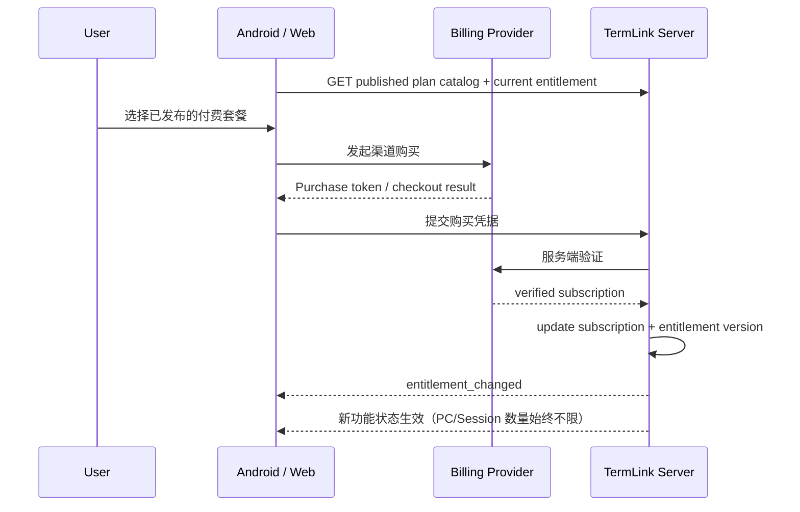

Android 发行版本遵守 Google Play Billing 规则。服务端通过 Real-time Developer Notifications/Webhook 与周期性对账同步续费、取消、退款和 Chargeback。

### 12.5 生命周期与状态变化

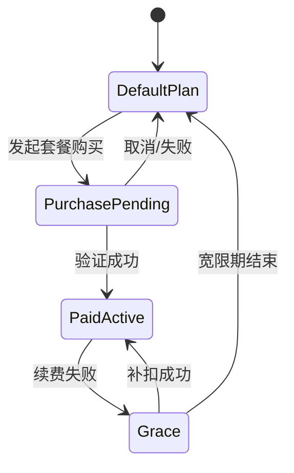

降级原则：

1. 不终止任何 Windows 本地 Shell；
2. 不删除 PC、设备身份/撤销记录、历史或密钥；
3. 不执行 PC/Session 数量降级选择、暂停或清理；
4. 购买状态只影响可选功能和展示，不改变 PC/Session 数量；
5. 安全入口、设备撤销、停止远程访问和数据删除始终免费可用。

### 12.6 多端 UI

- Android：设备首页显示当前套餐与“不限数量”，会员页渲染服务端套餐目录、购买和恢复购买；
- Windows：托盘显示功能状态，主窗口提供账户与会员页；
- Server Console：订阅与权益页管理套餐草稿、发布版本、Product ID 映射、Provider/Webhook、Subscription 和 Entitlement；
- 完整布局稿见 [多端 UI 布局设计稿](UI_LAYOUT_DESIGNS.md)。

## 13. 异常、离线与空状态

| 场景 | 用户界面 | 系统动作 |
| --- | --- | --- |
| Relay 不可达 | 顶部 `正在重连`，保留最后画面 | 指数退避，PC 本地继续 |
| PC 离线 | PC 行显示最后在线时间 | 停止订阅，允许打开历史 |
| 输出缺口 | `History gap` 可解释提示 | 保持 ACK 不变；优先请求安全连续回放，协商启用后才允许从认证 Snapshot 重置引擎 |
| 租约被本地夺回 | 底部提示具体原因 | 立即阻止新输入，清 Modifier 状态 |
| 手机被撤销 | 全屏安全锁定 | 断 WS、清 Token/Key、跳登录 |
| Terminal Engine 崩溃 | 保留 Session，提供重载/切换引擎 | 从完整连续前缀恢复；能力启用后可从已绑定 Snapshot 恢复，不重发输入 |
| 历史为空 | 说明云历史默认关闭或没有记录 | 提供相关设置入口 |
| 无 PC | 引导安装 Win-Agent 并登录同一 OIDC 账号 | 展示下载与登录说明，不显示配对/Grant 步骤 |

## 14. 测试与验收

### 14.1 Windows

- CMD、Windows PowerShell、PowerShell 7、WSL 创建/输入/输出/resize/退出；
- Ctrl+C、Ctrl+Break、Alt/Shift、功能键和逐键输入；
- Vim、less、htop、fzf、tmux/WSL 长时间操作；
- Windows Terminal Stable/Preview Profile 与主题解析；
- Agent/Host 断开、Agent 重启、Shell Crash、Windows 锁屏和多用户；
- 并发创建 20 个 Session，验证句柄不泄漏和关闭顺序。

### 14.2 Terminal Golden Stream

录制并固定：

- ANSI 16/256 色、24 位渐变与 SGR 属性；
- 中文双宽、emoji、ZWJ、组合字符和边界换行；
- Alternate Screen、快速 resize、滚动区和光标保存恢复；
- PowerShell PSReadLine、Vim、htop、fzf、less；
- Mouse 1000/1002/1003/1006、Focus 1004 和 bracketed paste 2004；
- OSC 4/8/10/11/12/52、标题、恶意超长控制序列。

同一流输入 Termux Fork 与 xterm.js，比较网格、样式、光标、模式和截图；Windows Terminal 参考截图只作视觉对照，不作为可移植状态格式。

### 14.3 网络、服务端与计费

- 丢包、乱序、重复、慢消费者、Wi-Fi/蜂窝切换和 30 秒离线；
- 同一 `input_id` 重复 100 次仍只调用 terminal-main 异步通道一次；
- 多 Android 争抢租约、租约过期、PC 本地抢占；
- Docker 首次启动、迁移、滚动升级和 PostgreSQL 恢复；
- 单账号多 PC × 多 Session，持续 2 MB/s 压测；
- Relay 日志、DB、Redis 和监控全链路明文扫描；确认服务端没有历史或文件正文。
- 同账号第二台及更多 PC、第四个及更多实时 Session 均可成功注册/订阅；
- Google Play/Web 购买验证、重复 Webhook、乱序续费、取消、退款、Grace Period 和恢复购买；
- 客户端篡改 `isPro`、过期缓存或重放 Purchase Token 均不能提升 Entitlement。

### 14.4 Android 真机矩阵

- Android 8/10/12/14/最新稳定版；
- arm64 主流手机、低内存设备、平板、折叠屏；
- Gboard、Samsung Keyboard、搜狗等中英文 IME；
- 蓝牙/USB 硬件键盘和鼠标；
- 深浅主题、200% 字体、TalkBack、横竖屏、Doze 和低电量模式。

### 14.5 MVP 验收门槛

1. Android 与 Windows Agent 登录同一 OIDC 账号后，无配对、自授信或 Grant 即可发现至少三种受管 Shell 会话并实时显示；不同账号不可见且不可路由。
2. 常见 ANSI、True Color、中文、光标和一个全屏 TUI 正确。
3. 获得租约后文本、Enter、方向键、Ctrl+C 和 Paste 正常；只读输入可靠拒绝。
4. 网络断开 30 秒后恢复，输出不乱序，输入不重复。
5. 撤销设备后现有连接及时断开，旧凭据不能恢复访问。
6. Relay 停机时 Windows 本地会话正常运行。
7. Docker Compose 能在全新主机启动、健康检查通过并完成备份恢复演练。
8. Termux Fork 达到 ≥99% Golden Grid 门槛；未达门槛的会话可以安全切换 xterm.js 回退。
9. 首发 Free 与 Pro 均可注册不限数量 PC、同时订阅不限数量实时 Session；接口返回 `-1` 表示不限。
10. 会员到期和退款不会结束本地 Shell、删除设备或清理实时订阅。

### 14.6 Tail-first 七项原始需求验收矩阵

下表是上线门，不是当前通过声明。`结果/证据` 由主代理在最终代码、Debug APK、真实 Windows
受管会话、生产 Relay/History 和冷启动 Android 环境上完成验证后填写；模块单测、固定夹具、
LAN Replay 或文档中的设计图不能替代该结果。

| ID | 原始需求 | 可观测验收 | 结果/证据 |
| --- | --- | --- | --- |
| TF-01 | Windows durable producer | 1000 个唯一 marker 均先进入可恢复 `LocalFrame`/WAL；每个接收设备均为 Transcript 先提交、Snapshot S 最后提交，崩溃重试不产生冲突对象。 | 待主代理最终验证；证据路径待填 |
| TF-02 | Android S/S+1 bootstrap | 产品路径完成 select/download/verify/prepare/cache/bind/install，随后以 S 订阅且首个新事件为 S+1；任何预绑定失败不推进 ACK。 | 待主代理最终验证；证据路径待填 |
| TF-03 | 首次仅最后一屏 | 初次打开恰有一个 Snapshot、本地 Transcript/Event Chunk 均为 0；marker 1000 可见且 marker 0001 不可见。 | 待主代理最终验证；证据路径待填 |
| TF-04 | 顶部越界分页 | 每个真实上滑手势只前移一页且最多载入 200 行；锚点始终为 S，页面只进入独立 viewport，S 与 live ACK 均不因分页改变。 | 待主代理最终验证；证据路径待填 |
| TF-05 | 浏览历史时实时继续 | 历史 overlay 打开期间新 marker 使 live ACK 前进；关闭 overlay 返回实时尾部并显示该 marker，历史 viewport 不污染 live parser。 | 待主代理最终验证；证据路径待填 |
| TF-06 | 同账号多 Android 接收方隔离 | 至少两台未撤销 Android 各自只能选择、下载和解密自己的 Snapshot/Transcript；交叉 URL、对象 ID、密钥或缓存均被拒绝。 | 待主代理最终验证；证据路径待填 |
| TF-07 | 失败回退、双语与布局 | 缺对象、篡改、Key Epoch 错误、安装失败、缺 S+1、分页失败均 fail closed 并按设计回退；中英文状态完整；Terminal/底栏在显示区内、互不重叠且位于可见 IME 上方。 | 待主代理最终验证；证据路径待填 |

## 15. 交付阶段

### 阶段 0：terminal-main 异步通道兼容性验证（1～2 周）

- 以 terminal-main 的 `ITerminalConnection` Mock/真实连接录制 Golden Stream；旧 ConPTY Probe 仅作为迁移前对照；
- 建立 Termux Fork 最小 Android Harness；
- 验证异步通道、控制键、TUI、IME、鼠标、取消/关闭竞态和配色；
- 输出明确的不兼容清单。

### 阶段 1：terminal-main 到 Agent 的本地闭环（3～4 周）

- terminal-main AsyncTerminalChannel、Agent 桥接、本地授权通道和本地加密 Buffer；
- Android `RemoteTerminalSession`、设备/Session UI；
- 测试 Relay 上完成实时显示、输入、ACK、Snapshot 和恢复。

2026-08-15 本轮已完成阶段 0 及阶段 1 的本地代码骨架：`termForward/terminal-main` 的
`AsyncTerminalChannel` 已连接 `ITerminalConnection`，提供有界异步输入、输出、resize、
状态、取消和幂等关闭；Windows Agent 已加入 `TerminalMainChannelBridge`，验证 UTF-16
跨块编码、提交后累计 ACK、Gap 和损坏输入统计。进程内注册、本地授权通道、DPAPI Buffer
进程注册、认证 IPC、可重放/幂等持久化 sink、Registry 接入和公网生产 runtime 切换仍未完成；旧 SessionHost/ConPTY 结果继续只作为迁移前对照。

截至 2026-08-04 的实施状态（不改变上述生产设计）：Host-Agent IPC、DPAPI Buffer、
Session Registry、正式 .NET 8 Agent/SessionHost/Tray/Updater、DPAPI 注册索引和 20 个真实
ConPTY Session 的 Agent 强制结束/受控重启恢复已经验证。Android 状态机及 Android → Docker
临时双向测试 Relay → 真实 Termux View 的 ACK、断线恢复、输入 accepted、测试租约、Flow Control、
History Gap 和 exited 也已验证。测试链路使用隔离的明文 `TLT1` 格式，不是生产
Protobuf/Relay/E2EE。`TerminalSnapshotV1`/`TerminalTranscriptPageV1` 的 Phase 1 字段、
严格校验规则和 C#/Kotlin 共享 golden vector 已冻结；最终工作树已包含 Android
crypto/domain decoder、detached prepare/install、checkpoint/ACK 原子绑定、独立 Transcript
viewport，以及 Windows durable `LocalFrame` producer、逐接收设备 seal 和
Snapshot/Transcript ordered uploader 的 runtime 接线。Release 开关仍强制为 `false`，Agent/
Android 仍未宣告 `terminal_snapshot_v1`；这些并行改动必须由主代理完成最终构建、故障矩阵和
真实产品 E2E 后才能更新状态。Updater 已用
两个真实开发签名 MSIX 验证签名清单、身份/版本/哈希、篡改拒绝和故障回滚状态机；第 7 项
还在临时 `LocalMachine/TrustedPeople` 开发信任下完成真实 AppX 安装、包身份启动、更新、
降级和卸载。生产发布证书链与实际登录周期仍未外部验收。

### 阶段 2：Docker 服务端与账号（3～4 周）

- Go API/Relay、PostgreSQL、Redis/Valkey 和 Compose；
- OIDC、同账号设备自动注册/直连、账号隔离、Lease 和撤销；旧 pairing/Grant 仅做兼容回归；
- E2EE、Key Epoch、审计与无正文可观测性。

### 阶段 3：产品化（3～5 周）

- 完整 Android UI、历史回放、设置、通知和无障碍；
- Windows 托盘、Profile、签名安装和更新；
- xterm.js 回退、压力测试和安全测试；备份恢复与发布流水线已完成本地实现和演练，外部发布待验收。

### 阶段 4：稳定与规模化

- Termux 上游同步自动化、Golden Regression 和性能优化；
- 多 Relay 实例、外部 OIDC 和更完整的自托管文档。

## 16. 推荐仓库结构

```text
TermLink/
├── README.md
├── docs/
├── protocol/
│   ├── protobuf/
│   └── test-vectors/
├── win-agent/
│   ├── src/Agent
│   ├── src/Tray
│   ├── src/SessionHost
│   ├── src/Updater
│   └── tests
├── server/
│   ├── cmd/termlink-server
│   ├── internal
│   ├── migrations
│   ├── Dockerfile
│   └── compose
├── android/
│   ├── app
│   ├── core-*
│   ├── feature-*
│   └── terminal-engine-*
├── terminal-forks/
│   └── termux-patches
├── testdata/
│   └── terminal-golden-streams
└── prototypes/
    └── conpty-probe
```

Termux Fork 可以使用 Git Subtree/Submodule + Patch Queue，也可以镜像为独立仓库；无论哪种方式，主仓库必须锁定上游 Commit 并能一键重放补丁与回归测试。

## 17. 默认产品策略

| 决策 | 默认值 |
| --- | --- |
| 目标用户 | 个人多设备用户，兼顾小型团队未来扩展 |
| 远程访问 | 同 OIDC 账号、未撤销设备直接访问；无需配对或 Grant |
| 远程首次控制 | 首次需要 PC 本地确认；之后按 PC 策略 |
| 本地优先 | 始终开启 |
| PC 本地历史 | 7 天 |
| 云历史 | 关闭 |
| 输入记录 | 关闭 |
| 输入租约 | 30 秒，10 秒续约 |
| Android 默认引擎 | Termux Fork |
| 兼容回退 | xterm.js 离线 WebView |
| 自托管 | Docker Compose 官方支持 |
| 首发 Free 默认配额 | PC 与实时 Session 均不限数量（API 为 `-1`） |
| 首发付费套餐 | Pro Monthly，月付自动续费、可取消 |
| 套餐配置 | 名称、周期、权益、渠道映射、排序和上下架均由服务端版本化发布 |
| 客户端套餐逻辑 | 读取已发布 Catalog 和 Entitlement，不硬编码 Free/Pro 枚举 |
| 会员状态变化 | 不终止本地 Shell；不执行 PC/Session 数量降级清理 |

## 18. 已知风险与下一项技术验证

迁移阶段的主要风险包括旧 ConPTY/SessionHost 基线与新链路并存，以及：

1. Session Host 双层 PTY 在 Windows Terminal 中的透明程度；
2. Termux Fork 对 PowerShell/Windows ConPTY 边缘 VT 行为的兼容度；
3. Android IME、复杂 Unicode 与高吞吐增量绘制；
4. 多设备 E2EE 的历史密钥恢复和撤销语义；
5. Docker 服务端慢消费者和大规模 WebSocket 路由；
6. Windows Snapshot producer/uploader 与 Android 独立 Transcript viewport 已在最终工作树接线，但 producer/importer 等价语料、崩溃矩阵和真实 tail-first E2E 尚未达到 `terminal_snapshot_v1` 启用门槛。

当前环境已经完成 Golden Stream → Termux/xterm.js 对照，以及 Android → Docker 临时测试
Relay → Termux View 的双向闭环，以及正式 .NET 8 Agent/Tray、DPAPI 注册索引和 20 Session
重启恢复。Windows 已具备自包含签名 MSIX、登录 StartupTask、Tray 单实例和受控 Updater；
开发证书下的包结构、签名、更新输入、故障回滚以及真实 AppX 安装/更新/降级/卸载均已验证，
演练只临时使用本机 TrustedPeople 并已清理。服务端 TLS、无正文指标、告警、备份恢复和镜像
供应链也已完成本地验证。生产发布证书、真实域名 ACME、GitHub OIDC release tag、外部 Provider
和实际登录周期仍需外部验收。Snapshot/Transcript 对象合同和主要 runtime 接线已进入最终
工作树，但生产能力必须等主代理确认构建、Windows producer/Android importer 等价语料、
崩溃边界、S+1 并发和七项真实产品 E2E 全部通过后再启用；
arm64 真机、厂商 IME、外接键鼠与更多屏幕形态仍需真实硬件验证。

## 19. 关联文档

- [产品需求与早期技术方案](PRODUCT_REQUIREMENTS_AND_SOLUTION.md)
- [第一轮 ConPTY 技术验证与 Windows Terminal 移植评估](TECHNICAL_VALIDATION.md)
- [Android 全功能 Terminal 引擎调研与技术方案](ANDROID_TERMINAL_ENGINE_RESEARCH.md)
- [Android、Windows Agent、Server Console UI 布局设计稿](UI_LAYOUT_DESIGNS.md)
- [ConPTY Probe 运行说明](../prototypes/conpty-probe/README.md)
- [Phase 1 临时双向测试协议](../protocol/test-vectors/PHASE1_TEST_SESSION_V1.md)
