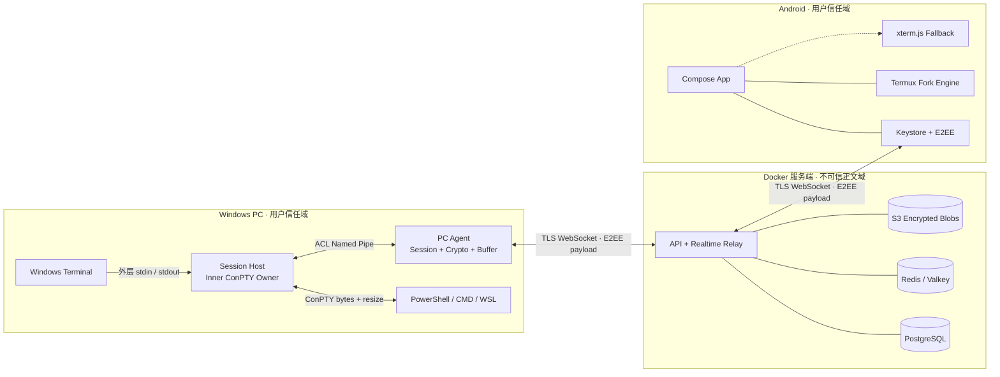
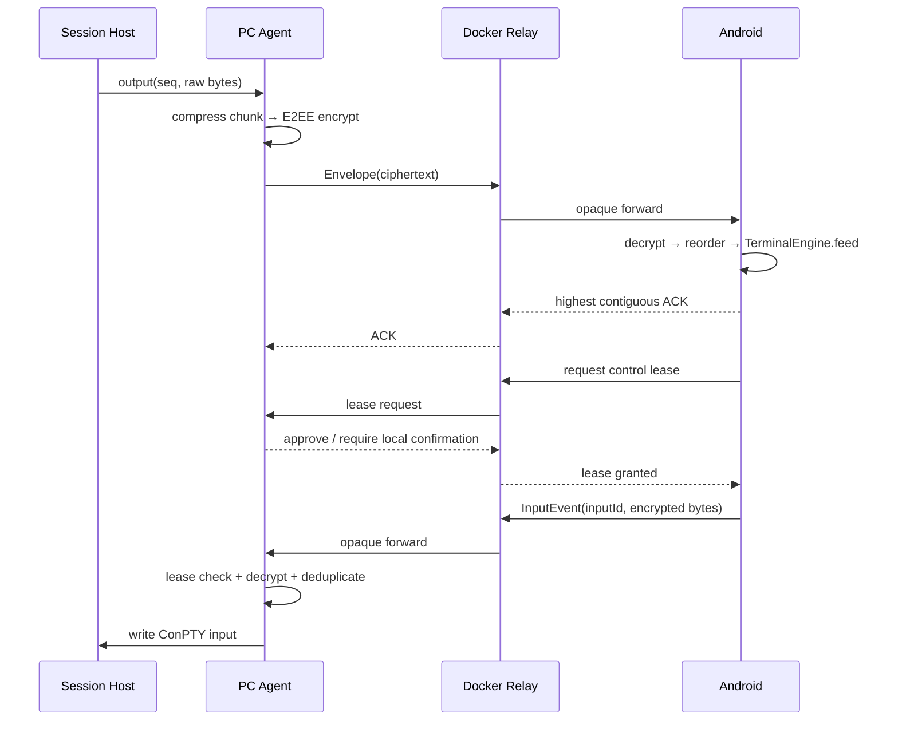
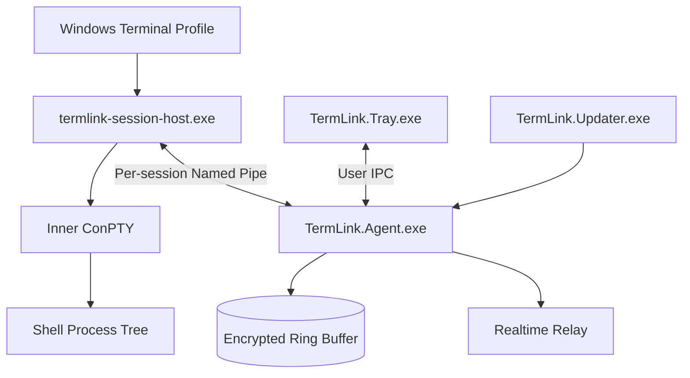
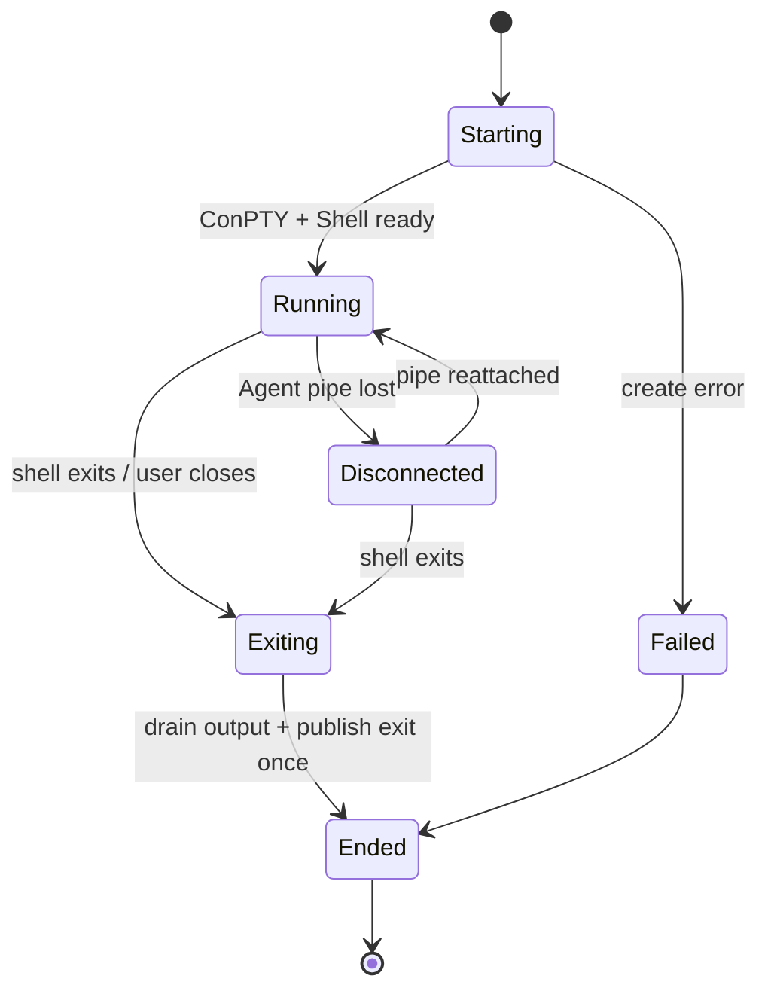
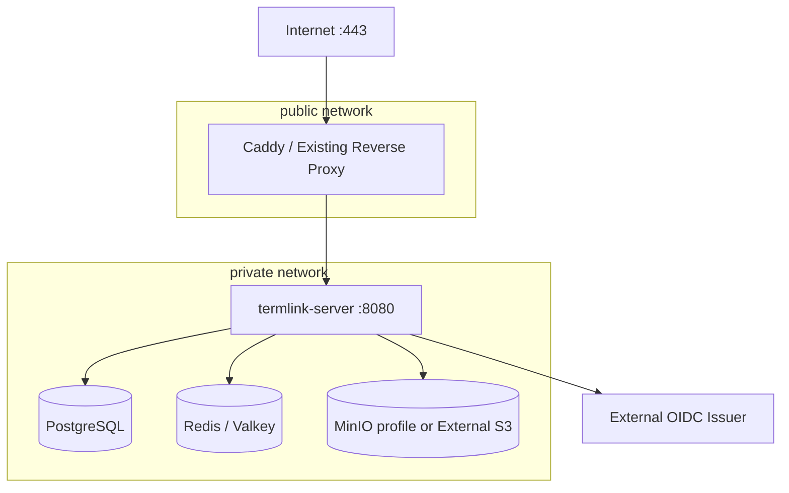
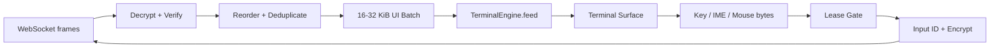
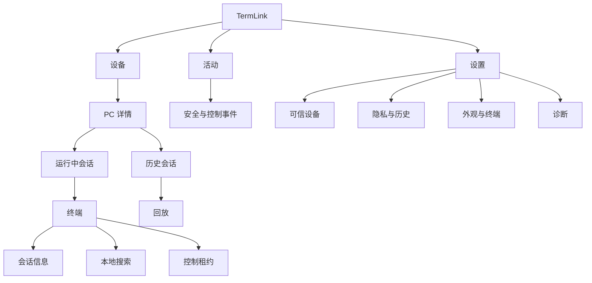
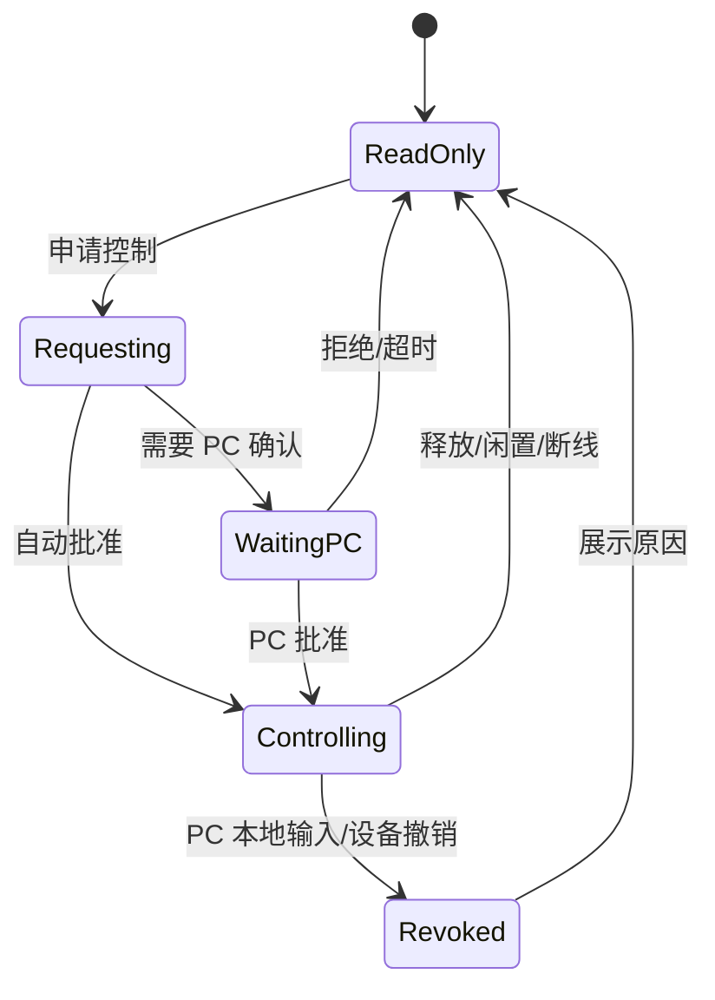
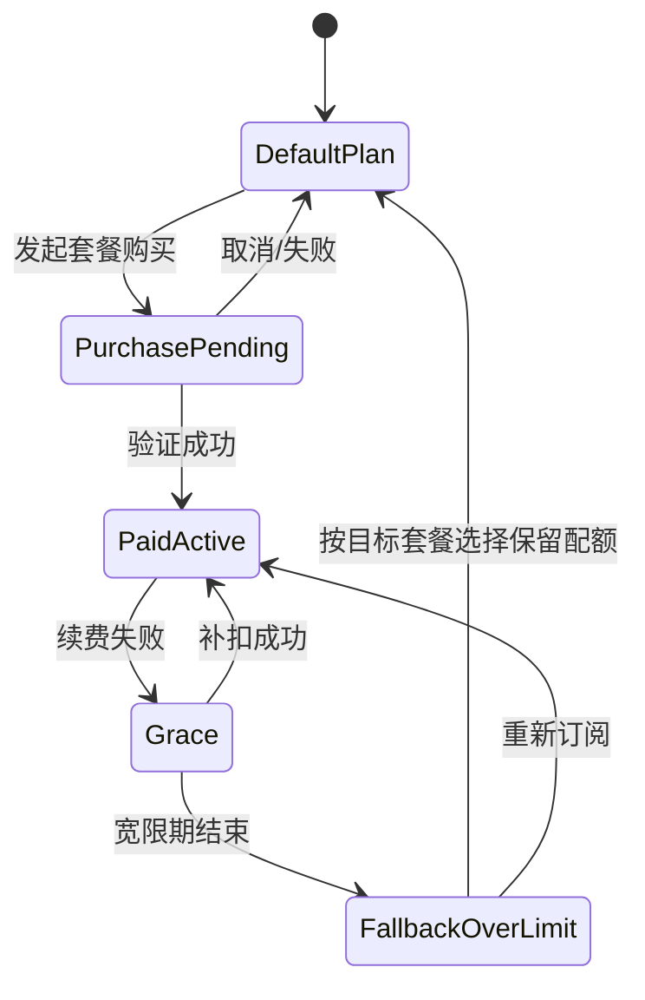

# TermLink 完整产品与系统设计

文档版本：1.0
状态：开发基线
更新日期：2026-08-02
适用范围：Windows Agent、Docker 服务端、Android 客户端、终端引擎与 UI/UX

## 1. 文档目的与最终决策

本文把 TermLink 已确认的产品需求、ConPTY 技术验证、Android Terminal 引擎调研、服务端部署要求和 UI 设计合并为统一开发基线。若本文与早期草案冲突，以本文为准；底层验证证据仍以专项文档为准。

已经确定的核心决策：

1. TermLink 管理自己创建的终端会话，不通过窗口抓取、键盘钩子或进程注入接管任意既有 Windows Terminal 标签页。
2. Windows 端使用 ConPTY 创建 PowerShell、CMD 和 WSL；首轮实机验证已经通过输出捕获、输入、resize 和退出码测试。
3. Android 不移植完整 Windows Terminal。默认使用 Termux `terminal-emulator` + `terminal-view` 派生 Fork，xterm.js 离线 WebView 作为兼容性对照与运行时回退。
4. PC 与 Android 传输原始、有序的 VT/ANSI 字节，不传屏幕截图，也不在 Relay 中转换成字符串。
5. 登录同一账号只用于设备发现；新设备必须经过配对批准，远程输入还需要设备权限与会话输入租约。
6. 服务端采用 Go，可用 Docker Image 和 Docker Compose 部署；PostgreSQL 保存元数据，Redis/Valkey 保存在线状态与租约，S3 兼容存储保存可选的端到端加密历史块。
7. 服务端只路由密文。终端正文、输入和快照在 PC 与已批准 Android 设备之间端到端加密。
8. UI 采用“Quiet Focus / 安静专注”设计语言：低干扰、内容优先、上下文操作、清晰状态和渐进披露，不以炫光、渐变或大量卡片代替可用性。
9. 服务端提供可配置套餐目录；首发预置 Free（1 台远程 PC、3 个实时 Session）与 Pro Monthly，但套餐名称、周期、额度、渠道映射和上下架状态均不硬编码在客户端。

## 2. 产品定义

### 2.1 一句话目标

让用户从 Android 安全、低延迟地查看和控制自己多台 Windows PC 上的受管终端会话，同时保留可恢复、可审计和可选的加密历史。

### 2.2 产品边界

TermLink 是远程终端系统，不是：

- 远程桌面或 GUI 控制工具；
- Windows Terminal 的 Android 移植版；
- 任意控制台窗口的无侵入录屏工具；
- 首版文件管理、端口转发或远程 IDE；
- 依靠自然语言判断命令是否安全的防护系统。

### 2.3 用户角色

| 角色 | 目标 | 默认能力 |
| --- | --- | --- |
| 账号所有者 | 管理 PC、手机、权限和记录策略 | 设备管理 |
| PC 本地用户 | 本地运行 Shell，并决定是否允许远程访问 | 本地最高优先级 |
| Android 远程用户 | 浏览、观察、取得控制权并输入命令 | 由设备授权决定 |

设备权限分为：

- `VIEWER`：查看在线状态、实时输出和授权范围内历史；
- `CONTROLLER`：拥有 Viewer 能力，并可申请输入租约；
- `MANAGER`：可批准、降权、撤销设备以及修改 PC 访问策略。

### 2.4 MVP 范围

纳入：

- Windows 10 1809+，优先保证 Windows 11；
- PowerShell 7、Windows PowerShell 5.1、CMD、WSL 2；
- 单账号最多 5 台 PC，每台 PC 最多 20 个并发受管会话；
- 多 PC/多会话发现、实时显示、远程输入、断线恢复和最近历史；
- ANSI 16 色、256 色、True Color、常见 TUI、鼠标、IME 和组合键；
- 设备配对、分级授权、输入租约、设备撤销和 E2EE；
- Windows Terminal Scheme 配色同步；
- Docker Compose 单机部署和外部 S3/OIDC 接入。
- Free 方案和月付会员的购买、恢复、续费、宽限、降级及配额执行。

暂不纳入：

- 附加普通 Profile 已经打开的标签页；
- 多人同时向一个会话输入；
- macOS/Linux Host Agent 和 iOS；
- 企业组织、LDAP、审批流和合规归档；
- 文件传输、端口转发与公网 SSH Gateway。

模型推理、终端内容解释或摘要、自然语言导航和命令生成不在产品规划内。

### 2.5 成功指标

| 指标 | MVP 目标 |
| --- | --- |
| 稳定网络输出显示延迟 | 区域内 P95 ≤ 250 ms |
| Android 输入写入 ConPTY | 区域内 P95 ≤ 250 ms |
| 持续输出能力 | 单会话 2 MB/s 持续 10 分钟无 OOM |
| 断线恢复 | 断线 30 秒后从 ACK/快照恢复，不重复输入 |
| 终端网格兼容 | Golden Stream 最终网格正确率 ≥ 99% |
| 数据保密 | Relay、数据库、对象存储与日志均无终端明文 |
| 本地可用性 | Relay 停止时 Windows 本地终端继续运行 |

## 3. 需求目录

### 3.1 账号、设备与权限

| ID | 需求 |
| --- | --- |
| AUTH-001 | Android 使用 OAuth 2.1/OIDC Authorization Code + PKCE 登录。 |
| AUTH-002 | PC Agent 使用浏览器设备授权，不保存账号密码。 |
| AUTH-003 | 每台设备生成独立公私钥；PC 私钥由 DPAPI、Android 私钥由 Keystore 保护。 |
| AUTH-004 | 同账号新设备默认未受信任，必须由 PC 或已有 Manager 批准。 |
| AUTH-005 | 支持 Viewer、Controller、Manager 三档权限和按 PC 授权。 |
| AUTH-006 | 撤销设备后立即断开连接、拒绝旧 Token，并轮换受影响的会话密钥。 |

### 3.2 Windows Agent

| ID | 需求 |
| --- | --- |
| WIN-001 | 安装后提供托盘应用、自动启动、卸载和签名更新。 |
| WIN-002 | 注册 TermLink PowerShell、CMD、WSL Windows Terminal Profile。 |
| WIN-003 | 每个 Session Host 独立创建 ConPTY 与 Shell 进程树。 |
| WIN-004 | 捕获原始输出、远端/本地输入、resize、标题、创建、退出码和中断事件。 |
| WIN-005 | 创建、列出、重命名、终止、归档和删除受管会话。 |
| WIN-006 | 网络中断时写入有界的本地加密环形缓冲，恢复后按序补发。 |
| WIN-007 | 本地键盘输入可立即撤销远端输入租约。 |
| WIN-008 | 托盘明确显示远程查看者和控制者，并提供“一键停止远程访问”。 |
| WIN-009 | 支持仅本机、只读远程、允许控制三种 PC 策略。 |
| WIN-010 | Agent 重启后准确标记会话中断，不伪造在线会话。 |
| WIN-011 | Session Host 不继承 Token、日志、Relay Socket 等敏感句柄。 |
| WIN-012 | 支持停止同步、停止记录、清除本地历史和配置保留期限。 |

### 3.3 服务端与 Docker

| ID | 需求 |
| --- | --- |
| SRV-001 | 提供版本化 REST API 和 TLS WebSocket Realtime Relay。 |
| SRV-002 | 管理账号映射、设备、公钥、授权、PC 在线状态、会话索引和审计元数据。 |
| SRV-003 | 支持输出 ACK、续传、去重、限流、背压、心跳和输入租约。 |
| SRV-004 | 终端载荷保持 E2EE，服务端不得持有正文解密密钥。 |
| SRV-005 | 历史开启时只保存加密 Event Chunk 与 Snapshot Blob。 |
| SRV-006 | 官方发布多架构 Docker Image，支持 Docker Compose 单机部署。 |
| SRV-007 | 容器以非 root 用户运行，提供健康检查、只读根文件系统和外部 Secret 注入。 |
| SRV-008 | PostgreSQL、Redis/Valkey 和对象存储支持内置 Compose 或外部托管服务。 |
| SRV-009 | 支持数据库迁移、备份、恢复、审计与版本回滚兼容。 |
| SRV-010 | 日志、指标和 Trace 不包含终端正文、Token、私钥或完整 IP。 |

### 3.4 Android 客户端

| ID | 需求 |
| --- | --- |
| AND-001 | 展示多 PC 在线状态、版本、最近在线时间与访问权限。 |
| AND-002 | 按 PC 展示运行中、已退出、已归档会话，并支持搜索和状态筛选。 |
| AND-003 | 会话页支持 ANSI/VT、True Color、备用屏幕、滚动区、TUI 和鼠标。 |
| AND-004 | 支持中文 IME、emoji、宽字符、组合字符、软键盘辅助栏和硬件键盘。 |
| AND-005 | 支持文本、确认式多行粘贴、Enter、Tab、Esc、方向键和 Ctrl/Alt 组合键。 |
| AND-006 | 显示 Live、Reconnecting、Read only、Controlling、Exited 和 History gap 状态。 |
| AND-007 | 支持快照 + 增量事件恢复、历史回放、跳转最新和本地明文搜索。 |
| AND-008 | 横竖屏适配、字体缩放、保持常亮、后台恢复和可选前台监控通知。 |
| AND-009 | 控制请求展示租约持有者、期限和 PC 本地确认状态。 |
| AND-010 | 本地缓存使用 Keystore 包装的数据密钥加密；退出/撤销后清除可恢复密钥。 |

### 3.5 终端兼容与主题

| ID | 需求 |
| --- | --- |
| TER-001 | 默认使用 Termux Terminal 派生 Fork，并抽象统一 `TerminalEngine`。 |
| TER-002 | xterm.js 离线 WebView 保留为兼容对照与按会话回退。 |
| TER-003 | 原始字节只由终端引擎解释；网络层不得按字符串拼接。 |
| TER-004 | 支持 SGR mouse、bracketed paste、主/备用屏幕和快速 resize。 |
| TER-005 | Windows Terminal 16 色、前景、背景、光标和选择色可映射。 |
| TER-006 | 背景图、透明度、字体、光标形状等非 Scheme 外观由 TermLink 单独定义。 |
| TER-007 | Termux Fork 补齐 OSC 8、焦点事件、任意鼠标移动、选择色、搜索、快照和复杂 grapheme cluster。 |

### 3.6 安全与隐私

| ID | 需求 |
| --- | --- |
| SEC-001 | 外部通信使用 TLS 1.3，内部容器网络至少受独立网络和访问控制保护。 |
| SEC-002 | 载荷使用 X25519 派生密钥和 ChaCha20-Poly1305 或 AES-GCM。 |
| SEC-003 | AEAD 关联数据包含协议版本、会话、方向、序号、发送设备和 Key ID。 |
| SEC-004 | 输入事件包含唯一 `input_id`，PC Agent 持久化短期去重窗口。 |
| SEC-005 | 输入默认不落盘；云历史默认关闭；PC 本地记录默认 7 天。 |
| SEC-006 | OSC 52、链接、外部 Intent、粘贴和通知正文执行显式安全策略。 |
| SEC-007 | 组件升级包与 Windows 二进制必须签名，服务端镜像应生成 SBOM。 |

### 3.7 会员、计费与权益

| ID | 需求 |
| --- | --- |
| BILL-001 | 首发 Free 默认最多启用 1 台 PC 的远程访问。 |
| BILL-002 | 首发 Free 默认最多同时远程显示 3 个不同的实时 Session。 |
| BILL-003 | 首发 Pro Monthly 按月自动续费，解锁更多 PC 和实时 Session。 |
| BILL-004 | 实际价格、货币、税费和续费条款由购买渠道在确认前展示，不硬编码在客户端。 |
| BILL-005 | Android 使用 Google Play Billing；其他渠道通过服务端购买 Provider 抽象接入。 |
| BILL-006 | 客户端不能自报会员状态，服务端验证购买凭据并签发版本化 Entitlement。 |
| BILL-007 | 会员到期不终止本地 Shell、不删除设备和历史，只暂停超过 Free 配额的远程能力。 |
| BILL-008 | 降级超额时允许用户按目标套餐的当前额度选择保留 PC 和实时 Session。 |
| BILL-009 | 套餐名称、周期、额度、排序、上下架、降级目标和渠道 Product ID 由服务端版本化配置。 |
| BILL-010 | Android、Windows 和 Web 只渲染服务端已发布的套餐目录，不依赖 `FREE/PRO` 客户端枚举。 |
| BILL-009 | E2EE、设备批准、撤销、本地优先和紧急停止等安全能力不得放入付费墙。 |

## 4. 总体架构

### 4.1 逻辑架构



### 4.2 信任边界

| 边界 | 信任假设 | 强制措施 |
| --- | --- | --- |
| Session Host ↔ Agent | 同一 Windows 用户，但进程隔离 | 当前用户 SID ACL Named Pipe、进程身份校验、长度限制 |
| Agent ↔ Relay | Relay 不可信终端正文 | TLS + E2EE + 序号 + AEAD |
| Relay ↔ Android | 网络和 Relay 均可被观察 | TLS + E2EE + 设备批准 |
| Android UI ↔ Terminal Engine | 终端输出可能恶意 | OSC/URL/剪贴板策略、资源限制、无任意脚本 |
| Docker Edge ↔ 内部服务 | 仅 Edge 暴露公网 | 私有网络、非 root、Secret、最小端口 |

### 4.3 核心实时流程



### 4.4 断线恢复原则

1. 输出序号由 PC Agent 按会话单调生成，Android 只 ACK 已连续接收的最高序号。
2. Android 重连时提交 `last_acked_seq` 和可用 `snapshot_id`。
3. Agent 有增量时直接续传；增量过期时发送最新快照及其后事件。
4. 数据已经永久缺失时，Android 清空旧解析状态，从新快照恢复并显示 History gap。
5. 输入 ACK 只表示 PC Agent 已接受该 `input_id`，不表示命令执行成功。
6. 多行粘贴只有明确确认 PC Agent 从未接受对应 `input_id` 时才能整体重试。

## 5. Windows Agent 设计

### 5.1 进程与组件



| 组件 | 运行身份 | 职责 |
| --- | --- | --- |
| `TermLink.Tray.exe` | 当前交互用户 | 登录、策略、会话列表、远端状态、紧急停止 |
| `TermLink.Agent.exe` | 当前用户后台进程 | 账号、密钥、Relay、会话目录、缓冲、授权和 IPC |
| `termlink-session-host.exe` | 每个终端会话一个 | 创建 ConPTY、启动 Shell、桥接本地/远程 I/O、上报生命周期 |
| `TermLink.Updater.exe` | 受控提升 | 验证签名、原子更新和失败回滚 |

MVP 不让高权限 Windows Service 直接托管用户 Shell。若后续需要无人登录持续在线，可增加 Broker Service，但它只能负责用户会话发现与启动，Shell 仍以目标用户身份运行。

### 5.2 Windows Terminal Profile 与双层 PTY

Windows Terminal Profile 启动命令示例：

```text
termlink-session-host.exe start --shell pwsh --profile-id powershell-7
```

Windows Terminal 拥有外层控制台，Session Host 创建内层 ConPTY 并运行真实 Shell：

```text
Windows Terminal outer PTY
    ↕ local keyboard / rendered output
Session Host bridge
    ↕ captured raw VT bytes / remote input / resize
Inner ConPTY
    ↕
PowerShell / CMD / WSL
```

这一结构保证本地窗口与 Android 收到相同的 Shell 输出。必须用 Golden Test 检查双层 PTY 对标题、颜色、输入模式和 resize 的影响；若某个 Shell 存在差异，允许提供独立 TermLink 桌面窗口作为本地前端，但不改变远程协议。

### 5.3 Session Host 生命周期



关闭顺序固定为：停止远端输入 → 关闭 ConPTY 输入写端 → 等待或终止 Shell 进程树 → 关闭 ConPTY → 排空剩余输出 → 发布唯一的 Ended 事件。

### 5.4 本地 IPC

每个会话使用独立 Named Pipe：

- Pipe ACL 只允许当前用户 SID 和 Agent 进程；
- Agent 与 Host 相互校验 PID、用户 SID、Session ID 和一次性握手 Token；
- 帧格式为长度前缀 + 类型 + Session ID + 序号 + Payload；
- 单帧默认上限 1 MiB，输出按 16～64 KiB 批量；
- Host 断开 Agent 时继续服务本地终端并进入有界缓冲；
- 不把 Relay Socket、Token 或加密私钥传入 Session Host。

### 5.5 Agent 内部模块

| 模块 | 职责 |
| --- | --- |
| Session Registry | 会话元数据、状态机、Host IPC 和 Shell 类型 |
| Stream Sequencer | 分配输出 seq、批处理、压缩和 ACK 窗口 |
| Local Buffer | DPAPI 包装数据密钥，加密事件块与环形淘汰 |
| Realtime Client | WebSocket、心跳、重连、背压和能力协商 |
| Device Crypto | 设备密钥、会话密钥、轮换和撤销 |
| Access Controller | PC 策略、设备授权、输入租约和本地优先 |
| Profile Manager | Windows Terminal Stable/Preview Profile 注册和 Scheme 解析 |
| Diagnostics | 无正文结构化日志、指标、导出诊断包 |

### 5.6 本地数据目录

```text
%LOCALAPPDATA%\TermLink\
├── config.json                 # 非敏感配置
├── device.dat                 # DPAPI 保护的设备材料
├── sessions.db                # 会话索引，不含明文正文
├── chunks\<session-id>\       # 加密事件块
├── updates\                   # 已验证的待安装更新
└── logs\                      # 脱敏滚动日志
```

### 5.7 托盘 UI

托盘弹层采用 Windows 11 Fluent 视觉，与 Android 的信息架构保持一致：

- 顶部：PC 名称、Relay 状态、当前策略；
- 活动区：运行会话数、查看者、控制者和最近安全事件；
- 会话行：Shell 图标、标题、时长、同步状态、查看/终止菜单；
- 高优先级操作：`停止所有远程访问`；
- 次级操作：新建 PowerShell/CMD/WSL、打开完整设置、退出账号；
- 有远端控制时托盘图标和弹层持续显示，不用短暂 Toast 代替状态。

### 5.8 安装、签名与更新

- 安装格式优先 MSIX；若系统服务与复杂升级需要，再提供签名 MSI；
- 二进制使用企业代码签名证书，更新 Manifest 另行签名；
- 更新先下载到隔离目录，校验签名和 SHA-256，再等待无活跃升级冲突时原子替换；
- 更新失败自动回滚；协议至少兼容前一正式版本；
- Profile 修改前备份相关 JSON 片段，只修改 TermLink 自有 Profile 和 Scheme。

## 6. Docker 服务端设计

### 6.1 服务边界

MVP 将 REST API、WebSocket Relay、租约协调和后台清理任务编译成一个 Go 二进制，通过不同启动参数运行。这样既能使用单容器部署，也可以在规模扩大后拆分副本。

| 逻辑组件 | 职责 | 是否接触正文 |
| --- | --- | --- |
| API | 设备、PC、会话索引、授权、配对和审计 API | 否 |
| Realtime Relay | WebSocket 认证、路由、ACK、背压和心跳 | 只见 Envelope |
| Lease Coordinator | 输入租约申请、续约、释放和抢占 | 否 |
| History Indexer | 加密 Event Chunk/Snapshot 索引和过期删除 | 只见密文 Blob |
| Worker | 撤销传播、过期、配额、审计保留和删除任务 | 否 |

### 6.2 Docker Compose 拓扑



默认只暴露 443。PostgreSQL、Redis/Valkey、MinIO 和应用的 8080 端口仅在 Docker private network 可见。已有 Nginx、Traefik 或 Cloudflare Tunnel 的部署可关闭 Caddy Profile。

### 6.3 镜像设计

官方镜像：

```text
ghcr.io/termlink/termlink-server:<semver>
```

镜像要求：

- Multi-stage Build，最终使用 distroless 或精简运行时镜像；
- 发布 `linux/amd64` 与 `linux/arm64`；
- 固定非 root UID/GID，根文件系统只读；
- `/tmp` 使用有大小限制的 tmpfs；
- 不在镜像层写入默认密码、OIDC Secret 或数据库密码；
- 提供 OCI Label、SBOM、来源证明和镜像签名；
- 启动时先执行兼容性检查，迁移使用独立 `migrate` 命令；
- `SIGTERM` 后停止接收新连接，等待有限时间排空 WebSocket 再退出。

### 6.4 Compose Profiles

| Profile | 组件 | 用途 |
| --- | --- | --- |
| `core` | TermLink Server、PostgreSQL、Redis/Valkey | 最小自托管 |
| `edge` | Core + Caddy | 无现有反向代理的公网部署 |
| `history` | Core + MinIO + 独立 internal `object` 网络 | 本地保存 E2EE 历史；客户端预签名 GET/PUT 经 TLS Edge 进入 MinIO，Edge 不加入数据库 `backend`，且只放行规范密文对象路径 |
| `observability` | Prometheus、Grafana、Loki/OTel Collector | 运维诊断，可选 |

生产部署必须固定镜像版本和 Digest，不使用 `latest`。数据库、对象存储使用 Named Volume 或宿主机受管目录，应用容器本身保持无状态。

### 6.5 关键配置

| 配置 | 说明 | 是否 Secret |
| --- | --- | --- |
| `TERMLINK_PUBLIC_URL` | 外部 HTTPS 地址 | 否 |
| `TERMLINK_OIDC_ISSUER` | OIDC Issuer | 否 |
| `TERMLINK_OIDC_CLIENT_ID` | 公共客户端 ID 或服务端 Client ID | 否 |
| `TERMLINK_OIDC_CLIENT_SECRET_FILE` | OIDC Secret 文件路径 | 是 |
| `TERMLINK_DATABASE_URL_FILE` | PostgreSQL DSN 文件路径 | 是 |
| `TERMLINK_REDIS_URL_FILE` | Redis/Valkey DSN 文件路径 | 是 |
| `TERMLINK_S3_ENDPOINT` | S3/MinIO Endpoint | 否 |
| `TERMLINK_S3_ACCESS_KEY_FILE` | 对象存储 Access Key | 是 |
| `TERMLINK_S3_SECRET_KEY_FILE` | 对象存储 Secret | 是 |
| `TERMLINK_TOKEN_SIGNING_KEY_FILE` | 服务端 Token 签名私钥 | 是 |
| `TERMLINK_LOG_LEVEL` | `info`/`warn`/`error` | 否 |
| `TERMLINK_HISTORY_ENABLED` | 是否允许云历史 | 否 |

Secret 优先使用 Docker Secret 文件；环境变量只保存非敏感值。配置加载失败时进程必须 Fail Fast，不静默使用不安全默认值。

### 6.6 REST API

所有路径以 `/v1` 开头，使用 OIDC Access Token 与设备签名证明：

| 方法与路径 | 用途 |
| --- | --- |
| `POST /v1/devices/register` | 注册设备公钥和设备证明 |
| `GET /v1/devices` | 获取账号设备与信任状态 |
| `POST /v1/devices/{id}/approve` | 批准新设备 |
| `POST /v1/devices/{id}/revoke` | 撤销设备 |
| `GET /v1/pcs` | PC 列表与 Presence |
| `GET /v1/pcs/{pcId}/sessions` | 会话摘要列表 |
| `POST /v1/pcs/{pcId}/grants` | 设置设备对 PC 的权限 |
| `POST /v1/sessions/{id}/subscribe` | 创建短时订阅授权 |
| `POST /v1/sessions/{id}/lease` | 请求输入租约 |
| `DELETE /v1/sessions/{id}/lease/{leaseId}` | 主动释放租约 |
| `GET /v1/sessions/{id}/history` | 获取加密块索引和签名下载地址 |
| `DELETE /v1/sessions/{id}` | 删除索引并触发密文清理 |
| `GET /v1/audit-events` | 获取不含正文的安全审计 |
| `GET /v1/billing/plans` | 获取已发布套餐目录、权益与渠道 Product ID 映射 |
| `GET /v1/account/entitlements` | 获取服务端签发的当前配额 |
| `POST /v1/billing/google/verify` | 验证 Google Play Purchase Token |
| `POST /v1/billing/web/checkout` | 创建合规的 Web Checkout |
| `POST /v1/billing/restore` | 恢复/重新同步购买 |
| `POST /v1/admin/billing/plans` | 新建套餐草稿 |
| `PUT /v1/admin/billing/plans/{id}` | 修改套餐、额度和渠道映射 |
| `POST /v1/admin/billing/catalog/publish` | 校验并发布新套餐目录版本 |
| `POST /v1/account/quota-selection` | 降级时选择保留的 PC/Session |

所有变更 API 支持 Idempotency Key。列表接口使用游标分页，错误返回稳定的机器码、用户可读文案 Key 与 Trace ID。

### 6.7 Realtime WebSocket

入口：`GET /v1/realtime`。连接建立后完成：

1. Bearer Token 校验；
2. Device ID、设备签名 Challenge 和撤销状态校验；
3. 协议版本与能力协商；
4. 注册 PC 或 Android 连接角色；
5. 仅对已授权 Session 建立路由。

服务端限制：

- 单 Envelope 默认最大 1 MiB；
- 单连接、单账号和单 IP 分级限流；
- 慢消费者先发 `flow_control`，超过缓冲上限后断开并要求从 ACK 恢复；
- Heartbeat 建议 15 秒，45 秒无响应判定离线；
- Relay 不保证永久队列，持久恢复由 PC 本地 Buffer 与可选历史块负责。

### 6.8 数据模型

| 表 | 关键字段 |
| --- | --- |
| `users` | `id`, `oidc_subject_hash`, `status`, `created_at` |
| `devices` | `id`, `user_id`, `type`, `name`, `public_key`, `trust_state`, `revoked_at` |
| `pcs` | `id`, `owner_user_id`, `name`, `agent_version`, `last_seen_at` |
| `device_grants` | `device_id`, `pc_id`, `permission`, `approved_by`, `expires_at` |
| `sessions` | `id`, `pc_id`, `shell_type`, `title_cipher`, `state`, `created_at`, `ended_at` |
| `control_leases` | `session_id`, `holder_device_id`, `lease_id`, `expires_at`, `version` |
| `event_chunks` | `session_id`, `start_seq`, `end_seq`, `object_key`, `size`, `expires_at` |
| `snapshots` | `session_id`, `snapshot_seq`, `rows`, `columns`, `object_key`, `format_version` |
| `audit_events` | `actor_device_id`, `action`, `target_type`, `target_id`, `result`, `ip_hash`, `created_at` |
| `subscriptions` | `account_id`, `provider`, `product_id`, `provider_ref_hash`, `status`, `renews_at`, `grace_until` |
| `entitlements` | `account_id`, `plan`, `max_remote_pcs`, `max_live_sessions`, `version`, `effective_at`, `expires_at` |
| `outbox` | `event_type`, `payload`, `available_at`, `attempts` |

标题与工作目录可能包含敏感信息，默认由 PC 生成经过裁剪的显示标题；需要云同步完整值时以密文字段保存。

### 6.9 租约一致性

输入租约使用 Redis/Valkey 原子脚本或 `SET NX PX` + 版本校验：

- 默认租约 30 秒；持有者每 10 秒续约；
- 同一 Session 只能存在一个远程租约；
- PC 本地输入可通过 Agent 发送高优先级 `lease_revoked`；
- Relay 故障时 Agent 默认拒绝新的远端输入，但不影响本地终端；
- Agent 最终执行前再次验证 `lease_id`、Holder、Expiry 和 Input Sequence，不能只信 Relay。

### 6.10 扩展、备份与恢复

- 单实例 MVP：一个 Server 容器即可承载 API + Relay；
- 多实例：Presence/Lease 放 Redis，连接路由使用节点登记 + Pub/Sub/NATS；
- PostgreSQL 每日全量备份 + WAL/PITR，定期执行恢复演练；
- Redis 只保存可重建状态，不作为唯一历史来源；
- S3 开启版本生命周期与服务端磁盘加密，但正文保密仍依赖客户端 E2EE；
- 删除流程先禁用索引，再异步删除对象，记录不含正文的删除证明事件。

### 6.11 可观测性

指标只记录规模与性能：

- 活跃 PC、Android、Session 和 WebSocket；
- Envelope 数量、字节数、路由延迟、ACK Lag、慢消费者断开；
- Lease 申请/拒绝/过期数量；
- REST 延迟、状态码、数据库连接池和任务积压；
- Event Chunk/Snapshot 大小，不记录内容。

日志字段允许：Trace ID、Device/Session 的不可逆短 Hash、消息类型、大小、耗时和错误码。禁止记录 Ciphertext、Token、完整公钥、标题、命令、终端正文和剪贴板内容。

## 7. Android 客户端设计

### 7.1 技术栈

| 层 | 选择 |
| --- | --- |
| 语言与 UI | Kotlin、Jetpack Compose、Material 3 基础能力 |
| 架构 | 单向数据流 + ViewModel + Coroutines/Flow |
| 网络 | OkHttp WebSocket 或 Ktor Client，Protobuf 二进制帧 |
| 本地数据 | Room；敏感数据库使用 Keystore 包装的数据密钥加密 |
| 密码学 | 经审计的 Tink/libsodium 封装，不自研算法 |
| 终端默认引擎 | Termux `terminal-emulator` + `terminal-view` Fork |
| 终端回退 | 完全离线 xterm.js WebView |
| 后台 | WorkManager；活跃监控按需使用 Foreground Service |

### 7.2 Gradle 模块

```text
android/
├── app
├── core-model
├── core-network
├── core-crypto
├── core-database
├── core-designsystem
├── terminal-engine-api
├── terminal-engine-termux
├── terminal-engine-xterm
├── feature-auth
├── feature-devices
├── feature-sessions
├── feature-terminal
├── feature-history
├── feature-activity
├── feature-billing
└── feature-settings
```

Feature 模块只能依赖 `terminal-engine-api`，不能直接访问 Termux 或 WebView 类型。明文终端字节只在内存中的 Realtime/Crypto/Terminal 边界短暂存在。

### 7.3 会话数据通路



线程约束：

- 网络、解密和排序不在主线程；
- 每个终端引擎只有一个串行解析 Dispatcher，保持 VT 状态确定性；
- View 刷新合并到一帧一次，避免每个字节触发重绘；
- 切后台时停止无意义绘制，但继续接收有界缓冲或主动降级订阅；
- 超过内存水位后请求快照恢复，不无限积压 UI 任务。

### 7.4 Termux Fork 集成

只 Fork `terminal-emulator` 与 `terminal-view`。将 `TerminalView` 对本地 `TerminalSession` 的直接依赖替换为：

```kotlin
interface TerminalSessionPort {
    val emulator: TerminalEmulator
    fun write(bytes: ByteArray)
    fun writeCodePoint(altDown: Boolean, codePoint: Int)
    fun resize(columns: Int, rows: Int, cellWidthPx: Int, cellHeightPx: Int)
}
```

`RemoteTerminalSession` 实现该接口：

- Relay 输出调用 `TerminalEmulator.append`；
- 键盘、鼠标、Paste 和终端查询响应通过 `write` 送入输入加密管线；
- View 尺寸变化先计算稳定 Columns/Rows，经去抖后同时调用本地 `resize` 和远端 ConPTY resize；
- Compose 使用 `AndroidView` 承载 TerminalView，页面其余区域保持 Compose；
- 上游 Fork 以独立补丁集维护，每次同步 Termux 后运行全部 Golden Stream。

必须补齐：Windows 选择色、OSC 8、DECSET 1004、DECSET 1003、搜索、版本化快照、复杂 Emoji/Grapheme、TalkBack 和增量绘制性能。

### 7.5 xterm.js 回退引擎

- JS/CSS/字体全部打包进 APK，不加载 CDN；
- 使用固定本地域名和受限 Web Message Channel；
- 禁止文件访问、混合内容、任意导航和外部网络；
- Kotlin 层负责登录、网络、密钥、Clipboard、URL 和下载策略；
- Release 关闭 WebView 调试；
- 引擎切换只能从快照 + 增量事件重新构建，不复制另一个引擎的私有状态。

### 7.6 本地缓存

Android 保存：

- 设备/会话非敏感摘要；
- 最后连续 ACK 和 Snapshot 索引；
- 用户允许的加密历史块；
- UI 偏好和主题；
- 设备密钥的 Keystore 引用。

默认不保存输入正文。退出账号清除 Token 和可恢复的数据密钥；设备被撤销时立即锁定 UI、关闭连接并清理会话内存。

### 7.7 Android 生命周期

| 状态 | 行为 |
| --- | --- |
| 前台 Terminal | 全速实时订阅，按帧刷新，可保持屏幕常亮 |
| 前台列表 | 降低输出订阅，仅接收摘要/通知；用户选择的监控会话除外 |
| 后台短时 | 有界接收并 ACK，停止绘制 |
| 后台长期 | 默认取消正文订阅，保留 Presence；可选前台监控服务 |
| Doze/网络切换 | 恢复后用 ACK/Snapshot 重建 |
| 被撤销/Token 失效 | 关闭 WS、清内存、进入重新认证页 |

### 7.8 输入与移动端键盘

- 点击 Terminal 获取 IME 焦点，不显示普通文本输入框；
- Extra Keys 默认提供 `Esc`、`Tab`、`Ctrl`、`Alt`、方向键和可配置按键；
- Ctrl/Alt 使用一次性锁定和长按锁定两种状态，并有明确视觉反馈；
- 多行粘贴显示行数、字符数和前几行预览，确认后形成一个 `input_id`；
- Terminal 开启 bracketed paste 时由模拟器生成包围序列；
- 触控拖动默认滚动历史，程序启用 Mouse Tracking 后按用户设置切换为鼠标事件；
- 本地选择模式始终优先于鼠标上报，避免无法复制文本。

## 8. 实时协议设计

### 8.1 Envelope

概念结构：

```protobuf
message Envelope {
  uint32 protocol_version = 1;
  MessageType message_type = 2;
  bytes session_id = 3;
  bytes sender_device_id = 4;
  Direction direction = 5;
  uint64 seq = 6;
  uint64 ack = 7;
  int64 sent_at_ms = 8;
  bytes key_id = 9;
  bytes nonce = 10;
  bytes ciphertext = 11;
}
```

`session_id`、路由角色、版本、方向、序号和 Key ID 作为 AEAD Associated Data 的一部分，防止跨会话或跨方向替换。

### 8.2 消息类型

| 类别 | 消息 |
| --- | --- |
| 连接 | `hello`, `welcome`, `capabilities`, `heartbeat`, `goodbye` |
| 会话 | `session_upsert`, `session_removed`, `subscribe`, `unsubscribe` |
| 输出 | `output_chunk`, `output_ack`, `flow_control`, `gap` |
| 输入 | `input_event`, `input_accepted`, `input_rejected` |
| 尺寸 | `resize_request`, `resize_applied` |
| 恢复 | `snapshot_offer`, `snapshot_chunk`, `resume_request` |
| 控制 | `lease_request`, `lease_granted`, `lease_denied`, `lease_revoked` |
| 主题 | `theme_changed` |
| 生命周期 | `session_started`, `session_interrupted`, `session_ended` |

### 8.3 顺序、ACK 与背压

- PC 输出与 Android 输入使用独立方向序号；
- 输出序号覆盖 Output、Resize、Title 和 Lifecycle，使回放顺序唯一；
- ACK 为累计 ACK，可附带小型缺口范围用于快速重传；
- Agent 保留最近 ACK 窗口和磁盘 Chunk；Relay 只保留短时内存缓冲；
- Android 解析队列超过软上限时发送 `flow_control`；Agent 降低批次频率但不能改变字节顺序；
- 达到硬上限时 Android 断开当前正文流并从快照恢复，不能随意丢弃中间 VT 字节。

### 8.4 快照格式

跨设备快照不能使用 xterm.js/Termux 私有序列化。`TerminalSnapshotV1` 至少包含：

```text
snapshot_seq, columns, rows
cursor(row, col, visible, style)
modes(alt_screen, origin, wrap, mouse, bracketed_paste)
scroll_region
palette + default colors
visible cells(codepoints, width, style, fg, bg)
bounded transcript rows
title
format_version
```

Snapshot 与 Columns/Rows 绑定。应用快照后只能继续消费 `snapshot_seq + 1` 之后的事件。MVP 可先回放有界原始事件流，规范化快照在兼容性验证后启用。

### 8.5 主题协议

```text
TerminalThemeV1 {
  name
  foreground
  background
  cursor
  selection_background
  selection_foreground_optional
  ansi_colors[16]
  bold_as_bright
  font_family_hint
}
```

PC Agent 只提取 Windows Terminal Scheme 与安全的显示字段，不上传整个 `settings.json`，不允许主题引用脚本、URL、字体文件或本地路径。

### 8.6 版本兼容

- `protocol_version` 控制信封破坏性变更；
- `capabilities` 独立声明 `snapshot_v1`、`osc8`、`mouse_1003`、`win32_input_mode` 等能力；
- 未知可选消息可忽略，未知必需能力必须拒绝并给出升级提示；
- Server 与 Agent/Android 至少兼容前一正式版本；
- 每个发布版本保留固定 Golden Capture 与跨版本连接测试。

## 9. 安全与密码学设计

### 9.1 设备信任与配对

1. 设备首次登录 OIDC 后生成设备密钥对并向服务端登记公钥。
2. 服务端把新设备标记为 `PENDING`，不授予 PC 或会话访问权。
3. PC 或已有 Manager 展示短验证码/二维码，其中包含 Device ID、公钥指纹、一次性 Challenge 和过期时间。
4. 双方确认后，批准设备对指定 PC 的 Grant；审计日志记录批准者与结果。
5. 后续每次连接同时证明 OIDC 身份和设备私钥持有权。

二维码不是永久登录凭据，默认 5 分钟过期并只能使用一次。

### 9.2 会话密钥

- 每台 PC 与每个已批准 Android 使用 X25519 建立共享材料；
- 通过 HKDF 派生账号/设备通道密钥，再为每个 Session、方向和 Key Epoch 派生子密钥；
- 输出和输入方向使用不同密钥；
- Nonce 必须在同一 Key 下唯一，可由随机前缀 + 单调序号构成；
- 设备撤销、成员变化、达到消息/时间阈值时轮换 Key Epoch；
- 服务端只保存公开 Key ID 和路由元数据。

正式实现前需对密钥分发、多人设备扇出和历史密钥恢复进行独立密码学审查。设计阶段不把伪代码视为可直接生产的加密实现。

### 9.3 威胁与对策

| 威胁 | 对策 |
| --- | --- |
| 账号 Token 泄露 | 设备私钥二次证明、新设备待批准、短 Access Token |
| Relay/数据库泄露 | E2EE、密文 Blob、元数据最小化 |
| 重放远程命令 | Direction Seq、AEAD、唯一 `input_id`、Agent 去重 |
| 旧设备继续访问 | 撤销广播、断连接、Key Epoch 轮换 |
| 恶意终端输出 | OSC 长度限制、URL/Clipboard 回调、内存/CPU 上限 |
| Android 截屏/后台泄露 | 敏感页可选 `FLAG_SECURE`、最近任务模糊、通知隐藏正文 |
| Windows 高权限扩大攻击面 | 用户权限运行 Shell、进程/句柄隔离、签名升级 |
| Docker Secret 泄露 | Secret 文件、非 root、只读文件系统、日志禁敏感字段 |
| 依赖供应链 | 锁版本/校验值、SBOM、镜像与二进制签名、漏洞扫描 |

### 9.4 高风险交互

- “危险命令检测”只能提示，不应声称可靠阻止；
- 多行粘贴、粘贴包含控制字符和远端请求 Clipboard 时必须经过策略；
- OSC 52 默认询问或禁用，且设置最大解码长度；
- OSC 8 链接显示完整域名，外部打开前确认，不允许 `file:`、`intent:` 等危险 Scheme。

## 10. 会话记录、历史与回放

### 10.1 事件类型

| 类型 | 内容 | 默认持久化 |
| --- | --- | --- |
| `output` | ConPTY 原始字节 | PC 本地是 |
| `input` | 本地或远端输入 | 否 |
| `resize` | Columns/Rows 和像素单元信息 | 是 |
| `snapshot` | 版本化终端状态 | 是 |
| `title` | 标题变化 | 可配置，敏感 |
| `lifecycle` | 创建、中断、恢复、退出码 | 是 |
| `control` | 租约变化 | 仅元数据 |

### 10.2 Chunk

- 按 1～4 MiB 或 5～15 秒切块，以先到条件为准；
- 块内先编码与压缩，再整体 AEAD 加密；
- Header 包含 Session、Start/End Seq、时间范围、Compression、Key ID、Hash 和格式版本；
- 上传采用幂等 Object Key 和校验 Hash；
- 默认 PC 本地保留 7 天；云历史默认关闭；
- 输入正文不进入 Event Chunk，除非用户明确开启并接受风险。

### 10.3 回放

- 打开长会话先选取目标时间之前最近 Snapshot；
- 应用 Snapshot 后按序回放 Event Chunk；
- 用户拖动时间轴时使用最近 Snapshot 跳转，不从会话开头逐字重放；
- 回放模式严格只读，键盘输入不会发送到已退出会话；
- 搜索在 Android 解密后的本地缓冲执行，Relay 不建立明文索引。

## 11. UI/UX 总体设计

### 11.1 设计语言：Quiet Focus

TermLink 的“安静专注”设计语言定义为：

- **内容优先**：Terminal 是主角，导航和状态占用最少空间；
- **上下文操作**：只在用户选中 PC、Session 或输出时出现相关动作；
- **可解释状态**：在线、同步、E2EE、租约和恢复进度均有明确文字，不依赖颜色猜测；
- **渐进披露**：默认只显示当前任务所需信息，高级网络、密钥和引擎诊断按需展开；
- **命令式入口**：提供统一搜索/命令面板，支持快速切 PC、Session 和动作；
- **克制的视觉表现**：使用柔和层级、细边界、即时反馈和有限的光谱强调，不大面积使用霓虹渐变或玻璃拟态；
- **人始终掌控**：远程输入、租约、终止和撤销等操作必须由用户明确发起或确认。

### 11.2 信息架构



手机底部导航保持三个入口：`设备`、`活动`、`设置`。Terminal 页属于沉浸式子页面，不显示 Bottom Navigation。

### 11.3 视觉 Token

颜色使用语义 Token，适配深色、浅色和系统动态色。Terminal Scheme 与 App Chrome 分离，避免 App 主题污染 ANSI 颜色。

| Token | 深色基准 | 用途 |
| --- | --- | --- |
| `canvas` | `#090B10` | App 背景 |
| `surface` | `#11151C` | 导航、列表与浮层 |
| `surface-raised` | `#171C26` | 对话框、命令面板 |
| `text-primary` | `#F1F4F8` | 主文字 |
| `text-secondary` | `#9CA7B8` | 元数据 |
| `accent-primary` | `#7C8CFF` | 选中、主操作、控制状态 |
| `accent-secondary` | `#4FD1C5` | E2EE、同步完成 |
| `success` | `#49C987` | 在线/完成 |
| `warning` | `#F2B84B` | 重连/待确认 |
| `danger` | `#F46D75` | 撤销/终止/错误 |

要求：

- 正文对比度达到 WCAG AA；状态不能只使用颜色；
- 圆角以 12/16 dp 为主，Terminal Surface 可使用 8～12 dp；
- 间距遵循 4 dp 基础网格，主要页面边距 16 dp；
- 不给每一行套 Card；分组主要依靠留白、标题和细分隔线；
- 光谱渐变只用于 Onboarding 品牌瞬间或命令面板选中光晕，面积不超过页面约 10%。

### 11.4 字体与图标

- App UI：Roboto Flex/系统 Sans，支持中文系统字体回退；
- Terminal：JetBrains Mono、Cascadia Mono 或用户选择的等宽字体；
- 数字状态使用 Tabular Numerals；
- 层级建议：页面标题 24sp、区块 16sp、正文 14～16sp、辅助信息不低于 12sp；
- 图标使用 Material Symbols Rounded 或统一线性图标，避免混用多套风格；
- 图标按钮必须有无障碍标签，关键动作同时显示文字。

### 11.5 动效与反馈

- 页面切换 180～240 ms，使用淡入 + 轻微位移；
- 状态变化使用局部更新，不让整个页面闪烁；
- Reconnecting 使用低频呼吸点和文字，不使用无限旋转大 Loading；
- 新终端输出不做逐行动画，保证性能和阅读稳定；
- 控制租约获得/失去提供视觉、触觉和可选声音反馈；
- 遵守系统“移除动画”和省电设置。

### 11.6 屏幕清单

| 屏幕 | 核心内容 | 主操作 |
| --- | --- | --- |
| 启动/登录 | 品牌、价值、OIDC 登录、自托管地址 | 登录 |
| 设备批准 | PC/手机名称、公钥指纹、短码、权限 | 批准/拒绝 |
| 设备首页 | PC 分组、在线状态、运行会话、最近活动 | 打开 PC/新建会话 |
| PC 详情 | Presence、策略、运行中/历史会话 | 进入会话 |
| Terminal | 状态、终端画布、Extra Keys、租约 | 观察/申请控制 |
| 会话信息 | Shell、尺寸、延迟、创建时间、引擎 | 重命名/归档/终止 |
| 历史回放 | Terminal、时间轴、速度、搜索 | 跳转/导出允许内容 |
| 活动 | 登录、配对、租约、撤销、会话生命周期 | 查看详情 |
| 可信设备 | 手机/PC、权限、最后活动 | 降权/撤销 |
| 设置 | 外观、终端、历史、安全、通知、诊断 | 保存 |
| 会员与配额 | 当前方案、PC/Session 用量、月付升级、恢复购买 | 订阅/管理会员 |

### 11.7 设备首页线框

```text
┌──────────────────────────────────────┐
│ TermLink                  搜索   头像 │
│ Free · 1/1 台 PC · 实时会话 2/3      │
│                                      │
│ 我的设备                              │
│ ● OFFICE-PC                 在线  28ms│
│   PowerShell · build-release   LIVE  │
│   WSL · api-server            12m    │
│                                      │
│ 🔒 添加更多 PC                       │
│   免费版已使用 1/1 · 升级月付会员    │
│                                      │
│ 设备              活动              设置│
└──────────────────────────────────────┘
```

列表直接展示最需要决策的信息：在线、延迟、权限和活动 Session。避免顶部 KPI 卡片占据空间。

### 11.8 Terminal 页面线框

```text
┌──────────────────────────────────────┐
│ ‹ OFFICE-PC / build-release      ⋮   │
│ ● Live · E2EE · 82×28       只读     │
├──────────────────────────────────────┤
│ PS C:\src\app> dotnet test           │
│ Restore complete (1.2s)              │
│ Tests: 248 passed, 0 failed          │
│                                      │
│ PS C:\src\app> █                     │
│                                      │
│                                      │
│                            ↓ 最新输出│
├──────────────────────────────────────┤
│ ESC  TAB  CTRL  ALT   ←  ↑  ↓  →    │
├──────────────────────────────────────┤
│          [ 申请控制 ]                │
└──────────────────────────────────────┘
```

获得租约后，底部改为输入状态和释放控制；键盘弹出时 Terminal 自动 resize，并对 PC 端 resize 做 100～200 ms 去抖。

### 11.9 Terminal 顶栏与状态

顶栏第一行显示 PC/Session 标识，第二行是可扫读状态：

- `Live`：绿点 + 文本；
- `Reconnecting · 12s`：黄点 + 离线时长；
- `Read only`：中性锁图标；
- `Controlling · 24s`：强调色 + 租约剩余时间；
- `Controlled by Pixel 10`：显示持有设备；
- `Exited · code 0`：退出状态；
- `History gap`：警告图标，可点击解释缺失范围。

延迟和尺寸属于次级诊断，可在横屏或会话信息中显示；小屏不把所有状态堆成 Badge。

### 11.10 控制请求流程



控制按钮必须描述结果，例如“申请 30 秒控制权”，不能只用无上下文的闪电图标。

### 11.11 历史回放 UI

- 顶部明确标记 `Replay`，避免用户误以为仍在 Live Session；
- 底部时间轴显示会话开始、断线、恢复、退出和 Snapshot 点；
- 默认 1×，支持 0.5×、2×、4×，拖动后从最近 Snapshot 恢复；
- 搜索结果显示本地匹配数和上/下一处；
- 终端正文不会发送到服务端搜索；
- 已退出会话不显示输入栏，只有“复制、搜索、跳转时间”。

### 11.12 Windows 托盘与 Android 一致性

两端共享相同术语和状态图标：`在线`、`实时`、`只读`、`控制中`、`正在重连`、`已退出`。危险动作都使用“动作 + 对象”命名，例如“终止 build-release 会话”“撤销 Pixel 设备”，减少误操作。

### 11.13 无障碍与国际化

- TalkBack 能读取页面控制与连接状态；Terminal 提供可切换的屏幕阅读器模式；
- 支持系统字体缩放到 200%，关键动作不被截断；
- 横屏和折叠屏使用双栏：左侧 Session，右侧 Terminal；
- 所有颜色状态有文本/图标冗余；
- 日期、数字、快捷键与 RTL 布局使用资源化格式；
- 中文、英文作为首批语言，终端内容方向不随 App RTL 自动反转。

## 12. 会员、计费与权益设计

### 12.1 可配置套餐目录

以下是首发预置值，不是客户端硬编码常量：

| 权益 | Free（首发默认） | Pro Monthly（首发默认） |
| --- | --- | --- |
| 远程 PC | 1 台 | 5 台 |
| 同时远程显示实时 Session | 3 个不同 Session | 20 个 |
| Windows 本地 Shell | 不限制 | 不限制 |
| E2EE、设备批准和撤销 | 完整 | 完整 |
| 计费 | 免费 | 月付、自动续费、可取消 |

管理员可以配置 `plan_id`、展示名称、说明、计费周期、PC/实时 Session 额度、功能标记、渠道 Product ID、排序、可见平台、上下架时间和降级目标。套餐以 Catalog Version 发布；修改已售套餐时创建新版本，存量订阅保留购买时版本或按显式迁移策略升级，禁止静默改变已付费权益。

具体价格不写死在 App 或 Agent。Android 使用 Google Play Billing 返回本地化价格；Web/Windows 从服务端购买渠道返回价格。确认购买前必须展示实际货币、税费、周期、自动续费和取消方式。

```text
PlanDefinition {
  plan_id
  version
  display_name
  billing_period: FREE | MONTH | YEAR
  max_remote_pcs
  max_concurrent_live_sessions
  features[]
  provider_products { provider, platform, product_id }
  fallback_plan_id
  available_from
  available_until
  status: DRAFT | ACTIVE | RETIRED
  sort_order
}
```

### 12.2 配额计数

- PC 配额计算账号下启用远程路由的不同 `pc_id`；
- 实时 Session 配额计算账号当前订阅正文的不同 `session_id`；
- 同一个 Session 在同一账号多个 Android 页面显示时可按账号 + Session 去重；
- 历史回放不占实时 Session 配额；
- Android 进入后台并取消正文订阅后释放配额；
- Windows 本地运行的 Shell 数量不受会员限制；
- 当实时订阅达到当前 Entitlement 上限时返回 `ENTITLEMENT_LIMIT_REACHED`；首发 Free 配置下即为第四个会话。

### 12.3 权益模型

```text
Entitlement {
  account_id
  plan_id
  plan_version
  max_remote_pcs
  max_concurrent_live_sessions
  effective_at
  expires_at
  grace_until
  source: DEFAULT | GOOGLE_PLAY | WEB
  provider_reference_hash
  version
}
```

客户端缓存 Entitlement 仅用于提前展示 UI，服务端在 PC Presence 注册和 Session Subscribe 时再次检查。Redis/Valkey 原子维护短时占用，PostgreSQL Entitlement 是权威来源。

### 12.4 购买与同步


Android 发行版本遵守 Google Play Billing 规则。服务端通过 Real-time Developer Notifications/Webhook 与周期性对账同步续费、取消、退款和 Chargeback。

### 12.5 生命周期与降级



降级原则：

1. 不终止任何 Windows 本地 Shell；
2. 不删除 PC、设备授权、历史或密钥；
3. 用户按目标套餐当前 Entitlement 额度选择要保留的 PC 和实时 Session；首发默认 Free 为 1 台和 3 个；
4. 未选择前暂停新增远程订阅，现有超额订阅进入有限宽限，而不是随机断开；
5. 安全入口、设备撤销、停止远程访问和数据删除始终免费可用。

### 12.6 多端 UI

- Android：设备首页显示当前套餐与实际额度，会员页渲染服务端套餐目录、购买和恢复购买；
- Windows：托盘显示紧凑配额，主窗口提供账户与会员页；
- Server Console：订阅与权益页管理套餐草稿、发布版本、Product ID 映射、Provider/Webhook、Subscription 和 Entitlement；
- 完整布局稿见 [多端 UI 布局设计稿](UI_LAYOUT_DESIGNS.md)。

## 13. 异常、离线与空状态

| 场景 | 用户界面 | 系统动作 |
| --- | --- | --- |
| Relay 不可达 | 顶部 `正在重连`，保留最后画面 | 指数退避，PC 本地继续 |
| PC 离线 | PC 行显示最后在线时间 | 停止订阅，允许打开历史 |
| 输出缺口 | `History gap` 可解释提示 | 请求 Snapshot 并重置引擎 |
| 租约被本地夺回 | 底部提示具体原因 | 立即阻止新输入，清 Modifier 状态 |
| 手机被撤销 | 全屏安全锁定 | 断 WS、清 Token/Key、跳登录 |
| Terminal Engine 崩溃 | 保留 Session，提供重载/切换引擎 | 从 Snapshot 恢复，不重发输入 |
| 历史为空 | 说明云历史默认关闭或没有记录 | 提供相关设置入口 |
| 无 PC | 引导安装 Win-Agent 与配对 | 展示下载/二维码，不显示空 Dashboard |

## 14. 测试与验收

### 14.1 Windows

- CMD、Windows PowerShell、PowerShell 7、WSL 创建/输入/输出/resize/退出；
- Ctrl+C、Ctrl+Break、Alt/Shift、功能键和逐键输入；
- Vim、less、htop、fzf、tmux/WSL 长时间操作；
- Windows Terminal Stable/Preview Profile 与主题解析；
- Agent/Host 断开、Agent 重启、Shell Crash、Windows 锁屏和多用户；
- 并发创建 20 个 Session，验证句柄不泄漏和关闭顺序。

### 14.2 Terminal Golden Stream

录制并固定：

- ANSI 16/256 色、24 位渐变与 SGR 属性；
- 中文双宽、emoji、ZWJ、组合字符和边界换行；
- Alternate Screen、快速 resize、滚动区和光标保存恢复；
- PowerShell PSReadLine、Vim、htop、fzf、less；
- Mouse 1000/1002/1003/1006、Focus 1004 和 bracketed paste 2004；
- OSC 4/8/10/11/12/52、标题、恶意超长控制序列。

同一流输入 Termux Fork 与 xterm.js，比较网格、样式、光标、模式和截图；Windows Terminal 参考截图只作视觉对照，不作为可移植状态格式。

### 14.3 网络、服务端与计费

- 丢包、乱序、重复、慢消费者、Wi-Fi/蜂窝切换和 30 秒离线；
- 同一 `input_id` 重复 100 次仍只写入 ConPTY 一次；
- 多 Android 争抢租约、租约过期、PC 本地抢占；
- Docker 首次启动、迁移、滚动升级、数据库恢复和对象删除；
- 单账号 5 PC × 20 Session，持续 2 MB/s 压测；
- Relay 日志、DB、Redis、S3 和监控全链路明文扫描。
- 使用首发 Free 默认配置时，第二台 PC 和第四个实时 Session 均被一致拒绝；修改套餐额度并发布后，各入口使用新 Entitlement 一致执行；
- Google Play/Web 购买验证、重复 Webhook、乱序续费、取消、退款、Grace Period 和恢复购买；
- 客户端篡改 `isPro`、过期缓存或重放 Purchase Token 均不能提升 Entitlement。

### 14.4 Android 真机矩阵

- Android 8/10/12/14/最新稳定版；
- arm64 主流手机、低内存设备、平板、折叠屏；
- Gboard、Samsung Keyboard、搜狗等中英文 IME；
- 蓝牙/USB 硬件键盘和鼠标；
- 深浅主题、200% 字体、TalkBack、横竖屏、Doze 和低电量模式。

### 14.5 MVP 验收门槛

1. Android 经批准后能发现至少三种 Shell 会话并实时显示。
2. 常见 ANSI、True Color、中文、光标和一个全屏 TUI 正确。
3. 获得租约后文本、Enter、方向键、Ctrl+C 和 Paste 正常；只读输入可靠拒绝。
4. 网络断开 30 秒后恢复，输出不乱序，输入不重复。
5. 撤销设备后现有连接及时断开，旧凭据不能恢复访问。
6. Relay 停机时 Windows 本地会话正常运行。
7. Docker Compose 能在全新主机启动、健康检查通过并完成备份恢复演练。
8. Termux Fork 达到 ≥99% Golden Grid 门槛；未达门槛的会话可以安全切换 xterm.js 回退。
9. 首发 Free 默认严格执行 1 台 PC、3 个同时实时 Session；发布套餐新版本或验证购买后，无须重新登录即可刷新权益。
10. 会员到期和退款不会结束本地 Shell，超额远程能力按选择/宽限规则降级。

## 15. 交付阶段

### 阶段 0：兼容性验证（1～2 周）

- 扩展现有 ConPTY Probe，录制 Golden Stream；
- 建立 Termux Fork 最小 Android Harness；
- 验证双层 PTY、控制键、TUI、IME、鼠标和配色；
- 输出明确的不兼容清单。

### 阶段 1：本地闭环（3～4 周）

- Win-Agent、Session Host、Named Pipe 和本地加密 Buffer；
- Android `RemoteTerminalSession`、设备/Session UI；
- 测试 Relay 上完成实时显示、输入、ACK、Snapshot 和恢复。

截至 2026-08-04 的实施状态（不改变上述生产设计）：Host-Agent IPC、DPAPI Buffer、
Session Registry、正式 .NET 8 Agent/SessionHost/Tray/Updater、DPAPI 注册索引和 20 个真实
ConPTY Session 的 Agent 强制结束/受控重启恢复已经验证。Android 状态机及 Android → Docker
临时双向测试 Relay → 真实 Termux View 的 ACK、断线恢复、输入 accepted、测试租约、Flow Control、
History Gap 和 exited 也已验证。测试链路使用隔离的明文 `TLT1` 格式，不是生产
Protobuf/Relay/E2EE；可移植 Snapshot 仍未冻结，也未用 Termux 私有状态替代。Updater 已用
两个真实开发签名 MSIX 验证签名清单、身份/版本/哈希、篡改拒绝和故障回滚状态机；第 7 项
还在临时 `LocalMachine/TrustedPeople` 开发信任下完成真实 AppX 安装、包身份启动、更新、
降级和卸载。生产发布证书链与实际登录周期仍未外部验收。

### 阶段 2：Docker 服务端与账号（3～4 周）

- Go API/Relay、PostgreSQL、Redis/Valkey 和 Compose；
- OIDC、设备注册、配对、Grant、Lease 和撤销；
- E2EE、Key Epoch、审计与无正文可观测性。

### 阶段 3：产品化（3～5 周）

- 完整 Android UI、历史回放、设置、通知和无障碍；
- Windows 托盘、Profile、签名安装和更新；
- xterm.js 回退、压力测试和安全测试；备份恢复与发布流水线已完成本地实现和演练，外部发布待验收。

### 阶段 4：稳定与规模化

- Termux 上游同步自动化、Golden Regression 和性能优化；
- 多 Relay 实例、外部 S3、OIDC 和更完整的自托管文档。

## 16. 推荐仓库结构

```text
TermLink/
├── README.md
├── docs/
├── protocol/
│   ├── protobuf/
│   └── test-vectors/
├── win-agent/
│   ├── src/Agent
│   ├── src/Tray
│   ├── src/SessionHost
│   ├── src/Updater
│   └── tests
├── server/
│   ├── cmd/termlink-server
│   ├── internal
│   ├── migrations
│   ├── Dockerfile
│   └── compose
├── android/
│   ├── app
│   ├── core-*
│   ├── feature-*
│   └── terminal-engine-*
├── terminal-forks/
│   └── termux-patches
├── testdata/
│   └── terminal-golden-streams
└── prototypes/
    └── conpty-probe
```

Termux Fork 可以使用 Git Subtree/Submodule + Patch Queue，也可以镜像为独立仓库；无论哪种方式，主仓库必须锁定上游 Commit 并能一键重放补丁与回归测试。

## 17. 默认产品策略

| 决策 | 默认值 |
| --- | --- |
| 目标用户 | 个人多设备用户，兼顾小型团队未来扩展 |
| 远程访问 | 新设备必须批准 |
| 远程首次控制 | 首次需要 PC 本地确认；之后按 PC 策略 |
| 本地优先 | 始终开启 |
| PC 本地历史 | 7 天 |
| 云历史 | 关闭 |
| 输入记录 | 关闭 |
| 输入租约 | 30 秒，10 秒续约 |
| Android 默认引擎 | Termux Fork |
| 兼容回退 | xterm.js 离线 WebView |
| 自托管 | Docker Compose 官方支持 |
| 首发 Free 默认配额 | 1 台远程 PC、同时 3 个不同 Session |
| 首发付费套餐 | Pro Monthly，月付自动续费、可取消 |
| 套餐配置 | 名称、周期、权益、渠道映射、排序和上下架均由服务端版本化发布 |
| 客户端套餐逻辑 | 读取已发布 Catalog 和 Entitlement，不硬编码 Free/Pro 枚举 |
| 会员降级 | 不终止本地 Shell；按目标套餐额度选择保留 PC 和实时 Session |

## 18. 已知风险与下一项技术验证

最高风险不再是 ConPTY 能否读写，而是：

1. Session Host 双层 PTY 在 Windows Terminal 中的透明程度；
2. Termux Fork 对 PowerShell/Windows ConPTY 边缘 VT 行为的兼容度；
3. Android IME、复杂 Unicode 与高吞吐增量绘制；
4. 多设备 E2EE 的历史密钥恢复和撤销语义；
5. Docker 服务端慢消费者和大规模 WebSocket 路由。

当前环境已经完成 Golden Stream → Termux/xterm.js 对照，以及 Android → Docker 临时测试
Relay → Termux View 的双向闭环，以及正式 .NET 8 Agent/Tray、DPAPI 注册索引和 20 Session
重启恢复。Windows 已具备自包含签名 MSIX、登录 StartupTask、Tray 单实例和受控 Updater；
开发证书下的包结构、签名、更新输入、故障回滚以及真实 AppX 安装/更新/降级/卸载均已验证，
演练只临时使用本机 TrustedPeople 并已清理。服务端 TLS、无正文指标、告警、备份恢复和镜像
供应链也已完成本地验证。生产发布证书、真实域名 ACME、GitHub OIDC release tag、外部 Provider
和实际登录周期仍需外部验收。兼容和安全评审完成后再冻结生产 Envelope 和可移植 Snapshot；
arm64 真机、厂商 IME、外接键鼠与更多屏幕形态仍需真实硬件验证。

## 19. 关联文档

- [产品需求与早期技术方案](PRODUCT_REQUIREMENTS_AND_SOLUTION.md)
- [第一轮 ConPTY 技术验证与 Windows Terminal 移植评估](TECHNICAL_VALIDATION.md)
- [Android 全功能 Terminal 引擎调研与技术方案](ANDROID_TERMINAL_ENGINE_RESEARCH.md)
- [Android、Windows Agent、Server Console UI 布局设计稿](UI_LAYOUT_DESIGNS.md)
- [ConPTY Probe 运行说明](../prototypes/conpty-probe/README.md)
- [Phase 1 临时双向测试协议](../protocol/test-vectors/PHASE1_TEST_SESSION_V1.md)
