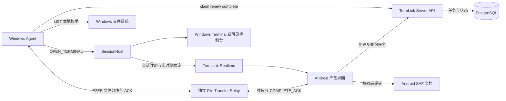
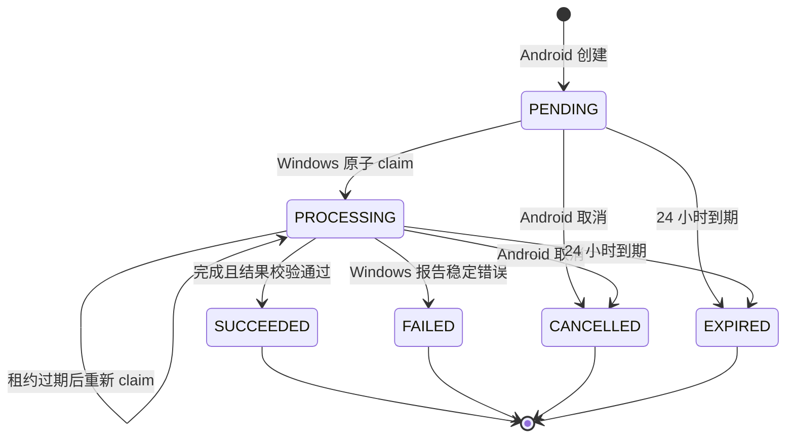
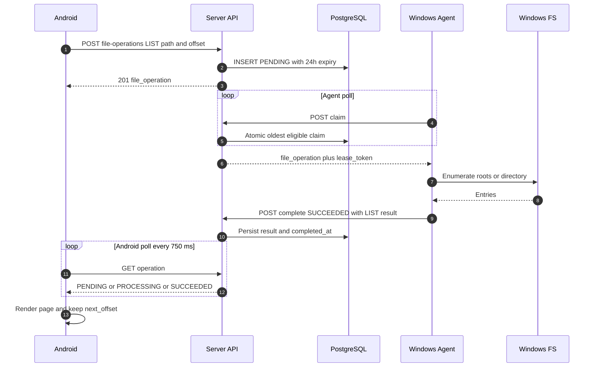
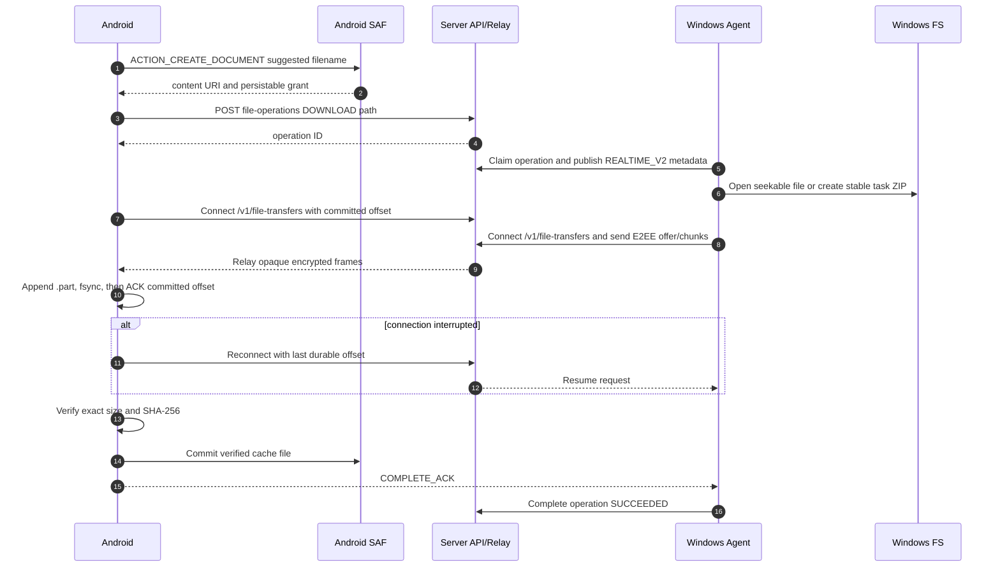
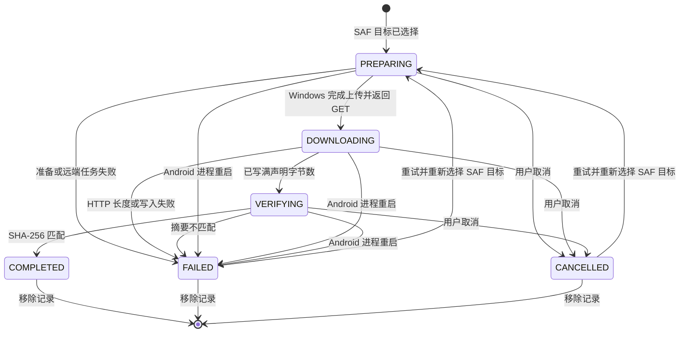
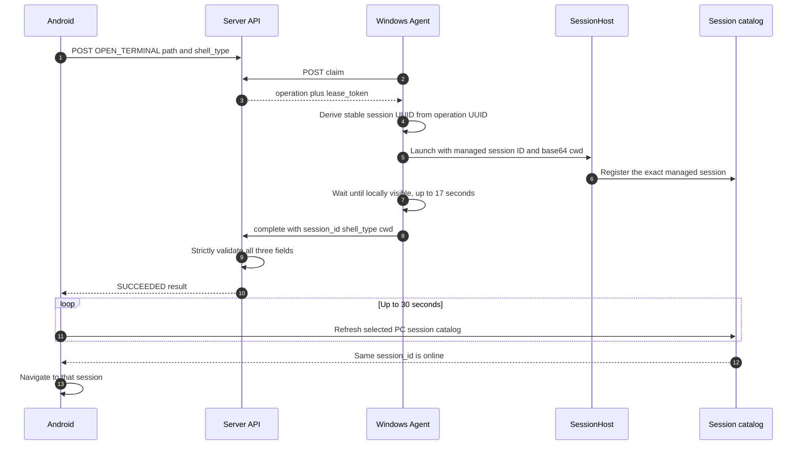
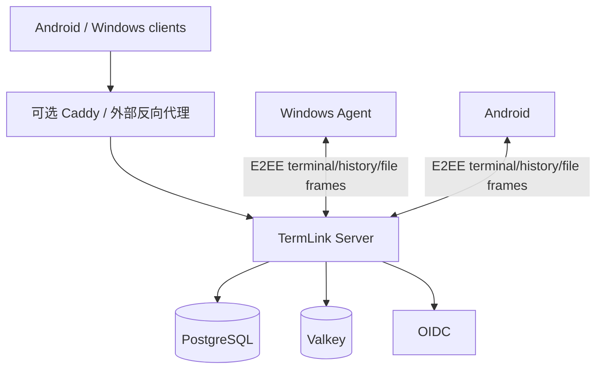

# Android ↔ Server ↔ Windows 文件操作 E2E

> 文件内容通道使用独立的 E2EE Realtime File Transfer V2，断点续传与缓存真值
> 见 `docs/REALTIME_FILE_TRANSFER_V2.md`。

本文记录当前已经落入源码的远程文件操作契约、端到端数据路径、Android 下载中心生命周期、Docker 部署取舍与验收边界。中文是产品主说明，首次出现的主要界面词同时给出英文，便于核对中英文资源。

实现基线：2026-09-05。协议真值以 `server/internal/api/file_operations.go`、`server/internal/store/file_operations.go`、数据库 Migration 40/41、`win-agent/src/Agent/ProductionFileOperationWorker.cs`、`win-agent/src/Agent/ProductionFileTransferSender.cs`、`android/app/src/main/kotlin/dev/termlink/product/ProductionFileTransferClient.kt` 和 `RemoteFileModels.kt` 为准。

## 已实现的产品行为

- Android 设备页只展示在线 Windows PC；每台 PC 的右上状态区域提供“浏览文件 / Browse files”，设备页右上角提供跨 PC 聚合的“下载中心 / Download center”。
- 文件浏览从空路径开始列出 Windows 逻辑驱动器。进入目录后支持返回上一级、刷新和“加载更多 / Load more”。目录优先，再按名称排序。
- 文件和目录都可下载。文件按原始字节传输；目录先在 Windows 端生成包含所选根目录的 ZIP，保留空目录，不跟随 junction、symlink 等 reparse point。
- Android 先通过 Storage Access Framework（SAF）选择保存位置，再创建服务端 `DOWNLOAD` 任务。Windows 与 Android 通过独立文件 WebSocket 传送 E2EE 分块，服务端只鉴权和转发。
- Android 先把分块写入私有 `.part` 缓存并持久化连续偏移，支持断线和进程重启续传；长度和 SHA-256 验证通过后才提交 SAF 文档。零字节文件合法，截断、超长或摘要不符都会失败关闭。
- 文件/目录行右侧统一使用操作菜单；目录菜单提供 ZIP 下载、收藏/取消收藏，以及该 PC Agent 实际上报可用的命令行。收藏按服务端与账号隔离，并记录 PC 与绝对路径，可从收藏目录跨 PC 直达。
- 目录页面只在 PC 的 `supported_shells` 中包含相应值时，才允许启动 CMD（`cmd.exe`）或 Windows PowerShell（`powershell.exe -NoLogo -NoProfile`）。新窗口由 TermLink SessionHost 托管，随后按返回的准确 `session_id` 出现在 Android 会话页。
- 下载中心显示准备/压缩、下载、校验、完成、失败和取消状态以及字节进度；支持取消、失败或取消后的重试、终态记录删除。删除记录只删 Android 元数据，不删除已经保存的 SAF 文档。
- Android 和 Windows Agent 使用同一账号时直接发现并处理任务，不要求用户执行逐 PC 配对或 Grant。文件操作仍只会路由到所选 PC 自己的 Agent。
- 文件浏览、下载和远程开 Shell 都受 Windows 的“远程访问已启用”开关约束；关闭后 Agent 不再领取新任务，并取消正在处理的长任务。

主要中英文 UX 对应为：`浏览文件 / Browse files`、`下载中心 / Download center`、`正在 Windows 上准备 / Preparing on Windows`、`正在 Windows 上压缩 ZIP / Compressing ZIP on Windows`、`正在下载 / Downloading`、`正在校验大小与 SHA-256 / Verifying size and SHA-256`、`已完成 / Completed`、`失败 / Failed`、`已取消 / Cancelled`、`重试 / Retry` 和 `移除记录 / Remove record`。两套资源使用相同 key，系统语言切换不改变状态机或协议值。

## 总体流程图



控制面是 Android/Windows 与 Server API 之间的小型 JSON 请求；下载数据面使用独立于终端连接的 E2EE 文件 WebSocket。终端和文件拥有不同的队列、心跳与背压边界。

## 服务端任务协议

### 端点

| 调用方 | 方法和路径 | 请求重点 | 成功响应 |
| --- | --- | --- | --- |
| Android | `POST /v1/pcs/{pcId}/file-operations` | `operation`、`path`，可选 `offset` 或 `shell_type` | `201`，`file_operation` |
| Windows | `POST /v1/pcs/{pcId}/file-operations/claim` | 空正文 | `200`，`file_operation` + 顶层 `lease_token`；无任务时 `204` |
| Android | `GET /v1/pcs/{pcId}/file-operations/{operationId}` | 无 | `file_operation`；成功下载在顶层附带 `download` |
| Android | `DELETE /v1/pcs/{pcId}/file-operations/{operationId}` | 无 | `file_operation.status=CANCELLED`；已取消时幂等 |
| Windows | `POST /v1/pcs/{pcId}/file-operations/{operationId}/upload` | 租约、文件名、大小、SHA-256、是否目录 ZIP | 顶层 `upload` 预签名请求 |
| Windows | `POST /v1/pcs/{pcId}/file-operations/{operationId}/renew` | `lease_token` | 更新后的 `file_operation.lease_expires_at` |
| Windows | `POST /v1/pcs/{pcId}/file-operations/{operationId}/complete` | 租约、`SUCCEEDED` + 可选结果，或 `FAILED` + `error` | 终态 `file_operation` |

Android 创建请求只有三种合法形状：

```json
{"operation":"LIST","path":"","offset":0}
```

```json
{"operation":"DOWNLOAD","path":"C:\\Users\\me\\report.txt"}
```

```json
{"operation":"OPEN_TERMINAL","path":"C:\\work","shell_type":"windows-powershell"}
```

`LIST` 的根目录请求可省略 `offset`；`DOWNLOAD` 不允许 `offset` 或 `shell_type`；`OPEN_TERMINAL` 只接受 `command-prompt` 和 `windows-powershell`。路径必须是有效 UTF-8、不得含 NUL，服务端上限是 4096 字节；Windows 进一步要求文件/目录操作使用已存在的绝对路径，并拒绝 `\\?\`、`\\.\` 设备命名空间。

公共任务视图包含以下字段中的适用部分：

```json
{
  "file_operation": {
    "id": "operation UUID",
    "pc_id": "PC UUID",
    "operation": "LIST | DOWNLOAD | OPEN_TERMINAL",
    "path": "C:\\work",
    "offset": 0,
    "shell_type": "windows-powershell",
    "status": "PENDING | PROCESSING | SUCCEEDED | FAILED | CANCELLED | EXPIRED",
    "attempt_count": 1,
    "lease_expires_at": "RFC 3339 timestamp",
    "result": {},
    "error": "stable-code: readable message",
    "expires_at": "RFC 3339 timestamp",
    "completed_at": "RFC 3339 timestamp",
    "cancelled_at": "RFC 3339 timestamp",
    "created_at": "RFC 3339 timestamp",
    "updated_at": "RFC 3339 timestamp"
  }
}
```

对象存储 key、租约摘要、账号 ID 和请求设备 ID 不出现在 Android 响应中。原始租约只在 claim 响应顶层返回给对应 Windows Agent。

### 状态与时限



- 任务有效期：创建后 24 小时。
- claim 租约：1 小时，且 `lease_expires_at` 永不超过任务 `expires_at`。Windows 处理任务时默认每 5 秒续租。
- Agent 空闲 claim 间隔和 Android 状态轮询间隔：均为 750 ms；瞬态连接错误采用最高 15 秒的退避。
- Windows 的目录与文件 Worker 独立于 Agent 心跳和实时会话运行。HTTP 超时不会结束 Worker；未分类异常由内部监督循环按最高 15 秒退避重新启动该 Worker，不重启 Agent，也不停止现有本地会话。每个故障周期只记录一次中英双语降级事件，恢复后记录一次恢复事件，诊断位于 `%LOCALAPPDATA%\TermLink\logs\TermLink-file-operations.jsonl`。
- 只有持有当前 32 字节 Base64URL 租约的 Windows Agent 能上传元数据、续租或完成。
- 多 Agent poller 通过 PostgreSQL `FOR UPDATE SKIP LOCKED` 原子领取；租约丢失后当前 ZIP/上传/启动工作会被取消，任务可按服务端状态决定是否重领。
- 所有修改状态的 API 请求携带 `Idempotency-Key`。Android 对一次 create 尝试保持同一 key；Windows 对结果不明确的 claim 重试复用 key，upload/renew/complete 的 key 绑定 operation、动作和租约摘要。任务 UUID 是后续轮询、取消和结果去重的唯一标识。
- `complete` 支持同一租约、同一终态正文的幂等重放；内容不同的重复完成会冲突。

## 目录浏览时序



成功 `LIST` 结果形状如下：

```json
{
  "current_path": "C:\\work",
  "parent_path": "C:\\",
  "entries": [
    {
      "name": "src",
      "path": "C:\\work\\src",
      "kind": "directory",
      "size_bytes": null,
      "modified_at": "2026-08-24T01:02:03Z",
      "attributes": ["directory"]
    }
  ],
  "next_offset": 500
}
```

每页最多 500 项；Windows 还把序列化结果限制在 900 KiB，给服务端 1 MiB 结果上限留出余量。Android 使用 `next_offset` 追加下一页，并按不区分大小写的绝对路径去重。切换目录时，迟到的旧请求不能覆盖新页面；新目录加载失败时恢复上一个已成功页面。

## 文件和目录下载时序



文件内容只存在于 Windows 源文件/任务缓存和 Android 私有任务缓存中。服务端验证账号、设备、任务、方向、有效期和帧大小，然后转发 E2EE 帧；不保存块内容、续传偏移或文件密钥。

### 大小、校验和缓存生命周期

- 文件和压缩后 ZIP 的共同硬上限是 5 GiB，即 `5,368,709,120` 字节。
- Windows 普通文件直接以只读可 seek 流发送；目录 ZIP 固定在 `%LOCALAPPDATA%\TermLink\Cache\FileTransfers\<transfer-id>\`，从而可在断线或 Agent 重启后续传。
- Android 先写 `<cacheDir>/file-transfers/<transfer-id>/payload.part`，每次持久化后才 ACK 当前连续偏移；重连时这个偏移是唯一续传权威。
- 重复块必须逐字节一致；前向缺口触发 `RESUME`，不会创建稀疏文件。
- Android 在写入 SAF 前核对长度和 SHA-256；Windows 仅在收到 `COMPLETE_ACK` 后报告任务成功。
- 成功、明确取消、过期、授权丢失或用户移除记录后清理任务缓存。瞬态断线和进程重启保留缓存。
- 文件传输使用独立的 `termlink.file-transfer.v2` WebSocket，不与终端 `/v1/realtime` 共用队列和心跳。

## 取消、失败、恢复和重试



Android 下载记录字段包括本地记录 ID、PC、远端路径、文件名、是否 ZIP、SAF URI、服务端 operation ID、总字节数、已下载字节数、状态、时间和错误；最多保存最近 100 条。进度最多每秒持久化一次，避免每个数据块都写 SharedPreferences。

取消执行以下动作：取消 Android coroutine 和 OkHttp call；删除或截断未完成 SAF 文档；若已得到 operation ID，则尽力调用服务端 `DELETE`。Windows 的下一次续租看到租约冲突后会中断压缩或上传。即使取消请求遇到瞬态网络错误，Android 本地仍显示已取消，24 小时服务端到期是最终兜底。

Android 进程被杀后，原 `PREPARING`、`DOWNLOADING` 或 `VERIFYING` 记录在下次启动时变为可重试的 `FAILED`；应用清理未完成文档、释放持久 URI 权限并尽力取消已知服务端任务。失败或取消的重试复用本地记录 ID，但清空旧 operation ID 和进度，重新选择 SAF 目标并创建新服务端任务。

“移除记录 / Remove record”只允许终态记录，并且不会调用 `DocumentsContract.deleteDocument` 删除已完成文件。退出登录或切换服务配置会停止活动下载并清空属于原账号上下文的下载元数据。

## PC 命令行能力协商

Windows Agent 在每次 PC upsert/心跳元数据中发送实际探测结果：

```json
{
  "name": "Office PC",
  "agent_version": "0.1.29.35",
  "key_epoch": 1,
  "session_heartbeat_capable": true,
  "supported_shells": ["command-prompt", "windows-powershell"]
}
```

能力成立需要 `TermLink.SessionHost.exe` 与对应 Shell 可执行文件同时存在。服务端仅接受
`command-prompt`、`windows-powershell`，去重后按固定顺序写入 `pcs.supported_shells` 并从
`GET /v1/pcs` 原样返回。旧 Agent 不发送字段时保存空数组；Android 对字段缺失、空数组或未知值
均不猜测，不显示命令行选项。该字段是 Agent → Server → Client 的能力协商接口；新增 Shell 必须
同时扩展 Agent 探测/启动白名单、服务端输入与数据库约束、客户端映射和协议测试，不能只改 UI。

## 在所选目录打开终端



成功结果必须且只能包含：

```json
{
  "session_id": "canonical non-zero UUID",
  "shell_type": "command-prompt",
  "cwd": "C:\\work"
}
```

服务端要求 `session_id` 为规范 UUID，`shell_type` 与请求完全相同，`cwd` 与请求路径字符串完全相同。Windows 实际启动前会把目录规范化，并把同一个 ID 传给 `TermLink.SessionHost.exe --managed-session-id`，把目录以 `--working-directory-base64` 传入。Agent 对 operation ID 派生稳定 session ID；任务因租约重领而重放时，如会话已注册则不会再开第二个 Shell。优先用 Windows Terminal 新标签页，找不到或启动失败时回退到可见 SessionHost 控制台。

## Docker 拓扑与精简取舍



生产运行时不再包含 MinIO/S3。PostgreSQL 仅保存账号、设备、会话目录、文件任务和路由元数据；Valkey 支撑实时协调；终端历史由在线 Windows Agent 提供，文件内容由 Windows 与 Android 通过 Relay/Direct 路径传送。隐私数据导出功能及其对象制品已移除。

`external-services.compose.yml` 现在只表示外部 OIDC 部署；`acceptance.compose.yml` 仍提供 Keycloak、PostgreSQL、Valkey、Server 和入口代理，但不启动对象存储。

## 部署与 E2E 验收清单

1. 将数据库迁移到当前最新版本，确认旧隐私导出表、`pc_file_operations.object_key` 和 `OBJECT_V1` 任务已清理。
2. 确认 Compose 不包含 MinIO、S3 凭据、对象网络或 `/termlink-history` 反向代理。
3. 访问 `/readyz` 应为 `200`；`/v1/client-config` 的 OIDC issuer 和 public origin 必须使用实际域名。
4. Android 与 Windows Agent 登录同一账号，验证设备目录和会话目录加载。
5. 浏览根驱动器及超过 500 项的目录，覆盖中文、空格和 Unicode 文件名。
6. 下载零字节文件、多块文件和目录 ZIP，核对名称、长度、SHA-256、ZIP 空目录和内容。
7. 在传输中断网后恢复，确认 Android 从已持久化偏移续传且终端连接不断开。
8. 杀掉 Android 进程后重新进入任务，确认 `.part` 缓存可续传；完成后的 SAF 文档不会重复提交。
9. 在 Windows Agent 重启后续传目录 ZIP，确认稳定任务缓存被复用。
10. 分别取消 Android 和 Windows 侧任务，确认两端任务缓存最终清理，服务端只保留受限生命周期的任务元数据。
11. 打开终端并同时进行文件传输，验证输入、输出、心跳、本地主机历史和控制租约不受影响。

协议和缓存边界详见 [Realtime File Transfer V2](REALTIME_FILE_TRANSFER_V2.md)。

## 验证状态与设备边界

### 已验证的自动化覆盖

- Server：Go 全量测试覆盖文件操作 API、角色边界、实时传输路由、5 GiB 元数据边界、幂等完成、租约轮换、取消/到期和 Migration 40/41。
- Windows：Release 验证覆盖目录排序/分页、ZIP 空目录、reparse point、统一缓存、E2EE 多块发送、续传、取消、续租丢失和独立 Worker 恢复。
- Android：单元与仪器测试覆盖文件协议、零字节/多块/重复/缺口/SHA 错误、私有缓存恢复、SAF 单次提交和“删记录不删文件”。
- Docker/入口：生产配置策略覆盖 64 组功能组合，并禁止 MinIO、S3 凭据、对象网络和对象代理入口。

这些结果证明分层实现和服务端真实数据库契约，不自动等同于一次物理 Android 设备到真实 Windows 文件系统的完整用户操作已经通过。

### 仍需物理设备或发布环境确认

- Android 真机上的 OEM DocumentsProvider、外置存储/云盘 SAF provider、权限回收、低存储空间和后台进程限制。
- 真实移动网络切换、超大文件长时间下载、接近 5 GiB 上限的端到端耗时与厂商省电策略；5 GiB 是协议上限，不是已经用真机搬运 5 GiB 的性能结论。
- 真机触控与中英文布局、屏幕旋转、Activity 重建后的系统文件选择器体验，以及下载中心的人工可用性。
- 不同 Windows 版本、企业 ACL、锁定文件、网络盘和实际 reparse point 目录的人工行为；自动化只覆盖可控夹具。
- 公网 ingress、证书链以及 Relay/Direct 切换下的大文件续传需要在最终部署环境再做一次验收。

正式验收记录应分别注明 `protocol_e2e`、`android_ui_emulator` 和 `android_physical_device`，未执行的层级不得由其他层级的成功结果代替。
