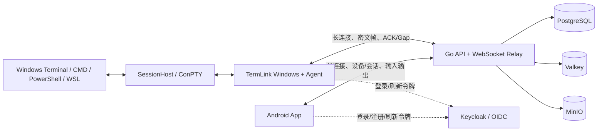

# TermLink 新会话交接（2026-08-25）

本文记录截至 2026-08-25 00:40（Asia/Shanghai）的代码、运行环境、已发布版本、验证证据和发布参数。
新会话应先阅读本文，再根据实际任务查看 `README.md`、`docs/RELEASE.md` 和对应模块 README。

本文不包含密码、Token、私钥、Keycloak 临时密码或带签名的临时下载 URL。不要把本机 Secret
内容复制到聊天、Git、构建日志或发布说明中。

## 1. 产品目标与当前 E2E 主链路

终极目标是：Android 登录与 Windows 相同账号后，可以发现该账号在线 PC 和真实 Windows
命令行会话，查看输出并输入命令，体验尽量接近在 PC 本地操作终端。

当前产品明确采用“同账号直接使用”：

- 不要求配对、首次授信、逐 PC Grant 或人工批准；
- Windows 和 Android 使用同一 OIDC 账号后自动归属同一个账号空间；
- 不同账号之间仍由服务端隔离；
- 同一会话允许多个 Android 客户端同时接收与输入；
- 普通 Agent 断线或重启不结束本地 Shell，升级安装则会明确提示并终止受管终端。



终端输出方向：`Shell -> SessionHost -> Agent -> Server Relay -> 同账号 Android`。

输入方向：`Android -> Server Relay -> Agent -> SessionHost -> Shell`。

远程文件方向：Android 浏览 Windows 目录；单文件直接下载，目录由 Windows 端压缩为 ZIP 后传输；
Android 下载列表负责进度、取消和删除。Android 也可以在选定 Windows 目录中打开 CMD 或 PowerShell。

## 2. 工作区、Git 与工具链

| 项目 | 当前值 |
| --- | --- |
| 工作区 | `E:\WorkSpace\AICodeProject\TermLink` |
| 分支 | `main` |
| Windows 功能提交 | `3323a9238cf4e0b3b09414b37faa4330c481f98c` |
| 远端当时位置 | `origin/main = 678d5e0` |
| 远端 | `git@github.com:myucxy/TermLink.git` |
| 固定 .NET SDK | `D:\Dev\Env\dotnet-sdk-8.0.303\dotnet.exe` |
| Android SDK | `D:\Dev\Env\Android\Sdk` |
| JDK | 优先使用清单中的 `D:\Dev\Env\Jdk\jdk-21` |
| 环境清单 | `D:\Dev\DEV_ENV_MANIFEST.json` |
| 环境检查 | `D:\Dev\Scripts\Ensure-DevEnv.ps1` |

写本文之前工作树干净，但 `main` 比 `origin/main` 超前 1 个功能提交。本文本身提交后超前数量会继续增加。
新会话必须先执行：

```powershell
Set-Location 'E:\WorkSpace\AICodeProject\TermLink'
git status -sb
git log -5 --oneline --decorate
& 'D:\Dev\Scripts\Ensure-DevEnv.ps1' -Tool git,dotnet,jdk,android-sdk
```

不要假设功能提交已经推送。只有用户明确要求 Git push 时，再执行 `git push origin main`。

## 3. 目录作用

| 目录 | 作用 |
| --- | --- |
| `android/` | Android 原生产品客户端、终端引擎、登录、设备/会话、文件下载和更新功能 |
| `win-agent/` | Windows 主程序、内嵌 Agent、SessionHost、安装器、更新器和 Windows 测试 |
| `server/` | Go API/Relay、迁移、Web Portal、生产验收 Compose、运维脚本 |
| `protocol/` | Protobuf、E2EE、历史、Golden Stream 和测试协议定义 |
| `technical-validation/e2e/` | 从旧 `termlinkE2E` 迁入的技术验证模块，不是独立产品部署 |
| `scripts/` | 跨平台统一构建与 AppShip Production 发布包装器 |
| `release/` | 产物清单、签名、版本和本地发布验证脚本 |
| `docs/` | 系统设计、需求、E2E 时序、发布和历次交接文档 |
| `artifacts/release/` | 本机构建产物；被 Git 忽略 |
| `.appship/` | AppShip 幂等/断点状态；被 Git 忽略但必须保留以便 Resume |

关键设计文档：

- `docs/COMPLETE_SYSTEM_DESIGN.md`
- `docs/PRODUCT_REQUIREMENTS_AND_SOLUTION.md`
- `docs/REMOTE_FILE_OPERATIONS_E2E.md`
- `docs/FILE_OPERATIONS_E2E.md`
- `docs/TAIL_FIRST_E2E.md`
- `docs/RELEASE.md`
- `win-agent/README.md`
- `android/README.md`
- `server/README-runtime.md`

## 4. 当前主要功能状态

### 4.1 Windows

- `TermLink.exe` 提供主窗口、托盘和后台运行时；页面与 Agent 已做统一体验，不要求用户单独启动 Agent。
- 账号支持注册、登录、记住登录、刷新令牌和失效后提示重新登录。
- 能发现 Windows Terminal 中由 TermLink Profile 启动的 CMD、Windows PowerShell、PowerShell 7、WSL 会话。
- SessionHost 使用唯一会话 ID；Agent 重启后 SessionHost 会重新注册，已有本地 Shell 不结束。
- Relay 使用 WebSocket 长连接，断线自动重连；设置页可配置：
  - 初始重连间隔：1–60 秒；
  - 最大指数退避间隔：1–300 秒；
  - 快速重连次数：0–1000，0 表示无限；
  - 达到有限次数后每 60 秒继续探测，不会结束本地 Shell。
- 配置位置：`%LocalAppData%\TermLink\Agent\connection.preferences.json`。
- Windows Terminal 本地选择复制、右键粘贴和鼠标滚轮历史已恢复；SessionHost 不再错误吞掉鼠标事件。
- Android 远程关闭会话时会结束对应 SessionHost，Terminal Profile 的 `closeOnExit: always` 负责关闭对应标签页。
- 设置页可以重新生成 Windows Terminal Profile；安装/升级会覆盖 TermLink 自己的旧 Profile，不修改其他用户 Profile。
- 主窗口显示版本号、连接失败原因、重试按钮、中英文和 DPI 自适应。
- 自动更新从 AppShip 检查、下载、校验 SHA-256/Authenticode 后启动安装器。
- 升级安装始终提示将关闭 TermLink、Agent、SessionHost 和受管命令行会话，默认按钮为“否”；确认后安装提交前会再次扫描并终止随后启动的 TermLink 进程。

重要语义：普通 Agent 重启保留本地会话；升级安装会关闭受管命令行会话，这是为避免旧进程和旧文件继续占用而作出的明确选择。

### 4.2 Android

- 原生账号注册、登录、记住登录和中英文界面。
- 设备页只显示在线 Windows PC，记住上次展开的 PC；支持刷新和关闭远程会话。
- 会话页只显示从设备页打开的 Tab；Tab 上的 `X` 仅关闭 Android 本地页面，不关闭远程会话。
- 设备页“关闭会话”才真正关闭 Windows 远程会话，并同步关闭已打开的 Android Tab。
- 后打开 Android 时优先请求 TailOnly 最新一屏；历史记录上滑按页加载，并通过序号/标识去重。
- 用户上滑查看历史时保持当前位置，不会被实时输出强制拉回底部；回到底部后恢复跟随最新输出。
- 会话不再支持左右滑动切换，避免误触。
- 同账号多个 Android 可以同时连接和输入同一个会话。
- 终端列宽随 PC 端列数和首选字体缩放；行数按 Android 可用高度铺满，输入法弹出时按实际 Insets 上移。
- 支持退格、Delete、自定义按键组合、自定义快捷命令、快捷键排序和颜色选择器。
- 支持 Windows 文件浏览、文件/目录下载、目录 ZIP、下载列表、取消/删除，以及在目录中打开 CMD/PowerShell。
- 启动后和手动操作均可检查 AppShip 更新，点击后下载并调用系统安装。

### 4.3 服务端

- Go API + WebSocket Relay，负责 OIDC 身份、账号隔离、在线设备、会话目录、输入输出路由和状态同步。
- 同账号设备直接发现；旧 pairing/grant/trust API 仅保留兼容，不是产品使用前置条件。
- 用户、设备、会话目录、配置和业务状态持久化在 PostgreSQL；Keycloak 持久化身份；Valkey 用于在线/短期协调；MinIO 用于历史和文件对象。
- 支持同账号多个 Android 的共享控制、会话标题同步、离线 PC 隐藏和陈旧会话清理。
- Relay 不应把旧会话正文发送到新会话；实时帧、TailOnly 和历史分页使用会话 ID/序号去重。
- 公网健康检查截至交接时返回 `{"status":"ready"}`。

### 4.4 尚需牢记的技术边界

- `terminal-main/AsyncTerminalChannel` 和桥接代码已经完成技术验证，但生产 `ProductionAgentRuntime`
  仍使用现有 ConPTY/SessionHost 链路；不要误称 terminal-main 新通道已经切换生产。
- Windows 当前签名证书 Subject 是 `CN=TermLink Development`，签名状态和时间戳有效，但它不是公开 CA 商业证书，不能承诺没有 SmartScreen/信任提示。
- Android 签名证书来自既有 NuanYa keystore，必须保持指纹连续，不能临时生成新证书。

## 5. 当前运行中的服务端部署

### 5.1 公网与本机入口

| 用途 | 地址 |
| --- | --- |
| 产品/API/Relay 公网入口 | `https://termlink.kget.cc:8910` |
| 健康检查 | `https://termlink.kget.cc:8910/readyz` |
| 本机 LAN 地址 | `192.168.9.28/24` |
| Lucky 当前上游 | `http://192.168.9.28:8080` |
| 本机验收 Edge | `https://127.0.0.1:9443`（只绑定 loopback） |

截至交接时，Docker Compose 项目为 `termlink-production-acceptance`，配置文件是
`server/compose/acceptance.compose.yml`，7 个服务均在运行且健康：

| 服务 | 作用 |
| --- | --- |
| `server` | TermLink Go API 与 Relay |
| `postgres` | 用户、设备、会话和业务持久化 |
| `valkey` | 在线状态和短期协调 |
| `minio` | 历史/文件对象存储 |
| `keycloak` | OIDC 登录、注册和账号身份 |
| `edge` | 内部 HTTPS/Caddy 边缘入口 |
| `lucky-upstream` | 暴露宿主机 `0.0.0.0:8080` 给 Lucky 反向代理 |

当前 server 容器：

- 容器：`termlink-production-acceptance-server-1`
- 本地镜像：`termlink-production-acceptance-server:local`
- Image ID：`7953eab1b80d...`
- 镜像约 32.5 MB
- OCI 标签仍是 `version=dev`、`revision=unknown`

因此它是本机生产验收镜像，不是可追溯的 Docker Hub 正式发布。交接时 `docker images` 中没有
`myucxy/termlink` 标签。用户已经在 Docker Hub 创建了 `myucxy/termlink` 仓库，但当前镜像尚未按该名称构建、标记或推送。

只读检查：

```powershell
docker compose -f .\server\compose\acceptance.compose.yml ps
Invoke-RestMethod 'https://termlink.kget.cc:8910/readyz'
```

正常重建/启动验收栈（不重置数据）：

```powershell
& .\server\ops\Start-ProductionAcceptance.ps1 `
  -LuckyBindAddress '0.0.0.0' `
  -LuckyPort 8080
```

`-Reset` 和 `Stop-ProductionAcceptance.ps1 -RemoveVolumes` 会重建或删除受管持久化数据；未得到用户明确授权前不要运行。

Docker Hub 发布尚有流程差异需要处理：

- `scripts/Build-Release.ps1 -ServerImage` 只生成多架构 OCI tar，不会 push；
- Production Server 构建要求 Cosign 和 Server Signing Key；交接时本机未发现可用 `cosign`，仓库 `server/secrets/` 也没有发布签名 key；
- 现有 `server/release/Verify-ImageRelease.ps1` 针对 `ghcr.io/myucxy/termlink-server`，与用户指定的 Docker Hub `myucxy/termlink` 不一致；
- 下一会话如要正式推送 Docker Hub，应先调整并审核这条发布链，不要直接把 `dev/revision=unknown` 的本地验收镜像标为正式版。

## 6. 已发布客户端

### 6.1 Windows stable

| 字段 | 值 |
| --- | --- |
| AppShip application | `termlink-win64` |
| Version / Build | `0.1.27` / `33` |
| 文件 | `TermLink-Setup-0.1.27.33-x64.exe` |
| 本地路径 | `artifacts/release/0.1.27-33/TermLink-Setup-0.1.27.33-x64.exe` |
| 大小 | `177113656` bytes |
| SHA-256 | `806e2a70a6d2c6805c1acb9bfe89e73ce195433a81b5277c0458cdecad541601` |
| Signer SHA-1 | `91AE60BC06D866628B8EB2C62F32BDE9DAB56466` |
| ProductVersion | `0.1.27.33+3323a9238cf4e0b3b09414b37faa4330c481f98c` |
| AppShip release ID | `44b1483f-408d-465d-8605-4fd2ab3bc581` |
| AppShip artifact ID | `8290fdf3-ca93-44c0-84ef-a046d322c317` |
| AppShip 状态 | `published` / artifact `ready` |

AppShip 幂等状态文件：

`.appship/termlink-win64-stable-0.1.27-build33-signature-approved.json`

Windows 0.1.27 包含：Agent 可配置重连、成功连接后正确重置退避、普通 Agent 重启恢复已有会话、
Windows Terminal 复制/粘贴/滚轮恢复，以及升级前明确提示并终止旧受管进程和终端。

### 6.2 Android stable

| 字段 | 值 |
| --- | --- |
| AppShip application | `termlink-android` |
| Version / Build | `0.1.26` / `32` |
| 文件 | `TermLink-Android-0.1.26-32.apk` |
| 本地路径 | `artifacts/release/0.1.26-32/TermLink-Android-0.1.26-32.apk` |
| 大小 | `18093750` bytes |
| SHA-256 | `3f353e615b7cde520c3adb23b48d57be55e55661fecef77a8d4dade7f7534a9b` |
| Signer SHA-256 | `f374794c07dbc34299d6c141cba4eee034849efc625a031eb893dc5748df021b` |
| AppShip release ID | `f7ddb4fd-3d5b-4112-82a9-3123fb82ac68` |
| AppShip artifact ID | `660100b4-50b0-4487-bc7c-0a4fe4997bcf` |
| AppShip 状态 | `published` / artifact `ready` |

AppShip 幂等状态文件：

`.appship/termlink-android-stable-0.1.26-build32-signature-approved.json`

公开更新接口验证：

```text
GET https://appship.kget.cc:8910/api/v1/apps/termlink-win64/updates?platform=windows&arch=x64&channel=stable&build=<current-build>
GET https://appship.kget.cc:8910/api/v1/apps/termlink-android/updates?platform=android&arch=universal&channel=stable&build=<current-build>
```

使用旧 build 应返回 `optional` 和上表版本；使用最新 build 应返回 `no_update`。

## 7. 最近 Windows 修改的验证证据

最近一轮使用固定 `.NET SDK 8.0.303` 完成：

- Windows 完整 Release Solution：0 warnings / 0 errors；
- `ProductionPcHeartbeatValidation`：重连配置持久化、退避、损坏配置回退、PC 心跳和标题重发布；
- `Test-SessionRegistry.ps1`：Agent 异常退出、受控重启、20 个 SessionHost 恢复；
- `Test-SessionHost.ps1`：Unicode、Ctrl/Alt/方向键、2 MiB 输出、resize、10 秒 soak、20 次泄漏循环；
- `Test-ControlPipeConcurrency.ps1 -ClientCount 32`：32 个并发客户端，0 failure；
- `Test-TrayExit.ps1`：内嵌运行时、立即重试和退出路径；
- `Validate-WindowsSetup.ps1 -Version 0.1.27.33`：安装、原地升级、终止旧进程、Profile、快捷方式、启动项和卸载；
- Tray Visual Smoke：96/120/144/192 DPI × 中英文 × 明暗主题，共 120 张截图。

证据：

- `artifacts/validation/session-registry-reconnect-0.1.27.json`
- `artifacts/validation/session-host-terminal-input-0.1.27.json`
- `artifacts/validation/windows-setup-upgrade-0.1.27.33.json`
- `artifacts/validation/tray-visual-reconnect-0.1.27/`

快速复跑命令：

```powershell
& .\win-agent\tests\Test-ProductionPcHeartbeat.ps1 `
  -DotNetPath 'D:\Dev\Env\dotnet-sdk-8.0.303\dotnet.exe'

& .\win-agent\tests\Test-SessionRegistry.ps1 `
  -EvidencePath "$env:TEMP\termlink-session-registry.json"

& .\win-agent\tests\Test-SessionHost.ps1 `
  -LeakIterations 20 -SoakSeconds 10 `
  -EvidencePath "$env:TEMP\termlink-session-host.json"

& .\win-agent\Build-Windows.ps1 `
  -Configuration Release `
  -DotNetPath 'D:\Dev\Env\dotnet-sdk-8.0.303\dotnet.exe'
```

## 8. 发布所需的非敏感固定信息

### 8.1 AppShip

| 参数 | 值 |
| --- | --- |
| Base URL | `https://appship.kget.cc:8910` |
| 用户名 | `admin`（密码不写入本文） |
| Credential Manager target | `TermLink-AppShip-release-manager` |
| Windows slug | `termlink-win64` |
| Android slug | `termlink-android` |
| Channel | `stable` |
| 发布技能客户端 | `F:\AISession\.codex\skills\appship-publish\scripts\publish.ps1` |
| 仓库包装入口 | `scripts/Publish-AppShipProduction.ps1` |

真实发布必须使用 `PSCredential`，不能把 AppShip 密码放入命令参数或文件。发布中断时保留同一个
`.appship` 状态文件，用完全相同的 manifest、版本、说明、签名审核信息加 `-Resume`；不要创建第二个 release。

### 8.2 Windows 签名

| 参数 | 值 |
| --- | --- |
| PFX | `win-agent/secrets/TermLink.Development.CodeSigning.pfx` |
| 密码文件 | `win-agent/secrets/code-signing-password.txt`（仅本机、Git ignored） |
| 公钥 CER | `win-agent/secrets/TermLink.Development.CodeSigning.cer` |
| Signer SHA-1 | `91AE60BC06D866628B8EB2C62F32BDE9DAB56466` |
| Subject | `CN=TermLink Development` |
| RFC 3161 URL | `http://timestamp.acs.microsoft.com`，必须显式传 `-AllowHttpWindowsTimestamp` |

不要更换 PFX 或指纹；更换会破坏更新签名连续性。

### 8.3 Android 签名

| 参数 | 值 |
| --- | --- |
| Keystore | `D:\Dev\Env\Android\keystores\nuanya-release.jks` |
| Alias | `nuanya-release` |
| Credential Manager target | `TermLink-Android-Keystore` |
| Signer SHA-256 | `f374794c07dbc34299d6c141cba4eee034849efc625a031eb893dc5748df021b` |
| 最低 Android API | 26 |

不要在 Git、参数或日志中写 keystore 密码，不要生成新的 Android 发布证书。

## 9. 标准客户端构建与 AppShip 发布流程

统一入口是 `scripts/Build-Release.ps1`。它只构建和生成 `artifact-manifest.json`，不会上传。

版本必须递增。当前 Windows 已到 build 33，Android 已到 build 32：

- 下一次 Windows 单独发布至少使用 build 34；
- Android 单独发布可以使用它自己的下一版本/build；
- 如果 Android/Windows 同批共用一个 manifest，建议直接使用高于所有现有 build 的统一版本，例如 `0.1.28 / 34`。

### 9.1 Windows Production 构建

```powershell
$version = '<three-part-version>'
$build = <new-build-number>
$windowsPassword = ConvertTo-SecureString `
  (Get-Content -Raw '.\win-agent\secrets\code-signing-password.txt').Trim() `
  -AsPlainText -Force

& .\scripts\Build-Release.ps1 `
  -Version $version `
  -BuildNumber $build `
  -WindowsSetup `
  -ReleaseMode Production `
  -DotNetPath 'D:\Dev\Env\dotnet-sdk-8.0.303\dotnet.exe' `
  -WindowsCertificatePath '.\win-agent\secrets\TermLink.Development.CodeSigning.pfx' `
  -WindowsCertificatePassword $windowsPassword `
  -WindowsTimestampUrl 'http://timestamp.acs.microsoft.com' `
  -AllowHttpWindowsTimestamp `
  -ExpectedWindowsSignerSha1 '91AE60BC06D866628B8EB2C62F32BDE9DAB56466'
```

构建应生成：

```text
artifacts/release/<version>-<build>/TermLink-Setup-<version>.<build>-x64.exe
artifacts/release/<version>-<build>/artifact-manifest.json
```

### 9.2 Android Production APK 构建

```powershell
$version = '<three-part-version>'
$build = <new-build-number>
$androidPassword = Read-Host 'Android keystore password' -AsSecureString

& .\scripts\Build-Release.ps1 `
  -Version $version `
  -BuildNumber $build `
  -AndroidApk `
  -ReleaseMode Production `
  -AndroidSdkPath 'D:\Dev\Env\Android\Sdk' `
  -AndroidKeystorePath 'D:\Dev\Env\Android\keystores\nuanya-release.jks' `
  -AndroidKeystorePassword $androidPassword `
  -AndroidKeyAlias 'nuanya-release' `
  -ExpectedAndroidSignerSha256 'f374794c07dbc34299d6c141cba4eee034849efc625a031eb893dc5748df021b'
```

### 9.3 发布前复核

Windows：

```powershell
& .\release\Verify-LocalRelease.ps1 `
  -ReleaseDirectory ".\artifacts\release\$version-$build" `
  -ManifestPath ".\artifacts\release\$version-$build\artifact-manifest.json" `
  -ExpectedReleaseMode Production `
  -ExpectedWindowsSignerSha1 '91AE60BC06D866628B8EB2C62F32BDE9DAB56466' `
  -RequireWindowsTimestamp
```

Android 发布前也必须提供 Android SDK 和预期 SHA-256 指纹运行同一 verifier。manifest 如果同时包含
APK 和 Setup，发布任一目标时包装器会复核两端，因此必须同时提供两端签名参数。

### 9.4 AppShip 发布

```powershell
$appShipCredential = Get-Credential -UserName 'admin' `
  -Message 'TermLink AppShip release manager'

& .\scripts\Publish-AppShipProduction.ps1 `
  -ManifestPath ".\artifacts\release\$version-$build\artifact-manifest.json" `
  -Target WindowsSetup `
  -BaseURL 'https://appship.kget.cc:8910' `
  -Credential $appShipCredential `
  -PublishScriptPath 'F:\AISession\.codex\skills\appship-publish\scripts\publish.ps1' `
  -ExpectedWindowsSignerSha1 '91AE60BC06D866628B8EB2C62F32BDE9DAB56466' `
  -SignatureApproved `
  -SignatureReviewNote 'Exact production artifact independently verified'
```

Android 把 `-Target` 改为 `AndroidApk`，并传入：

```powershell
-AndroidSdkPath 'D:\Dev\Env\Android\Sdk' `
-ExpectedAndroidSignerSha256 'f374794c07dbc34299d6c141cba4eee034849efc625a031eb893dc5748df021b'
```

完成后记录非敏感的 application/release/artifact ID、版本、状态、SHA-256 和状态文件路径，并调用公开更新接口验证。

## 10. 新会话建议起始指令

可以在新会话直接发送：

```text
请先完整阅读 E:\WorkSpace\AICodeProject\TermLink\docs\SESSION_HANDOFF_2026-08-25.md，
然后检查 git status、当前 Docker Compose 状态和公网 /readyz。保留现有用户改动和所有 Secret，
不要重复创建 AppShip release。功能代码从 Windows 提交 3323a92 继续；若需要发布，严格使用文档中的
Build-Release、Verify-LocalRelease 和 Publish-AppShipProduction 流程。只有服务端代码发生变化时才处理
Docker；Docker Hub 目标是 myucxy/termlink，但当前本机只有 dev/revision=unknown 的验收镜像，先完善并审核
Docker Hub 发布链再推送。
```

## 11. 新会话开始时优先确认

1. `git status -sb`：确认本地提交是否已经 push，是否出现新的用户改动。
2. `Invoke-RestMethod https://termlink.kget.cc:8910/readyz`：确认公网服务。
3. AppShip 两个公开更新接口：确认 stable 最新版本没有被其他会话更新。
4. `docker compose ... ps`：确认 7 个验收服务健康。
5. 根据任务判断是否改动 `server/`；没有服务端改动就不要重建/推送 Docker。
6. 发布前重新跑与改动范围匹配的测试，不复用旧测试结果冒充新构建证据。
7. 构建前先提交功能代码，使 Windows `ProductVersion` 和 Server OCI revision 能绑定真实 Git commit。

## 12. 2026-08-25 0.1.30 最终发布与部署（覆盖前文旧状态）

本节是本文件最新状态；第 5、6、10 节中关于 0.1.29、Docker Hub 尚未发布和下一步版本号的描述仅保留为
历史记录。后续发布先阅读[发布与部署运行手册](RELEASE_RUNBOOK.md)，不要重复使用本次已经确认无效的命令。

### 12.1 源码与正式客户端产物

- 功能发布提交：`c8befe1abf6d993053c2afc3913f46e695f2ec71`；当时 `origin/main` 与 `v0.1.30` 均指向该提交。
- Git 只提交源码、测试、脚本和文档；`artifacts/` 中的 APK、EXE、manifest、截图与 `.appship/` 状态不进入 Git。
- Android：`0.1.30 (36)`，SHA-256
  `2113f2779bf7ef8a206c28e22d76fb5a44e3d6cd62961d4c720bbca4006abe08`，signer SHA-256
  `f374794c07dbc34299d6c141cba4eee034849efc625a031eb893dc5748df021b`，v2 签名通过。
- Windows Setup：`0.1.30.36`，SHA-256
  `0b823ac18c300072296bec5cae8a8ec0c03821c0ab86de41c8c354f4155017b1`，Authenticode `Valid`，signer
  SHA-1 `91AE60BC06D866628B8EB2C62F32BDE9DAB56466`，RFC 3161 时间戳通过。

### 12.2 AppShip

| 目标 | application ID | release ID | artifact ID | 状态 |
| --- | --- | --- | --- | --- |
| `termlink-android/stable` | `4759ec79-a6a2-45d1-9eb9-7ea16b2a3fb2` | `8f6a86be-00b6-4e40-939d-88deffb0a8ca` | `a0cc56ba-7d56-4f0e-bccf-48894845036b` | `published` / `ready` |
| `termlink-win64/stable` | `0ae760b3-294e-48e8-a793-95d162f685e2` | `0fc70a98-9410-42d6-9d87-20db55b3b8f1` | `9de54f6a-a238-40f9-aaa0-90fea8b770b4` | `published` / `ready` |

两个 build 35 更新检查均返回 `status=optional`、latest `0.1.30 (36)`；build 36 均返回
`status=no_update`。幂等状态文件位于 `.appship/termlink-android-stable-0.1.30-build36-signature-approved.json`
与 `.appship/termlink-win64-stable-0.1.30-build36-signature-approved.json`，必须保留但不提交。

### 12.3 Docker Hub 与本地服务

- Docker Hub：`docker.io/myucxy/termlink:0.1.30`。
- OCI index digest：`sha256:8a8af2b7c18cca74fce30e7eb1f63eededda260f09e9ee499dfd684684a4e942`。
- amd64 manifest：`sha256:70905569783996fa5d63a9de2d35dc9cfd3d0a53cf02dae0d081abdb23e9a2b6`。
- arm64 manifest：`sha256:f50c01caf0df5093ee360cfbc5881967ae00153125d573b3023b682cbfabeca8`。
- 两个平台均验证有 SPDX SBOM 与 SLSA provenance，OCI revision 为 `c8befe1abf6d993053c2afc3913f46e695f2ec71`。
- GitHub Actions run `32835273986` 在 `docker/login-action` 因 Docker Hub secret 失败，未执行构建和签名。镜像改用
  运行手册中的一次性 BuildKit/tmpfs 降级路径发布，因此没有 GitHub OIDC/Cosign keyless signature，也没有
  独立 CycloneDX attestation；不得描述为完整供应链签名发布。
- 本地 Compose 使用
  `docker.io/myucxy/termlink:0.1.30@sha256:8a8af2b7c18cca74fce30e7eb1f63eededda260f09e9ee499dfd684684a4e942`。
  `server`、`lucky-upstream`、`keycloak`、`edge`、`valkey`、`minio`、`postgres` 共 7 个服务均健康；
  `schema_migrations` 最高版本为 20，原有 12 个 named volumes 全部保留，公网 `/readyz` 返回
  `{"status":"ready"}`，Production OIDC/TLS/API/Realtime probe 通过。

### 12.4 本机客户端

- 模拟器 `emulator-5554` 原装 0.1.29 是 Android Debug signer，不能被 production APK 覆盖。没有卸载；使用
  同一提交构建 `0.1.30 (36)` debug APK 后执行 `adb install -r`。升级前后 `appId=10216`、
  `firstInstallTime=2026-08-19 13:19:39` 未变化。App 启动无崩溃，OpenCode 既有会话最终画面、中文、颜色、
  光标和控制状态均成功恢复。另一条历史尚未上传成从序号 1 开始连续前缀、且快照模型拒绝
  `CSI_PRIVATE_MODE_UNSUPPORTED` 的现场会话显示详细 `TL-H113` 和可操作建议，不再回退为笼统 `TL-H101`。
- Windows 从 `0.1.28.34` 原地升级至 `0.1.30.36`，安装根仍是 `D:\Dev\Tool\TermLink`。所有产品 EXE 的
  ProductVersion 均为 `0.1.30.36+c8befe1abf6d993053c2afc3913f46e695f2ec71`；`--status-json` 返回
  `Success=true`、`RemoteAccessEnabled=true`、账号已关联且 Relay 已连接。
