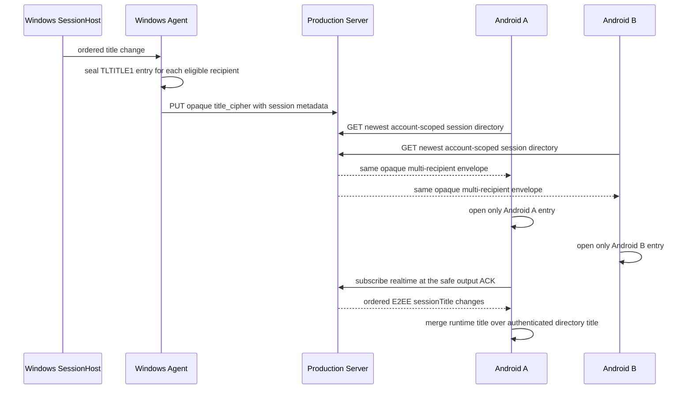
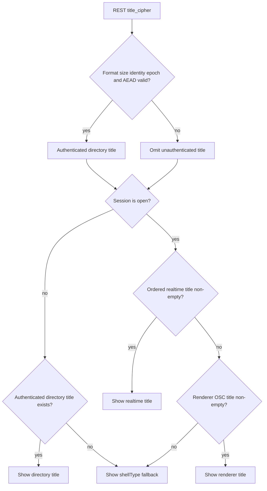

# Tail-first production product E2E

`scripts/Invoke-TailFirstProductE2E.ps1` is the repeatable acceptance entry for
the real Windows managed-ConPTY -> production relay/history -> Android product
path. It does not start, stop, recreate, or clean the production acceptance
Compose stack. The default `ManagedAcceptanceCompose` target performs one
read-only `docker compose ps --all` and requires every long-running service to
be healthy/running and every initializer to have exited with code 0. The
`ExternalHttps` target instead validates the deployed public HTTPS surface and
never resolves Docker or checks the local managed marker, acceptance secrets,
or disposable acceptance CA.

The runner is fail-closed. The Android Debug build generates a non-sensitive
contract asset containing the normalized build-time server origin and terminal
snapshot runtime setting. Preflight reads that asset directly from the APK and
rejects an origin mismatch or a build where terminal snapshot runtime is not
enabled before it inspects Docker or starts an AVD.

## Prerequisites

- For `ManagedAcceptanceCompose`, start the LAN production acceptance stack
  separately and leave it healthy. The runner never invokes
  `Start-ProductionAcceptance.ps1` or any Compose lifecycle command. For
  `ExternalHttps`, deploy the public service separately with a certificate
  trusted by Windows; the runner does not use the disposable local CA.
- Build the Windows `TermLink.SessionHost.exe`. Its Agent must already be linked
  to the same acceptance account as Android. Use `-AgentControlPipe` only when
  the linked Agent is using a non-default registry pipe.
- Build a Debug APK for the exact `-AcceptanceOrigin`, with terminal snapshot
  runtime and the Debug hook enabled. The two Gradle properties shown below are
  part of the acceptance contract; do not put acceptance credentials in the
  APK, hook response, command line, or evidence.

  ```powershell
  .\android\gradlew.bat -p .\android :app:assembleDebug `
    -PtermlinkServerUrl='https://termlink.192.168.9.28.sslip.io:9443' `
    -PtermlinkEnableTerminalSnapshotRuntime=true
  ```
- Configure the specified AVD to trust the target certificate chain and sign
  the app in to the acceptance account. The managed target normally uses the
  disposable acceptance CA, while the public target must use its deployed
  HTTPS chain. The AVD must be powered off; the runner rejects an
  already-running target because this gate requires a cold boot.
- Keep emulator port `5554` free, or select another unused even port.
- Keep `D:\Dev\DEV_ENV_MANIFEST.json` and
  `D:\Dev\Scripts\Ensure-DevEnv.ps1` available. The runner obtains ADB from the
  manifest and preflights the selected .NET and Go toolchains there. It does not
  fall back to profile or system installations.

Example from the repository root:

```powershell
.\scripts\Invoke-TailFirstProductE2E.ps1 `
  -AvdName 'TermLink_API_36' `
  -AcceptanceOrigin 'https://termlink.192.168.9.28.sslip.io:9443' `
  -TargetMode ManagedAcceptanceCompose `
  -AndroidApkPath '.\android\app\build\outputs\apk\debug\app-debug.apk'
```

To run against the deployed public origin without any local Compose, marker,
secret-path, or acceptance-CA dependency:

```powershell
.\scripts\Invoke-TailFirstProductE2E.ps1 `
  -AvdName 'TermLink_API_36' `
  -AcceptanceOrigin 'https://termlink.kget.cc:8910' `
  -TargetMode ExternalHttps `
  -AndroidApkPath '.\android\app\build\outputs\apk\debug\app-debug.apk'
```

The public preflight performs anonymous read-only GETs with a 15-second request
timeout, a 64 KiB response limit, and redirects disabled. It requires
`/readyz` to return HTTP 200 with `{"status":"ready"}`;
`/v1/client-config` to return HTTP 200 with its OIDC issuer and public web
callback bound exactly to `-AcceptanceOrigin`; and OIDC discovery under
`/realms/termlink/.well-known/openid-configuration` to return the exact issuer
`<origin>/realms/termlink`. A 502, redirect, invalid/oversized JSON, or origin or
issuer mismatch fails closed with a stable external-preflight code. The runner
does not send cookies or authorization headers during these requests.

Use `-PreflightOnly` to validate files, the tool manifest, the APK's actual
build-time origin and snapshot runtime setting, hook operations, the selected
managed-service or public-HTTPS target gate, and cold-start availability
without launching the AVD or a Windows session. `-KeepEmulator` leaves only the
emulator process that this invocation started; the default stops that owned
process. Pass `-ShowEmulator` when a visible emulator window is required for
interactive observation; otherwise the runner uses headless mode. Network-failure
injection cleanup is independent of `-KeepEmulator`:
the runner disables airplane mode and verifies the restored setting before it
decides whether to keep the owned emulator. Neither target mode touches
acceptance containers or volumes.

## Debug hook contract

The Debug APK must contain this generated UTF-8 JSON asset:

`assets/termlink-tail-first-e2e-contract-v1.json`

Its minimum content is:

```json
{
  "schema_version": 1,
  "transport": "explicit_broadcast_run_as_file",
  "package_name": "dev.termlink.harness",
  "receiver_class": "dev.termlink.product.debug.TailFirstE2EReceiver",
  "broadcast_action": "dev.termlink.product.debug.TAIL_FIRST_E2E",
  "response_relative_path": "no_backup/tail-first-e2e/response.json",
  "server_origin": "https://termlink.192.168.9.28.sslip.io:9443",
  "terminal_snapshot_runtime": true,
  "operations": [
    "probe",
    "open_session",
    "inspect",
    "page_up",
    "open_history",
    "close_history",
    "show_ime"
  ]
}
```

`server_origin` and `terminal_snapshot_runtime` are generated from the same
normalized Gradle values used for the Debug `BuildConfig`; the checked source
tree does not contain a stale fixed-value acceptance contract. Release variants
do not receive this generated asset.

The receiver must exist only in the Debug source set and be exported there so
the Android shell UID can address it; Release must not merge the receiver or
the contract asset. It receives an explicit broadcast addressed to the configured package/class, with string extras
`e2e_operation`, `request_id`, and `run_id`. Some operations also receive only
non-sensitive marker or paging extras. It atomically replaces
`no_backup/tail-first-e2e/response.json`; the runner reads that file through
`adb exec-out run-as`, checks `request_id`, then discards the raw response.

Every response has this envelope:

```json
{
  "schema_version": 1,
  "request_id": "same request id",
  "operation": "inspect",
  "ok": true
}
```

`probe` also returns `account_ready`, the HTTPS `server_origin`, and a
`capabilities` array containing all seven operations. State-producing
operations return these fields:

| Field | Type | Meaning |
| --- | --- | --- |
| `session_id` | string | Selected real production session identifier |
| `snapshot_count` | integer | Cached snapshots for that session |
| `transcript_count` | integer | Cached transcript objects for that session |
| `chunk_count` | integer | Cached encrypted event chunks for that session |
| `snapshot_sequence_s` | uint64 | Snapshot sequence `S` currently anchoring the renderer |
| `live_ack` | uint64 | Durable cumulative live output ACK |
| `history_overlay` | boolean | Whether the real history overlay is visible |
| `first_marker_visible` | boolean | Whether marker 0001 is in the rendered viewport |
| `last_marker_visible` | boolean | Whether marker 1000 is in the rendered viewport |
| `live_marker_visible` | boolean | Whether the post-overlay live marker is visible |
| `viewport_signature` | string | Non-sensitive stable viewport identity/digest |
| `terminal_columns` | positive integer | PC terminal grid width projected by Android |
| `terminal_rows` | positive integer | PC terminal grid height projected by Android |

`open_session` must discover and open the newest real managed session; it must
not insert fixture rows or construct a fake renderer. The runner first asserts
the live tail with no history overlay and then invokes `open_history` exactly
once. That transition opens the real overlay, performs its initial history
load, and returns `pages_moved` and `rows_loaded`. Only after this explicit
transition does each `page_up` perform exactly one real upward page gesture and
return the same two fields; `rows_loaded` describes only rows incorporated by
that operation. The paging contract is fixed at 200 rows, so
`-HistoryPageSize` accepts only `200`. A failed operation returns `ok: false`
and a stable `failure_code`; it must not mutate the current rendered page.
`close_history` returns to the live tail. `inspect` observes state without
changing the viewport or ACK. `show_ime` focuses the real input field, waits
for settled insets, and adds `ime_visible` plus `display_bounds`,
`terminal_bounds`, `bottom_bar_bounds`, and `ime_bounds` as objects containing
integer `left`, `top`, `right`, and `bottom` pixels.

The hook must never return fields whose names contain `token`, `password`,
`secret`, `authorization`, `cookie`, `private`, `credential`, or
`key_material`. The runner rejects such a response before recording any
observation. It also suppresses unexpected exception text and never reads the
acceptance password, identity, key, database URL, Redis URL, or OIDC secret.

## Session-title directory and live-merge path

The title path is complementary to the tail-first Snapshot/Transcript path.
It must not be represented as terminal history, and title verification must
not advance the live output ACK. A cold Android open first receives the latest
REST `title_cipher`; after the realtime subscription is established, ordered
E2EE `sessionTitle` events supersede that directory value. The Termux
renderer-derived OSC title is only a compatibility fallback for an older
Agent, and the final UI fallback is the directory `shellType`.





The envelope and clients fail closed. The UTF-8 title is limited to 4,096
bytes, the binary envelope to 1,048,576 bytes, and the recipient count to
4,096. Every entry binds the Session ID, PC device ID, recipient device ID,
recipient index/count, Key Epoch, Key ID, nonce, and plaintext length. A
missing/duplicate recipient, wrong identity or epoch, malformed/truncated data,
trailing bytes, inconsistent entry lengths, failed AEAD, or non-strict UTF-8
omits only the title; the session directory remains usable. The client must not
try another recipient entry or render ciphertext/unauthenticated text.

This title flow is part of the product E2E review, but it is not evidence that
the seven tail-first Snapshot/Transcript assertions below passed. Evidence for
it requires two Android recipients, positive directory/live-title display,
cross-recipient and wrong-epoch rejection, and confirmation that rejection does
not change the selected session, renderer state, or live ACK.

## Assertions and evidence

The managed PowerShell ConPTY session emits exactly 1000 unique run-scoped
markers. The runner then verifies:

1. Initial open has exactly one snapshot, zero transcripts, zero chunks, and no
   history overlay.
2. Marker 1000 is visible while marker 0001 is not visible.
3. `open_history` transitions to the overlay, loads exactly one bounded page,
   advances the transcript-object count from zero to one, changes the viewport,
   and leaves snapshot sequence `S` and live ACK unchanged.
4. Each subsequent upward gesture moves exactly one page, loads 1–200 rows,
   increments the transcript-object count exactly once, produces a viewport
   signature not seen on any earlier page, leaves the overlay open, and leaves
   the snapshot count, chunk count, `S`, and live ACK unchanged.
5. Terminal rows and columns remain identical to the initial PC grid through
   history paging, overlay/live interaction, return to the live tail, and IME
   display. Showing the IME may scale the projection but must not change that
   grid or its viewport signature.
6. With the overlay open, the runner enables Android airplane mode and requests
   the next uncached transcript page. The request must fail, after which a local
   `inspect` must show the same session, overlay, cache counts, `S`, live ACK,
   viewport signature, and terminal grid as the last successful page. Airplane
   mode is disabled and verified in `finally`, with an outer cleanup retry for
   any earlier failure.
7. While the history overlay remains open, a new real ConPTY marker advances
   live ACK. Closing the overlay returns to the live tail and shows that marker.
8. Terminal and bottom-bar bounds stay inside the display and above the visible
   IME. The terminal does not overlap the bottom bar and its bottom edge is no
   more than one pixel above the bar's top edge.

Each run gets a new, non-overwriting directory under
`artifacts/tail-first-e2e/<run-id>/`. `evidence.json` contains tool selections,
the selected `target_mode`, sanitized managed-service status or external
endpoint/status summaries, observations, assertions, cleanup disposition, and
a stable failure code. Public response bodies, cookies, and request or response
authentication headers are never written to evidence. PNG screenshots capture
initial tail, paged history, the page retained after the controlled offline
failure, overlay/live progress, return to the live tail, and IME layout.
Evidence records whether network failure was injected and whether restoration
was verified. Emulator and SessionHost output are drained but are not persisted
because product processes could accidentally write sensitive diagnostics.

Run the non-live parser, policy, parameter, and missing-hook checks with:

```powershell
.\scripts\Test-TailFirstProductE2E.ps1
```

That test creates temporary fixtures only below repository `artifacts`, removes
only its own run directories, and deliberately fails before querying Docker or
starting ADB devices.
