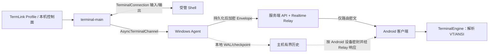
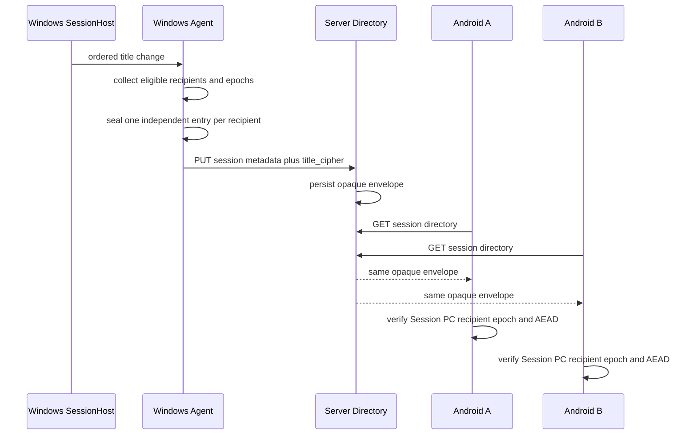
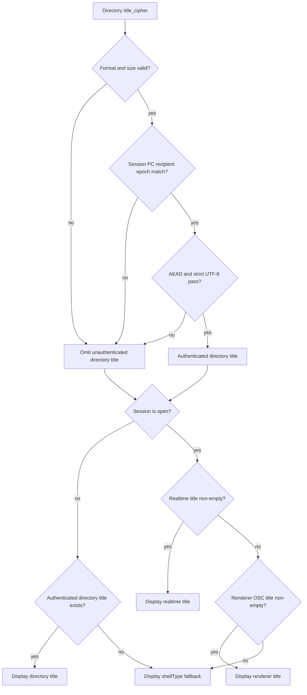
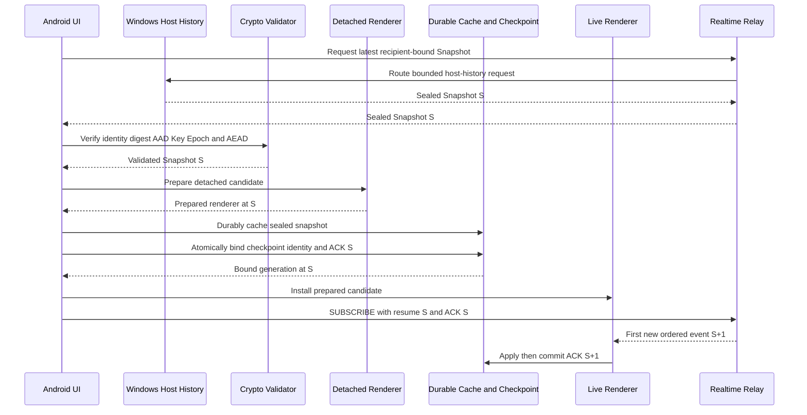
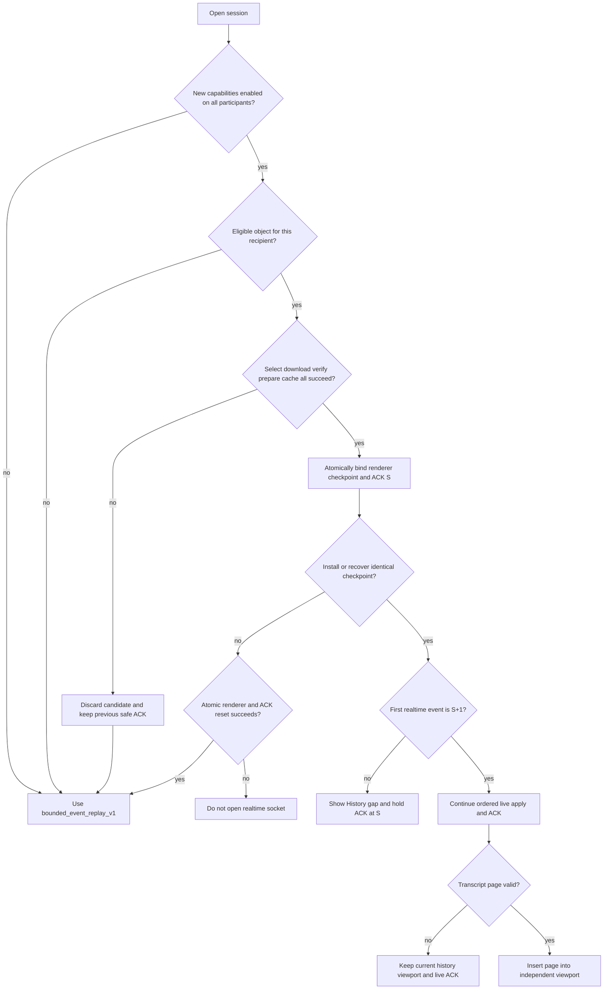

# TermLink 终端信息获取与服务端转发需求基线

文档版本：1.0
状态：2026-08-22 需求重整与 tail-first 补充基线
适用范围：`termForward/terminal-main` 本地终端宿主、异步输入输出通道、Windows Agent、服务端 Relay、Android 实时会话与历史恢复

## 1. 目的、来源与优先级

本文只收口“终端信息如何产生、如何经过服务端到达客户端”这一需求切片，不重新定义账号、计费、安装器或 Android 视觉规范。它结合了 TermLink 当前源码、现有生产协议和 `E:\WorkSpace\AICodeProject\termForward\doc` 的需求候选，并把实现方案与产品要求分开。

需求优先级如下：

1. 本文对终端信息获取、事件语义、服务端转发、隐私和验收的规定优先于早期草案中的同名内容。
2. [完整产品与系统设计](COMPLETE_SYSTEM_DESIGN.md) 仍是其他产品域的基线；其中 `WIN`、`SRV`、`AND` 和 `SEC` 条目若与本文冲突，以本文的终端信息边界为准。
3. [生产 Realtime V1](../protocol/protobuf/PRODUCTION_REALTIME_V1.md) 和 `protocol/protobuf/termlink_realtime.proto` 是当前生产线协议事实；本文不擅自改变已经冻结的 Envelope、ACK、E2EE 和方向 ACL。
4. termForward 文档中的“规划”不视为已批准的 TermLink 功能；其中的 JSONL、SQLite、文件布局、上传批次字段和固定重试时间也不构成实现约束。

本轮对 `termForward/terminal-main` 的源码审计结论是：它提供进程内 `ITerminalConnection` 输入、输出、resize、SessionId 和状态事件边界，但没有通用的远程端点、认证、消息封装、ACK、重连或终端发现协议。因此本项目只复用可观察的连接边界（`ITerminalConnection.idl`、`BaseTerminalConnection` 状态语义、`ControlCore`/`TermControl` 的线程与关闭约束），不让 TermLink 直接复用或维护 ConPTY、Azure、DebugTap、`src/server` 或缓冲区回读实现。terminal-main 作为宿主仍可在其内部使用自身连接后端；这不构成 TermLink 的第二条采集路径。

本文中的状态标签含义：

| 标签 | 含义 |
| --- | --- |
| 已实现 | 当前源码存在对应行为，并有本地模块/契约测试证据；不等于公网生产三端验收。 |
| 部分实现 | 数据链路存在，但语义、持久化或客户端呈现不完整。 |
| 需求缺口 | 需要后续实现或明确决策，不能在发布说明中宣称已完成。 |
| 明确排除 | 不允许作为 TermLink 的终端信息来源或默认交付方案。 |

## 2. 最终架构决策

### 2.1 受管会话范围

新的目标架构以 `termForward/terminal-main`（Windows Terminal 源码树）为本地终端宿主。TermLink 在 `TerminalConnection` 的进程内边界增加独立的异步通道，并由后续集成适配器把 terminal-main 已经产生的输入、输出、尺寸和生命周期事件交给 Agent；不再由 TermLink 直接调用、读取或维护 ConPTY，也不再以独立 `SessionHost` 作为新采集入口。terminal-main 内部为运行 Shell 所使用的平台连接后端属于宿主内部实现细节，不进入 TermLink 的采集协议。当前注册、IPC、持久化 sink 和 runtime 切换仍待完成。

TermLink 只管理由 TermLink Profile 或 terminal-main 本机控制面创建并显式注册的会话。普通 Windows Terminal（或其他终端前端）中没有注册到异步通道的会话不属于产品范围。

TermLink 不承诺观察或接管：

- 普通 Windows Terminal 已经打开的非 TermLink 标签页；
- 其他程序已经创建的 ConPTY、控制台窗口或 GUI 窗口；
- 任意屏幕截图、窗口文本抓取、键盘全局钩子、进程注入或直接 ConPTY 读写产生的“近似终端信息”。

### 2.2 信息生产者与传输边界

必须满足：

- terminal-main 异步通道及其受控集成适配器是新链路的唯一生产者；Agent 不通过读取窗口、查询屏幕缓冲或追踪第三方进程补齐信息。
- 通道的生产者和网络消费者解耦，输入和输出都不能在 UI 线程等待网络；网络不可用时 terminal-main 和 Shell 仍可继续工作。
- Agent 只在事件已提交到本地有界缓冲后交给生产 runtime；断网时本地终端继续可用。
- Agent 将实时载荷按 Android 设备和会话密钥端到端加密。Relay 可以验证身份、授权、方向、序号、大小、ACK、背压和租约，但不能解密终端正文、输入字节或敏感会话描述。
- Android 只在解密后把通道定义的终端数据交给 `TerminalEngine`；网络层不得把输出块按字符串拼接、按行拆分或逐块独立解码。

### 2.3 异步通道契约

这是 terminal-main 与 Agent 之间的新增本地契约，不等同于生产 WebSocket/Protobuf。实现可以使用 C++/WinRT `IAsyncAction`、线程安全队列或等价机制，但必须保持以下外部语义：

- `OpenAsync(session_id, connection_info, cancellation)`：建立一个稳定会话 ID，重复打开不能产生第二条发送链路。
- `WriteInputAsync(input_id, utf16_units, cancellation)`：按 terminal-main `ITerminalConnection.WriteInput(Char[])` 的语义写入；空输入、已关闭通道和取消必须返回明确结果。
- `ResizeAsync(rows, columns, cancellation)`：使用 terminal-main 的行列顺序和范围；C++ 通道通过有序 `ResizeResult` 报告执行结果，集成适配器再把它映射成与输出共用顺序的生产尺寸记录。
- `OutputChunk`：从 terminal-main 的 `TerminalOutput(Char[])` 事件进入有界异步队列；保留 UTF-16 code unit 和 VT 控制字符，不按行或完整字符重组。当前生产 Protobuf 仍只有隐式 UTF-8 bytes；明确编码/版本字段和适配器转换策略是待完成的 wire 变更。
- `StateChanged`：映射 `NotConnected → Connecting → Connected → Closing → Closed/Failed` 的单调状态；关闭前撤销回调，等待已提交回调完成。
- `CloseAsync(reason)`：可取消、幂等、不会死锁；关闭后禁止产生新的输入或输出事件。
- 通道必须有容量、溢出和取消统计；网络慢时只能暂停/丢弃并发出可识别的 loss/gap，不能阻塞 terminal-main UI、输入处理或 Shell。

terminal-main 没有可直接复用的远程服务、认证、序号、ACK、断线恢复或会话发现协议。异步通道只复用 `ITerminalConnection` 的可观察输入/输出/resize/状态边界；Agent/服务端继续负责设备授权、E2EE、序号、ACK、背压和重连。

### 2.4 实时查看、远程输入与历史记录是三个概念

实时输出是受管会话的基本能力，不能因为历史记录关闭而停止转发。远程输入是授权后的控制命令，不等同于“采集键盘硬件事件”。输入内容默认不进入主机历史；本地输入只发布控制权已被夺回的 `local_input_epoch`，不把键盘内容作为独立历史事件上传。历史记录保存在 Windows App 私有目录，并通过加密、有界、按接收设备隔离的实时响应提供。

### 2.5 Tail-first durable 生产合同

Tail-first 主机历史对象只能从已经提交到 Windows 本地持久化边界的有序 `LocalFrame` 生成。
producer WAL 是崩溃恢复和幂等重试的事实来源；terminal-main channel ordinal 仍然只是诊断顺序，
不能替代 durable wire sequence。Transcript Page 必须先于同一 S 的 Snapshot 提交，Snapshot
必须最后提交并充当该批历史对象可选择性的发布屏障。

```mermaid
flowchart LR
    SOURCE[Registered terminal source event] --> SEQ[Assign durable session sequence]
    SEQ --> FRAME[Commit LocalFrame]
    FRAME --> WAL[Append and fsync producer WAL]
    WAL --> MODEL[Replay portable terminal model through S]
    MODEL --> MATERIALIZE[Materialize Snapshot S and main-screen Transcript Pages]
    MATERIALIZE --> OUTBOX[Persist ordered outbox from the same 1..S prefix]
    OUTBOX --> TSEAL[Seal Transcript separately for each active Android recipient]
    TSEAL --> TUPLOAD[Upload and commit all Transcript pages first]
    TUPLOAD --> SSEAL[Seal Snapshot separately for the same recipient]
    SSEAL --> SUPLOAD[Upload and commit Snapshot S last]
    SUPLOAD --> ELIGIBLE[Publish recipient-bound Snapshot S as selectable]
```

规范要求：

- frame、WAL、对象 metadata 与内容摘要必须使用稳定身份；重启后的重复上传是幂等操作，不能
  生成两个逻辑上竞争的 Snapshot S。
- Snapshot S 与全部 Transcript Page 必须来自完全相同的 `LocalFrame 1..S` 前缀。没有更早
  主屏行时 Transcript 集合可以为空，但仍要先完成空集合提交屏障，再提交 Snapshot。
- 最终工作树中的 producer WAL 使用每帧一个 DPAPI 保护文件、原子替换、write-through 与
  `Flush(true)`；当前不把自动裁剪宣告为已验收能力。未来引入 retention watermark 时，只能在
  所有目标 recipient 的对象提交达到策略要求后推进；失败或撤销的 recipient 必须有显式处理
  结果，不能让其部分提交对象对外可见。
- 实时 Envelope 可以与历史物化并行，但 Snapshot/Transcript 不消耗 Envelope seq，也不通过
  Realtime 发送，更不能推进任何 Android ACK。
- 当前真实 tail-first 验收可以使用仓库现有受管 SessionHost/ConPTY 路径产生测试输出；这只
  验证历史产品链，不证明目标 terminal-main 注册/IPC/runtime 切换已经完成。生产来源切换仍受
  第 6 节双轨门禁约束。

## 3. 终端信息需求

### 3.1 必须支持的事件

生产 `seq` 的持久化所有者尚未在新进程桥接中冻结：C++ 通道的 `ordinal` 只是本地诊断顺序（包含隐藏工作且可能因丢弃/合并而不连续），当前 C# 合同适配器要求源提供连续 `Sequence`/`Gap`，并不把 ordinal 当作 wire seq。未来适配器必须在本地提交后使用单一、可恢复的序号再发送。通道输入输出以 terminal-main 的 UTF-16 code unit 为边界；进入生产 Envelope 时才按显式版本策略编码为字节。不能假设一次回调形成完整字符、完整 ANSI 控制序列或完整显示行。

| ID | 事件 | 需求 | 当前状态 |
| --- | --- | --- | --- |
| TIF-001 | `output` | 转发 terminal-main 异步通道的 `TerminalOutput(Char[])` 数据，保持 UTF-16 code unit、VT 控制字符的顺序和边界语义；不得转为截图或服务端明文。 | 部分实现：terminal-main `AsyncTerminalChannel` 已有界面和隔离测试，公网生产载荷尚未切换 |
| TIF-002 | `resize` | 转发 terminal-main viewport 的列数、行数；远端 resize 需通过现有租约和边界校验后调用异步通道。 | 部分实现 |
| TIF-003 | `lifecycle` | 发布 started/running、interrupted 和 ended；ended 必须保留有无真实退出码的区别。 | 部分实现 |
| TIF-004 | `input.result` | 通过现有 `input_id`、lease/version、输入序号和去重语义反馈 accepted/rejected；accepted 只表示异步通道接受写入，不表示命令成功。 | 部分实现：通道提供输入结果回调，生产 Agent 接入仍待完成 |
| TIF-005 | `control` | terminal-main 本地输入夺回控制权时发布带单调 epoch 的撤销事件；不得上传本地输入正文。 | 需求缺口 |
| TIF-006 | `gap` | 异步通道、Agent 有界缓冲或历史不可恢复时发布精确缺口范围；客户端不得把缺口伪装成连续输出。 | 部分实现 |
| TIF-007 | `title.changed` | 标题必须由明确的 Host 语义适配器产生；当前受管 SessionHost 以 console title 与有界 OSC 0/2 旁路解析生成有序 Title frame，Agent 发送实时 E2EE 标题并生成 REST `title_cipher`。Relay 不得猜测或解密标题；目标 terminal-main 适配器仍需保留同一语义。 | 当前 SessionHost/Agent/Android 已实现；terminal-main 来源切换仍待完成 |
| TIF-008 | `session.metadata` | 会话 ID、Shell 类型、尺寸、开始/结束时间、关闭原因和退出码可用于客户端状态；命令行、CWD、PID、环境变量等敏感字段默认不发送。 | 部分实现 |
| TIF-009 | `loss` / `producer.error` | 任何丢弃、缓冲超限、编码/写入失败必须可观测；如果事件流是 best-effort，不得把它宣称为完整审计记录。 | 部分实现 |

### 3.2 事件公共字段

生产协议当前用 Envelope 字段承载会话、方向、序号、发送时间、密钥和加密载荷。后续扩展的事件载荷应遵守以下语义，而不固定具体 JSON、文件或数据库格式：

- `schema_version`：事件载荷版本；未知必需版本必须拒绝或显式降级。
- `session_id`：稳定的 TermLink 会话 GUID；重连不创建新 ID，Host 被替换或新建 Profile 才创建新 ID。
- `seq`：目标是每会话从 1 开始的单调事件序号；输出、resize、生命周期、控制和输入结果共用同一序列。当前新桥接尚未实现序号分配/持久化，不能把 channel ordinal 直接提升为生产 seq。
- `type`：事件类型；方向和允许类型由生产协议 ACL 决定。
- `payload`：原始字节或结构化字段。任意字节必须有长度边界，不能依赖换行分隔。
- 时间：若需要事件发生时间，必须由集成适配器记录 UTC 时间；当前 C++ 仅有进程内 `steady_clock`，C# 桥接也未携带该值，Envelope 的发送时间不能冒充 terminal-main 事件时间。

ACK 只有在 Android 终端引擎完成事件应用、必要的会话状态提交和渲染状态切换后才能推进。重连从持久化的最高连续 ACK 继续；输入事件在传输不确定时不得自动换新 ID 重试。

### 3.3 信息最小化与隐私

- 默认不记录或上传输入正文、完整环境变量、Token、密码、私钥、Pipe 名和本地缓冲路径。
- 命令行、CWD、子进程 PID、主机名和最终窗口标题可能包含凭据或个人信息。窗口标题仅可通过本合同的逐 recipient E2EE `title_cipher` 和有序 E2EE realtime 事件同步；Relay、数据库、日志和指标不得保存标题明文，其余敏感字段除非另有明确合同否则只保留本机诊断摘要。
- Relay、PostgreSQL、Valkey、指标和日志不得出现终端正文或解密后的敏感描述；服务端不得保存历史或文件正文。
- 不能依赖“检测密码提示符”进行脱敏；SSH、数据库客户端和 TUI 可以用任意方式请求秘密。
- 若未来支持历史、搜索、导出或删除，查看/导出/删除动作本身要写入不含正文的审计事件，并使用租户隔离和最小权限。

## 4. 服务端转发契约

### 4.1 REST 会话索引

服务端 REST 只维护发现和路由需要的元数据：PC/设备归属、Shell 类型、生命周期、尺寸、最后序号、创建/结束时间和授权范围。`title_cipher` 等字段只能保存无法由服务端解密的密文；不能新增明文 `title`、`command_line` 或 `working_directory` 列来绕过 E2EE。

生命周期和尺寸更新必须以会话当前投影为基础，不能在单独的 lifecycle 帧中把未知字段重置成 `80×24` 或覆盖已知退出码。若服务端尚未具备完整投影能力，应明确标记字段未知，而不是伪造默认值。

#### 4.1.1 `title_cipher` 多接收者合同

REST `title_cipher` 是 `TLTITLE1` version 1 多接收者 envelope 的 Base64URL 表示。Windows Agent
从账号内未移除、具有有效 32-byte pairwise key 与 Key Epoch 的接收设备构造 envelope；每个
recipient entry 使用独立派生密钥和 12-byte 随机 nonce。服务器只 Base64URL 解码并保存 opaque
bytes，不解析 envelope、不解密标题，也不按某台 Android 重写内容。

| 范围 | 字段与约束 |
| --- | --- |
| 根部 | 8-byte `TLTITLE1`、大端 `uint32` version `1`、16-byte Session ID、16-byte PC device ID、大端 `uint32` recipient count |
| 每个 entry | 16-byte recipient device ID、大端 `int64` Key Epoch、12-byte nonce、大端 `uint32` ciphertext length、AEAD ciphertext + 16-byte tag |
| Key ID | `title-v1:<recipient UUID N>:<epoch 8 位十进制>` |
| AAD 绑定 | 固定前缀、version、Session ID、PC device ID、recipient count/index、recipient device ID、Key Epoch、Key ID、nonce、明文长度 |
| 大小 | 标题严格 UTF-8 且最多 4,096 bytes；envelope 最多 1,048,576 bytes；recipient 最多 4,096；服务器 JSON body 最多 2 MiB |
| 唯一性 | recipient 不能是 PC device ID，不能重复；所有 entry 的明文长度必须一致 |

没有可用 recipient 时 Agent 发送空 `title_cipher`；recipient directory 临时不可用时 metadata
heartbeat 继续但省略标题更新。服务端在这两种情况下都保留上次成功密封的标题。Android 只查找
本机 exact recipient entry；不得用其他 entry、旧 Key Epoch 或另一 Session/PC 的 envelope 回退。

### 4.2 Realtime Relay

- 认证后的 PC 和 Android 连接只能发送各自方向 ACL 允许的 MessageType。
- Relay 按账号、PC、会话、设备授权和租约路由；不解析、不重写、不排序、不合并密文载荷。
- `Envelope.ack` 与加密 `OutputAckPayload`/`FlowControlPayload` 的累计序号必须一致；背压暂停远程流时，terminal-main 异步通道和 Shell 继续运行。
- 慢消费者被关闭或进入显式暂停状态时，必须保留本地可恢复语义；不能为了网络吞吐阻塞本地输入/输出线程。
- 服务器重启、连接重连和重复发送必须是幂等的；相同已认证序号不得产生重复执行的输入。

### 4.3 Android 接收

- 订阅成功后先按累计 ACK 恢复，再接受新的实时事件；无法恢复时进入用户可见的 History Gap，而不是清空网格后假装完整。
- `output` 块按到达序号交给同一个 `TerminalEngine`；块边界不得触发独立字符解码。
- `resize`、`lifecycle`、`control` 和标题/元数据事件必须与输出共用顺序，不能在暂停输出期间越过终端正文。
- 只读、重连、控制中、退出和缺口状态必须可观察；状态变化不能依赖服务器是否在线的猜测。

目录标题解密必须同时核对 expected Session ID、expected PC device ID、本机 recipient device ID
和 expected Key Epoch。magic/version/尺寸、身份、recipient 缺失或重复、recipient 等于 PC、epoch、
entry 长度一致性、截断/尾随字节、AEAD 或严格 UTF-8 任一失败时，必须 fail closed：只省略该标题，
不使整个会话目录失败，不显示密文或未认证字符串，也不尝试另一 recipient entry。

标题展示合并顺序如下。实现可以把来源合并到同一 `sessionTitles` 投影，但不能因此取消来源的认证
边界：已打开会话优先使用有序 E2EE realtime `sessionTitle`；旧 Agent 没有该事件时，使用 Termux
renderer 从 OSC 解析的 title；两者均为空时，UI 使用会话目录的 `shellType`。

### 4.4 Android tail-first 选择、安装与分页

只有双方协商并启用 `host_history_v1` 与 terminal snapshot runtime 后，Android 才能进入
主机恢复路径；`TerminalTranscriptPageV1` 受同一门禁约束，不是独立 live event。
Windows 必须按账号、会话和 `recipient_device_id` 密封响应，Relay 只做短时路由。

- 初次打开只安装 Snapshot S 的主/备用可见屏幕；`scrollback_rows` 必须为空，不预取
  Transcript Page 或 Event Chunk。
- 用户到达顶部后才请求 Transcript。请求固定 `as_of_snapshot_seq=S` 和排他
  `before_line_id`，单页最多 200 行；页面只插入独立 history viewport，不进入 live parser。
- 浏览历史期间 S 固定不变，但 live parser 可继续消费 S+1、S+2 并在应用后推进 live ACK。
  分页、搜索、缓存命中、失败和重试都不得改变 live ACK。
- 只有完整验证、detached prepare、durable cache 和 checkpoint/ACK S 原子绑定均成功后，
  才允许发出 `SUBSCRIBE(S)`；下载成功本身不授权 ACK S。

### 4.5 同账号多 Android recipient 隔离与失败回退

同账号直连只授予发现/授权范围，不意味着共享密文。每台未撤销 Android 必须有独立
recipient row、对象密文、AEAD AAD/Key Epoch、签名 URL 和本地缓存命名空间。对象唯一性和查询
至少绑定账号、Session、recipient、对象类型、S 与分页游标。交叉使用另一 recipient 的 URL、
metadata、密文或缓存必须在解密/安装前失败；一台设备撤销、重试或删除缓存不能影响另一台设备。

用户可见的 Live、Reconnecting、Read only、History gap、历史为空、分页失败、对象损坏、恢复和
重试状态必须同时具备简体中文与 English 资源；布局验收必须覆盖两种语言、系统大字体、横竖屏
和可见 IME，不能让 Terminal、底栏、顶部状态或 IME 相互重叠。

## 5. 明确不继承 termForward 的方案

termForward 文档中可迁移的是失败隔离、字节保真、显式丢失、幂等 ACK、重试分类、保留策略和安全验收等行为要求。以下内容明确不作为 TermLink 的方案：

| 不采用 | 原因 |
| --- | --- |
| 直接在 `ConptyConnection`、系统 ConPTY 或 `conhost.exe` 层读取/复制输入输出 | 新架构只在 terminal-main 的异步通道边界交换数据，禁止 TermLink 直接依赖或维护第二条 ConPTY 句柄和读写线程；terminal-main 内部后端不属于该边界。 |
| 把 terminal-main 的内部 `src/server`、AzureConnection 或 DebugTapConnection 当作远程服务/采集器 | terminal-main 没有通用远程协议；这些组件是本地控制台、特定云连接或调试 tap，不能替代 Agent/Relay。 |
| 读取/替换 WindowsApps、修改系统 `conhost.exe`/ConPTY、API hook、进程注入 | 破坏签名与更新边界，扩大权限和崩溃范围，并可能捕获不属于用户的会话。 |
| 通过窗口抓取、屏幕 OCR、TerminalCore 缓冲区回读或定时读取终端文本获取信息 | 无法稳定保持通道顺序、VT/TUI、光标、备用屏幕和输入语义。 |
| 把 `logPath`、`session-<GUID>.log`、`[IN]/[OUT]` 文本日志当作生产协议 | 该格式不能可靠表达任意字节、序号、缺口、ACK 或密文转发。 |
| 强制采用 JSONL、SQLite、固定目录、固定批次字段、固定 1/2/4 秒重试表 | 这些是参考设计的存储/调参选择，不是已批准的 TermLink API；现有 DPAPI Buffer、Realtime 和 History V1 已承担对应职责。 |
| 把本地/云日志功能和实时查看绑定成一个总开关 | 关闭历史不能中断受权实时终端；输入持久化也不能默认开启。 |

## 6. 当前实现盘点与重构优先级

### P0：新架构必须保持的闭环

1. 在 terminal-main 内实现独立的 `AsyncTerminalChannel` 适配层；它只连接 `ITerminalConnection` 的输入、输出、resize 和状态事件，不读取 ConPTY 或 TerminalCore 缓冲区。（本轮已落地本地 C++ 实现和 TAEF 隔离测试，尚非生产 IPC。）
2. 将通道事件交给 Agent 的本地桥接层；保持“提交到有界缓冲后 ACK”、精确 Gap、Agent 重启恢复和 terminal-main 本地会话独立运行。（本轮已加入 UTF-16→UTF-8 的 `TerminalMainChannelBridge` 合同适配；进程内注册、可重放源、幂等 sink 和生产 runtime 切换仍待完成。）
3. 保持 Agent→Relay 的 per-recipient E2EE、方向 ACL、累计 ACK、Flow Control、输入租约与本地输入 epoch；服务端不因采集层替换而获得明文。
4. 保持 Android `RemoteTerminalSession` 的严格连续序号、feed 后 ACK、History Gap 和失败输入不重试。

旧 `win-agent/src/SessionHost`/ConPTY 链路是迁移前基线：它可继续用于 Golden Stream 和回归对照，但不能作为新生产结构的依赖。迁移完成前必须同时标注两条链路的证据，禁止把旧链路测试写成新异步通道已验收。

### P1：终端信息语义收口

1. 将 `WIN-004` 拆成 TIF-001～TIF-006，明确“本地输入正文不采集”，并将生产来源改为 terminal-main 异步通道。
2. 修正会话投影更新：生命周期事件不得覆盖已知尺寸、开始时间或退出码；未知值必须显式表示未知。
3. 保持已冻结的标题合同：目标 terminal-main 适配器必须生成与当前受管 SessionHost 等价的有序语义事件，并保留 `title_cipher` 绑定、实时标题 > renderer OSC > `shellType` 的已打开会话优先级；Relay 不得从原始输出猜测标题。
4. 为本地产生事件补充捕获时间和显式 loss/error 统计，但不把发送时间当作采集时间。

### P2：可选能力与真实验收

1. 跨端可验证的 Snapshot/Transcript 格式、Windows durable producer/outbox 和 Android importer/独立 viewport 已进入最终工作树；完成主代理最终构建、Termux/xterm.js 等价、崩溃和真实 E2E 验证后才能启用 Snapshot，在此之前 Gap 必须保持诚实可见。
2. 若产品批准历史搜索、导出或管理员查看，单独定义授权、脱敏、保留和删除 API；不得让服务端解密实时正文。
3. 完成真实 Windows→公网 Relay→Android 的输出、输入、ACK、背压、断线和恢复验收；本地模块测试不能替代此证据。

### 6.1 迁移步骤与文件边界

1. **冻结 terminal-main 通道契约**：在 `terminal-main/src/cascadia/TerminalConnection` 和 `TerminalControl` 增加 `AsyncTerminalChannel` 的接口、状态、取消、容量、UTF-16 输出事件和输入/resize 回调；不改 `ConptyConnection`、`src/server`、Azure 或 DebugTap 作为采集实现。
2. **增加本机桥接适配器**：由 terminal-main 的受控进程把通道事件交给 Agent。未来桥接层负责会话注册、持久化帧序号、ACK、断线和错误隔离；当前合同适配器只验证源事件、编码并按提交后 ACK 顺序调用抽象 sink，不承担注册或跨进程传输。
3. **复用并收口服务端链路**：保留现有生产 Envelope、E2EE、Relay ACL、租约、Flow Control 和 Android `RemoteTerminalSession`；只有在编码版本、通道元数据或事件类型确实需要时才做向后兼容的 Protobuf 扩展。
4. **双轨验证后切换**：旧 ConPTY/SessionHost 仅运行 Golden Stream 和回归对照；新 terminal-main 通道必须有独立的单测、故障注入、吞吐和真实服务端转发证据。新链路达到验收前，不删除旧测试资产，也不把旧结果标为新架构证据。
5. **迁移完成后的门禁**：生产构建不得再依赖 `win-agent/src/SessionHost` 作为终端信息来源；构建、安装、回滚、崩溃转储和日志中都不得出现 ConPTY 句柄采集路径。

## 7. 验收矩阵

| 类别 | 验收条件 | 当前证据/后续动作 |
| --- | --- | --- |
| 来源隔离 | 只从 TermLink 注册的 terminal-main 异步通道获取信息；普通已有标签页不出现在会话列表，TermLink 不读取 ConPTY。 | 新增通道单测和 terminal-main 集成测试；旧 SessionHost 仅作为迁移前对照。 |
| 通道保真 | UTF-16 code unit、中文、emoji、组合字符、ANSI、OSC、回车进度条、TUI、超长输出及被拆开的输出块可由 Android 引擎连续重放。 | 新增 terminal-main AsyncTerminalChannel 测试；Golden Stream 保留为跨引擎对照。 |
| 端到端安全 | Relay、DB、Valkey、日志和指标均无终端明文，服务端不保存历史或文件正文；错误日志不泄露 Token/密钥。 | E2EE/Relay 契约测试；公网三端扫描仍待验收。 |
| 顺序与恢复 | 重连从最高连续 ACK 继续，不重复输出、不重复执行输入；缺口范围精确且用户可见。 | Host-Agent、Android、Relay 单测/契约；补真实公网重启/断网证据。 |
| 背压与离线 | Android 暂停或慢消费者不阻塞 terminal-main；Relay 不可用时本地终端与本地输入继续。 | 新增异步通道取消/满载测试；补持续 2 MB/s、慢磁盘/慢网络实测。 |
| 状态语义 | started/interrupted/ended、退出码、尺寸和授权状态不被默认值覆盖；未知值不伪造。 | 当前 lifecycle/resize 路径存在投影缺口，列为 P1 修复。 |
| 隐私 | 输入正文、环境变量和秘密字段默认不持久化；查看/导出/删除有审计。 | 当前输入/DPAPI 边界已实现；历史管理中心审计仍需单独需求。 |
| 发布边界 | 不修改 WindowsApps/系统 ConPTY；只在自有 terminal-main 异步通道边界扩展并使用自有签名包。 | 本文为架构门禁；构建/签名/升级需新增 terminal-main 构建与桥接验收。 |

### 7.1 Tail-first 七项原始需求验收

下表不表示真实 E2E 已通过。当前代码与测试结果由主代理在最终工作树、真实 Windows、production
Relay/History 和冷启动 Android 上验证后更新；本地模块测试只可作为辅助证据。

| ID | 原始需求 | 专项验收条件 | 当前结果 |
| --- | --- | --- | --- |
| TF-01 | durable frame/WAL 与提交顺序 | `LocalFrame 1..S` 可崩溃恢复；每 recipient Transcript first、Snapshot last，重复提交幂等。 | 待主代理最终验证 |
| TF-02 | Android S/S+1 安装时序 | select/download/verify/prepare/cache/bind/install 全部成功后才 subscribe S；首个新事件严格为 S+1。 | 待主代理最终验证 |
| TF-03 | 首开只取最后一屏 | 只缓存一个 Snapshot，0 Transcript、0 Chunk；尾 marker 可见，首 marker 不可见。 | 待主代理最终验证 |
| TF-04 | 固定 S 历史分页 | 每手势一页且最多 200 行；独立 viewport，不改变 S、live parser 或 ACK。 | 待主代理最终验证 |
| TF-05 | 历史与实时并行 | 历史打开时实时 ACK 可前进；关闭后回到实时尾部且新输出可见。 | 待主代理最终验证 |
| TF-06 | same-account recipient 隔离 | 至少两台 Android 正向访问各自对象；交叉对象/URL/密钥/缓存拒绝，单设备撤销不影响另一台。 | 待主代理最终验证 |
| TF-07 | 故障回退、能力门与双语布局 | 所有故障 fail closed 或回退 `bounded_event_replay_v1`；Release 新能力关闭直至全门通过；中英状态和 IME bounds 合格。 | 待主代理最终验证 |

## 8. 与现有文档的关系

- [完整产品与系统设计](COMPLETE_SYSTEM_DESIGN.md)：保留账号、权限、计费、部署和 UI 基线；本文收口其终端信息和转发部分。
- [产品需求与技术方案](PRODUCT_REQUIREMENTS_AND_SOLUTION.md)：作为早期草案保留；其中 `input`、`title`、本地记录等表述按本文重新解释。
- [生产 Realtime V1](../protocol/protobuf/PRODUCTION_REALTIME_V1.md)：协议事实来源；本文不把 termForward 的日志格式写入生产 wire。
- [Windows Agent README](../win-agent/README.md)：迁移前实现和验证入口；新结构需增加 terminal-main 异步通道桥接说明。
- `termForward/doc`：只作为候选语义与风险参考，不是运行时依赖、代码来源或安装包来源。
