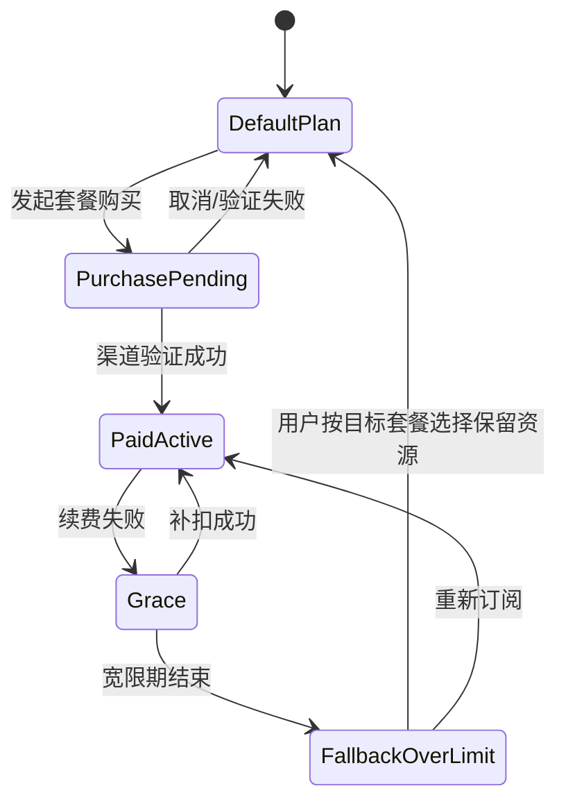

# TermLink 多端 UI 布局设计稿

文档版本：1.0
状态：可交互布局稿
更新日期：2026-08-02
覆盖：Android、Windows Agent、Docker Server Console、会员与配额

## 1. 设计稿入口

可交互原型位于：

- [`ui-prototypes/index.html`](../ui-prototypes/index.html)
- [`ui-prototypes/styles.css`](../ui-prototypes/styles.css)
- [`ui-prototypes/app.js`](../ui-prototypes/app.js)

本地预览：

```powershell
cd ui-prototypes
python -m http.server 4173
```

打开 `http://127.0.0.1:4173/`，顶部可切换 Android、Windows Agent、Server Console 和明暗主题；左侧切换各服务页面。

## 2. 设计方向

设计语言采用 `Quiet Intelligence / 安静智能`：

- Terminal 内容优先，装饰退居其次；
- 连接、E2EE、权限、输入租约和会员配额均有可读文字；
- 常用操作靠近上下文，高级选项渐进披露；
- 使用克制的光谱强调和环境光感，不大面积堆叠 AI 渐变；
- 状态不用纯颜色表达；
- AI 未来只能解释、摘要和生成待确认草稿，不能自动执行命令。

## 3. 共享布局系统

### 3.1 视觉 Token

| 类别 | Token | 用途 |
| --- | --- | --- |
| 背景 | `bg`, `bg-elevated` | 应用背景、导航背景 |
| 表面 | `surface`, `surface-2`, `surface-3` | 页面、次级区域、控件 |
| 文本 | `text`, `text-2`, `text-3` | 主文字、说明、低优先级信息 |
| 品牌 | `accent`, `accent-2` | 选中、主操作、E2EE/智能状态 |
| 状态 | `success`, `warning`, `danger` | 在线、待确认、错误/撤销 |
| Terminal | 独立 Terminal Token | 不受 App 深浅主题影响 ANSI 配色 |

### 3.2 字体

- UI：Segoe UI Variable / Roboto Flex / 系统中文字体；
- Terminal：Cascadia Mono / JetBrains Mono；
- 状态数字使用 Tabular Numerals；
- 手机正文不低于 12sp，核心动作不低于 14sp；
- 管理台高密度元数据不低于 11px，正式实现应根据系统缩放换算。

### 3.3 层级

```text
Level 0  Canvas：页面背景
Level 1  Navigation：导航、列表分组
Level 2  Context Surface：搜索、策略、当前状态
Level 3  Dialog/Command：确认、购买渠道、命令面板
Level 4  Critical：撤销、终止、停止所有远程访问
```

列表默认使用留白和分隔线，不给每一行增加独立 Card。只有需要表达边界的状态汇总、购买方案或确认区域使用封闭 Surface。

## 4. 会员与配额规则

### 4.1 可配置套餐目录

以下仅为首发预置，客户端不得写死套餐枚举或额度：

| 权益 | Free（首发默认） | Pro Monthly（首发默认） |
| --- | --- | --- |
| 账号 | 1 个个人账号 | 同一账号 |
| 可远程连接 PC | 1 台 | 5 台 |
| 同时远程显示的实时会话 | 3 个不同 Session | 20 个 |
| Windows 本地 Shell | 不限制 | 不限制 |
| E2EE、设备批准和安全能力 | 完整提供 | 完整提供 |
| 计费周期 | 免费 | 月付、自动续费、可取消 |

服务端可以配置套餐名称、说明、周期、PC/Session 额度、功能标记、渠道 Product ID、排序、可见平台、上下架时间和降级目标，并以版本化 Catalog 发布。存量订阅保留原版本或按显式迁移规则处理。

最终价格不写死在客户端。Android 从 Google Play Billing 返回本地化价格；Web/Windows 从服务端配置的购买渠道返回价格。所有页面在进入购买确认前展示实际价格、税费、周期和续费规则。

### 4.2 “同时显示三个会话”的定义

- 计数对象是账号当前订阅的不同 `session_id`；
- 同一个 Session 在同一用户两台 Android 上显示，服务端可按账号 + Session 去重；
- 历史回放不占实时会话名额；
- 后台已经取消正文订阅的页面不占名额；
- Windows 本地打开多少个 Shell 都不占远程显示名额；
- 达到当前 Entitlement 上限后的实时订阅请求返回 `ENTITLEMENT_LIMIT_REACHED`；首发 Free 默认下即为第四个会话。

### 4.3 PC 限额

- 首发 Free 默认只能激活一台 PC 的远程访问；
- 第二台 Agent 登录时仍可完成账号认证，但进入 `Upgrade required` 状态，不获得远程 Presence/Session 路由；
- 用户可免费更换主 PC，但应设置短冷却或安全确认，防止被滥用为并发切换；
- 付费套餐过期时不会结束本地 Shell；用户按降级目标套餐额度选择保留 PC，其余 PC 暂停远程路由。

### 4.4 续费与降级



降级不终止 Windows 本地进程，不删除设备和历史；只暂停超过目标套餐配额的远程能力。UI 必须按服务端返回的降级额度允许用户明确选择保留哪些 PC 和实时订阅。

## 5. Android 布局

基准画板为 390 × 844 dp；320dp 小屏保持单栏，600dp+ 平板进入双栏。

### 5.1 设备首页

```text
System status
App Bar：问候 + 页面标题 + 账号
Command Search：PC / Session / Action
Ambient Summary：Free · 1/1 PC · Live 2/3
PC List
  ├─ OFFICE-PC：在线、延迟、2 个 Session
  └─ 添加更多 PC：会员升级入口
Bottom Navigation：设备 / 活动 / 设置
```

行为：

- 点击 PC 进入 PC/Session 列表；原型直接进入第一个 Live Session；
- 免费额度已满时，“添加 PC”行保持可见，但不伪装成错误；
- 搜索按钮打开统一命令面板，可切 PC、Session 或设置；
- 设备状态同时显示 Presence、延迟和最近在线时间。

### 5.2 实时 Terminal

```text
Top App Bar：返回 / Session + PC / 更多
State Bar：Live · E2EE · 82×28 · 只读/控制中
Terminal Surface：Termux Fork
Jump Latest
Extra Keys：Esc Tab Ctrl Alt ← ↑ ↓ →
Control Bar：申请控制 / 释放控制
```

布局优先级：

1. Terminal Surface；
2. 连接与控制状态；
3. 快捷键和输入；
4. 会话信息、主题、搜索等次级操作。

键盘弹出后隐藏非必要标题元数据，将可用高度用于 Terminal，并以 100～200ms 去抖同步 Resize。

### 5.3 历史回放

- 顶部始终显示 `Replay` 和 Exit Code；
- Terminal 与实时页视觉一致，但没有输入按钮；
- 时间轴显示快照、断线、恢复、退出等事件；
- 支持 0.5×、1×、2×、4×；
- 搜索仅处理手机端已解密数据；
- 拖动后从最近 Snapshot 恢复。

### 5.4 可信设备

- 当前设备独立分组并显示 `MANAGER`；
- 其他 PC/Android 显示类型、最近活动、授权 PC 和权限；
- 点击设备进入详情，可降权或撤销；
- 批准新设备使用二维码/短码；
- 撤销弹窗必须显示会导致哪些连接断开。

### 5.5 会员与配额

页面顺序：

1. 当前方案身份；
2. PC 和实时 Session 实际用量；
3. 服务端返回的可购买套餐及其权益；
4. “查看月付价格并订阅”；
5. 恢复购买。

升级弹层不使用虚假倒计时、默认勾选附加项或隐藏取消入口。价格、税费和续费条款由购买渠道在最终确认前展示。

### 5.6 Android 付费触发点

| 场景 | UI |
| --- | --- |
| 添加第二台 PC | 在设备首页显示 `1/1`，点击添加后进入会员页 |
| 打开第四个 Live Session | Bottom Sheet 说明当前 `3/3`，提供关闭现有 Session 或升级 |
| Pro 续费失败 | 顶部非阻断 Warning，展示宽限截止时间 |
| Pro 已过期且超额 | 选择保留 PC/Session 页面，未选择前不随机终止 |
| 恢复购买 | 显示渠道同步状态和明确结果 |

## 6. Windows Agent 布局

### 6.1 托盘弹层

基准 380 × 560px：

```text
PC identity + Settings
Relay connection + latency
Remote policy
Active sessions
New managed terminal
Free/Pro quota row
Stop all remote access
Version + Open TermLink
```

托盘用于即时状态和紧急操作。停止所有远程访问保持独立危险色，但不与普通“退出应用”混淆。

### 6.2 会话管理

- 左侧导航：会话、远程访问、活动、设置；
- 顶部：页面标题和新建会话；
- Toolbar：搜索、运行中、已退出、已归档；
- Table：标题/目录、Shell、远程状态、活动时间；
- 底部健康条：Agent、Session Host 和本地加密 Buffer。

### 6.3 远程访问

- 当前策略作为页面首个 Context Surface；
- 当前查看者显示设备、Session、延迟和只读/控制状态；
- 默认开启“首次控制需要确认”和“本地输入收回控制”；
- 页面底部提供“停止所有远程访问”。

### 6.4 Agent 设置

Tab：常规、Terminal Profile、历史、网络、高级。

常规页包含设备名称、自启动、记录保留时间、磁盘用量、版本与诊断。协议、代理和 Buffer 上限放在网络/高级页，不污染默认设置。

### 6.5 账户与会员

- 显示账号级 Free/Pro 状态；
- PC 配额和实时会话配额分别显示；
- Windows 购买按钮可以打开合规 Web Checkout，返回后刷新 Entitlement；
- 明确说明升级只扩展远程能力，不影响 E2EE；
- 明确说明会员过期不会终止本地 Shell。

## 7. Docker Server Console 布局

Server Console 是自托管运维与订阅管理 UI，不是终端内容后台。

### 7.1 运行概览

回答四个问题：

- 有多少在线连接和活动 Session；
- Relay P95 延迟是否正常；
- Docker 服务是否 Healthy；
- 最近是否发生连接、租约、密文存储异常。

流量图只显示密文字节数，不允许下钻 Payload。

### 7.2 连接路由

表格字段：Connection ID、角色、Session Route 数、区域/延迟、密文吞吐、状态。Device/Session ID 仅显示截断值；高延迟和慢消费者使用文字状态。

### 7.3 Docker 部署

- 当前版本、Digest、架构和总体健康；
- Compose 容器列表、内存与 CPU；
- PostgreSQL PITR、对象存储生命周期、恢复演练；
- 非 root、只读 RootFS、Secret、TLS、签名、SBOM、Healthcheck、固定 Digest 检查。

### 7.4 安全审计

审计时间线按 Login/Device、Grant、Lease、Delete 分类。允许显示 Trace ID、不可逆 Hash、动作和结果；禁止显示命令、Terminal 正文、Token、完整 IP、公钥和 Ciphertext。

### 7.5 订阅与权益

页面分为：

- Billing Provider 与 Webhook 健康；
- 套餐草稿、Catalog 发布版本、渠道 Product ID 映射与 Entitlement；
- 最近订阅状态；
- Grace Period、取消和恢复购买事件；
- 配额规则发布、回滚与存量订阅迁移策略。

服务端只信任经过渠道签名/服务端 API 验证的购买状态。客户端上报的 `isPro=true` 永远不能直接生效。

## 8. 付费技术边界

### 8.1 权益模型

```text
PlanDefinition {
  plan_id
  version
  display_name
  billing_period
  max_remote_pcs
  max_concurrent_live_sessions
  provider_products[]
  fallback_plan_id
  status
  available_from / available_until
  sort_order
}

Entitlement {
  account_id
  plan_id
  plan_version
  max_remote_pcs
  max_concurrent_live_sessions
  effective_at
  expires_at
  grace_until
  source: DEFAULT | GOOGLE_PLAY | WEB
  provider_reference_hash
  version
}
```

### 8.2 API

| API | 用途 |
| --- | --- |
| `GET /v1/billing/plans` | 返回已发布套餐、权益和渠道 Product ID 映射，不自行伪造价格 |
| `GET /v1/account/entitlements` | 获取服务端签发的当前权益 |
| `POST /v1/billing/google/verify` | 服务端验证 Google Play Purchase Token |
| `POST /v1/billing/web/checkout` | 创建 Web Checkout Session |
| `POST /v1/billing/webhooks/{provider}` | 接收签名 Webhook |
| `POST /v1/billing/restore` | 重新同步购买状态 |
| `POST /v1/account/quota-selection` | 降级时选择保留 PC/Live Session |
| `POST /v1/admin/billing/plans` | 新建套餐草稿 |
| `PUT /v1/admin/billing/plans/{id}` | 配置名称、周期、额度、渠道映射和上下架状态 |
| `POST /v1/admin/billing/catalog/publish` | 校验并发布套餐目录新版本 |

### 8.3 强制执行点

- PC Agent Presence 注册时检查 `max_remote_pcs`；
- Android/Relay 创建 Session Subscription 时检查 `max_concurrent_live_sessions`；
- REST 和 WebSocket 使用同一 Entitlement Service；
- 配额占用通过 Redis/Valkey 原子操作维护，并以 PostgreSQL 权益为权威；
- 购买成功后服务端增加 Entitlement Version，并通过 Realtime 推送 `entitlement_changed`；
- 客户端缓存只用于显示，不能越过服务端限制。

## 9. 响应式规则

| 宽度 | Android | Windows/Server 原型 |
| --- | --- | --- |
| 320～599 | 单栏手机，Bottom Navigation | 设计评审页横向画布；正式桌面端设最小窗口 |
| 600～839 | PC/Session 双栏，Terminal 全屏可切换 | — |
| 840～1199 | 折叠屏/平板左列表右 Terminal | Windows 主窗口完整布局 |
| 1200+ | — | Server Console 左导航 + 主工作区 |

Windows 主窗口建议最小 900 × 620px；Server Console 建议最小 1024 × 720px。窄于最小尺寸时优先压缩列、隐藏次级元数据，不缩小正文到不可读。

## 10. 无障碍与状态规则

- 在线、警告、错误同时使用图标、文字和颜色；
- 所有图标按钮有 Accessible Name；
- 键盘可遍历导航、表格动作、购买和危险确认；
- 会员升级不能阻断“停止远程访问”“撤销设备”等安全操作；
- Free 与 Pro 均提供相同的 E2EE、配对、撤销和本地优先能力；
- 支持 200% 字体缩放和系统减少动画；
- Terminal 配色不使用 App 主题自动重映射。

## 11. UI 验收

1. 三端所有页面可在布局原型中切换，无脚本错误。
2. 320px 宽度下 Android 画板不发生页面级横向溢出。
3. 深浅主题均可读，关键正文达到 WCAG AA。
4. Free 用户在添加第二台 PC 或第四个 Live Session 前能看到清晰配额。
5. 购买前显示月付、自动续费、取消/恢复购买入口和渠道实际价格。
6. 会员过期 UI 不暗示会杀掉本地 Shell 或删除历史。
7. Server Console 任何页面都不展示 Terminal 正文或完整支付凭据。
8. 危险动作、付费动作和普通导航具有不同视觉优先级。
