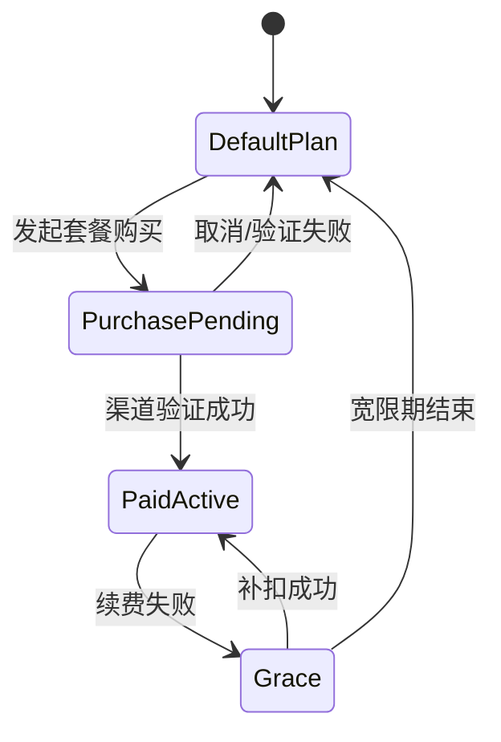

# TermLink 多端 UI 布局设计稿

文档版本：1.3
状态：生产级交互原型；生产 API Adapter 待各阶段后端实现
更新日期：2026-08-22
覆盖：Android、Windows Agent、Docker Server Console、账号身份、双语、会员与兑换码

## 1. 设计稿入口

可交互原型位于：

- [`ui-prototypes/index.html`](../ui-prototypes/index.html)
- [`ui-prototypes/styles.css`](../ui-prototypes/styles.css)
- [`ui-prototypes/app.js`](../ui-prototypes/app.js)

本地预览：

```powershell
cd ui-prototypes
python -m http.server 4173
```

打开 `http://127.0.0.1:4173/`，顶部可切换 Android、Windows Agent、Server Console、简体中文/English 和明暗主题；左侧切换各端页面。

当前原型已完成 UI 层生产化：20 个页面具有稳定 Hash 路由与恢复、语言/明暗主题持久化、
统一命令面板、确认弹层、详情抽屉、Toast、筛选/搜索、设置子页、回放控制、控制租约、
兼容设备管理、远程紧急停止、账号注册登录、邮箱验证、首次管理员强制改密、角色管理、会员
兑换码、部署操作和版本化 Catalog 管理交互。所有按钮均有明确行为，高风险操作必须二次
确认，320px 宽度没有页面级横向溢出。

“生产级交互原型”只表示 UI 信息架构、状态、交互、安全文案、响应式和无障碍契约已经
可作为正式客户端实现基线。账号、E2EE、账号隔离、设备撤销、Session Host、Relay、计费验证、
备份和 Catalog 发布仍必须连接对应生产 API；原型对这些外部写操作只展示明确的待接入
状态，不伪造服务端成功结果。

## 2. 设计方向

设计语言采用 `Quiet Focus / 安静专注`：

- Terminal 内容优先，装饰退居其次；
- 连接、E2EE、权限、输入租约和会员配额均有可读文字；
- 常用操作靠近上下文，高级选项渐进披露；
- 使用克制的光谱强调和环境光感，不大面积堆叠霓虹渐变；
- 状态不用纯颜色表达；
- 远程输入、租约、终止和撤销等操作必须由用户明确发起或确认。

## 3. 共享布局系统

### 3.1 视觉 Token

| 类别 | Token | 用途 |
| --- | --- | --- |
| 背景 | `bg`, `bg-elevated` | 应用背景、导航背景 |
| 表面 | `surface`, `surface-2`, `surface-3` | 页面、次级区域、控件 |
| 文本 | `text`, `text-2`, `text-3` | 主文字、说明、低优先级信息 |
| 品牌 | `accent`, `accent-2` | 选中、主操作、E2EE/智能状态 |
| 状态 | `success`, `warning`, `danger` | 在线、待确认、错误/撤销 |
| Terminal | 独立 Terminal Token | 不受 App 深浅主题影响 ANSI 配色 |

### 3.2 字体

- UI：Segoe UI Variable / Roboto Flex / 系统中文字体；
- Terminal：Cascadia Mono / JetBrains Mono；
- 状态数字使用 Tabular Numerals；
- 手机正文不低于 12sp，核心动作不低于 14sp；
- 管理台高密度元数据不低于 11px，正式实现应根据系统缩放换算。

### 3.3 层级

```text
Level 0  Canvas：页面背景
Level 1  Navigation：导航、列表分组
Level 2  Context Surface：搜索、策略、当前状态
Level 3  Dialog/Command：确认、购买渠道、命令面板
Level 4  Critical：撤销、终止、停止所有远程访问
```

列表默认使用留白和分隔线，不给每一行增加独立 Card。只有需要表达边界的状态汇总、购买方案或确认区域使用封闭 Surface。

### 3.4 语言与本地化

- 产品目标支持 `跟随系统`、`简体中文` 和 `English`，首次启动默认跟随系统；
- 当前 Windows Tray 已有跟随系统/中文/English 偏好；Android 已提供中英文资源并跟随系统，但 App 内固定语言切换与完整动态文案覆盖仍待验收；Server 账号门户的双语覆盖也需按实际部署逐页验证；
- 静态页面、动态 Dialog/Drawer、Toast、筛选项、占位文字和 Accessible Name 使用同一词典；
- 语言切换不清空当前端、页面、表单模式、主题和会话筛选状态；
- 服务端返回错误码，客户端按本地词典显示，不依赖服务端返回可直接展示的中文或英文；
- 日期、时间、数字、货币和复数使用目标语言区域格式，产品名、协议名和 ID 不翻译。

## 4. 会员与数量策略

### 4.1 可配置套餐目录

以下仅为首发预置，客户端不得写死套餐枚举或额度：

| 权益 | Free（首发默认） | Pro Monthly（首发默认） |
| --- | --- | --- |
| 账号 | 1 个个人账号 | 同一账号 |
| 可远程连接 PC | 不限数量 | 不限数量 |
| 同时远程显示的实时会话 | 不限数量 | 不限数量 |
| Windows 本地 Shell | 不限制 | 不限制 |
| E2EE、账号隔离、设备撤销和安全能力 | 完整提供 | 完整提供 |
| 计费周期 | 免费 | 月付、自动续费、可取消 |

服务端可以配置套餐名称、说明、周期、功能标记、渠道 Product ID、排序、可见平台和上下架时间，并以版本化 Catalog 发布。历史 PC/Session 额度字段保留用于兼容，接口固定返回 `-1`（不限）。

最终价格不写死在客户端。Android 从 Google Play Billing 返回本地化价格；Web/Windows 从服务端配置的购买渠道返回价格。所有页面在进入购买确认前展示实际价格、税费、周期和续费规则。

### 4.2 实时会话策略

- 同一账号可订阅不限数量的不同 `session_id`；
- 同一个 Session 在同一用户多台 Android 上显示，服务端为每个设备维护独立活动租约；
- 历史回放不改变实时订阅状态；
- `max_remote_pcs` 与 `max_live_sessions` 为历史兼容字段，服务端统一以 `-1` 表示不限；PC 注册和实时订阅不会因数量返回 `ENTITLEMENT_LIMIT_REACHED`。

### 4.3 PC 数量策略

- 同一账号可激活不限数量的 Windows PC 远程路由；
- 每个 PC 必须使用属于该 OIDC 账号、未撤销的独立 Windows 设备身份，并通过设备签名校验；无需用户配对、自授信或创建 Grant；
- 会员状态变化不会暂停或清理 PC/Session。

### 4.4 续费与状态变化



状态变化不终止 Windows 本地进程，不删除设备、历史或实时订阅；UI 只展示购买/同步结果，不提供配额保留选择。

## 5. Android 布局

基准画板为 390 × 844 dp；320dp 小屏保持单栏，600dp+ 平板进入双栏。

### 5.1 账号与登录

```text
Brand + welcome context
Verified Server：固定公开 HTTPS Origin / TLS
Segmented mode：登录 / 创建账号
Credential fields：用户名或邮箱 / 密码 / 邮箱验证
Primary action：登录 / 创建账号
Security note：固定 HTTPS OIDC 端点；需要交互时使用受控浏览器回退
```

- 客户端公开地址固定展示 `https://termlink.kget.cc:8910`，不向用户暴露 Lucky 上游地址；
- Android 当前把凭据仅提交给固定 HTTPS OIDC Token Endpoint，不持久化密码；身份提供方要求账号设置或额外交互时，使用 Authorization Code + PKCE 浏览器回退；
- 注册必须覆盖服务条款确认；当前部署未要求邮箱验证，若运营方后续启用验证，再展示邮件重发和过期处理；
- 找回密码对账号存在与否返回相同提示，链接 30 分钟内有效且只能使用一次；
- 登录成功后设备按同一 OIDC subject 自动注册，可直接发现和使用同账号 PC/Session；产品 UI 不显示 `PENDING`、配对、自授信或逐 PC Grant 前置步骤；
- Android 加密保存经过清理的 OIDC 会话以支持进程重启后恢复登录；此行为需继续覆盖冷启动与 Refresh Token 轮换验收；
- 登录、注册与安全说明采用单一纵向节奏，注册字段增加时允许页面自然滚动。

### 5.2 设备首页

```text
System status
App Bar：问候 + 页面标题 + 账号
Command Search：PC / Session / Action
Ambient Summary：账号状态 · PC/Live Session 不限数量
PC List
  ├─ OFFICE-PC：在线、延迟、2 个 Session
  └─ 添加更多 PC：安装/登录 Windows Agent 引导
Bottom Navigation：设备 / 活动 / 设置
```

行为：

- 点击 PC 进入 PC/Session 列表；原型直接进入第一个 Live Session；
- “添加 PC”进入 Windows Agent 安装与同账号登录引导，不进入会员、配对或 Grant 流程；
- 搜索按钮打开统一命令面板，可切 PC、Session 或设置；
- 设备状态同时显示 Presence、延迟和最近在线时间；
- 设备页右下角提供固定刷新按钮；刷新中显示进度且忽略重复点击，列表末尾预留空间，按钮不得覆盖最后一台 PC；
- 会话只有在 `state != RUNNING` 或所属 PC Presence 已超时后才显示永久删除入口。客户端先确认，服务端再次权威校验；删除同时清理服务器密文历史且不可恢复。

### 5.3 实时 Terminal

```text
Compact Header：PC 名 / Session 名 / 状态
State Bar：Live · E2EE · 82×28 · 只读/控制中
Terminal Surface：Termux Fork
Jump Latest
Extra Keys：Esc Tab Ctrl Alt ← ↑ ↓ →
Control Bar：申请控制 / 释放控制
```

布局优先级：

1. Terminal Surface；
2. 连接与控制状态；
3. 快捷键和输入；
4. 会话信息、主题、搜索等次级操作。

当前 Android 实现把 PC 名与会话名放在紧凑双行标题中，长名称使用 marquee；快捷栏是 Terminal
下方的独立布局区域而不是覆盖层，并可水平滚动。`adjustResize` 与会话页局部 IME inset 共同保证
键盘弹出时最后一行、光标和快捷栏都位于输入法上方，并以 100～200ms 去抖同步 Resize。

手机端以左右拖动切换相邻会话。切换必须是明确手势：拖动距离严格超过页面宽度 65% 才切页，
短而快速的甩动也不能绕过距离阈值，一次最多切换一页；切换完成后清除已滑出页面的 Terminal
输入焦点，防止 IME 继续把内容发送给旧会话。

### 5.4 历史回放

- 顶部始终显示 `Replay` 和 Exit Code；
- Terminal 与实时页视觉一致，但没有输入按钮；
- 时间轴显示快照、断线、恢复、退出等事件；
- 支持 0.5×、1×、2×、4×；
- 搜索仅处理手机端已解密数据；
- 拖动后从最近 Snapshot 恢复。

“新设备首次打开只恢复最后一屏、上滑再加载更早历史”必须建立在可移植
`TerminalSnapshotV1` 和独立只读 transcript 分页之上。现有生产链路仍只有从序号 1 开始的有界
VT 事件回放；在快照格式、Windows 生产者和 Termux 原子 importer 冻结前，不允许截取中段 raw
VT bytes 或把旧字节 prepend 到实时 parser 来伪装尾屏加载。服务端倒序 cursor、Snapshot 恢复后
原子保存 ACK=S、随后 `SUBSCRIBE(S)` 以及上滑分页仍是跨端后续工作。
Phase 1 的字段、边界、E2EE domain 和启用门禁已记录在
[`TERMINAL_SNAPSHOT_V1.md`](../protocol/test-vectors/TERMINAL_SNAPSHOT_V1.md)；协议落地不等于
Windows producer、Android importer 或上滑历史 UI 已经交付。

### 5.5 设备安全与兼容管理

- 首版当前产品导航不展示可信设备、配对、二维码/短码或逐 PC 权限页；同账号设备自动注册并直接使用；
- 账号安全面可以显示本账号设备类型、名称、最近活动和撤销状态，但不得暗示用户还需“批准”才能发现 PC；
- 撤销是独立于退出登录的安全动作，弹窗必须说明会断开哪些连接并停止向该设备提供新密钥；
- 旧 `PENDING/TRUSTED`、pairing 与 `VIEW/CONTROL/MANAGE` 页面只可作为兼容/运维界面，不进入当前主流程。当前 Android 独立“解绑此设备”产品入口尚待实现与端到端验收。

### 5.6 会员与功能状态

页面顺序：

1. 当前方案身份；
2. PC 和实时 Session 实际用量（上限显示“不限数量”）；
3. 服务端返回的可购买套餐及其权益；
4. “查看月付价格并订阅”；
5. 输入会员兑换码；
6. 恢复购买。

升级弹层不使用虚假倒计时、默认勾选附加项或隐藏取消入口。价格、税费和续费条款由购买渠道在最终确认前展示。

### 5.7 设置与账号安全

- 集中提供账号中心、语言、主题、Terminal 和诊断设置；兼容设备/会员页面不进入首版主导航；
- 登录与安全覆盖修改密码、MFA、活跃登录和撤销其他登录；
- “退出登录”清理当前 Token、实时连接和本地会话缓存，不删除账号、其他设备，也不等同于撤销/解绑当前设备；
- “解绑/撤销此设备”必须是独立的高风险动作；当前 Android 产品入口及 Windows/Server 跨端一致性仍待验证；
- 删除账号需要重新认证、输入确认词并进入 7 天冷静期；
- 冷静期结束后删除账号、设备记录/兼容授权记录和云端密文，合规审计只保留不可逆元数据。

### 5.8 Android 付费触发点

| 场景 | UI |
| --- | --- |
| 添加更多 PC | 直接注册并显示在线状态，不进入会员拦截页 |
| 打开更多 Live Session | 直接创建/订阅，不显示数量配额弹窗 |
| Pro 续费失败 | 顶部非阻断 Warning，展示宽限截止时间 |
| Pro 已过期 | 保留现有 PC、Session 和本地 Shell，不强制清理 |
| 恢复购买 | 显示渠道同步状态和明确结果 |

## 6. Windows Agent 布局

### 6.1 托盘弹层

基准 380 × 560px：

```text
PC identity + Settings
Relay connection + latency
Remote policy
Active sessions
New managed terminal
Account features and billing status (no PC/session quota)
Stop all remote access
Version + Open TermLink
```

托盘用于即时状态和紧急操作。停止所有远程访问保持独立危险色，但不与普通“退出应用”混淆。

### 6.2 会话管理

- 左侧导航：会话、远程访问、活动、设置；
- 顶部：页面标题和新建会话；
- Toolbar：搜索、运行中、已退出、已归档；
- Table：标题/目录、Shell、远程状态、活动时间；
- 底部健康条：Agent、Session Host 和本地加密 Buffer。

### 6.3 远程访问

- 当前策略作为页面首个 Context Surface；
- 当前查看者显示设备、Session、延迟和只读/控制状态；
- 默认开启“首次控制需要确认”和“本地输入收回控制”；
- 页面底部提供“停止所有远程访问”。

### 6.4 Agent 设置

Tab：常规、Terminal Profile、历史、网络、高级。

常规页包含设备名称、自启动、记录保留时间、磁盘用量、版本与诊断。协议、代理和 Buffer 上限放在网络/高级页，不污染默认设置。

### 6.5 账户与会员

- 显示账号级 Free/Pro 状态；
- PC 与实时会话显示“不限数量”；
- Windows 购买按钮可以打开合规 Web Checkout，返回后刷新 Entitlement；
- 明确说明购买只影响可选功能，不影响 E2EE；
- 明确说明会员状态变化不会终止本地 Shell 或实时订阅。

账号注册、改密、MFA 和兑换码不在 Windows 本地窗口重复实现。Agent 使用系统浏览器打开公开
账号中心，显示“等待浏览器授权、已返回、已取消、已过期、服务器不匹配”状态，并用
Authorization Code + PKCE 将结果交回当前 Agent。登录同一 OIDC 账号后直接发布 PC/Session，
不展示配对或 Grant 控件；重新登录不覆盖或导出既有设备私钥。Windows 登录记忆、主动退出与
显式设备撤销的完整 UI 语义仍需按实际发布构建验收。

## 7. Docker Server Console 布局

Server Console 是自托管运维与订阅管理 UI，不是终端内容后台。

### 7.1 账号门户

账号门户采用左侧身份/信任上下文和右侧独立认证工作区：

- 登录、注册、邮箱验证、找回密码、MFA 和活跃登录；
- Android 的原生 OIDC 登录/受控浏览器回退，以及 Windows 系统浏览器授权回调和 PKCE 校验；
- 公开 Origin、Issuer、注册策略和身份服务健康状态；
- Docker 首次启动管理员初始化与强制改密说明。

`identity-bootstrap` 首次启动创建 `admin` 超级管理员和 24 位随机临时密码。密码只在首次
启动日志显示一次，普通重启不重放；建议 24 小时过期，首次登录不能跳过改密。改密后撤销
临时会话并引导配置 MFA/恢复码。任何日志都不得输出改密后的密码、Token 或其他 Secret。

### 7.2 账号与角色

- 管理开放注册/仅邀请/关闭注册、邮箱验证、默认角色和 MFA 策略；
- 账号列表支持搜索、角色/状态筛选、邀请、禁用、恢复和撤销登录；
- 角色至少包含 `SUPER_ADMIN`、`ADMIN`、`AUDITOR` 和 `USER`；
- 唯一 `SUPER_ADMIN` 不允许降级、禁用或删除，必须先验证另一个超级管理员；
- 角色变更、禁用、登录撤销和密码重置均需重新认证并写入安全审计。

### 7.3 兑换码管理

- 按批次配置名称、套餐、权益时长、数量、兑换截止日期和渠道标识；
- 完整兑换码只在创建成功后显示和导出一次，服务端仅保存 HMAC/Hash；
- 列表与日志只显示批次、截断前缀、使用数量、到期日和状态；
- 兑换必须事务化、幂等并同时受账号、设备和网络速率限制；
- 确认前向 Android/网页展示套餐、权益时长和预计到期日；
- 停用只影响未兑换码，不静默撤销已生成的 Entitlement。

### 7.4 运行概览

回答四个问题：

- 有多少在线连接和活动 Session；
- Relay P95 延迟是否正常；
- Docker 服务是否 Healthy；
- 最近是否发生连接、租约、密文存储异常。

流量图只显示密文字节数，不允许下钻 Payload。

### 7.5 连接路由

表格字段：Connection ID、角色、Session Route 数、区域/延迟、密文吞吐、状态。Device/Session ID 仅显示截断值；高延迟和慢消费者使用文字状态。

### 7.6 Docker 部署

- 当前版本、Digest、架构和总体健康；
- Compose 容器列表、内存与 CPU；
- PostgreSQL PITR、对象存储生命周期、恢复演练；
- 非 root、只读 RootFS、Secret、TLS、签名、SBOM、Healthcheck、固定 Digest 检查。

### 7.7 安全审计

审计时间线按 Login、Device register/revoke、Lease、Delete 分类；兼容 API 发生 Pairing/Grant 时可单独归类，但不得把它们显示成当前必经步骤。允许显示 Trace ID、不可逆 Hash、动作和结果；禁止显示命令、Terminal 正文、Token、完整 IP、公钥和 Ciphertext。

### 7.8 订阅与权益

页面分为：

- Billing Provider 与 Webhook 健康；
- 套餐草稿、Catalog 发布版本、渠道 Product ID 映射与 Entitlement；
- 最近订阅状态；
- Grace Period、取消和恢复购买事件；
- 功能规则发布、回滚与存量订阅迁移策略（PC/Session 数量字段仅兼容展示）。

服务端只信任经过渠道签名/服务端 API 验证的购买状态。客户端上报的 `isPro=true` 永远不能直接生效。

## 8. 付费技术边界

### 8.1 权益模型

```text
PlanDefinition {
  plan_id
  version
  display_name
  billing_period
  max_remote_pcs: -1 (unlimited; legacy field)
  max_concurrent_live_sessions: -1 (unlimited; legacy field)
  provider_products[]
  fallback_plan_id
  status
  available_from / available_until
  sort_order
}

Entitlement {
  account_id
  plan_id
  plan_version
  max_remote_pcs: -1 (unlimited; legacy field)
  max_concurrent_live_sessions: -1 (unlimited; legacy field)
  effective_at
  expires_at
  grace_until
  source: DEFAULT | GOOGLE_PLAY | WEB | REDEMPTION_CODE
  provider_reference_hash
  version
}
```

### 8.2 API

| API | 用途 |
| --- | --- |
| `GET /v1/billing/plans` | 返回已发布套餐、权益和渠道 Product ID 映射，不自行伪造价格 |
| `GET /v1/account/entitlements` | 获取服务端签发的当前权益 |
| `POST /v1/billing/google/verify` | 服务端验证 Google Play Purchase Token |
| `POST /v1/billing/web/checkout` | 创建 Web Checkout Session |
| `POST /v1/billing/webhooks/{provider}` | 接收签名 Webhook |
| `POST /v1/billing/restore` | 重新同步购买状态 |
| `GET /v1/account/security` | 返回邮箱验证、MFA 和活跃登录摘要，不返回 Secret |
| `POST /v1/account/sessions/revoke` | 撤销指定或其他登录会话 |
| `POST /v1/billing/redemptions/preview` | 校验兑换码并返回套餐、时长和预计到期，不立即兑换 |
| `POST /v1/billing/redemptions/redeem` | 事务化、幂等兑换并签发 Entitlement |
| `GET /v1/admin/accounts` | 搜索和筛选账号、角色与状态 |
| `PUT /v1/admin/registration-policy` | 更新注册、邮箱验证和 MFA 策略 |
| `POST /v1/admin/redemption-batches` | 创建兑换码批次并一次性返回明文导出流 |
| `POST /v1/admin/redemption-batches/{id}/disable` | 停用批次中尚未兑换的码 |
| `POST /v1/admin/billing/plans` | 新建套餐草稿 |
| `PUT /v1/admin/billing/plans/{id}` | 配置名称、周期、额度、渠道映射和上下架状态 |
| `POST /v1/admin/billing/catalog/publish` | 校验并发布套餐目录新版本 |

### 8.3 强制执行点

- PC Agent Presence 注册不再读取或比较 `max_remote_pcs`；仅校验设备归属、类型、信任状态和 PC ID 一致性；
- Android/Relay 创建 Session Subscription 不再读取或比较 `max_concurrent_live_sessions`；Valkey 只维护短时过期租约；
- REST 和 WebSocket 继续执行同一套身份、设备签名、会话权限和输入租约校验；
- 购买成功后服务端仍增加 Entitlement Version，并通过 Realtime 推送 `entitlement_changed`；
- 客户端收到 `-1` 时展示“不限数量”，不得把旧额度当作拒绝条件。

## 9. 响应式规则

| 宽度 | Android | Windows/Server 原型 |
| --- | --- | --- |
| 320～599 | 单栏手机，Bottom Navigation | 设计评审页横向画布；正式桌面端设最小窗口 |
| 600～839 | PC/Session 双栏，Terminal 全屏可切换 | — |
| 840～1199 | 折叠屏/平板左列表右 Terminal | Windows 主窗口完整布局 |
| 1200+ | — | Server Console 左导航 + 主工作区 |

Windows 主窗口建议最小 900 × 620px；Server Console 建议最小 1024 × 720px。窄于最小尺寸时优先压缩列、隐藏次级元数据，不缩小正文到不可读。

## 10. 无障碍与状态规则

- 在线、警告、错误同时使用图标、文字和颜色；
- 所有图标按钮有 Accessible Name；
- 键盘可遍历导航、表格动作、购买和危险确认；
- 会员升级不能阻断“停止远程访问”“撤销设备”等安全操作；
- Free 与 Pro 均提供相同的 E2EE、账号隔离、逐设备密钥、撤销和本地优先能力；
- 支持 200% 字体缩放和系统减少动画；
- Terminal 配色不使用 App 主题自动重映射。

## 11. UI 验收

1. 三端所有页面可在布局原型中切换，无脚本错误。
2. 320px 宽度下 Android 画板不发生页面级横向溢出。
3. 深浅主题均可读，关键正文达到 WCAG AA。
4. 同账号添加多台 PC、订阅多个 Live Session 均不出现配额拦截或横向滚动溢出。
5. 购买前显示月付、自动续费、取消/恢复购买入口和渠道实际价格。
6. 会员过期 UI 不暗示会杀掉本地 Shell 或删除历史。
7. Server Console 任何页面都不展示 Terminal 正文或完整支付凭据。
8. 危险动作、付费动作和普通导航具有不同视觉优先级。
9. 简体中文与 English 下 20 个页面、动态弹层、Toast 和表单 Accessible Name 均无混合语言遗漏。
10. Android 与 Server 登录/注册模式均可切换，注册页可滚动但无横向溢出。
11. `admin` 首次登录必须完成改密；临时密码普通重启不再展示。
12. 完整兑换码只在新批次创建后显示/导出一次，旧批次不能恢复明文。
13. Windows Agent 与 Android 登录同一 OIDC 账号后，无配对、自授信或 Grant 即可发现并打开受管 Session；不同账号看不到列表且不能建立 Realtime 路由。
14. “退出登录”和“撤销/解绑设备”使用不同文案与确认；退出后可重新登录，撤销后连接关闭且设备不再接收新密钥。尚未落地的解绑入口必须标为待验证。

2026-08-04 浏览器复核结果：

- 20/20 页面路由与刷新恢复通过，内嵌 Server 导航不会污染页面容器状态；
- 页面按钮显式绑定覆盖 100%，无空名称按钮、重复 ID、无标签表单或无标题 Dialog；
- Android 正文不低于 12px，Windows/Server 高密度元数据不低于 11px；
- 20 个页面可见交互目标均不低于 28px，Android/桌面按钮统一至少 32px；
- 320px 视口文档与活动页面横向溢出均为 0；
- Android/Server 登录与注册支持回车提交、浏览器原生必填校验和方向键切换模式；
- Android 授权/注册/邮箱验证、Server 注册/找回密码/初始化/强制改密英文动态弹层无中文残留；
- 命令面板支持 `Ctrl/Cmd+K`、搜索、方向键、Enter 和 Escape；
- 明暗主题刷新后恢复，控制租约、回放速度/时间轴、设备权限、远程停止、设置、备份和
  Catalog 发布确认均通过；
- 浏览器控制台无脚本错误或警告。
