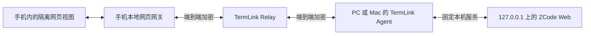

# ZCode 原生接入与本地网页转发分析

> 后续实施决定：用户选择复用本机 ZCode.app、移除填 URL 方案，现按原生会话路线实现。Android／iOS 已同步修改，Mac 接入与验证边界见 [本轮实现记录](../artifacts/zcode-native-20261027/REPORT.md)。下文是此前两种路线的比较。

> 2026-10-28 补充验证：原版 App 内部有共享既有 Host 的机制，但当前未找到外部进程可取得该 attachment 的入口，现有会话读取／续聊和模型授权复用未接通。详见 [桌面 Host 验证](../artifacts/zcode-host-validation-20261028/REPORT.md)。

> 2026-10-29 技术原型：在独立 App 副本的 Electron Main 加入认证 IPC，15 项检查通过，双 attachment 已复用同一个窗口 Host／Agent 与测试会话，双向配置读写、释放和重连成功。真实官方账号模型、原版已有会话、TermLink Relay／手机仍未验收。见 [Main 桥接原型](../artifacts/zcode-main-bridge-poc-20261029/REPORT.md)。

日期：2026-10-27。结论：两条路线均有可行基础；若目标是保留 ZCode 自己的界面并由 TermLink 转发连接，建议先验证独立 `zcode --web`，再接入受控的 HTTP／WebSocket 加密隧道。直接转发官方远控网址仍然需要 ZCode 官方登录，不会自动改为 TermLink 转发。

本次完成源码、官方文档、公开网页与本机安装包的只读检查，没有创建真实模型会话、读取用户凭据、登录 ZCode、启用远控、安装软件或部署服务。实现与端到端验收仍待后续开发。

同日补充：用户要求优先复用本机 ZCode.app。已直接启动其内置 Agent 并完成真实 `runtime/capabilities` 往返，现有 App 可作为原生适配的运行时；当前桌面进程未发现可直接转发的网页监听端口。模型授权与当前窗口会话接管未验收，详见 [Mac App 实测](../artifacts/zcode-macos-app-20261027/REPORT.md)。独立 Web 构建未继续执行。

## 版本与证据

- 本机 `/Applications/ZCode.app`：**3.16.3 / 3.16.3.8992**；内置 `glm/zcode.cjs`：**0.17.0**。
- 使用安装包自身的 Electron Node 模式执行 CLI `--version`／`--help`，明确包含 `app-server`、`login [zai|bigmodel]` 与 `--no-browser`。没有启动任务或执行登录。
- 本机 PATH 未找到独立 `zcode`。桌面内置 CLI 入口不等于包含 Web／Server 的统一发行包；本轮没有验证可直接启动的完整本地 Web 发行包或运行中的本地 Web 服务。
- 官方仓库现场 `main` revision：[`3c5b227649371507ddc4eb46ac5133afe6db1cab`](https://github.com/zai-org/ZCode/tree/3c5b227649371507ddc4eb46ac5133afe6db1cab)，提交日期 2026-10-20；不能将该公开 revision 认作本机 3.16.3 的精确来源。
- `https://zcode.z.ai/remote/v4` 本次返回网页，入口为 `/remote/v4/latest/assets/index-B-ilXaCQ.js`；公开脚本包含 OAuth 配置及官方登录服务 origin。它的线上构建与公开仓库版本不必相同。
- 版本、公开资源及所检查源码的 SHA-256 见 [evidence.json](../artifacts/zcode-analysis-20261027/evidence.json)。没有保存配对链接、Cookie 或 Token。

2026-10-03 的 [历史分析](ZCODE_DESKTOP_REMOTE_ANALYSIS.md) 基于旧版本，不能继续把其中的旧远控协议与未明确开放的许可判断当作当前结论。现行公开仓库根许可为 Apache-2.0；本分析只参考行为，未把上游代码或网页资源加入产品，实际分发仍需核对具体资源与第三方依赖许可。

## 为什么填入链接后仍要求登录

新版公开源码明确将官方远控绑定到账户：

- 桌面 `webRemoteControlManager.start()` 检查登录 JWT 和 userId，缺少时进入 `auth-required`；之后才注册／取得设备连接凭据。
- 手机 `WebRemoteControlEntry.start()` 检查 `getZCodeJwtToken()`，未登录先展示登录页，再进入设备选择／连接流程。
- 官方入口和模型调用还有各自的授权职责；TermLink 的设备登录不能代替 ZCode 官方账户或模型权限。

对应源码：[桌面远控管理器](https://github.com/zai-org/ZCode/blob/3c5b227649371507ddc4eb46ac5133afe6db1cab/packages/desktop/src/main/webRemoteControlManager.ts)、[手机远控入口](https://github.com/zai-org/ZCode/blob/3c5b227649371507ddc4eb46ac5133afe6db1cab/packages/web/src/web-remote-control/app/webRemoteControlEntry.ts)。

TermLink 现有集成另有兼容缺口：

- Android `AiRemotePage.kt` 只允许 HTTPS `zcode.z.ai/remote` 路径下的导航；登录跳到其他路径或域名会被拦截，也没有新窗口登录处理。
- iOS `AIRemoteView.swift` 对主页面使用同样的路径限制，并使用 `WKWebsiteDataStore.nonPersistent()`；即便完成网页登录，也不会像普通浏览器那样跨 WebView 创建保留站点数据。
- 因此当前“打开官方页”不等于“完整支持新版 OAuth”。直接放开任意域名不足以修复，应验证确切授权端点、回调、窗口与站点存储策略。短期可使用已有的系统浏览器入口完成官方登录，但本轮未用真实 ZCode 账号验证。

## 路线一：与其他 Agent 一样进入 TermLink 原生聊天

**可以继续开发，Windows 已有相当一部分适配；当前官方账户模型不能直接用。**

`win-agent/src/Agent/AiAgentSession.cs` 已调用 ZCode 的 `runtime/capabilities`、`session/create`、`session/subscribe`、发送／停止与配置相关协议，并处理模型流、工具、审批和问题。这条路线无需保存官方远控链接。

当前最直接的阻塞位于同文件 `interaction/requestProviderRuntimeHeaders` 分支：TermLink 明确返回 `headersApplied=false` 和 `AGENT_DESKTOP_AUTH_REQUIRED`。普通个人 API Provider 可以沿用已有适配继续验证；需要官方账户运行时授权的模型会失败。安装探测成功或创建会话成功都不能代替真实模型响应验收。

新版 CLI 已支持自己执行 `zcode login`，官方文档也描述独立 CLI 账户路径；因此不能再笼统认为 CLI 永远只能使用 API Key。但 `app-server` 的公开实现会向宿主请求运行时授权，当前 TermLink 没有实现这部分。仅在电脑登录 CLI、修改 `--surface` 或删除错误提示，不能证明其所需授权响应已经接通。

原生路线还需：

1. 明确支持的 ZCode 版本与协议，保留个人 API Provider 的可用路径；将授权状态与程序可启动状态分开。
2. 在电脑本地实现受支持的授权适配或本地 helper，由 ZCode 处理登录与刷新；不把桌面 Cookie、账户 Token 或 API Key发给手机／TermLink Server。缺少稳定宿主接口时先保留限制。
3. 补模型目录、配置 revision、流式事件、审批、取消、恢复与登录失效验收。
4. 将当前“保存远控链接就覆盖 native 策略”的逻辑改为明确的接入模式选择。现逻辑在 `AiAgentDiscovery.ApplyRemoteStrategy()`。
5. Mac 当前只有本地 CLI 检测和 Relay 控制连接，尚无完整远程 AI 数据链路；Windows 的 ZCode 适配不能直接视为 Mac 已具备。

参考：[CLI 快速开始](https://github.com/zai-org/ZCode/blob/3c5b227649371507ddc4eb46ac5133afe6db1cab/apps/zcode-cli/docs/usage/01-quickstart.md)、[运行时授权请求](https://github.com/zai-org/ZCode/blob/3c5b227649371507ddc4eb46ac5133afe6db1cab/apps/zcode-cli/packages/bootstrap/src/zcode-protocol/provider-runtime-headers.ts)、[app-server 工作区适配](https://github.com/zai-org/ZCode/blob/3c5b227649371507ddc4eb46ac5133afe6db1cab/apps/zcode-cli/packages/bootstrap/src/zcode-protocol/workspace-model-runtime.ts)。

## 路线二：TermLink 转发电脑上的 ZCode 本地网页

**具有明确可行入口，更适合先保留完整 ZCode 界面。** 最新统一发行包提供：

```sh
zcode --web --host 127.0.0.1 --workspace /absolute/project --port 3030 --no-open
```

这是官方完整发行包的入口，不能将命令直接套到桌面 `glm/zcode.cjs` 上。该发行包包含 Agent、Web 与 Server；本轮没有安装或启动它。选用端口应由本机接入管理器检测与分配，不能假定 3030 空闲。

源码中有静态网页服务、`/api/*`、普通客户端 `/ws` 和访问 Token 支持；Web 后端提供自己的服务及授权处理，因而不必先由 TermLink 原生聊天补齐每个 ZCode 协议方法。模型登录／配置仍由 ZCode 正常处理，不能保证所有桌面登录信息自动共享。

建议的数据路径：



图中端到端加密的两端是手机与电脑；Relay 只转发密文。手机本地网关是待实现组件，不是现有能力。

电脑无需开放公网或局域网端口，符合当前 Relay Only 范围。但现有 Relay 帧和 Host 只有特定终端／AI业务，本轮未发现现成的通用 HTTP／WebSocket 隧道，不能只在服务端加一条反向代理就算接通。若使用服务端明文 HTTP 反代，服务端将能读取网页及会话数据，不能沿用端到端加密承诺。

本地网页方案必须作为独立能力开发：

- 电脑端只连接明确启用且验证过的 ZCode loopback 服务，固定目标端口和允许的协议；手机不能传入任意 URL、任意端口或转向其他本机服务。
- 每条隧道绑定账号、电脑、已授权手机和有效期；关闭远程访问、撤销设备或退出时立即关闭。复用现有身份及加密基础，但另行定义网页服务授权。
- 同时转发静态资源、HTTP 请求／响应、WebSocket 双向消息与关闭、流式内容和文件；需要分块、背压、超时、并发和重连边界。带副作用的请求不能在断线后自动重放。
- 普通 Web 客户端只使用 `/ws`；不向手机暴露可信宿主 `/ws/host` 或 `/api/rpc-host-capability` 等提权入口。版本变更时核对新增 API，而不是无条件允许整个后端。
- ZCode 本地服务应启用访问令牌；电脑端持有并按需附加，隧道／网页里不暴露 TermLink 账号 Token。公开源码的保护路径包括 `/api/*` 与 `/ws`，具体启动、握手及 Cookie 处理仍需真实验证。
- 手机网页网关使用独立站点与受限入口；验证 Android 网络策略、iOS ATS、Origin、Cookie、CSP、OAuth 回调、上传／下载及 WebSocket。不能假设 `WKURLSchemeHandler` 或一次 HTML 加载自动覆盖全部网络流量。
- 网页不注入可执行 TermLink 原生业务的桥；第三方内容保持独立存储和权限边界。

官方依据：[统一发行包说明](https://github.com/zai-org/ZCode/blob/3c5b227649371507ddc4eb46ac5133afe6db1cab/README.md)、[Web 启动器](https://github.com/zai-org/ZCode/blob/3c5b227649371507ddc4eb46ac5133afe6db1cab/scripts/zcode-distribution/runner.mjs)、[HTTP／WebSocket 服务](https://github.com/zai-org/ZCode/blob/3c5b227649371507ddc4eb46ac5133afe6db1cab/packages/server/src/http.ts)。

## “转发网页”与“操控已打开的桌面窗口”不同

独立 `--web` 会运行自己的服务／Host，不保证自动接管 Electron 当前窗口、正在生成的任务或同一会话数据库。不能让两个 Host 无验证地同时读写桌面数据目录。

如果用户要求手机继续操控电脑上已经打开的那个 ZCode 窗口，目前有证据的路径仍是官方桌面远控：完成其官方登录后使用原入口。要把同一桌面窗口的控制改走 TermLink，还需公开支持的桌面连接接口，或独立适配其 Host／远控协议；转发静态页面或某个碰巧监听的端口不能替代它。

## 建议实施顺序与验收

1. 先做独立 Web 可用性验证：固定一个完整发行包版本，临时工作目录／数据目录启动，仅绑定 loopback；验证静态网页、普通 `/ws`、授权与真实一轮模型／工具任务。登录由用户在 ZCode 中完成。
2. 通过后开发 `local_web` 接入模式，先完成电脑端受控目标、Relay 加密分块和手机网关，再补文件及恢复；Windows／Mac 用相同契约、各自管理进程生命周期。
3. 手机端真实验证登录回调、会话、流式回复、审批、停止、文件选择、断线、电脑离线、设备撤销和完全退出。不存在的能力保持隐藏。
4. 原生 ZCode 适配继续作为统一聊天的长期路线；不要因转发网页而报告已获得原生结构化会话、通知或审批能力。

本轮交付的是有源码依据的可行性分析及接入边界，没有宣称网页隧道、真实 ZCode 模型或 PC／Mac 跨端联通已通过。
