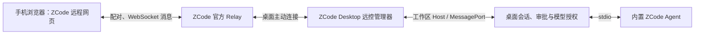

# ZCode 桌面远控接入分析（2026-10-03）

结论：可以优先使用 ZCode 自带的移动远程网页，沿用桌面会话与桌面模型授权；把它接入 TermLink 原生 AI 页面，仍需独立适配远控协议。反向代理官方入口在技术上可研究，但不是把桌面本地端口转发出来就能使用。

## 本机与只读证据

- 安装位置：`D:\Program Files\ZCode`；`resources/app.asar` 包元数据为 `@zcode/desktop` **3.14.4**。
- 内置 `resources/glm/zcode.cjs` 为 **0.16.9**。帮助明确 `app-server` 使用 stdio；TermLink 当前调用的是这个独立进程入口。
- 桌面实际启动了多个 `app-server` 子进程。主进程通过 Electron `utilityProcess`、`MessageChannelMain` / MessagePort 连接 Host，会话管理与 provider 授权在 Host 中处理。
- 本机 Host 有 `127.0.0.1:13621` 监听，根路径只读 GET 返回空 404；未发现该端口提供通用会话 API。不能把“存在 HTTP 端口”作为可直接代理聊天的证据。
- 桌面主程序含完整 WebRemoteControlManager：启用、刷新配对、停止、工作区 Host 附着、消息转发、重连与错误处理。
- 默认官方网页 `https://zcode.z.ai/remote/v4` 实测返回 HTTP 200，标题 ZCode，脚本入口位于 `/remote/v4/latest/assets/`；默认 Relay 为 `wss://zcode.z.ai/ws`。测试环境另有域名，实际以桌面生成的链接为准。

上述来自本机安装包的只读行为分析与公开网页访问，未修改 ZCode 安装包、读取用户 token、开启新的远控授权或扫码配对。因此这里确认的是架构与入口可达性，不是本机已经完成移动控制联通。

## 官方远控链路

现场代码包含 `device_register_init`、`auth_challenge` / `auth_response`、`pair_status_ack`、`data` 消息；设备注册、挑战响应和配对后才转发数据。二维码由设备标识、配对材料、时间及客户端信息生成，不能只打开不带配对上下文的首页就宣称取得控制权。配对链接应视为访问凭据，不放入日志、公共截图或版本文档。

模型侧的 `interaction/requestProviderRuntimeHeaders` 会进入桌面 Host 的账户授权处理。这解释了为什么“桌面已登录”不等于 TermLink 单独启动的 `app-server` 自动拥有相同授权，而官方远控通过桌面 Host 则具备复用该处理链的条件。

## 方案比较

| 方案 | 可行性与工作量 | 边界 |
| --- | --- | --- |
| 直接使用官方移动入口 | 最快：桌面开启移动远控，手机扫码配对 | 使用 ZCode 网页与官方 Relay，桌面须保持运行；无需先配置独立 CLI API Key |
| TermLink 提供官方远控入口 | 推荐先做：用户显式导入/扫描配对链接，通过 Android Custom Tabs 或系统浏览器打开 | 是外部 ZCode 会话入口，不混成 TermLink 原生 AI 会话，不宣称经过 TermLink Server/E2EE |
| WebView 内嵌官方网页 | 有条件可行，需要验证登录跳转、Cookie、WebSocket、文件选择、下载、键盘与返回 | 比 Custom Tabs 维护成本高；不能因此获得原生会话协议能力 |
| 自有域名反代官方网页与 Relay | 原理上可行，尚未联通测试 | 依然依赖官方服务，未变成自托管 ZCode |
| 反代 `127.0.0.1:13621` | 当前没有证据可行 | 未发现通用聊天接口，不能替代桌面 MessagePort 和配对流程 |
| TermLink 原生 UI 适配 ZCode 远控协议 | 可进一步验证，工作量明显较大 | 需实现授权、设备/工作区选择、协议与事件恢复、审批、断线、桌面版本兼容；当前未实现 |

## 反代的实质范围

至少分别验证：

1. 网页 `/remote/v4` 与其 `latest/assets` 静态资源是否在新域名正常加载。
2. `/ws` 的 Upgrade、长连接超时、重连及代理头；若前端使用绝对官方地址，仅反代 HTML 不会改变数据路径。
3. 网页调用的 API、登录回调、Cookie 域与 SameSite、Origin/Host 校验及 CSP。必须现场追踪真实配对请求，不能猜一条 `proxy_pass` 即可完成。
4. 桌面和手机是否仍进入同一 Relay，与二维码的配对上下文是否一致。

安装包中存在 `ZCODE_WEB_REMOTE_CONTROL_RELAY_WS_URL` 和 `ZCODE_WEB_REMOTE_CONTROL_URL` 覆盖入口，但它们是本版本观察到的实现，不代表公开稳定集成契约。更改这些地址不会自动实现 Relay 服务端的设备注册、认证和配对协议。本轮未设置这些变量，也未部署代理。

若目标仅为“手机使用电脑上已登录的 ZCode”，先使用官方入口即可；若目标是“所有聊天统一进入 TermLink 原生 AI 页面，并走自己的服务端”，应把桌面授权与远控协议适配列为独立功能，不能用网页反代代替。

本次仅参考通信行为，没有复制或重新分发 ZCode 代码、网页资源或品牌图标。安装包未提供明确的产品代码开放许可，后续不得直接打包其资源进 TermLink。
