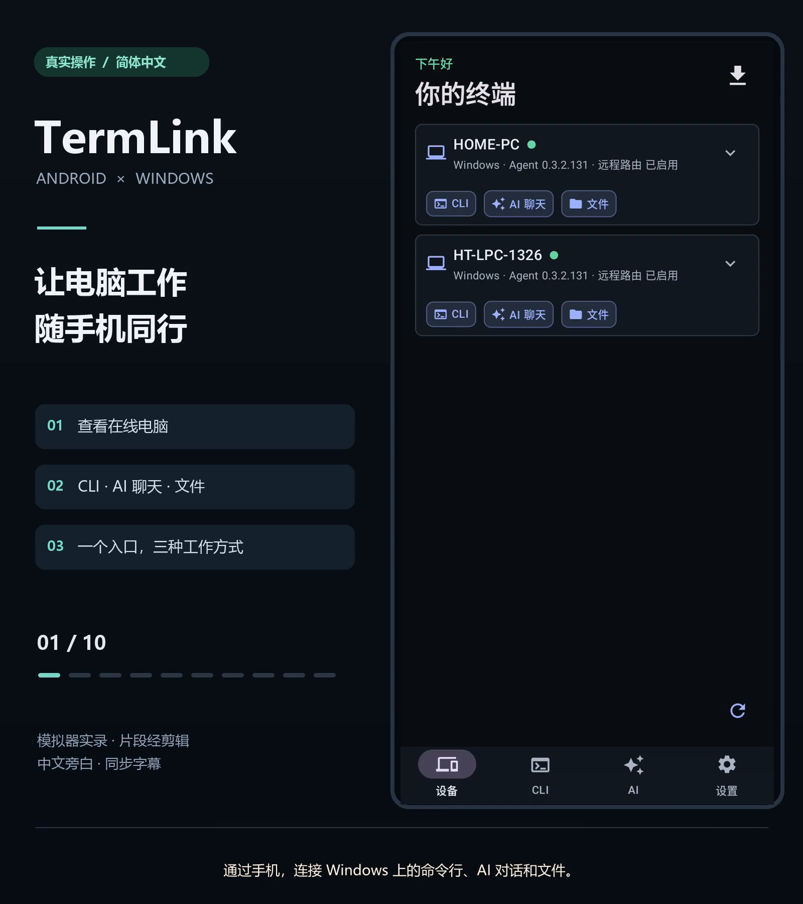

# TermLink 中文功能演示

[](termlink-demo-zh.mp4)

- [观看或下载 MP4](termlink-demo-zh.mp4)
- [封面原图](termlink-demo-zh.png) · [中文字幕 SRT](termlink-demo-zh.srt)
- 时长：1 分 54 秒；1600 × 1800，30 fps；H.264 / yuv420p，AAC 双声道 48 kHz。
- 内容：简体中文界面、中文合成旁白、同步字幕、轻电子背景音乐。

点击 README 封面进入视频文件。如果当前 Markdown 阅读器不支持播放，请下载 MP4。演示保存在仓库中，不依赖外部视频平台。

## 章节

| 时间 | 操作 |
| --- | --- |
| 00:00 | 查看在线电脑与 CLI、AI 聊天、文件入口 |
| 00:11 | 新建独立 CLI，会自动创建工作目录 |
| 00:20 | 输入命令、展开和收起键盘、查看电脑输出 |
| 00:31 | 从云朵菜单按手机窗口调整终端行列 |
| 00:41 | 选择电脑可用的 AI Agent 和工作目录 |
| 00:51 | 分别选择模型、推理强度与授权方式 |
| 01:05 | 查看生成状态及真实中文回复 |
| 01:17 | 打开 AI 工作目录文件、预览并进入所在目录 |
| 01:31 | 从目录菜单新建 AI 聊天，自动填入工作路径 |
| 01:43 | 切换深色主题 |

时间为近似章节起点。字幕已烧录到视频中，SRT 可用于阅读、翻译或重新剪辑。

## 录制与制作

录制日期为 2026-10-06。画面来自 Android 模拟器中的 TermLink DEV（0.3.2 / 130）和 Windows 客户端（0.3.2.131），采用服务器中转。模拟器及应用界面切换为简体中文，录制后保留深色主题。

CLI 命令与 Codex 回复均在连接电脑后实际执行。演示使用独立的 CLI / AI 工作目录，文件内容为演示任务生成的示例。镜头裁去系统状态栏，等待和操作停顿经过压缩，部分画面延长停留以便阅读；不展示登录凭据。画面中的 DEV 版本与功能菜单可能不同于当前正式版，各 Agent 的选项也可能不同。

旁白使用 Microsoft Edge TTS 的 `zh-CN-XiaoxiaoNeural` 合成。背景音乐由本地脚本合成和弦、琶音与轻节奏，未使用第三方歌曲或采样；人声出现时降低配乐音量，片头、片尾淡入淡出。该视频展示所列操作，不作为全部产品功能或全部 Agent 的回归测试结论。

## 本地剪辑工程

本次制作使用 jianying-editor 技能和 FFmpeg。可编辑的剪映草稿名称为 `TermLink_中文功能演示_20261006_完成版`，位于本机默认草稿目录：

```text
%LOCALAPPDATA%\JianyingPro\User Data\Projects\com.lveditor.draft\TermLink_中文功能演示_20261006_完成版
```

工程包含 10 段画面、10 段中文旁白、同步字幕和独立 BGM 音轨；素材复制到草稿目录中。章节版式已合成到画面素材，可直接调整片段、声音和字幕；修改版式需重新运行制作脚本。

原始录屏、界面检查、合成音频与制作脚本保留在本机被 Git 忽略的 `artifacts/demo-20261005/`，不纳入公开素材：

- `make_voice.py`：生成旁白及句子时间信息。
- `render_demo.py`：剪辑、混音、字幕、封面及剪映工程生成。
- `review_demo.py`：逐章节画面检查。
- `edit/timeline.json`、`edit/draft-result.json`、`edit/audio-qc.log`：时间轴、工程保存及音量检查记录。

历史的 [12 秒深色主题片段](termlink-dark-theme.mp4) 保留归档，README 主入口已改为上面的中文功能演示。
